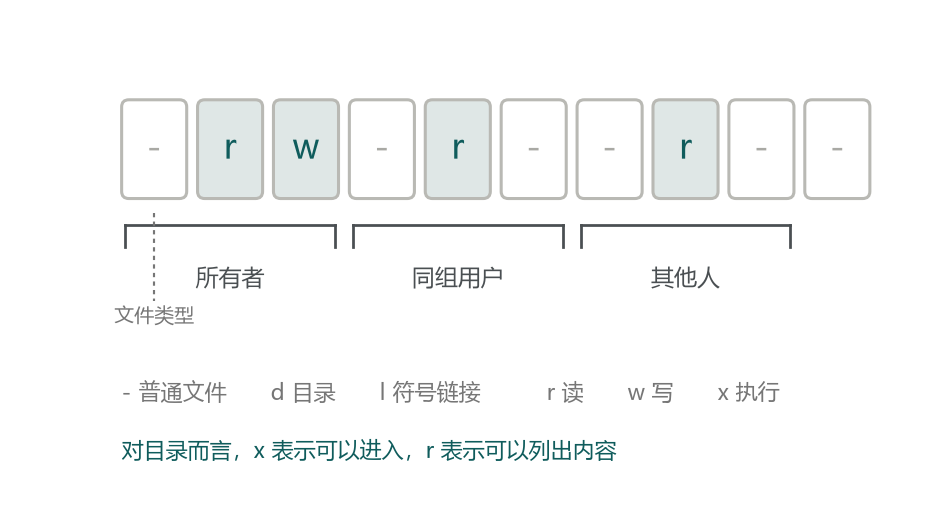
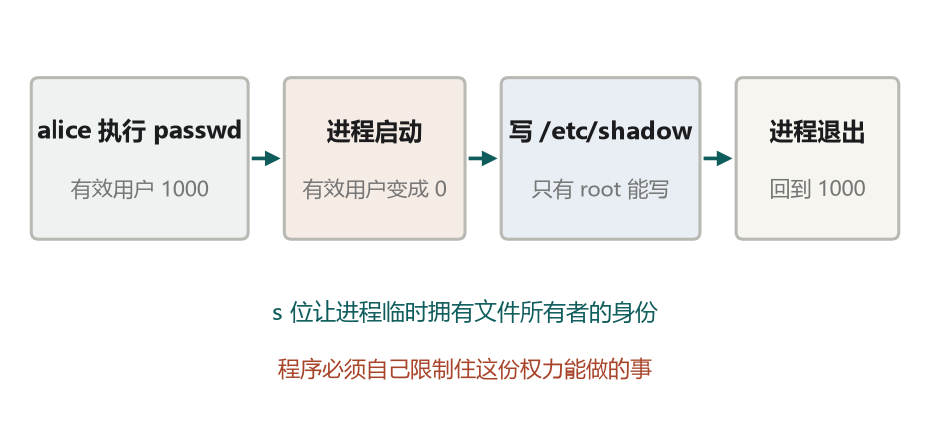

# 第三章　操作系统的门与锁

一台服务器上跑着几十个程序，其中有一个是别人写的、行为可疑的、随时可能崩溃的。它崩溃的时候，其他程序毫发无损，整台机器照常工作。这件事在今天看来理所当然，在早期的计算机上却不是这样。那时候一个程序跑飞，可以直接把内存里别人的数据改掉，或者让整台机器停下来等人重启。

从"一个程序能毁掉一切"到"一个程序只能毁掉自己"，靠的是一整套隔离机制。这一章讲这套机制的三个部分，进程之间的边界，文件与身份的权限，以及用户程序进入内核的那道门。理解了它们，才能理解为什么攻击者拿到一个普通账号之后，下一步总是想办法提高自己的权限。

## 3.1 进程之间的墙

上一章讲过，每个进程有自己独立的虚拟地址空间。这堵墙是硬件帮着砌的，处理器在每次访存时都会查页表，页表里没有的地址直接报错，权限不符的访问也被拦下。进程 A 就算知道进程 B 的某个变量在物理内存的哪个位置，也没法直接读写，因为它手里没有对应的虚拟地址映射。

除了内存，进程之间还有几样东西是分开的。打开的文件描述符是一张每进程独立的表，A 打开的文件 B 用不了。信号、定时器、当前工作目录、环境变量，都挂在进程自己的控制块上。

这堵墙有一个例外，就是共享内存。两个进程可以约定同一块物理内存，各自映射进来，用来高速交换数据。这是性能上的必要妥协。代价是这块区域的访问顺序没有保证，第八章讲竞态条件时会回到这里。

墙的存在带来一个结果。攻击者拿下一个普通用户的进程之后，他得到的东西仅限于这个用户的权限范围。要动系统配置、要装驱动、要读别人的文件，都得再往上爬一级。爬的过程叫权限提升（privilege escalation），后面会反复出现。

## 3.2 文件与权限位

Unix 的设计哲学里有一句话，一切皆文件。硬盘上的文档是文件，目录是文件，键盘鼠标在 `/dev` 下面也是文件，网络连接可以用文件描述符来读写，连内核的状态都挂在 `/proc` 下面以文件的形式暴露。

每个文件都带着一组元信息，其中最重要的是所有者、所属组和权限位。用 `ls -l` 看一眼就明白。

```text
-rw-r--r-- 1 alice students 1204 Mar  3 10:22 notes.txt
drwxr-x--- 2 alice students 4096 Mar  3 10:20 lab
-rwsr-xr-x 1 root  root    68208 Jan 12 09:01 passwd
```

第一列的十个字符分成四段。第一个字符是文件类型，`-` 是普通文件，`d` 是目录，`l` 是符号链接。后面九个字符每三个一组，分别是所有者、所属组、其他人的读、写、执行权限。

`notes.txt` 的权限是 `rw-r--r--`，所有者 alice 能读写，同组的和其他人只能读。`lab` 目录是 `rwxr-x---`，所有者能进能改，同组能进能看，其他人连进都不行。

执行权限对目录的含义和对文件不同。对文件来说，`x` 表示这个文件可以被当作程序执行；对目录来说，`x` 表示可以进入这个目录，也就是可以用它作为路径的一部分去访问里面的东西。只有 `r` 没有 `x` 的目录，能列出文件名，但打不开任何一个。

权限检查发生在每次打开文件的时候。内核拿到路径，逐级检查目录的 `x` 权限，最后检查目标文件的权限，对照当前进程的有效用户号（effective UID）和有效组号，决定允许还是拒绝。这套检查很朴素，但几十年里一直是 Unix 安全模型的核心。

<figure>

<figcaption>图 3-1　权限位的三组划分。同一串比特，对文件和对目录的含义不同；内核在打开文件时逐级检查路径上每一层目录的执行权限。</figcaption>
</figure>

这里有一个常被忽略的细节。权限位只描述"谁能对这个文件做什么"，不描述"这个文件里是什么"。一个 `rw-r--r--` 的脚本，所有人都能读，里面的密码也就所有人都能读。大量真实的泄露事故不是因为权限被绕过，而是因为权限从一开始就设得太宽。

## 3.3 身份的魔力

Unix 里有一个用户号是 0，叫 root。它对几乎所有权限检查都免疫。root 可以读任何文件，可以改任何进程的内存，可以加载内核模块，可以改系统时间。

这样一个全能的身份当然不能随便给。登录的时候，系统验证口令，然后把你切换成对应的用户号。此后你启动的所有进程都带着这个身份。

问题出在一个常见的需求上，普通用户要修改自己的口令，而口令存在 `/etc/shadow` 里，这个文件只有 root 能写。怎么让普通用户完成一件需要 root 权限的事，又不给他 root 的全部能力。

答案是一个特殊的权限位，叫 setuid。设置了它的可执行文件，在被执行时，进程的有效用户号会临时变成文件所有者的用户号，而不是执行者的。`/usr/bin/passwd` 的所有者是 root，权限里有那个 `s`，所以普通用户运行它时，进程以 root 身份运行，可以写 `/etc/shadow`。

<figure>

<figcaption>图 3-2　setuid 程序的权限变化。普通用户执行 passwd 时，进程的有效用户号临时变成 root，程序内部再严格限制自己只做改口令这一件事。</figcaption>
</figure>

这个机制很聪明，也很危险。它等于在系统里开了若干个"以 root 身份运行、但输入来自普通用户"的入口。这些程序里只要有一个存在缓冲区溢出、命令注入或者竞争条件，攻击者就能借它拿到 root。历史上被利用过的 setuid 程序数不胜数，`sudo`、`passwd`、`mount`、`ping` 都出过问题。

防守的办法是尽量少开这类入口。现代系统把很多功能从 setuid 挪到了别的机制上，比如让一个常驻的服务以 root 运行，普通程序通过受限的接口请它代办。接口的粒度越细，被滥用的空间越小。

## 3.4 唯一的一道门

用户程序不能直接操作硬件，也不能直接改页表，这些动作需要特权。要完成这些事，程序必须请求内核。

请求的方式是一条指令，在 x86 上是 `syscall`。执行它时，处理器切换到内核态，跳到内核里一个固定的入口，同时把请求的编号放在约定的寄存器里。内核根据编号查表，找到对应的处理函数，检查参数，执行，最后把结果放回寄存器，切回用户态。

Linux 上有三百多个系统调用，常用的就那么几十个。

```text
openat   打开文件        read    读文件      write    写文件
execve   执行程序        fork    创建进程    exit     退出
socket   创建套接字      connect 建立连接    mmap     映射内存
```

站在安全的角度，这些调用是攻击者最终想要的东西。拿到代码执行能力之后，真正的目的往往是调用 `execve` 起一个 shell，或者调用 `openat` 读走 `/etc/shadow`，或者调用 `socket` 把数据送出去。前面几章讲的各种漏洞，最后都要落到这几个调用上。

也正因为如此，防守方在这里设了很多关卡。系统调用可以被拦截和过滤，容器技术用命名空间和 cgroup 把进程能看到的资源切小，seccomp 可以规定一个进程只允许调用白名单里的那几个。这些机制的原理都不复杂，难的是配得足够严又不出错。

## 3.5 页表上的权限

第一章提到虚拟内存靠页表映射，页表的每一项除了记录物理地址，还记录着权限。

典型的权限有四位。可读、可写、可执行，还有一位表示这一页只能由内核访问。处理器在每次访存时读到虚拟地址，查页表，发现权限不符就触发一个页错误，交给内核处理。用户态程序试图写只读页，内核会直接把它杀掉。

页的大小通常是 4 KB，也可以是 2 MB 或者 1 GB 的大页。用大页能减少页表项的数量，提升地址翻译的效率，代价是权限的粒度变粗，一个 2 MB 的区域只能整体设成可写或不可写。

这套机制有一个关键性质，权限是按页设的，不是按变量。一个页里可能同时放着代码和常量，只要这一页被标成可执行，里面的数据也能被执行。第七章讲的一种攻击手法就建立在这个事实上。

## 3.6 内核漏洞为什么可怕

内核代码运行在最高特权级，它自己不受页表权限的约束，可以直接访问任何物理内存。所以内核里的一个越界写，后果和用户态完全不是一个量级。

2016 年披露的 Dirty COW（CVE-2016-5195）是个典型的例子。Linux 内核在处理写时复制时有一处竞态条件，攻击者可以在两个线程之间制造时间差，让内核把只读文件的私有映射写回原文件。利用它，任何本地用户都能改掉系统上的只读文件，包括 `/etc/passwd`，也就等于拿到了 root。这个漏洞在内核里躺了九年才被修掉。

这类漏洞的可怕之处在于它绕过了所有上层防护。应用层再怎么加固，只要内核有一个洞，攻击者就能从洞里钻到最底下。所以操作系统的补丁节奏比普通软件要紧得多，很多严重漏洞的利用代码在补丁发布后几天内就会公开。

## 3.7 提权的两条路

权限提升在实战里通常走两条路。

一条是打内核。找一个本地可利用的内核漏洞，从普通用户跳到 root。这条路需要目标系统的内核版本恰好有洞，难度较高，但一旦成功就很干净，不留配置文件痕迹。

另一条是找配置错误。系统里某个脚本以 root 定时运行，而它的路径可以被普通用户改写；某个服务用 root 启动但监听的接口没有鉴权；某个备份文件权限设成了所有人可写；某个用户的 `.bashrc` 属于别人却可写。这类问题不需要任何高深技术，靠的是对系统配置的熟悉和一点耐心。

现实中的入侵往往是两条路混着走。先用一个 Web 漏洞拿到低权限的 shell，再翻配置文件找可写的定时任务，最后借一个 setuid 程序或者内核漏洞拿到 root。每一步都不惊天动地，串起来就是一次完整的接管。

到这里，机器内部的三个层次讲完了。指令怎么执行，内存怎么组织，权限怎么隔离。下一章把视角移到机器之外，看看两台计算机之间的数据是怎么走过去的。那里没有页表，没有权限位，只有一堆几十年前定下的协议，而它们大多假设对方是诚实的。
