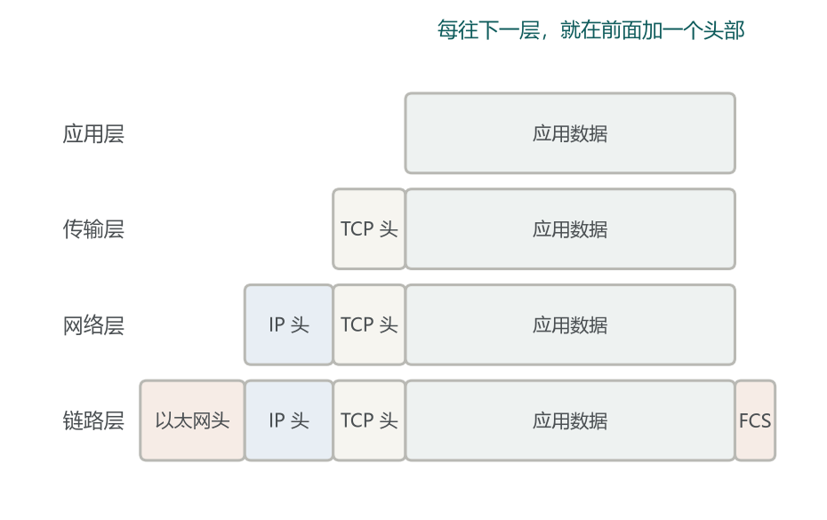
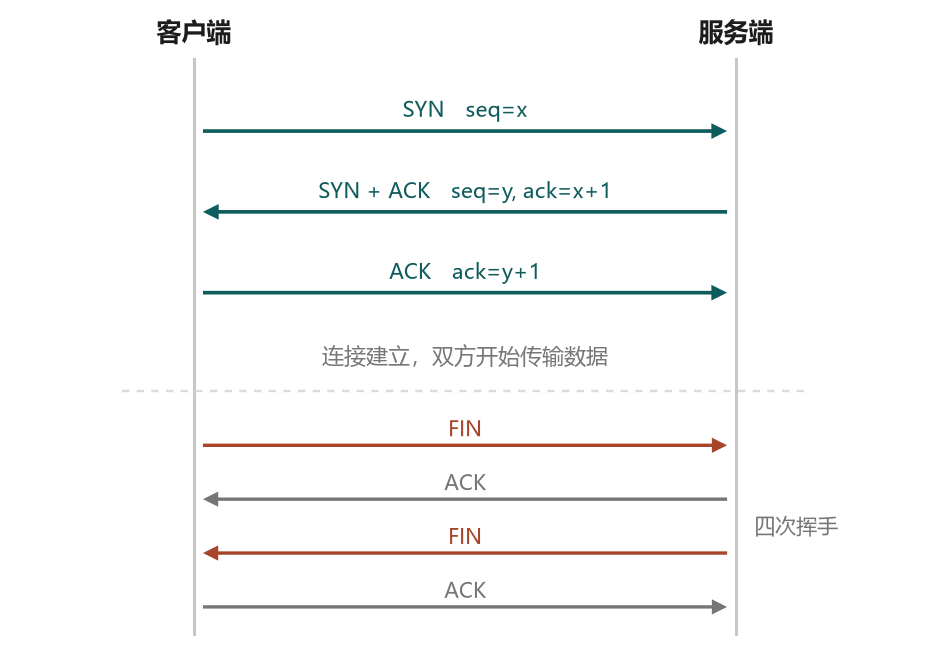

# 第四章　网络是怎样连接的

一台电脑要访问另一个城市的服务器，中间隔着路由器、交换机、光纤、海底电缆和若干个运营商的机房。这些设备来自不同的厂商，跑着不同的系统，唯一共同的东西是一套几十年前定下来的约定。

这套约定里有一个贯穿始终的假设，参与通信的各方都是善意的。协议的设计者们关心的是如何把数据可靠地送过去，如何让不同的网络互联，如何在没有中心管理者的前提下达成一致。他们没有花太多精力考虑"如果中间有人故意捣乱会怎样"，因为当时的网络只有几十个节点，都在大学和研究机构里，彼此认识。

今天这个假设早就不成立了，但协议还在用。理解这些协议原本的设计目标，才能理解为什么网络攻击有那么多看起来"本不该存在"的空间。

## 4.1 一条线的两端

最早的局域网是把所有机器接在同一根同轴电缆上。任何一台机器发送的信号，所有机器都能收到，网卡根据数据帧里的目标地址决定要不要理它。这种共享介质的结构简单便宜，缺点是同一时刻只能有一台机器说话，而且谁都能偷听。

后来出现的交换机改变了物理结构。每台机器单独接一个端口，交换机内部维护一张表，记录哪个 MAC 地址在哪个端口上。收到一帧，查表，只往目标端口转发。这样一来，别的机器在物理上收不到信号。

但逻辑上的问题没有解决。交换机只负责转发，不负责认证。谁往表里写什么，它就照着做。一个设备如果声称自己是网关，交换机不会怀疑。第十章讲的 ARP 欺骗，利用的就是这一点。

再往上就是路由器。交换机管一个局域网内部，路由器管局域网之间。它根据 IP 地址和路由表决定下一步把数据包送往哪里。你和千里之外的服务器之间，通常要经过十几跳路由器，每一跳都只负责把包交给下一跳，没有人知道全貌。

## 4.2 一层套一层

网络协议最巧妙的设计是分层和封装。你要发一句话，这句话先被包进一层的信封，再被包进另一层，直到变成能在网线上传输的电信号或光信号。收方从外往里一层层拆开，最后拿到那句话。

四个层次大致是这样。

应用层是你能看到的部分，HTTP、DNS、SMTP 都在这一层。它们规定了两台机器之间用什么格式说话，比如 HTTP 规定了请求行、头部字段、正文的结构。

传输层负责端到端的可靠传输或快速传输，代表是 TCP 和 UDP。TCP 会确认每个字节是否到达，丢了就重传，还会按顺序组装；UDP 只管发出去，不保证到达，也不保证顺序。

网络层负责寻址和路由，核心是 IP 协议。它把数据切成包，每个包上写着源地址和目标地址，交给路由器转发。

链路层负责在相邻的两个设备之间搬运数据，以太网、Wi-Fi、PPP 都属于这一层。它关心的是 MAC 地址和物理介质。

<figure>

<figcaption>图 4-1　数据的逐层封装。每一层在自己的头部里写下这一层需要的信息，收方逐层拆开。任何一层被伪造，上层都看不出来。</figcaption>
</figure>

封装带来一个副作用，值得单独说一句。每一层都相信自己收到的上一层头部是真的。TCP 不会去验证 IP 头里的源地址有没有被改过，HTTP 也不会去验证 TCP 连接是从哪台机器来的。这种层间的信任是效率的来源，也是欺骗的入口。

## 4.3 地址与门牌

IP 地址标识一台机器在网络中的位置，端口号标识这台机器上的哪个程序。两者合起来叫套接字，写作 `192.168.1.10:8080` 这样的形式。

一台机器可以同时跑很多网络程序。浏览器、邮件客户端、聊天软件，每个都在监听或使用不同的端口。系统收到一个数据包时，根据目标端口找到对应的进程，把数据交给它。这个过程叫解复用。

旧时代端口是稀缺资源，0 到 1023 号的端口需要管理员权限才能监听，因为这些都是固定分配给特定服务的公认端口，比如 80 是 HTTP，22 是 SSH，443 是 HTTPS。注册端口从 1024 到 49151，临时端口从 49152 往上，系统随机分配给出站连接。

服务器的数量远远少于客户端，所以 IPv4 的 43 亿个地址不够用。解决办法是网络地址转换。家里所有的设备共用路由器的一个公网地址，路由器维护一张表，记录哪个内部地址的哪个端口对应哪条外发连接，收到回包时按表转发回去。

<figure>

<figcaption>图 4-2　TCP 建立与断开连接。三次握手确认双方的收发能力，四次挥手各自确认方向上的数据发完。序列号让双方能发现丢包与乱序。</figcaption>
</figure>

TCP 的可靠性建立在一串数字上。建立连接时，双方各自随机选一个初始序列号，告诉对方自己从哪个数字开始编号。之后每发一段数据，序列号就往前推进，接收方回一个确认号表示"这个数字之前的数据都收到了"。发出去的包如果超时没有确认，就重发。

三次握手的过程很简单。客户端发一个 SYN 包，带着自己的初始序列号。服务端回一个 SYN-ACK，既确认客户端的序号，也报出自己的序号。客户端再回一个 ACK。连接建立之后，双方都可以开始发数据。

选初始序列号时用随机数，这点很重要。如果序列号可预测，攻击者就能伪造出一个看起来合法的包插入连接，冒充其中一方。早期的一些系统确实用了可预测的序列号，被利用过很多次。

## 4.4 名字与地址

人记不住 IP 地址，所以有了域名。域名系统负责把 `www.example.com` 这样的名字翻译成 IP。

解析过程是分层的。你的机器先问本地配置的递归解析器，通常是运营商或者公共 DNS 服务。递归解析器如果不知道答案，就去问根服务器，根服务器告诉它该问哪个顶级域服务器，顶级域服务器再告诉它该问哪个权威服务器，最后权威服务器给出答案。递归解析器把结果缓存一段时间，下次有人问同一个名字就直接回答。

这套设计的目的是分散负载，让全世界几十亿次查询不必都压到少数几台机器上。代价是缓存成了攻击目标。如果攻击者能在缓存里塞进一条假记录，那么在缓存过期之前，所有问这个名字的人都会拿到错误的地址。第十章的 DNS 缓存投毒讲的就是这件事。

域名和 IP 的绑定关系本身也不牢固。域名所有者可以随时改解析，注册商可以顺手把域名指到别处，过期域名会被别人抢注。所以"这个域名看起来对"和"这个域名现在指向的机器可信"是两件事。

## 4.5 明文的年代

HTTP、FTP、Telnet、SMTP 这些协议诞生的时候，网络上没有多少坏人。它们把口令和内容明文放在数据包里，谁抓到了包谁就能看到。

理论上这不难改，加密一层就行。实际上改起来花了二十年。原因不完全是技术，更多是习惯和成本。网站运营者觉得加了加密会慢，用户觉得地址栏多一个锁图标没什么用，中间的设备厂商（缓存、防火墙、负载均衡）需要能读懂明文才能工作。

直到 2010 年代，一系列大规模窃听和注入事件推动了 HTTPS 的普及，免费证书的出现降低了成本，浏览器开始把 HTTP 站点标记为不安全，情况才真正改变。到了 2020 年代，主流浏览器访问的流量里 HTTPS 已经占绝大多数。

即便如此，加密只解决了链路上的问题。它保证了你和对面那台服务器之间的数据别人看不到、改不了，但它不保证对面那台服务器是好的，也不保证那台服务器没有被别人控制。钓鱼网站同样可以用 HTTPS，证书同样可以是有效的。这个区别在第十六章会展开。

## 4.6 一次访问的完整路径

把前面几节串起来，看一遍在浏览器地址栏里敲下一个网址之后，到底发生了什么。

浏览器先看这个域名有没有缓存过。没有就向本地配置的 DNS 服务器发出查询，得到一个或多个 IP 地址。这一步走的是 UDP，53 号端口为多。

拿到 IP 之后，浏览器要和服务器建立一条 TCP 连接，三次握手就发生在这里。如果地址是 HTTPS，握手完成之后还要再做一次 TLS 握手，验证服务器证书、协商加密参数。

连接建立后，浏览器发出一段 HTTP 请求，里面写着要访问的路径、浏览器能接受什么格式、之前存下的 cookie。服务器处理后返回一段 HTML。浏览器解析 HTML，发现还要加载图片、样式表、脚本，于是对每个资源重复上面的过程。一次页面加载产生几十条连接，现代协议支持在同一条连接上并发多路请求，把开销压下来。

这条链路上的每一段都有可以被利用的地方。DNS 可以被投毒，TCP 可以被劫持，TLS 可以被降级，HTTP 里的输入可以被注入。第十一章讲第三段，第十章讲前两段。

## 4.7 三样东西

把这一章的内容压成一句话，一次网络通信涉及三样东西，两个端点和它们之间的路径。

路径的问题是不保密、不完整。中间的任何一跳都能看到明文，也能修改内容再转发出去，收方无法察觉。加密解决的是这一类问题。

端点的问题是谁在对面。IP 地址可以被伪造，域名可以被劫持，证书可以把身份绑到域名上，但绑不到"这家公司值得信任"上。身份认证解决一部分，剩下的要靠判断。

第三样东西容易被忽略，就是端点所在的那台机器本身。即使链路加密、身份正确，如果对面那台服务器上跑着一个有漏洞的程序，攻击者照样能通过它拿到数据。前面三章讲的所有内存与权限问题，在网络上会以另一种形式重演。

第二篇开始讲漏洞本身。第一个要回答的问题很朴素，漏洞到底是什么，为什么明知道有风险，这些漏洞还是源源不断地出现。
