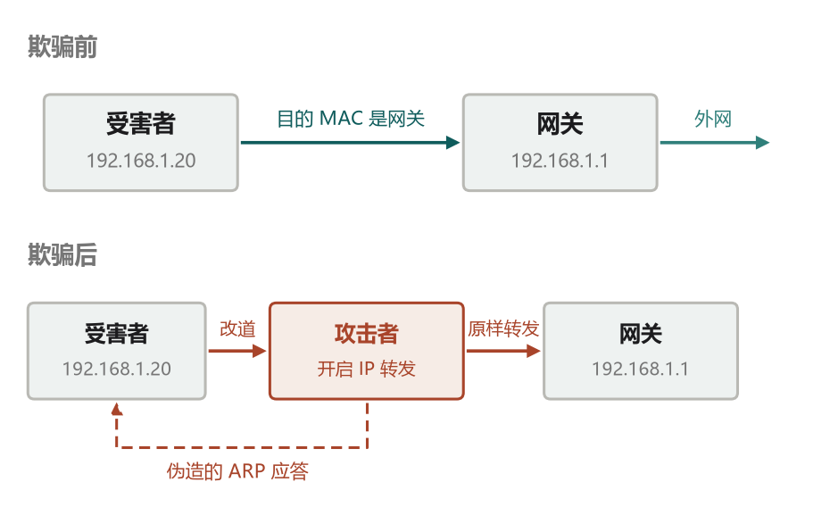
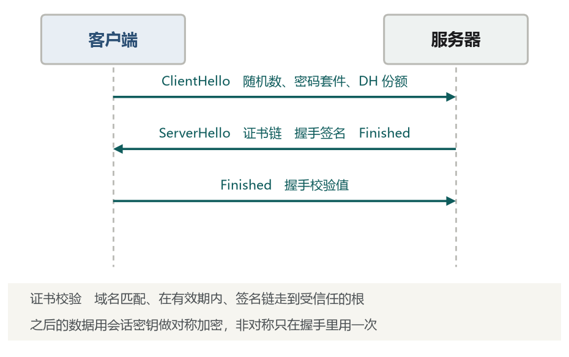
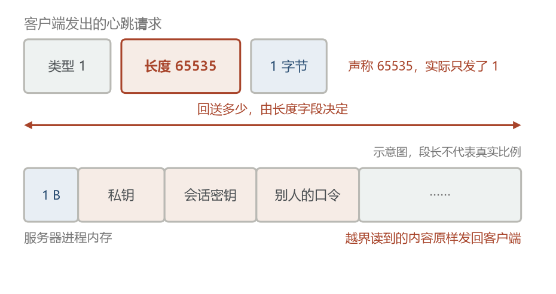

# 第十章　窃听、冒充与加密

在宿舍里连上路由器打开网页，你会默认这条线路只属于自己。实际上数据从网卡出来之后，要经过宿舍的路由器、楼道的接入交换机、运营商机房的设备，才到对端。中间任何一段都可能有人在听。

更近的一步是，同一台路由器下面的人可以让你的全部流量先经过他的电脑。页面照常打开，网速看不出变化，你的机器上也没有任何异常进程，因为那台电脑不需要在你的机器上运行任何东西。

这一章讲这个位置上的攻防。攻击者不碰你的电脑，只是站在你和服务器中间，这个位置叫中间人（man-in-the-middle）。先看他们怎样把自己塞进这条链路，再看加密堵住了什么，最后看堵不住的是什么。

## 10.1 一根线连着所有人

最早的以太网把几十台机器挂在同一根同轴电缆上，任何一台发出的信号沿线传播，所有网卡都能收到。网卡收到帧后检查目的 MAC 地址，是自己的就交给上层，不是就丢掉。这个丢掉是软件行为，为了省 CPU，不是安全边界。把网卡切到混杂模式（promiscuous mode），线上的帧会被全部收下。

交换机比集线器精细。它记住每个端口后面挂着哪个 MAC，形成一张表，查到就只往那个口送，查不到就向其余端口泛洪一次。这张表来自观察，也因此可以被别人喂进去。

真正的问题在 ARP。以太网靠 MAC 投递帧，IP 层只认 IP 地址，两套编号之间需要一个翻译，这就是地址解析协议（Address Resolution Protocol, ARP），定义在 1982 年的 RFC 826。

你要往网关发包，却不知道它的 MAC，于是向全网广播，谁是 192.168.1.1，请告诉 192.168.1.20。拥有这个地址的机器单播回答，192.168.1.1 的 MAC 是 aa:bb:cc:dd:ee:ff。答案进缓存，几分钟内不再问。

RFC 826 里没有身份这个概念。协议是无状态的，它没有规定必须先发问才可以回答。一台机器收到一条 ARP 应答，即使自己从未发过请求，也会照样更新缓存，也没有任何字段能验证这句话出自真正的地址持有者。

1982 年的网络是实验室里几十台机器，接线的人互相认识。四十年后，同一套协议跑在咖啡馆的公共 WiFi 上。

## 10.2 让流量拐个弯

ARP 欺骗的技术含量，就是发一条对方没有索取的应答。

攻击者构造应答，说网关的 IP 在我这个 MAC 上，发给受害者。受害者的缓存被覆盖，之后去往网关的包物理上都进了攻击者的网卡。对真正的网关做同样的事，回程的包也经过他。

<figure>

<figcaption>图 10-1　ARP 欺骗前后的流量路径。欺骗前数据帧直接送到网关；欺骗后受害者的缓存里网关的 MAC 已被换成攻击者的地址，去程与回程都绕经攻击者，由他原样转发。</figcaption>
</figure>

为了让受害者不断网，攻击者打开本机的 IP 转发，把包按原目的地址再送出去。两端都在正常通信，只是中间多了一跳。缓存会过期，欺骗包要周期性重发。

受害者这边几乎没有可观察的变化。多经过一台同网段的机器，延迟增加通常不到一毫秒，比一次 WiFi 重传还小。

拿到这个位置之后能看到什么，取决于上层协议加不加密。HTTP 的请求行、头部、正文全是明文，包括 `Cookie` 那一行，登录表单里的口令也是。Telnet、FTP、SMTP、POP3 都是明文设计，一封邮件经过好几台机器，每一台上都能读到全文。

就算对方用 HTTPS，中间人仍能看出你在访问哪个域名，因为 TLS 握手里的服务器名称字段（SNI）是明文，流量的大小和时间也看得见。

同一类问题在局域网里还有几个变种。DHCP 服务器可以被冒充，先到先得，默认网关和 DNS 就都指向了攻击者。

企业网里有补丁。交换机可以开启动态 ARP 检查，用 DHCP 监听建立的 IP 与 MAC 对照表核对每个 ARP 包，对不上就丢。机房会配，家用路由器不会，公共 WiFi 更不会。

## 10.3 域名解析这一跳

ARP 解决同网段的地址翻译，跨网段要靠域名系统（Domain Name System, DNS）。

输入一个域名，系统先看缓存，再看 hosts 文件，都没有就去问配置里的递归解析器。解析器不知道，就从根服务器开始一层层问。根说 `.com` 的事去问那几台，`.com` 说这个域名授权给下面这几台权威服务器，权威服务器最后给出 A 记录。结果按 TTL 缓存一段时间再返回。

查询走 UDP 的 53 端口，一问一答，报文里有一个 16 位的事务标识。解析器靠这个数字判断回来的包是不是自己要的。

16 位是 65536 种可能。攻击者如果能伪造响应并且抢在真实响应之前到达，就有 1/65536 的机会命中。单次很小，但可以重复。

2008 年 Dan Kaminsky 找到了让这个机会变大的办法。DNS 响应除了回答当前问题，还可以携带附加记录，解析器会把这些记录一并缓存。他先让解析器查询一个自己控制的域名，解析器于是去问那个域的权威服务器；在这个窗口里连续发送伪造响应，每个响应在回答的同时附带一条“这个域的服务器是攻击者的机器”。

只要有一个响应在真实响应之前命中事务标识，整个域的解析权就到手，之后所有子域名都跟着走。配合不断更换查询的子域名，命中概率随发包数量线性上升，当时的估算是在几秒到十几分钟内可以成功。

这件事在 2008 年初被发现，当年夏天在美国黑帽大会上公开，各大厂商在此之前已经拿到补丁。补丁的思路是扩大随机空间，让每次查询使用随机源端口，把 16 位变成 16 位加端口号。端口可用范围受限，总熵没有翻满一倍，但足以把攻击时间从秒级拖到天级。

DNSSEC 想从根上解决。它给每条记录加签名，上级用自己的私钥签下级公钥的摘要，从根区一路链下来。解析器只要预置了根公钥，就能判断记录有没有被改过。它堵住了缓存投毒，但不隐藏查询内容，也不保证终端真的在验证，很多解析器只是支持而不是强制。

## 10.4 明文的价格

DNS 决定你去找谁，接下来是找到之后说什么。

早期网页没有加密这个概念。登录一个论坛，服务器在响应头里放一句 `Set-Cookie: session=8f3a...`，浏览器存下来，之后每次请求自动附上。服务器看到这个字符串，就知道请求来自哪个已登录用户。

这个字符串就是全部凭证。谁抄到它，谁就是那个用户，不需要知道口令，不需要破解任何算法。在能被 ARP 欺骗的局域网里，抄下来的成本几乎是零。抓一个包，找到 `Cookie` 那一行，复制，粘进自己的浏览器，这叫作会话劫持（session hijacking）。

对称加密是最直接的想法。加密和解密用同一把钥匙，把明文和一串等长的随机比特逐位异或得到密文，再异或一次就还原。这串比特叫密钥流，如果它真随机、只用一次、与明文等长，这套办法叫一次一密（one-time pad），数学上不可破。麻烦在于双方得先持有那串随机数，而且只能用一次。

实际使用的分组密码（block cipher）放弃了一次性，用固定的密钥加一个编号反复生成密钥流，AES 是今天的主流。

难处不在算法，在钥匙怎么送到对方手里。一千个网站要一千把钥匙，最初那把还得通过一条不安全的线路交给对方。

非对称加密绕开了它。一对钥匙，公钥加密、私钥解密，公钥可以公开。类比是一把开着的挂锁，谁都能把东西锁进箱子，只有拿着钥匙的人能打开。RSA 和椭圆曲线是两种常见构造，安全性建立在大数分解和离散对数这类问题容易正向算、极难反向算的性质上。

Diffie-Hellman 密钥交换提供另一条路，双方不用传递钥匙，也能协商出同一把。两个人各选一种颜料并保密，各自兑进一桶公开的水里，把混合色当众交换，然后各自往对方那桶里加入自己的秘密颜料。两人得到同一种混合色，旁观者手里只有两种混合色，把原始成分分离出来很难。真实算法里，颜料换成了模幂运算。

数字签名把这对钥匙反过来用，私钥签，公钥验。它能证明两件事，这条消息出自私钥持有者，并且内容没有被改动过一个字节。

## 10.5 握手与证书

TLS（Transport Layer Security）把这些工具组装成一套能实际运行的流程。下面是简化到骨架的 1-RTT 握手。

<figure>

<figcaption>图 10-2　一次简化的一来回 TLS 握手。双方交换随机数与 Diffie-Hellman 公开份额，各自算出同一份会话密钥；证书把域名和公钥绑在一起，由证书链一路签到浏览器预置的根。</figcaption>
</figure>

客户端发 ClientHello，带自己的随机数、支持的密码套件、Diffie-Hellman 公开份额。服务器回 ServerHello，选定套件，给出随机数和自己的份额，紧接着发证书链，并用证书对应的私钥对前面的握手记录签一次名。

双方各自用对方的公开份额和自己的私密份额算出同一个共享秘密，再用两个随机数做盐，派生出会话密钥。之后的通信全部用对称加密，因为非对称运算慢几个数量级。

证书是唯一把公钥和身份连起来的东西。一张 X.509 证书里装着域名、公钥、有效期、用途，以及签发者的名字和对以上全部内容的签名。

浏览器验证时检查四件事，域名是否与地址栏一致，是否在有效期内，用途是否允许做服务器认证，签名链能否走到自己信任的某个根。根证书预置在操作系统里，有一百多个，来自世界各地的证书颁发机构（Certificate Authority, CA）。

关键在于，任何一个根，或者它授权的中间 CA，都有能力为任何域名签发证书。技术上无法区分 Google 自己申请的证书和某个 CA 被攻破之后签出来的证书，两者在密码学上完全等价。

2011 年 8 月，荷兰的 CA 机构 DigiNotar 被发现已经被人入侵。攻击者用它的签发设施造出几百张假证书，其中包含 `*.google.com`，并用它们对伊朗的 Gmail 用户做中间人。浏览器厂商在几天内移除了它的根证书，荷兰政府接管，公司在同年破产。

暴露出来的问题不是某个算法有漏洞，而是信任的粒度太粗。链条上任何一个环节失守，整条链上所有名字都不再安全。

行业后来给 TLS 生态打了两个补丁。HSTS 盯降级，攻击者坐在中间把页面里的 `https` 链接改写成 `http`，用户看到的是没有锁图标的页面，输进去的口令以明文送出，这套手法叫 SSL 剥离。配置了 HSTS 的服务器回一个响应头，浏览器就记住这个域名在一年内只准走 HTTPS，在本地把 `http` 改写掉，中间人连机会都没有。

证书透明（Certificate Transparency, CT）盯乱签。它要求 CA 把签发的每一张证书登记到公开的、只能追加的日志里，日志用 Merkle 树保证篡改会被发现。任何人为 `google.com` 签证书都会留下痕迹，域名所有者可以监控日志。两个都是补丁，不是替代品。

## 10.6 协议正确，实现出错

前面那些攻击多少能怪到设计上。ARP 没有认证，DNS 没有签名，HTTP 没有加密。还有一类完全相反，协议写得好好的，代码没照着写。

2014 年 4 月披露的 Heartbleed 就是这一类，编号 CVE-2014-0160。

TLS 有一个心跳扩展（heartbeat），定义在 RFC 6520，用途是连接空闲时确认对方还活着，不必传应用数据。请求格式是三段，一个类型字节，一个 16 位的长度字段，然后是载荷。协议规定长度字段表示载荷有多少字节，响应必须回送同样长的载荷。

OpenSSL 的实现里，服务器读到请求后按长度字段分配缓冲区，然后从请求缓冲区复制那么多字节出去。代码没有检查这个数字是否超过实际收到的字节数。

<figure>

<figcaption>图 10-3　Heartbleed 的越界读。请求声称载荷有 65535 字节，实际只发了 1 字节；实现按声称的长度回送，把紧随其后的进程内存一并发了出去，其中可能包含私钥和别人的会话数据。</figcaption>
</figure>

于是发一个载荷 1 字节、长度写 65535 的请求，服务器就把缓冲区之后那 64KB 内存原样返回。连续发，每次读到的是不同位置的残留数据。那块内存里可能有服务器私钥、刚协商的会话密钥、其他用户提交的口令。

Netcraft 在 2014 年 4 月的统计显示，约 17% 的 HTTPS 服务器受此影响，数量在五十万台量级。修复只是两行边界检查。

值得多想一层的是它为什么能活这么久。心跳扩展 2012 年进入 OpenSSL，这个错误在代码里待了两年，期间无数人使用、编译、部署过这段代码。OpenSSL 是互联网上最关键的软件之一，当时全职维护者只有几个人。协议文档写得清清楚楚，实现读起来也不难，差距没有人看住。

把这一章收拢，加密做到的事情有限但关键。它让链路上的人看不到内容，也改不了内容，ARP 欺骗、DNS 投毒、公共 WiFi 抓包在这一层面前都失效了。

它做不到的事情有两件。一件是对面是谁。证书只证明这个公钥属于这个域名，不证明这个域名属于你以为的那个组织。攻击者可以注册一个很像的域名，也可以正大光明地申请一张合法证书，浏览器会给一个完整的锁图标。

另一件是机器本身。终端上如果有恶意软件，它读到的是解密之后的明文，加密对它完全透明。内容在到达屏幕之前必须在内存里解开，能读内存的人不需要破解任何密码。

所以地址栏里那个小锁，能说明的事情比很多人以为的要少。一条真正安全的链路需要加密、身份、终端三样同时成立，而网页那一层只负责其中第一样。

