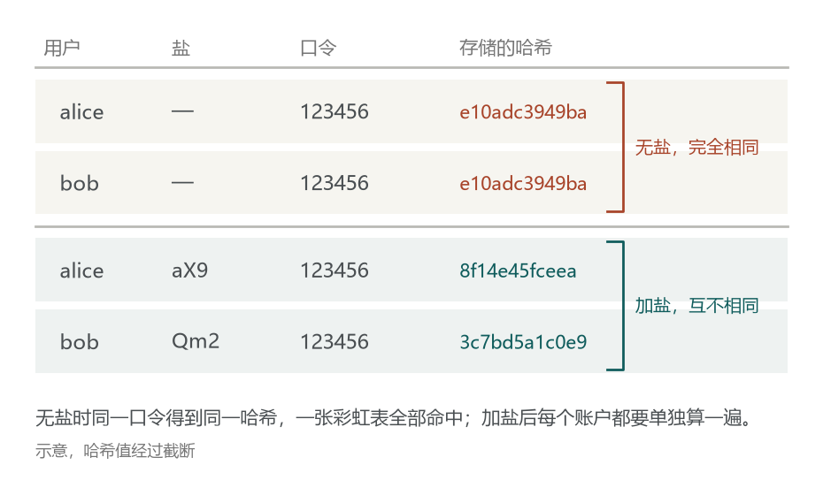
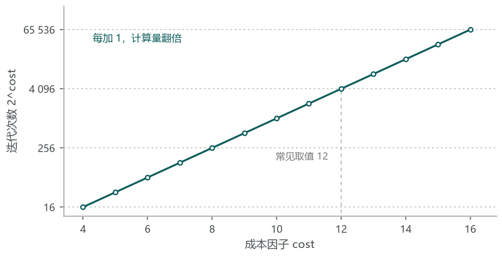

# 第十二章　密码的数学

注册一个网站，第一件事是起一个密码。这一步被重复了几百次，以至于没有人再想它为什么长这样。

密码背后其实有一整套数学。服务器并不保存你的密码，它保存的是一个由你的密码算出来的值，这个值不能反推回密码。你登录时，它把你输入的密码再算一遍，比较两个值是否相同。整套身份验证的可信度，就建立在“这个计算不可逆”这一条假设上。

这一章讲这条假设是怎么成立的，也讲它在哪些地方被现实磨掉了。前者是密码学，后者是工程。这本书反复出现的一个主题在这里会再出现一次，数学很少出错，出错的是使用数学的方式。

## 12.1 三种依据

证明“你是你”这件事，只有三种依据。

第一种是你知道的东西，密码、PIN 码、某个只有你记得的答案。第二种是你拥有的东西，手机、硬件令牌、一张智能卡。第三种是你本身，指纹、虹膜、声纹、走路的样子。

这三种依据各有各的失效方式。知道的东西可以被猜到、被偷看、被逼问；拥有的东西可以丢、可以被复制；你本身改不了，一根手指按在传感器上，你没有办法否认。

最后这一条听起来是优点，实际是麻烦。密码泄露了可以改，指纹泄露了没法换。一个人一生只有十个指纹，一旦某个数据库把它们泄露出去，这个“密码”就永久失效了，而且他还在用同一根手指开手机、过海关。生物特征适合做本地解锁，不适合做远程认证的唯一依据。

知道的东西一直没被淘汰，原因很朴素。它不需要额外硬件，不需要事先注册设备，可以在任何一台机器上输入，可以远程重置，可以在怀疑泄露时立刻换掉。它的成本几乎为零，而它的弱点恰好可以用别的手段补。

把两种以上的依据叠在一起，就叫多因素认证（multi-factor authentication）。ATM 取钱要插卡再输密码，是“拥有”加“知道”；手机解锁要指纹加密码，是“本身”加“知道”。单独一种依据都有明确的伪造方式，叠起来则要求攻击者同时完成两件不相干的事。

## 12.2 口令是怎么存的

最早的系统真的存明文。1970 年代的 Unix 把用户名和口令放在 `/etc/passwd` 里，任何用户都能读这个文件，因为登录程序需要它。那时候机器是分时共享的，能登录的人本来就有账号。

后来大家意识到，读得到口令文件的人可以直接拿走所有人的口令，于是口令被换成了哈希。

哈希函数的作用是把任意长度的输入压成固定长度的输出，而且这个过程不可逆。服务器保存 `hash(password)`，登录时用同样的方法算一遍再比较。攻击者拿到哈希，理论上不能算出原口令。

问题在于，攻击者不需要算。他可以猜。

常见口令只有那么多，几百万条就能覆盖相当大的一部分人群。攻击者把常见口令逐条哈希，和你手里的哈希比对，对上就是明文。这个过程可以预先做好，把结果存成一张巨大的表，之后查表就行。

这张表叫彩虹表（rainbow table）。2003 年 Philippe Oechslin 给出了它的实用构造，用一条链把“哈希”和“归约”两个操作交替串起来，用远小于穷举的存储换到了接近穷举的覆盖率。这是典型的时空权衡（time-memory tradeoff），一次计算，长期复用，对所有使用同一套哈希的系统都有效。

加盐解决了这个问题。服务器给每个用户生成一个随机值，存进数据库，计算时把它和口令拼在一起。

<figure>

<figcaption>图 12-1　加盐前后同一口令的存储结果。无盐时相同口令得到相同哈希，一张彩虹表可以同时命中所有账户；加盐后每个账户的盐不同，攻击者必须为每一个盐重跑一次计算。</figcaption>
</figure>

盐不需要保密，它和哈希存在同一行里。它的作用不是让计算变难，而是让“同一条口令”在不同账户上产生不同结果。三个人都用 `123456`，加了盐之后得到三个互不相同的哈希，彩虹表里预存的那一条就对不上了。攻击者只能针对每一个盐重新算一遍，等于把一次性的准备工作变成了每个账户一次的重复劳动。

盐要足够长，至少 16 字节，用密码学安全的随机数生成。盐如果太短或者可预测，比如用用户名当盐，攻击者仍然可以按用户名预先建表。

## 12.3 一个好的哈希应该长什么样

口令存储依赖哈希的三个性质。

单向，给定输出算不出输入。严格说哈希函数没有数学证明的不可逆性，它的安全性来自“目前没有人找到高效的反向算法”。

抗碰撞，找不出两个不同的输入得到同一个输出。这一条和口令存储关系不大，但和数字签名、证书关系极大，第十章里的伪造证书就靠破坏它。

雪崩效应，输入改一个比特，输出大约一半的比特会变化。这一条保证了输出看起来和输入毫无关系，攻击者无法从哈希的相似性推测口令的相似性。

MD5 曾经是标准。1991 年设计，输出 128 位，被用在无数系统里。2004 年，王小云团队公布了 MD5 的碰撞攻击，能在普通计算机上很快造出两个内容不同、哈希相同的文件。学术界当时已经在怀疑 MD5 不安全，这次是把它坐实了。2008 年，研究者用 MD5 的碰撞能力伪造了一张能被浏览器接受的 CA 证书，把“理论上的碰撞”变成了“可用的攻击”。

SHA-1 是 MD5 的后继，输出 160 位。2017 年 2 月，Google 和 CWI 的研究者公布了 SHAttered，两个精心构造的 PDF 文件哈希相同。他们为此消耗的算力约等于 6500 个 CPU 核心跑一年，或者 110 块显卡跑一年。这个成本对一个公司不算什么，对个人仍然昂贵，但已经不是不可想象的数量级。

这两件事说明，哈希函数的安全性是有保质期的。一个用了十几年的算法，可能在某个时刻被一篇论文推翻。

对现在的系统，口令哈希应该用专门为此设计的算法，而不是 MD5、SHA-1、SHA-256 这些通用哈希。原因在下一节。

## 12.4 让哈希变慢

通用哈希函数被设计得很快。SHA-256 在普通 CPU 上每秒能算几百万次，这不是缺点，是需求。签名、校验、去重，这些场景都希望它越快越好。

用在口令上，这个优点就变成了灾难。攻击者的工作量和哈希速度成正比，哈希越快，他能尝试的候选就越多。一块显卡每秒能完成的 MD5 计算比一颗 CPU 高出三到四个数量级，这个差距在口令破解上是决定性的。

于是有了慢哈希。思路很直接，把一次哈希变成成千上万次，并且把这个次数做成可调参数。

bcrypt 是第一个被广泛接受的方案，1999 年由 Niels Provos 和 David Mazières 在 USENIX Security 上发表。它基于 Blowfish 分组密码，引入一个成本因子（cost），计算量随因子指数增长。它还有一个额外的好处，内部的密钥扩展过程需要大量内存访问，让专用硬件不容易并行。

scrypt 是 2009 年 Colin Percival 提出的，把“需要多少内存”也做成了参数。它属于内存硬（memory-hard）函数，攻击者想跑得快就得多买内存，而内存的价格不像算力那样容易堆。这对用显卡或专用芯片批量破解的路线是有效的打击。

Argon2 是 2015 年密码哈希竞赛（Password Hashing Competition）的胜出者，2021 年成为 RFC 9106。它有三个变体，Argon2d 抗 GPU、Argon2i 抗侧信道、Argon2id 兼顾两者，目前推荐用最后一个。它同时参数化时间成本和内存成本。

<figure>

<figcaption>图 12-2　bcrypt 的迭代次数随成本因子指数增长，因子每加 1，服务器和攻击者的工作量同时翻倍。曲线由算法定义直接得出，纵轴为对数刻度。</figcaption>
</figure>

这张图的形状是这类算法的共同点。成本因子从 10 调到 11，计算量翻倍，服务器登录一次多花几毫秒，攻击者破解同一个库要多花一倍时间。翻倍听起来不多，但它是可以累积的，因子从 10 到 16 就是 64 倍。

代价也是真实的。服务器要为每一次登录付出同样的计算，高流量的站点把因子调得太高，会先把自己压垮。实践中要选一个“正常硬件上大约 100 毫秒”的值，这个值每隔几年要上调一次，因为硬件一直在变快。

## 12.5 破解的现实

真实的口令破解不是随机猜。攻击者手里有几样东西。

字典。几百万到上千万条真实泄露口令的合集，`rockyou.txt` 是最有名的一份，来自 2009 年一次泄露，包含约 1400 万条。这些口令不是随机的，它们是人想出来的，带有强烈的模式，人名、宠物名、球队、年份、键盘走向。

规则。在字典的每一条上做变形，首字母大写、末尾加数字、把 `a` 换成 `@`、把 `o` 换成 `0`、加一个感叹号。几百万条字典经过几十条规则，能扩张到几十亿候选。`P@ssw0rd!` 这种“看起来很复杂”的口令，正好落在这套规则的覆盖范围内。

掩码。知道口令的形状时，直接按形状穷举。八位数字的生日、四位数字的 PIN、手机号后六位，这些空间的规模小到可以在几分钟内走完。

这三种手段配合起来，效果远超“随机猜”的直觉。一个人以为自己设计了一个独特的口令，实际上他只是把字典里某个词做了两次最常见的变形。

这里不给具体速度，因为硬件更新太快，任何数字半年后就过时。需要记住的是量级关系。用 MD5 存口令的系统，一块消费级显卡每秒能尝试的候选数量在百亿量级；用 bcrypt 成本因子 12 存口令的系统，同样的显卡每秒只能尝试几千个。差六个数量级。一个八位随机小写字母加数字的口令，空间约 2.8 万亿，在前一种系统上几分钟就能走完，在后一种系统上要花几十年。

所以“快哈希等于没哈希”这个说法并不夸张。用了 SHA-256 存口令的系统，安全性上和存明文只差一步，攻击者拿到库之后，绝大多数口令会在几小时内还原。

熵是衡量口令空间的尺子。它表示“猜中它需要多少次尝试”，单位是比特，每多一个比特，候选数量翻一倍。真正随机生成的 8 位小写字母约 37 比特，随机 12 位大小写加数字约 71 比特。而人自己想的口令，即使看起来有 12 个字符，实际熵常常只有 30 比特上下，因为它的构造过程受限于人脑的习惯。四个随机单词组成的口令，长度接近 30 个字符，熵却有 50 比特以上，而且好记。

`correct horse battery staple` 比 `Tr0ub4dor&3` 强得多，前者长、随机、好记，后者短、看似复杂、实际可预测。这个结论反直觉。

## 12.6 长度、重用与第二因素

关于口令强度，过去二十年的建议发生过一次大的转向。

旧建议是复杂度，必须有大写、小写、数字、符号，每 90 天换一次。这套规则的问题在实践中暴露得很清楚。人会挑最容易满足规则的组合，`Password1!` 完全合规，熵却极低。定期更换导致人把 `Spring2024!` 改成 `Summer2024!`，规律一目了然。用户的负担增加了，安全性没有提升。

2017 年，NIST 在 SP 800-63B 里改了方向。核心几条是，长度比复杂度重要，最小 8 位，建议 15 位以上；不再强制定期更换，除非有泄露迹象；不再要求混合字符类型；检查用户设的口令是否出现在已知泄露库里，命中就拒绝；限制连续失败次数；允许粘贴，这样密码管理器才能用。

口令本身还有一个无法靠强度解决的问题，重用。

你在一个不重要的论坛注册过账号，那个论坛被拖库，邮箱和口令进了泄露合集。攻击者拿这批数据去尝试你的邮箱、你的网盘、你的支付工具。这套手法叫撞库（credential stuffing），它不破解任何东西，只是把一次泄露变成几千次登录尝试。只要你在任何一处重用了口令，那一处的强度就无关紧要了。

第二因素（2FA）是这一层的补丁。常见的形式有两种。

TOTP 是其中之一，服务器和你共享一个密钥，双方用当前时间做输入，每 30 秒算出一个 6 位数字。它挡得住撞库，因为攻击者没有那个密钥。它挡不住实时钓鱼，因为钓鱼站点可以让你在假页面上输入验证码，然后立刻拿去真站点用掉。中间人代理了整个会话，验证码只是转了一手。

FIDO2 和 WebAuthn 换了个思路。私钥生成在认证器里，永远不出来，登录时服务器发一个随机挑战，认证器用私钥签名，签名内容里绑定了网站的域名。钓鱼站点域名不同，签出来的东西真站点不认，攻击者连转发都没法做。这是目前唯一在原理上抗钓鱼的第二因素。

把前面的内容排一下，会看到一条清晰的分界。

哈希的单向性、加盐对彩虹表的破坏、慢哈希对算力的抵抗，在数学上是可靠的，到今天为止没有一个广泛部署的原语是被纯数学方法攻破的。失败都发生在别处。第十章那次是少了一行边界检查，口令库被拖走是权限和架构，撞库成功是因为在多个站点复用了同一个口令，钓鱼成功是因为人看错了域名。

“用强密码”这句话正确，但不够。真正决定一个账户安全的，是口令有没有被正确地存储、有没有第二因素、有没有在别处复用，以及那个服务本身有没有做好它该做的事。你能控制的部分比想象的小，但也不是零。

选一个长的、唯一的、由密码管理器生成的口令，再配一个绑定源的第二因素，比记住一个复杂但到处复用的口令要安全得多。

