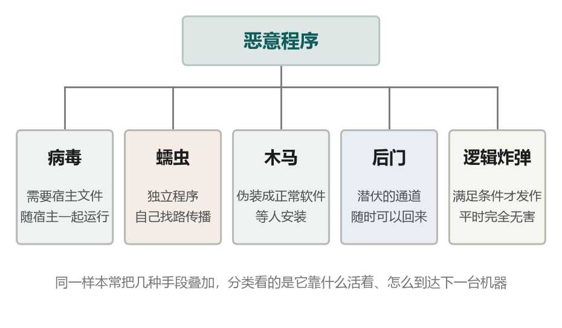
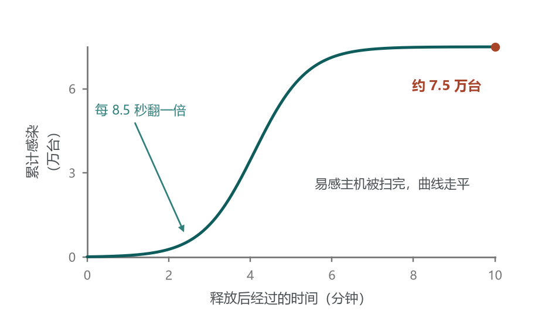
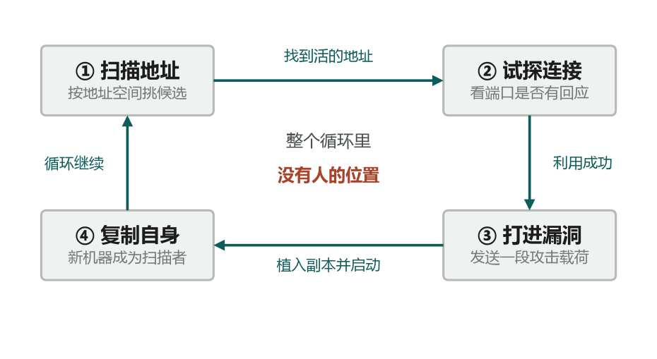

# 第十三章　病毒与蠕虫

1988 年 11 月 2 日傍晚，康奈尔大学的研究生 Robert Morris 在麻省理工的一台机器上启动了自己写的一段程序。他原本只想数一数当时的互联网上到底连着多少台机器。程序里有两个错误，一个让它在同一台机器上反复感染自己，另一个让它的感染判断过于保守。几个小时之后，全美各地的系统管理员发现机器越来越慢，日志里堆着重复的登录记录，邮件发不出去。

那时候的互联网上大约有六万台机器。事后清点，被感染的接近六千台，十分之一。ARPANET 的一部分被临时切断，国防部高级研究计划局成立了第一个应急小组。Morris 成了 1986 年《计算机欺诈与滥用法》下第一个被定罪的人，三年缓刑，四百小时社区服务，一万多美元罚金。

这段程序最让人不安的地方在于它不需要任何人配合。它不藏在邮件附件里等人双击，不伪装成好用的工具等人安装，它自己找地址，自己建立连接，自己复制。当时还没有一个现成的词来形容这种东西，人们借用了生物学里的 worm。

这一章讲的就是会自己走路的恶意程序。病毒和蠕虫经常被连在一起说，其实两者的差别不在破坏力，而在到达下一台机器的方式。

## 13.1 一张谱系图

恶意程序这个筐里装着一堆东西，分类标准不止一个，按传播方式分，也按发作条件分。最常见的误解是把病毒当成所有坏程序的总称，其实病毒只是其中一格，特征是必须寄居在别的文件里。

<figure>

<figcaption>图 13-1　恶意程序的几种基本形态。分类看两件事，靠什么活着，怎么到达下一台机器。实际样本常把几种手段叠在一起用。</figcaption>
</figure>

病毒（virus）需要宿主。它把自己挂到一个可执行文件、一段引导扇区或者一个文档的宏里，等宿主被运行时才获得执行机会。宿主不动，病毒就不动。这是它和蠕虫最根本的差别，也是它在软盘时代特别有效的原因。

蠕虫（worm）不需要宿主，它是一个完整的程序，能自己建立网络连接，自己完成传播。代价是它必须把怎么找目标、怎么打进去这两件事都写进代码，体积和暴露面都比病毒大。

木马（trojan）不负责传播，负责骗。它把自己伪装成正常软件，等着被安装、被运行。木马的价值在于第一次进入，进门之后的事交给后门。

后门（backdoor）是留在系统里的通道，让攻击者随时可以回来。它不传播，也不一定破坏什么，安静待着最不容易被发现。

逻辑炸弹（logic bomb）是按条件触发的代码，条件可能是一个日期，也可能是某个员工从工资表里消失。它在触发之前完全无害，杀毒软件扫过去什么都看不到。这类代码多半出自内部人，因为只有内部人才知道该把条件设成什么。

这五类在实际样本里经常混着。一个木马装完会开一个后门，后门用来下载蠕虫，蠕虫落地之后再埋一颗逻辑炸弹。分类是用来理解手段的，不是给每个样本贴唯一标签。

## 13.2 病毒怎样寄生

早期病毒的主战场是软盘和盗版光盘。机器从软盘启动时，BIOS 会把盘上第一个扇区读进内存并跳过去执行，那个扇区叫引导扇区。引导区病毒把真正的引导扇区搬到别处，自己占据原来的位置，开机时先跑自己的代码，再把控制权交还给真正的引导程序。它在操作系统加载之前就起来了，任何依赖操作系统的检测手段都看不到它。

文件感染型病毒走另一条路。它把自身代码附加到可执行文件末尾，修改文件头里的入口点，让程序一启动就先跳到病毒体。病毒执行完，把原程序的内存镜像恢复，再跳回原来的入口，用户看到的程序照常工作。常驻内存的版本更进一步，把自己挂到系统中断上，此后每次有程序要运行，它就先检查那个文件有没有被感染过。

1995 年之后，战场挪到了文档上。Office 文档可以带宏（macro），宏是一段在文档打开时自动执行的脚本。1999 年的 Melissa 通过邮件附件传播，感染 Word 文档，再利用收件人的通讯录给前 50 个地址群发。它造成的实际破坏有限，但邮件服务器被瞬间撑爆。宏病毒的意义在于宿主从可执行文件扩展到了数据文件，而数据文件是大家传得最随意的。

病毒作者很快发现，固定不变的特征码是最好的靶子。于是有了多态（polymorphic）。病毒体加密存放，每次感染换一把密钥，解密头随机生成，跑起来先解密再执行。检测方拿到的是一段看不懂的密文，字节串匹配自然失效。

变形（metamorphic）走得更远，每次感染都重写自己的指令序列，换寄存器、插入无用指令、把一条指令拆成几条等价的。磁盘上躺着两份同源样本，找不到一段共同的长字节串。

这两种技术把检测方逼到了另一条路上。看不到固定形状，那就看它做了什么。这条路走到了哪里，第十五章再说。

## 13.3 蠕虫的三段结构

任何蠕虫拆开都只有三部分。

扫描（scanning）负责找目标。生成候选地址，发探测包，看有没有回应。早期蠕虫老老实实按顺序遍历整个地址空间，后来的随机挑，也有先读本机路由表和 ARP 缓存、优先打局域网的。Code Red II 就偏爱 192.168.x.x，同网段的机器配置相似，打中一台之后把握更大。

感染（exploitation）负责进去。对回应者发攻击载荷。这是整个蠕虫里唯一需要聪明的地方，也是它和漏洞研究绑得最紧的地方。一个新漏洞公布，往往几天之内就出现把它做成蠕虫的样本。

载荷（payload）负责善后。可以什么都不做，只继续传播；也可以开一个后门、装一个 DDoS 客户端、把首页改掉。载荷决定危害，扫描和感染决定速度。

Morris worm 同时用了三条完全不同的路。

第一条是 sendmail 的调试模式。当时的 sendmail 编译时留了一个 DEBUG 选项，允许远程发一条命令让它以调试模式运行，并把后续输入当脚本执行。蠕虫发一段脚本过去，脚本把自身拷到目标机器再启动。

第二条是 fingerd 的栈溢出。finger 服务监听 79 端口，读一行输入。它用了 C 库里的 gets，这个函数不检查长度，输入超长就盖掉栈上的返回地址。第二章讲过栈帧的布局，也讲过返回地址被覆盖之后会发生什么，蠕虫用的就是这个。几十个字节的溢出代码，在 VAX 机器上换回一个 shell。

第三条是 rsh 的信任关系。当时机器之间常用 .rhosts 互相放行，A 机器上的用户可以免密登录 B。蠕虫读这些配置，冒充受信任的主机去登录下一台。

三条路各有各的失败条件，叠在一起覆盖面就很宽。这也解释了它的传播曲线为什么不如后来的单漏洞蠕虫整齐，有的网段是被 sendmail 打穿的，有的被溢出打穿。

Eugene Spafford 在事件之后写了一份技术分析报告，《The Internet Worm Program: An Analysis》。报告逐条拆了蠕虫的代码、传播路径和失效原因，第一次把分析一个正在传播的恶意程序变成可以照着做的流程。今天读它，后面二十年蠕虫研究里的几乎所有问题都已经在里面了。

## 13.4 2001 与 2003

2001 年 7 月，Code Red。目标是运行 IIS 的 Windows 服务器，入口是索引服务里的一个 ISAPI 过滤器，对输入长度检查不严，后来编号 CVE-2001-0500。蠕虫把一段 shellcode 塞进 HTTP 请求送进去。14 小时内感染约 35.9 万台主机，然后集体休眠，每月 20 日到 27 日醒来，对着白宫网站发起拒绝服务攻击。

Code Red 走 TCP，要三次握手，要维护连接状态，要等对端回应，一个连接从发起到失败要几百毫秒。并发开得再大，上限仍由协议和超时决定。

2003 年 1 月 25 日，Slammer。整个蠕虫 376 字节，一个 UDP 包装得下。目标是 SQL Server 2000 的 1434 端口，那个负责应答本机有哪些 SQL 实例的服务里有一个栈溢出。10 分钟内感染约 7.5 万台。Moore、Paxson、Savage、Shannon、Staniford 和 Weaver 在当年的 USENIX Security 上发表《Inside the Slammer Worm》，用网络望远镜和分布在各处的监测点还原了过程。峰值时每秒扫描 5500 万个地址，早期每 8.5 秒感染数翻一倍。

<figure>

<figcaption>图 13-2　Slammer 的感染增长。曲线按 Moore 等人 2003 年报告的两个测量值（早期倍增时间 8.5 秒、十分钟内约 7.5 万台）还原形状，纵轴刻度只标量程，不是逐点测量值。开头那段看着平缓，其实一直在加速，进入平段是因为易感主机被扫完了。</figcaption>
</figure>

Code Red 花 14 小时，Slammer 花 10 分钟，差距不在漏洞水平，在协议。

TCP 要握手，发包方要等回应，重传超时可能是几百毫秒到几秒。UDP 发出去就不管，打不中也不心疼，下一个地址已经在队列里排队。Slammer 的传播过程完全无状态，它不记录打过谁，也不需要知道谁被感染，发送方只管以线速往外灌，接收方中招之后自己也变成发送方。

376 字节是第二个原因。这个体积能塞进一个以太网帧，不需要分片，路由器转发它的开销最小。一个蠕虫如果能把自己压进单个包，速度就不再受带宽和协议开销约束，只受遍历地址列表的速度约束。

第三个原因是同质性。全世界几十万台机器跑着同一版本的 SQL Server，同一个端口，同一份默认配置，同一个漏洞，写一次代码就能打通所有目标。单一品种的大规模种植遇到一种病害就全线失守，道理是一样的。

<figure>

<figcaption>图 13-3　蠕虫的基本循环。四个动作串起来之后不再需要人，机器每秒可以把它重复几万次，这是蠕虫与病毒在能力上的分界。</figcaption>
</figure>

## 13.5 曲线为什么先慢后快

把一台已感染机器每秒能成功感染的台数记作 β，主机总数记作 N，已感染数记作 I。随机扫描时，探测包落到未感染机器上的概率大致是 (N-I)/N，于是

dI/dt = β·I·(N-I)/N

I 远小于 N 时，(N-I)/N 接近 1，方程退化成 dI/dt = βI，解是指数函数。这就是曲线开头那段看起来慢、其实一直在加速的部分。翻倍时间是常数，8.5 秒翻一倍，十分钟里就是七十次翻倍，早就超过了任何真实的机器总数。

现实里 N 会把它拦住。I 接近 N 时 (N-I)/N 变小，增长放缓，曲线拐进平段。整条线是个 S 形，拐点在 I = N/2 附近。拐点之前感染数的绝对值小，看起来无害；拐点之后，几乎同时全中。

这个模型给防守方的结论不太舒服。可用于判断的时间不在峰值，在指数段。β 越大，指数段越短。Slammer 的 β 决定了它的窗口以分钟计，等人反应过来，传播已经结束，剩下的工作只有清理。

还有一层。观测到的数字总比模型小，监测点只看得见没被过滤掉的扫描流量，很多网络在边界上就把这类包扔了，统计结果只是下限。

## 13.6 把窗口和半径压小

补丁窗口是漏洞公布到被利用之间的那段时间，这些年一直在缩短，从几个月到几天，个别案例只有几个小时。真正管用的不是打补丁的决心，而是打补丁的能力，知道自己有哪些资产、跑的什么版本、补丁能不能自动分发、出问题能不能回滚。不清楚自己在跑什么，谈窗口没有意义。

出口过滤（egress filtering）在网络出口拦掉源地址不属于本网段的包，也拦掉内网主机直接访问 1434、445 这类端口。它挡不住已经进来的蠕虫，但能挡住它往外扫，把一次全球事件降级成一次局部事件。BCP 38 是这方面流传最广的一份建议。

网络分段解决半径问题。同一广播域里蠕虫的传播速度远高于跨网段，把办公网、服务器区、监控与医疗设备网分开，一个网段失守不等于全部失守。Slammer 之后，很多机构做的第一件事就是给数据库端口加访问控制。

关闭不必要的服务最朴素，也最有效。Slammer 打的是 SQL Server 的实例名解析服务，大量装了 SQL Server 的机器根本不需要对外提供这个功能。默认安装加默认开启，是蠕虫最好的朋友。

还有一条不那么技术的，备份与恢复演练。清理一台被蠕虫打过的机器往往要重装，重装要多久、数据从哪来，答案决定了一次事件是一个下午还是一个星期。

蠕虫的破坏力从来不来自代码的复杂程度。Slammer 只有 376 字节，比很多网页图标还小。它做的事情就三件，找下一个地址，打进去，复制自己，然后把这个循环交给机器。人做不到一秒几万次，机器可以。加上同质性这个前提，一次编写就能同时在几万台机器上生效。

物联网把这个前提推到了极致。摄像头、路由器、温控器用同一套固件，默认密码相同，几年不更新，二十四小时在线。2016 年的 Mirai 就在这个基础上工作，做的事情和 Slammer 没有本质区别，只是目标从数据库换成了摄像头，规模从七万台变成了几十万台。这些被感染的设备后来被组织成了什么，是下一章的事。

