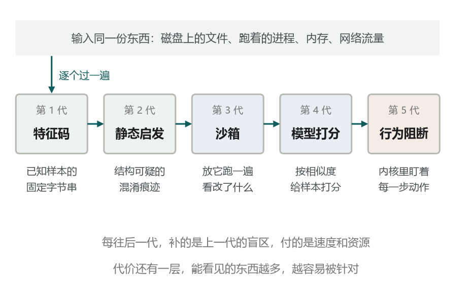
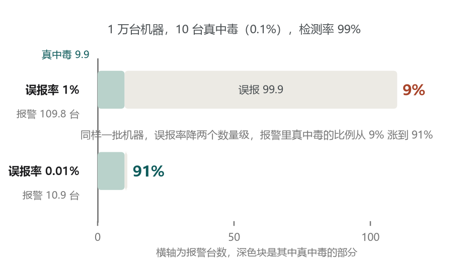
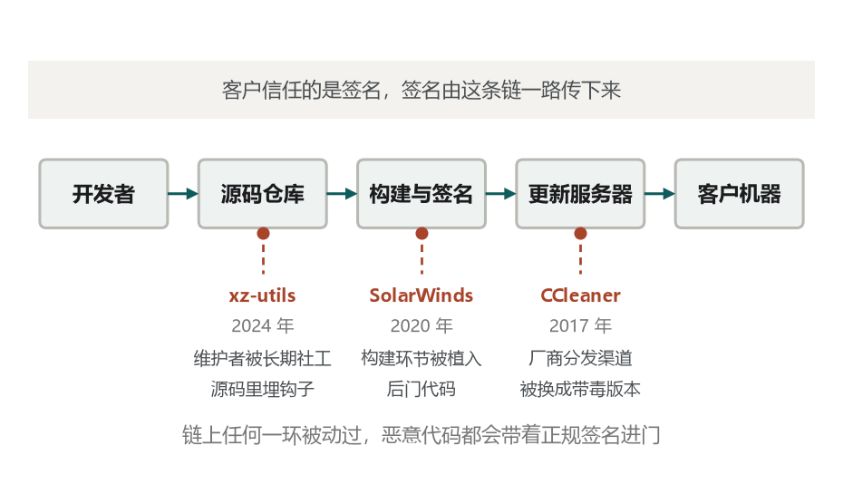

# 第十五章　杀毒软件为什么像病毒

装完一个安全软件，它要求重启。重启之后，系统里多了一个内核驱动。它开始全盘扫描，风扇转起来，两个小时才结束。它在后台不停地连服务器下载新的规则。你打开的每个文件它都要先看一眼。你试着关掉它，它弹出一个对话框，问你是不是确定要降低安全性，按钮默认停在"取消"上。卸载它，普通卸载程序删不干净，官方还提供了一个专门的清除工具。

把这段行为换个名字描述一遍。一个程序装进内核，读你所有的文件，持续联网接收新指令，阻止你关闭它，卸载困难。这就是木马的教科书定义，区别只在于这一次是你自己点同意装上去的。

两者的区别不在行为，在授权和数据的去向。这句话说起来轻巧，但它是这一章所有问题的源头。安全软件为了拦住恶意程序，必须拿到和恶意程序同一量级的权限，拿到之后，怎么保证这份权限不被滥用、不被偷走、不被自己搞砸，成了另一个问题。

## 15.1 五代检测

检测技术大致走过了五代，每一代都在补上一代的盲区，又都留下新的问题。

第一代是特征码（signature）。从已知样本里提取一段不会变的字节串，扫描的时候在全盘文件里找这段字节。速度极快，误报极低，实现简单到一个周末就能写出来。它的盲区也很清楚，只认见过的样本。加个壳、改几个字节、换一种编译方式，同一个家族的新样本就查不出来了。

第二代是启发式与静态分析。不再盯着具体字节，改看结构和组合。一个可执行文件的节表透着古怪，入口点指向最后一个节，导入表里同时出现写文件和加密相关的 API，脚本里出现了明显的混淆循环，这些都算可疑。它能抓住没见过的新变种，代价是误报开始上升，因为可疑不等于恶意。

第三代是沙箱与动态行为分析。把样本放进一个受控的虚拟机里跑几分钟，看它创建了什么文件、改了哪些注册表、连了哪个地址、有没有把自己复制到启动目录。加壳和混淆在这一步基本失效，因为程序总得跑起来才能作恶。代价是时间，几秒到几分钟不等，而且样本越来越会检查自己是不是在虚拟机里，检查鼠标有没有动，检查开机时间是不是太短。

第四代是机器学习。把样本的各种特征变成向量，训练一个分类器，让它给新样本打分。速度快，能泛化，对变种友好。问题在于它给出的结论经常说不清理由，误报之后没法向用户解释为什么。训练数据的偏差也会被继承，攻击者还可以针对模型做对抗样本。

2010 年，Sommer 和 Paxson 在 IEEE S&P 上发表《Outside the Closed World》，专门讨论了这类方法的困境。他们的结论不太客气，入侵检测的难点不在分类器不够聪明，在于正例太少、正常行为的边界本身是开放的，随便一个数学上漂亮的模型搬到真实流量上都会失效。这篇论文影响了后来很多年的研究方向。

第五代是 EDR（endpoint detection and response）与行为阻断。它不再只盯着文件，而是持续记录进程、注册表、网络、内存的动作序列，用规则和模型去匹配攻击链的形状，发现之后可以终止进程、隔离主机、回滚被改动的文件。它承认自己会漏，所以重点放在看见和响应上。代价是资源占用、日志量，以及一个更现实的问题，告警太多，没有人看。

<figure>

<figcaption>图 15-1　五代检测各自看的是什么。越往后，能看到的东西越多，付出的速度和资源代价也越大，被针对的面也越宽。</figcaption>
</figure>

## 15.2 一个不太舒服的算术

假设一家公司有一万台机器，其中十台真的中了毒，比例是千分之一。检测率 99%，误报率 1%，这两个数字放在任何产品说明里都算漂亮。

现在算一遍报警的构成。十台真中毒的机器里，百分之九十九会被抓到，也就是 9.9 台。剩下 9990 台干净的机器里，百分之一会被误报，也就是 99.9 台。报警总数是 109.8 台，其中真的中毒的只有 9.9 台。

9.9 除以 109.8，约等于 9%。

<figure>

<figcaption>图 15-2　按假设算出的报警构成，不是实测数据。误报率 1% 时，报警里只有约 9% 是真的；把误报率压到 0.01%，同一批机器的报警总数从 109.8 降到 10.9，真中毒的比例升到 91%。</figcaption>
</figure>

十次报警里有九次是冤枉的。这个结果和"检测率 99%"给人的印象差得很远，差在一个被忽略的分母上。真实的感染比例越低，误报的绝对数量越容易超过真阳性。这个现象叫基率谬误（base rate fallacy），它不是统计学的边角料，而是安全产品每天要面对的现实。

反过来说，降低误报率比提高检测率更值钱。误报率从 1% 压到 0.01%，精确率就从 9% 涨到 91%，效果比把检测率从 99% 提到 99.9% 明显得多。

漏报那一侧的数字同样不好看。99% 的检测率意味着每一百个真样本里有一个会被放过，而它落在哪个文件上是随机的。安全产品没法承诺零漏报，能做的是承认会漏，然后在后面再排几道拦截。

这也解释了一个看起来矛盾的现象。消费级杀毒软件敢报，因为一次误报最多让用户骂两句，重装个系统就过去了。企业级产品宁可漏报也不敢乱报，一条生产线的控制系统被误判成恶意程序而隔离，损失按分钟算。同一套算法，放在两个场景里，调参数的方向是相反的。

## 15.3 它为什么要那么大的权力

安全软件的行为之所以像木马，是因为它要解决的问题要求它这么做。

要拦住一个文件被创建，光在用户态轮询目录是不够的，文件可能在两次轮询之间被写入并执行。真正管用的做法是在文件系统驱动里挂一个回调，让每一次创建、写入、执行都先经过它。要拦住进程启动，要在内核的进程创建回调里插一脚。要防止注册表被改，要挂注册表回调。这些位置，恰恰也是 rootkit 藏身的位置。

要在大规模环境里做判断，需要看到全部文件，所以有全盘扫描。要在新威胁出现后的几小时内做出反应，需要一条随时下发的更新通道，所以有自更新。要保证自己在被攻击时不被第一个关掉，需要自我保护，所以有关不掉的进程和改不动的文件。

这几件事单独看都合理，合在一起就是一个能读所有文件、能阻止任何程序运行、能自己更新自己、还能远程接收指令的常驻程序。木马想要的全部能力，它都有。区别只剩下三条，谁授权它装的，它把数据发到哪里，以及它能不能被卸载。

这三条里最容易被忽略的是第二条。一个安全软件每天上报多少文件哈希、多少可疑路径、多少"匿名统计"，用户通常不知道，也不会去读那份隐私政策。这些数据在厂商手里是威胁情报，在攻击者手里就是地图。

还有一层。正因为安全软件权限这么大，它本身就是最高价值的攻击目标。攻破一家安全厂商的更新服务器，等于同时攻破它所有客户的机器，而且是以最可信的方式。这就带出了下一节。

## 15.4 更新链上的每一环

现代软件的可信度建立在一个假设上，代码是开发者写的，构建是构建系统做的，签名是厂商签的，更新是走官方渠道发下去的。攻击者发现，与其去骗用户，不如去动这条链上的某一环，让恶意代码自己带着正规签名进门。

<figure>

<figcaption>图 15-3　更新链与三个真实案例的注入位置。客户验证的是签名，签名只能证明东西出自这条链，不能证明链上每一环都干净。</figcaption>
</figure>

2020 年的 SolarWinds 是最出名的一次。攻击者进到 Orion 平台的构建环境里，在网络管理组件的更新包里植入了一段后门，之后正常签名、正常发布。约 1.8 万个客户下载了这个版本，攻击者再从中挑出几十家有价值的做后续渗透。整个过程中，客户的防护软件没有报警，因为更新包是签过名的。

2017 年的 CCleaner 走的是同一条路，只是规模小一些。5.33 版本被植入后门，约 227 万次下载，攻击者只对其中十几家科技公司下发第二阶段载荷。同年的 NotPetya 借的是乌克兰会计软件 M.E.Doc 的更新通道，表面上是勒索，实际是数据擦除，造成的全球损失以百亿美元计。

2024 年的 xz-utils 后门换了手法，但方向一致。有人在开源项目里用两年的时间慢慢取得信任，提交无害的补丁，在邮件列表里施压逼走原来的维护者，最后在一次看起来像测试的提交里塞进一段混淆过的构建脚本。结果是 liblzma 5.6.0 和 5.6.1 里带了一个后门，编号 CVE-2024-3094，能让 sshd 在特定条件下加载被改过的库。它被发现是因为一位微软的工程师注意到 ssh 登录慢了半秒。

开源项目还有一个结构上的弱点。大量基础设施由少数志愿者维护，没有报酬，也没有接班人，一个持续两年、态度友善、代码质量不错的贡献者，几乎找不到理由拒绝。xz 这件事之后，不少项目开始要求新维护者提供更多背景，也重新用起可复现构建，但这类防线靠的是人和流程，不是技术。

这四件事的共同点是，恶意代码都出现在"应该被信任"的位置上。检测方盯着用户下载了什么，很少有人盯着构建服务器吐出了什么。

## 15.5 普通人该怎么看

对绝大多数人，结论很简单，系统自带的够用。Windows 的 Defender、macOS 的 XProtect 这些年进步很大，和系统集成得更深，行为监控的权限也更完整。再装一个第三方产品，多数时候不会更安全，反而多了一个常驻的内核驱动、一份额外的隐私政策和一个新的攻击面。

要装的话，少而精。两套安全软件同时挂文件系统回调，会互相拦截对方的扫描，机器变慢，真出问题时两边都说不清。看更新是否及时，看独立测评的长期结果，AV-TEST 和 AV-Comparatives 这类机构会公布误报率和性能影响的实测数据，比广告里的百分比可信。警惕捆绑安装，很多"全家桶"是在装别的软件时被顺手勾上的，它们带来的弹窗和主页劫持比病毒更烦人。

还有一条常被忽略的，看它有没有说不清的功能。一个杀毒软件要求装浏览器插件、要求代理所有网页流量、要求读取你的聊天记录，这些请求和查毒没什么关系。

手机上的判断更简单。iOS 和 Android 的应用沙箱、商店审核、系统级完整性校验已经关掉了大部分入口，真正决定你安不安全的，是有没有装来路不明的描述文件、有没有给陌生应用开无障碍权限，而不是装没装某个清理大师。

在企业环境里，判断标准要换一套。EDR 的价值不在于检出率比传统杀毒高几个百分点，而在于它把"发生了什么"记录下来了，让响应有据可依。买它的同时要准备好日志存储、告警分诊的人和一套演练过的处置流程，否则它只是一个更贵的日志收集器。

回到开头那个问题。安全软件像病毒，是因为它必须在病毒能到达的地方等着它，那些地方只有高权限才进得去。

问题不在于它像，而在于它像却不受约束。一个能读你所有文件、能阻止任何程序运行、能自己更新自己的软件，如果不可审计、不可卸载、更新不可验证，它和木马之间的差别就只剩一张授权书。这张授权书是真的，但授权不等于免疫，也不等于可以不要监督。让这类软件权限最小化、行为可审计、组件可替换，比争论它是不是善意更有意义。

