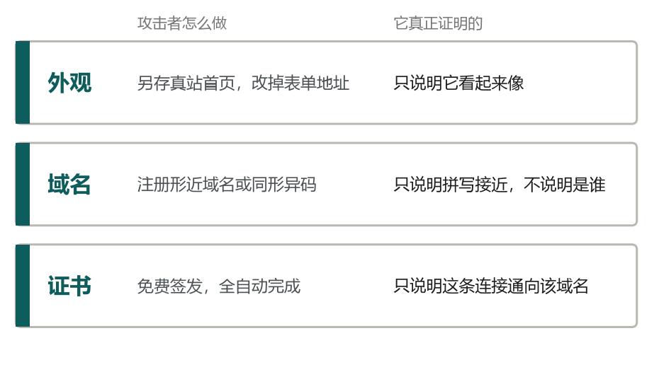
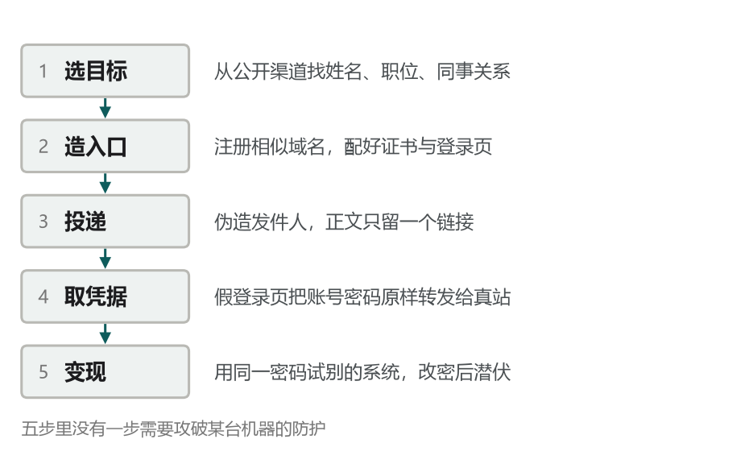

# 第十六章　骗局的工程学

一家跨国工程公司的财务职员收到过一封邮件。发件人显示是公司的首席财务官，主题写着“机密，请勿转发”，正文提到一笔正在谈的收购，要求她分十几笔把两亿港元转到几个指定账户。邮件没有附件，没有可疑链接，语气和她熟悉的老板一样简短。她照做了，直到几天后和同事核对才发现对方根本不是首席财务官。事后复盘，骗子提前看过她发在网上的会议照片和出差行程。

这类新闻读多了容易产生两种误解，一种觉得受害者太笨，换作自己不会上当；另一种觉得这事全凭运气，防不住。两种看法都站不住，骗子用的手法有明确来源，成功率可以测量和复现。它是一门工程学。

这一章讲这门工程学里最基础的部分，人被什么说服，钓鱼站点在技术上怎么做，防御为什么必须落在流程上。

## 16.1 六个开关

1984 年，社会心理学家 Robert Cialdini 把关于顺从的研究收拢成六条原则，互惠、承诺一致、社会认同、喜好、权威、稀缺。这套东西后来被无数销售培训教材抄来抄去，也进了钓鱼邮件的模板库。它的价值在于解释力，能覆盖绝大多数“我明明不需要，怎么还是买了”的经历。

互惠。餐厅结账时送一颗薄荷糖，小费会涨一点；送两颗，并且补一句“这是专门给您的”，涨幅能到两成以上。人收到东西之后会产生一种要还回去的压力，这份压力与礼物的实际价值不成比例。网络上对应的东西全是免费的，免费 WiFi、免费加速器、开源项目下面那个“赞助一杯咖啡”的按钮。攻击者也用这一条，先在群里耐心回答你的编译报错，等你觉得这人不错，再请你顺手确认一下收到的验证码。

承诺一致。1966 年 Freedman 和 Fraser 做过一个实验。他们先请住户在窗户上贴一张巴掌大的“安全驾驶”标语，几乎所有人都同意了；两周后再请同一批人在院子里立一块很大的牌子，同意率 76%，而直接去问另一批住户只有 17% 同意。人一旦做过一个小决定，就会倾向于让后面的行为与它保持一致。钓鱼的第一步常常是让你做一件很小的事，填一份问卷、加一个群、点开一份课程表。你已经投入了，后面的要求就不那么突兀。

社会认同。酒店房间里那张“请重复使用毛巾”的卡片，如果写上“本店 75% 的客人重复使用了毛巾”，效果明显好过写“保护环境”。人判断什么是正确行为，参照的是别人在做什么。网络上的社会认同可以批量制造，群里的“已领到，真实有效”，商品页的销量和好评。一封冒充辅导员的邮件如果抄送了整个班级名单，你看到收件人栏里全是同学的名字，警惕心会自己降下去。

喜好。人对长得好看的人、和自己相似的人、夸过自己的人更容易说好。二手车销售员会先找共同点，“我也是这个城市长大的”；直销模式里的家庭聚会，是把买卖塞进朋友关系里。网络上的对应物是头像、共同好友、和你一样的说话习惯。熟练的骗子加你之前会翻一遍你的主页，用你的口头禅开场，把你提到的城市说成“我去年还去过”。

权威。Hofling 等人在 1966 年做了一个护理实验，一个陌生医生在电话里让值班护士给病人注射明显超量的药，22 名护士里有 21 名准备照做，直到被观察者拦下。制服、头衔、工号压过的判断力，比愿意承认的多。网络上的权威符号极其廉价，把发件人显示名改成“IT 服务台”，伪造一个工单编号，注册一个以公司名开头的子域名。

稀缺。1975 年 Worchel 的饼干实验里，罐子里只剩两块饼干时，被试对它的评价明显高于罐子里有十块的时候。数量少和快要失去，都会让人加快决定。网页上的倒计时、“仅剩 3 个名额”、“账号将在 24 小时内停用”，作用都是压缩你思考和验证的时间。

六条原则有一个共同点，它们都不打算让你相信一个错误的信息，而是让你根本走不到“要不要相信”这一步。决定被提前做掉了。屏幕把这件事的成本压得更低，伪装一个身份只需要几十块钱和一个下午。

## 16.2 地址栏里的把戏

做钓鱼站点，技术上最难的一步不是页面，是让地址栏里那串字符看起来对。

最粗糙的办法是注册一个形近的域名，业内叫仿冒域名（typosquatting）。把 `m` 拆成 `rn`，字母 `o` 换成数字 `0`，`l` 换成 `1`，多加一个连字符，换一个顶级域。`paypa1.com`、`rnicrosoft.com`、`example.com.cn`，成本是一个域名几十块钱和十分钟，靠的是你扫一眼就点下去的习惯。

更巧妙的一层在字符集里。Unicode 收录了世界上几乎所有文字的字母，其中不少字形几乎完全一样。西里尔字母 `а`（U+0430）和拉丁字母 `a`，希腊字母 `ο` 和拉丁字母 `o`，看上去没有区别，编码完全不同。浏览器为了照顾用户，会把域名里的非 ASCII 字符用 Punycode 编码传输，显示时还原成人能读的形式，于是 `аррӏе.com` 在地址栏里和 `apple.com` 长得一模一样。这类攻击叫同形异码（homograph）。2017 年安全研究者 Xudong Zheng 公开过完整的演示，之后主流浏览器陆续改成：域名里混用了不同文字的字符时，强制显示 `xn--` 开头的编码形式。

还有一层利用的是人读域名的方向。域名从右往左收紧，`a.b.example.com` 的主人是 `example.com`，前面都是子域，而人从左往右读。于是 `paypal.com.login-secure.example.cn` 会让很多人以为自己在 PayPal 上，实际的主人是 `example.cn`。手机屏幕窄，地址栏只显示前十几个字符，移动端更严重。

HTTPS 在这一堆把戏里的角色最容易被误解。地址栏里那个小锁只有一种含义，你和这个域名之间的连接是加密的，中间人看不到内容，也不能改内容。它不说明这个域名属于谁，也不说明运营者有没有恶意。2015 年 Let's Encrypt 上线，免费签发域名验证证书（domain validation，DV），配合 ACME 协议可以全自动申请和续期，几分钟就能给任何域名配上小锁。在那之前证书要花钱、要人工审核，钓鱼站点常常只能用 http，小锁还有点区分度；现在没有了。付费的组织验证证书（organization validation，OV）和扩展验证证书（extended validation，EV）确实核验过企业身份，但浏览器早就不再把公司名显示在地址栏里。

<figure>

<figcaption>图 16-1　判断站点身份时人依赖的三层证据，以及每一层真正能证明什么。三层都能被低成本复制，叠起来也回答不了“这家网站是谁开的”。</figcaption>
</figure>

还有一路做法更直接，对地址栏本身动手。UI 重绘（UI redress）是在真页面上盖一层透明或半透明的框，你看到的按钮、地址栏图片其实都是页面画的，点在哪儿由攻击者决定。全屏 API 让页面占满屏幕，浏览器的地址栏和标签栏一起消失。滚动隐藏更简单，把页面往下滚一点，移动端浏览器的地址栏就会自动收起来。再加上弹出窗口无边框、网页应用以独立窗口运行，人可以一整天不看见一次真实地址。

## 16.3 2006 年的那间实验室

2006 年，伯克利的 Rachna Dhamija、J. D. Tygar 和 Marti Hearst 发表了一篇论文，题目就叫《Why Phishing Works》。他们让 23 名参与者判断一批网站的真假，其中有几个精心制作的钓鱼站点。最好的那个钓鱼站点骗过了 90% 的参与者。

论文里更有价值的是对“为什么”的分析。参与者判断站点是否可信，主要看内容和观感，logo 对不对、版面像不像、有没有熟悉的入口、写的话是否符合预期。地址栏被跳过了，即使有人去看，也往往读不懂那串字符的结构。小锁图标被普遍误解成“这个网站经过验证”，而不是“这条连接被加密”。论文的结论是浏览器的安全指示器基本失效，它们要求用户理解一个从未被教过的模型，还要在需要快速决策的场景里持续使用它。

这项研究做于 HTTPS 还很稀少的年代，结论今天反而更成立。当年小锁至少稀缺，现在它免费、自动、无处不在，区分度归零。论文里另一个容易被忽略的观察是，参与者中计算机水平高的那部分人，成绩并没有明显更好。知识在这里不转化为判断，因为没有人在真实的紧迫感下会去逐字检查域名。

## 16.4 从群发到定点

最早的钓鱼是群发的，一封“您的账户存在异常”发给几百万人，靠概率活着。命中率低，成本几乎为零，千分之一的人点进去就够本。

定点版本叫鱼叉式钓鱼（spear phishing）。攻击者先花时间研究一个具体的人，他的职位、上级、正在做的项目、常用的系统，然后写一封只对他成立的邮件。前面那家工程公司的案子就是这一类。鱼叉式钓鱼不需要技术上的精巧，它需要耐心和信息，而这两样东西在社交网络上大多是公开的。

<figure>

<figcaption>图 16-2　一次钓鱼从选目标到变现的五个步骤。整条链上没有一步需要攻破某台机器的防护，所有环节都在利用人的判断和流程的空隙。</figcaption>
</figure>

水坑攻击（watering hole）换了个思路。它不去追人，去追人一定会访问的站点，比如学院论坛、行业协会网站、某个专业的文档站。攻陷之后在页面里挂一段脚本，只对特定来源 IP 和浏览器投放恶意代码，其他人访问一切正常。受害者不是被选中的，只是恰好在那几天访问了那个站。

SIM 卡交换（SIM swap）把目标对准手机号。攻击者冒充机主联系运营商客服，用事先收集到的身份信息通过验证，把号码转到自己手里的空白卡上。之后所有短信都进了他的手机，短信验证码、短信找回密码、银行动账通知一起失守。所以短信验证码比没有好，但不该是最后一道，它在“对方能冒充你打个电话”的前提下并不成立。

冒充客服是另一条常见路径。搜索“某某软件客服电话”，排在前面的广告位可能是假的；打过去之后，对方会引导你装一个远程控制软件，TeamViewer、AnyDesk 或者向日葵，然后“帮您操作”。屏幕一共享，验证码、余额、密码输入过程全在对方眼里。同类手法还有多因素认证（multi-factor authentication，MFA）疲劳攻击，攻击者拿着已经到手的密码反复触发登录确认，一次不点、两次不点，凌晨三点第五次弹窗时总有人点“允许”。

还有一类邮件网关拦不住的东西，商业邮件诈骗（business email compromise，BEC）。它没有附件、链接和恶意代码，只有一段话，“我在开会不方便接电话，这笔款今天必须付出去”。网关扫的是特征，这封邮件在特征上干净。

## 16.5 把防御写进流程

面对这些，最常见的建议是“提高警惕”。这条建议有两个问题，它不可持续，人不可能一年三百六十五天保持怀疑；也不可度量，没法知道今天比昨天警惕了多少。有效的防御都把判断从人的注意力里挪走，交给机制。

硬件安全密钥是其中最彻底的一种。FIDO2 标准下的密钥（USB 棒或者带 NFC 的卡片）在注册和登录时都会让浏览器把当前页面的源（origin，协议加域名加端口）写进签名数据，服务器验证签名时一并验证源。钓鱼站点可以骗你点进去，也可以转发你的操作，但它拿到的签名里写的是自己的域名，真服务器一看就知道不对。这个机制不要求用户看懂地址栏，也不要求记得上次登录在哪里。

密码管理器解决另一半问题。它只在当前域名与保存记录完全一致时才自动填充，同形异码的域名不会被匹配，因为你从来没有为它保存过密码。它同时消灭了密码复用，一个站点泄露不会连带其他站点。浏览器自带的够用，前提是主密码足够强。

回拨验证便宜且有效。任何涉及钱、权限、数据导出的请求，只要是通过邮件或者聊天工具来的，就用另一个渠道确认一遍。关键是号码的来源，从通讯录、工牌、公司内网找，绝不用对方在消息里给的那个。骗子最喜欢的要求是“请打这个号码找我”。

双人复核把单点欺骗变成不够用。超过某个金额的付款需要两个人独立确认，改收款账户要走一条和付款分离的流程。这类设计不假设员工不犯错，而是承认任何环节都可能被单独攻破，所以不让单一环节拥有完整权力。

还有一件常被忽略的事，是减少可以被用来骗你的材料。公开主页上写着导师姓名、实验室门牌号、每周几在哪个楼值班，这些都是鱼叉式钓鱼的原料。删掉它们不会让攻击消失，但会让那封“只对你成立”的邮件难写。

到这一章为止，前面讲的大多是某一种具体技术怎么被攻破。下一章换一个看法，把四起真实事件放在一起，看它们在结构上到底共享了什么。
