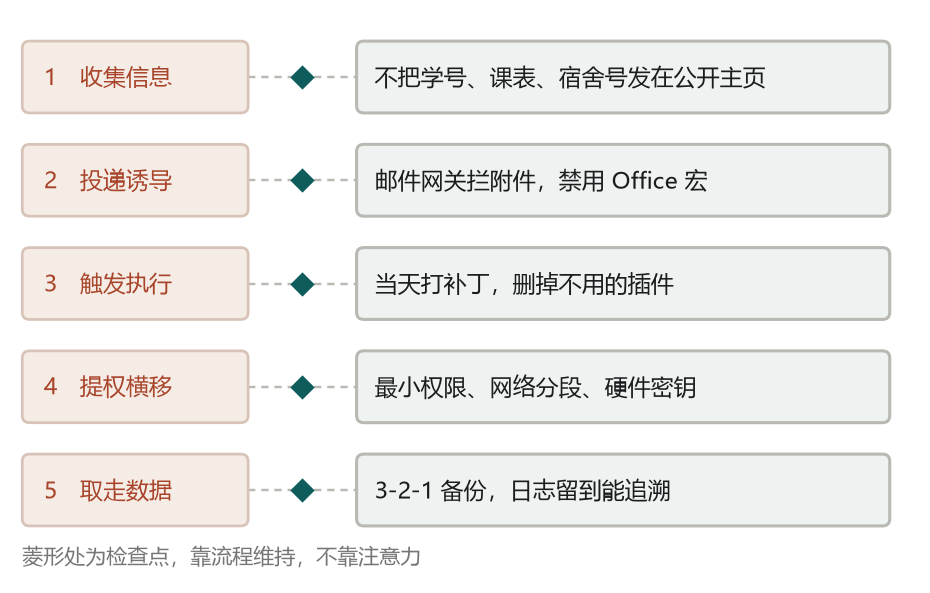
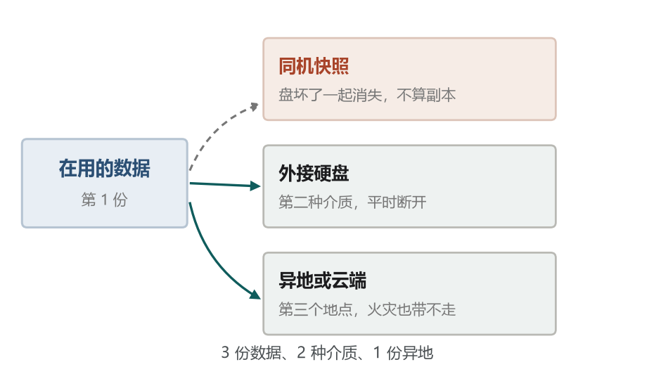

# 第十八章　如何保护自己

一个学生在图书馆把笔记本放在桌上，去了一趟卫生间，回来椅子还在，机器没了。硬盘里有没写完的毕业论文、三年的照片、十几个网站的登录状态、一个存着身份证照片的网盘客户端。他当天晚上改了邮箱密码，第二天发现社交账号已经被用来给同学发借钱的消息。

这件事里，偷机器的人大概率不懂技术。他关心的只是这台机器能卖多少钱，硬盘里的东西对他没有价值。但对他来说没价值的东西，对别人可能有，而数据是可以被复制很多次再卖掉的。损失的范围由别人决定，不由失主决定。

前面十七章讲的是攻击怎么发生。这一章讲防守，但不是列一张装备清单。清单的问题在于它不区分优先级，让人觉得每一样都要做，做不完就干脆不做。有效率的做法是先弄清楚自己到底在保护什么。

## 18.1 四个问题

安全工程里有一个叫威胁建模（threat modeling）的做法，落到个人身上，就是回答四个问题。我在保护什么，我要防谁，他能从哪里进来，出事之后会怎样。

我在保护什么。不是“我的电脑”，而是电脑上具体的东西。毕业论文的草稿、实验数据、身份证和银行卡的照片、邮箱和社交账号、网盘里的家庭照片、浏览器里保存的密码。有些东西丢了能重来，有些不能。这个区分决定了后面的投入往哪儿放。

我要防谁。对手不是抽象的黑客，是具体的一类人，能力有高有低。宿舍里随手翻你电脑的室友，图书馆里顺走包的惯偷，批量扫描弱密码的脚本，还有学校里拥有合法权限的管理员。对手越强，能做的事越少，成本越高，多数人的真实威胁来自最弱的那几档。

他能从哪里进来。设备丢失、密码多处复用、点开钓鱼链接、在公共电脑上登录没退出、把实验室内网的服务暴露在公网上、装了破解软件。把自己的入口列一遍，通常不超过十条，而且大部分是自己知道的。

出事之后会怎样。这一条最容易被跳过。丢一台电脑，如果硬盘加密了、备份在别处，损失是一台电脑的钱；如果没加密、没备份，损失是三年。同一个入口，后果可以差出一个数量级，而差别全部来自事先的准备。

四个问题答完，通常会得出一个不太舒服的结论，防护的重点不在“最可能的攻击”，而在“后果最重且不可逆的那一项”。学生最该花力气保护的是论文和身份材料，不是游戏账号。

<figure>

<figcaption>图 18-1　攻击链的每一步都对应一个检查点。检查点不是靠警觉维持的，它要么写在配置里，要么写在流程里。</figcaption>
</figure>

## 18.2 几条真正有效的措施

下面这些措施按“投入产出比”排，不是按名声排。它们的共同点是原理清楚，能说清挡住了什么，也能说清挡不住什么。

及时更新。每一个补丁都在修一个已知缺陷，而攻击者最喜欢已知缺陷，因为利用工具公开、成功率高。第十七章里 WannaCry 用的就是一个已经修好两个月的漏洞。打开自动更新，重启提示出现时不要拖到“下次再说”，这条措施的价值超过绝大多数安全软件。

3-2-1 备份。三份数据，两种介质，一份放在异地。它的原理是假设每一份都可能坏，所以不让任何单点决定结果。

<figure>

<figcaption>图 18-2　3-2-1 备份的结构。同一个盘上的快照不算独立副本，它和被保护的数据共享同一个故障点。</figcaption>
</figure>

备份还有一个容易被忽略的环节，恢复演练。很多人有备份，但从没试过能不能恢复出来，真需要的那天才发现压缩包损坏、密码忘了。每学期挑一天，从备份里恢复一个文件，确认它还能打开。

最小权限。这条原则说的是任何程序、任何账号，只给它完成当前任务所需要的权限，多一点都不给。日常上网不用管理员账号，手机应用不给不必要的通讯录和定位，网盘分享链接设有效期，数据库不监听公网地址。它之所以有效，是因为漏洞无法被消灭，权限决定漏洞被利用之后能波及多远。同一个漏洞，普通用户身份被攻破，损失限于这个用户；管理员身份则整台机器失守。

密码管理器。它解决两个问题，一是让你只需要记住一个足够强的主密码，其余密码全部随机生成；二是它按域名填充，域名不完全匹配就不填。后一条在第十六章讲过，是同形异码和仿冒域名最直接的解药。选一个能导出数据、有公开安全说明的产品。

双因素认证选硬件密钥。短信验证码能被 SIM 卡交换绕过，认证器应用生成的动态码好一些，但仍然可能被实时的钓鱼页面转发。FIDO2 硬件密钥把源站绑进了签名，钓鱼站点拿到也没用。一个密钥几十到几百块，可以给多个账号用。注册时生成的恢复码要离线保存，密钥丢了那是唯一的路。

全盘加密。笔记本、手机、移动硬盘都开。原理是用一把密钥把整块盘加密，关机状态下把盘拆出来读到的是乱码。它防的是设备丢失后的离线读取，防不了开机状态下被人操作，也防不了解锁时点开的恶意程序。它和备份配合起来，才构成“设备丢了不心疼”的前提。

网络分段。把不值得信任的设备放到单独的网络里，宿舍路由器给访客开一个隔离的 WiFi，智能插座和摄像头不要和电脑在同一网段。原理是限制横向移动，一台设备被攻破不等于全部失守。SolarWinds 能造成那么大影响，一部分原因就是运维平台天生坐在网络正中央。

手机权限审查。每隔几个月翻一遍应用权限，看看谁在后台读剪贴板、谁一直拿定位、谁有麦克风权限。价值不在抓出某个间谍软件，而在减少“被滥用也无从察觉”的面积。

## 18.3 怎样判断一个安全产品

安全产品的市场有一个结构性问题，效果很难被用户直接观察到。杀毒软件挡住了十次攻击，用户看到的是“什么都没发生”，于是觉得它没用；一个弹窗很吓人的产品，反而显得在工作。这个错位养活了大量靠包装活着的产品。

看官网。真正做技术的公司会把产品文档、版本更新日志、漏洞响应流程放在显眼位置。更新日志能看出很多东西，几个月不更新的安全产品，要么成熟到不用改，要么没人维护，前者极少。

看独立测评。厂商自己公布的“查杀率 99.9%”没有意义，样本自己选。可以看第三方机构的定期测评，比如德国的 AV-TEST、英国的 SE Labs，以及 MITRE 的 ATT&CK 评估报告，这些机构会公开测试方法和样本来源。测评里的第一名和第十名往往只差几个百分点，实际使用中的差别主要来自误报率和资源占用。

警惕捆绑安装。很多“安全卫士”会在安装时顺带塞进浏览器、导航站、下载器，装上之后很难彻底卸载。靠捆绑获取用户的产品，对你时间的尊重程度可以预期。破解版和绿色版软件是供应链攻击最常见的载体之一，更新包投毒在这个场景里每天都在发生。

警惕夸张宣传。“一键防黑客”、“军工级加密”、“AI 全维防护”这类说法没有可验证的含义。加密算法是公开的标准，强度取决于密钥长度和实现，跟“军工”无关。有效的产品说明通常很朴素，讲它检测什么、怎么检测、误报怎么处理。

再想一想它的商业模式。免费 VPN 要付带宽的钱，钱从别处来，通常是流量数据或者广告注入。不向你收钱、也不向广告主收钱的产品，要弄清楚它在拿什么换。

## 18.4 法律与伦理

技术本身是中性的，行为不是。同一个扫描器，扫自己的实验环境是学习，扫学校的教务系统是违法，区别不在工具，在有没有得到允许。

中国的《网络安全法》2016 年通过，2017 年 6 月 1 日施行。它规定了网络运营者的安全保护义务、网络实名制、关键信息基础设施的重点保护，第二十七条明确禁止非法侵入他人网络、干扰其正常功能、窃取网络数据，也禁止提供专门用于这类活动的程序工具；发现漏洞应当按规定报告，不能拿去卖或者公开利用。

《刑法》里有三条和这件事直接相关。第二百八十五条针对非法侵入国家事务、国防建设、尖端科学技术领域的计算机信息系统，第二款针对非法获取计算机信息系统数据、非法控制计算机信息系统，第三款针对提供侵入、非法控制计算机信息系统的程序、工具。第二百八十六条是破坏计算机信息系统罪，覆盖删除、修改、增加、干扰系统功能，后果严重的要负刑责。第二百八十七条不是新罪名，它规定利用计算机实施诈骗、盗窃等犯罪时按对应条款定罪处罚。

美国的相关法律是《计算机欺诈与滥用法》（Computer Fraud and Abuse Act，CFAA），1986 年制定，核心是“未经授权访问”和“超出授权范围访问”，量刑按损失金额和获利分级。2021 年最高法院在 Van Buren 案里收窄了“超出授权”的解释，但边界依然比多数人想象的更靠内。

所以“授权”要说得具体。授权是书面或可留证的，写清范围，哪些域名和 IP、什么时间段、允许哪些手段、禁止哪些操作。口头一句“你可以试试”在出事之后没有效力。范围之外一律不碰，包括同一台服务器上别人的数据、同网段里没列进来的主机、真实用户的账号。

想练手有合法的场所。自己搭靶场，用虚拟机做实验，参加 CTF 比赛，在公开的练习平台上打关卡，都不需要碰不属于你的系统。

发现别人的漏洞怎么办。业界的通行做法是协调披露（coordinated disclosure），先私下联系厂商，给它修复的时间，常见约定是九十天，到期还没修好再公开细节。很多公司有安全响应页面，域名下放一个 `security.txt` 说明联系方式。也有一些公司设立了漏洞赏金计划（bug bounty），按照漏洞的严重程度付钱。国内可以向国家信息安全漏洞共享平台报送。把漏洞直接挂到网上，或者拿去卖，风险和法律后果都远大于那点收益。

1988 年 11 月，康奈尔大学的研究生 Robert Tappan Morris 写了一个蠕虫，本意是想测量互联网的规模。代码里有一个设计失误，已经感染过的机器会被反复感染，机器越堆越多，最后大约六千台机器瘫痪，占当时联网机器的十分之一。1990 年判决下来，三年缓刑、四百小时社区服务、一万零五十美元罚金。他上诉，理由是代码有 bug，自己没有想造成破坏。法院没有接受，判决确立的东西很简单，法律看的是“有没有故意未经授权访问”，不是“有没有想造成损害”。无知不是免责。

## 18.5 回到机器

把全书收拢一下。

第一章说过，机器只会执行指令。它不判断指令从哪来，不判断结果是否符合主人的意愿，也不判断这条指令是不是刚被一段输入覆盖过。这本书里所有的攻击，最后都落在这一句话上。缓冲区溢出是在栈上写了一段不该写的字节，SQL 注入是让数据库把数据当成了命令，钓鱼是让人把凭据交给一个假的入口，供应链攻击是让更新包在编译时就被塞进了多余的东西。手段千差万别，本质都是同一件事，让系统执行一段它本来不会执行的指令。

所以安全的位置也很清楚，它不在机器的内部，而在指令与指令之间。系统调用之前的参数检查，跨进程访问之前的权限判断，建立连接之前的证书验证，签名之前的源站绑定。每一处都是一个人为加进去的检查点，机器自己不会想到要有这些东西。

这些检查点的共同特征是，它们都必须由人设计，由人部署，由人维护。设计时要想到攻击者会怎么绕，部署时要确认它真的生效，维护时要承认假设会变，今天充分的检查过两年可能就是个摆设。更新之所以重要，不是因为厂商勤快，而是因为检查点在不断被证伪，需要不断重写。

学这门课的目的，不是学会攻破某一台机器。工具会过时，漏洞会被补上，具体的手法三五年就换一轮。真正留下来的是判断力，看到一个系统时能问出那句话，这里本该有一次检查，为什么没有。能问出这句话的人，写代码时会少留一个洞，配服务器时会少开一个端口，收到一封邮件时会多看一眼发件人。这些动作加起来，就是安全。
