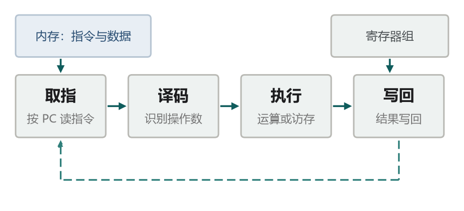
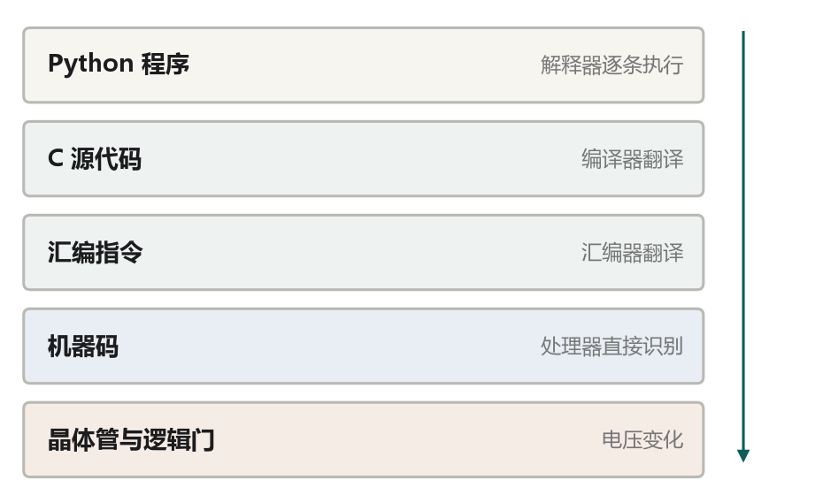
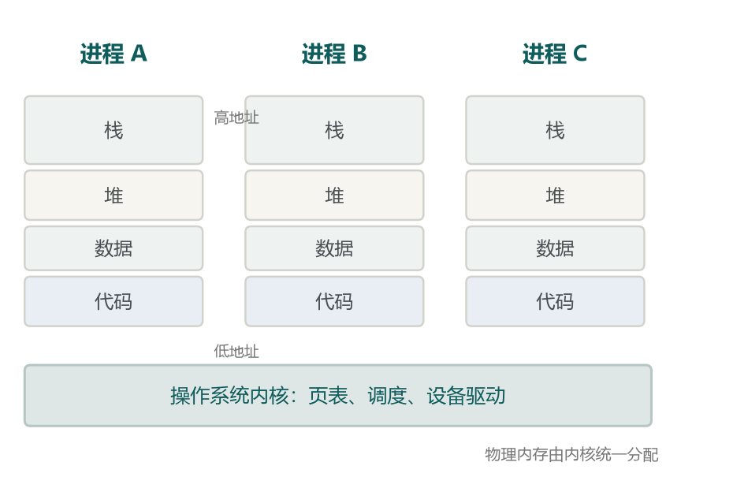
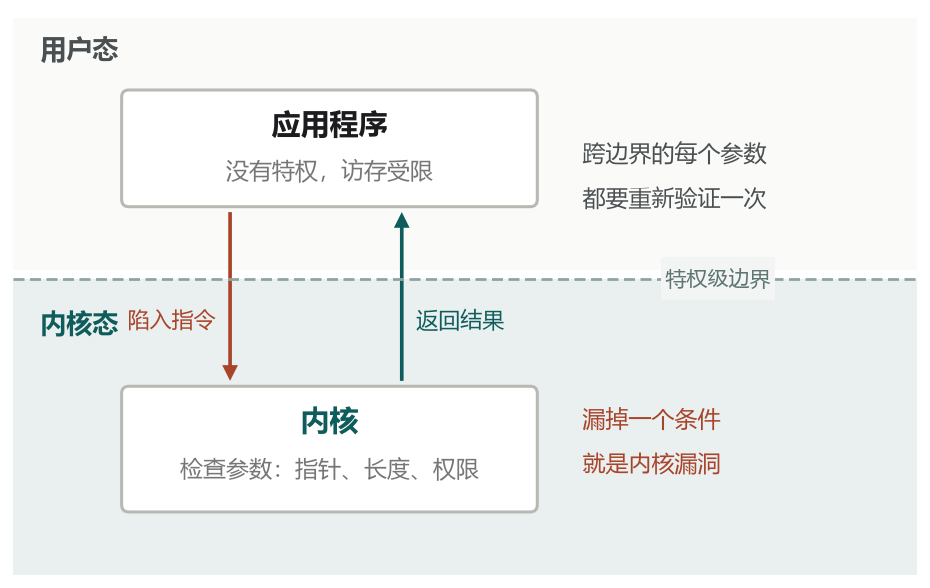
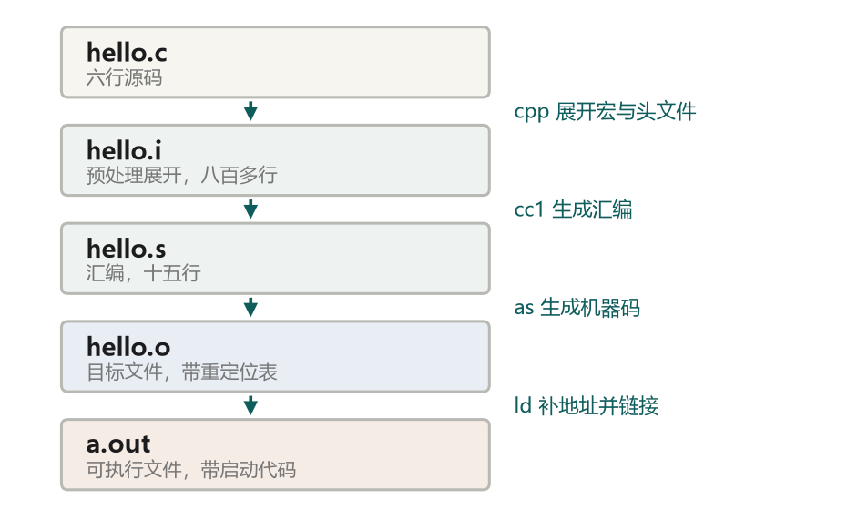

# 第一章　程序是怎样跑起来的

你在浏览器里点了一个链接，页面打开了。中间隔了不到一秒，跨越了几千公里的光纤、十几台你从未听说过的设备，还有你自己电脑里几千万行代码。整个过程顺利得让人习以为常，以至于很少有人会停下来问一句，它究竟是怎么做到的。

这一章要回答的是更靠下的一层问题。抛开网络，抛开浏览器，一台计算机在打开电源之后，到底在做什么。这个问题看起来很基础，但它决定了后面所有章节的样子。因为所有的入侵，最终都要落到同一件事情上，让这台机器执行一段它原本不该执行的指令。如果不清楚机器是怎么执行指令的，就没办法理解别人是怎么插进去的。

## 1.1 一台只会服从的机器

先看一个容易被忽略的事实。计算机不理解你的意思。

你在键盘上敲下“删除”两个字，它并不知道这两个字代表什么。它把按键的位置编号记录下来，交给一个程序，程序按照预先写好的规则去查一张表，发现这个编号对应的字符是“删”，于是把它显示在屏幕上。整个过程里没有任何一个环节涉及“理解”，只有查表和搬运。

这个特点贯穿了计算机的每一个层次。文字处理软件不知道你写的是情书还是合同，它只负责把字符放进内存、把字形画到屏幕。编译器不知道你的程序想解决什么问题，它只负责把一种形式翻译成另一种形式。CPU 更不知道自己在算什么，它只是按照指令的要求，把某些比特从一个地方搬到另一个地方，或者做一次加法。

有人把计算机比作一个极其勤奋但完全没有判断力的职员。你说什么它就做什么，做错了也不提醒你，因为它根本不知道什么叫做错。这个比喻有助于理解后面的事情。所谓黑客技术，很大程度上就是研究如何让这位职员做一件它的雇主没有打算让它做的事，而它自己完全意识不到有什么不对。

## 1.2 从开关到加法

要理解指令，得先理解机器里最小的零件。

最早的电子计算机用真空管，后来的机器用晶体管。晶体管在电路里扮演的角色非常朴素，它可以被看成一个由电压控制的开关。给它一个高电压，它就导通，让电流通过；给它低电压，它就截止。仅此而已。

把两个这样的开关串联起来，只有两个都导通时电流才能通过，这就是“与”。并联起来，只要有一个导通电流就能通过，这就是“或”。再加一个把输出反过来的接法，就是“非”。这三个动作构成了逻辑运算的全部基础，其他所有复杂的运算都可以由它们组合出来。

用“与”“或”“非”搭出加法器是一件很有耐心的工作。两个一位二进制数相加，有四种情况，其中三种的结果可以直接用异或算出来，剩下一种需要进位，用与门就能判断。把 32 个这样的一位加法器首尾相连，让进位信号一级一级传下去，就得到了一个能算 32 位加法的电路。减法可以用补码变成加法，乘法可以变成若干次加法与移位。到了这一步，机器已经能算算术了。

真正关键的下一步是存储。计算完的结果要放回某个地方，下次还要能取出来。用两个首尾相接的“非”门可以锁住一个比特，输入一个脉冲就翻转，没有脉冲就保持不变。这就是触发器，是寄存器和内存的基本单元。有了存储，机器才有可能执行“一系列”操作，而不只是算一次就结束。

1945 年，冯·诺依曼在一份关于 EDVAC 计算机的报告草稿里提出了一个想法，把指令和数据放在同一存储器里。这个想法今天听起来平平无奇，在当时却是一个转折。在此之前，很多计算机的“程序”是通过重新接线或者更换插件板来改变的，机器和人一样，改一次行为要动一次手。把指令也变成数据之后，改变机器的行为只需要改变存储里的内容。

这件事的后果远比它的表述重要。指令和数据共享同一个空间，意味着它们在物理上没有区别。一串比特，既可以解释成一条指令，也可以解释成一个数字，取决于谁在读它、以什么方式读它。第二章和第六章会反复用到这一点。

## 1.3 一条指令的旅程

现代处理器的内部结构极其复杂，但对外呈现的模型出奇地简单。它有几个寄存器，一块可以按地址访问的内存，还有一组固定的指令。所谓寄存器，是处理器内部极少量的高速存储，x86-64 架构里有十几个通用寄存器，每个能放 64 位。内存则是几个 GB 甚至几十 GB 的空间，按字节编址。

处理器做的事情可以概括成一个循环。

它先看程序计数器，这个寄存器里存着下一条指令的地址。处理器按照这个地址去内存里取回几个字节，这几个字节就是一条指令。取回来之后要译码，也就是弄清楚这条指令要做什么操作、操作数在哪里。接着执行，可能是做一次加法，可能是从内存读一个数，也可能是判断某个条件然后决定跳到哪里。最后把结果写回寄存器或者内存，程序计数器指向下一条指令，循环继续。

<figure>

<figcaption>图 1-1　处理器的指令周期。程序计数器指向下一条指令，取指、译码、执行、写回四个阶段周而复始，分支指令会改写程序计数器的值，从而改变执行路径。</figcaption>
</figure>

一条指令到底长什么样，可以直接看。x86-64 里有一条指令的机器码是这样的。

```text
48 01 D8        add rax, rbx
```

前两个字节是前缀和操作码，表示这是一次 64 位加法，后面一个字节说明操作数用的是哪两个寄存器。这条指令的意思是，把 rbx 里的数加到 rax 里，结果留在 rax。执行这条指令，处理器内部大概要做几次门电路的翻转，时间以纳秒计。

人不可能直接写这种十六进制。于是有了汇编语言，给每条机器指令起一个助记符，`add` 就是加法，`mov` 就是搬运。汇编和机器码是一一对应的，写汇编差不多等于直接指挥硬件。再往上，C 语言把“把两个数加起来”写成 `a + b`，编译器负责把它翻译成一条或几条指令。Python 又隔了一层，解释器在运行时决定要做什么，对程序员隐藏了几乎所有细节。

<figure>

<figcaption>图 1-2　从人类书写的代码到晶体管之间的层次。每一层都向下翻译，向上隐藏细节。层次越多，写程序越容易，但出了问题也越难看清究竟发生在哪一层。</figcaption>
</figure>

层次感是理解安全问题的一把钥匙。同一个现象在不同层次上有完全不同的解释。一个网页被篡改，在应用层看是输入没有过滤，在系统层看是文件权限设置不当，在网络层看是证书校验被绕过。搞不清现象发生在哪一层，就很难判断该在哪里修补，也容易被一些听起来很专业的说法唬住。

## 1.4 条件判断是怎么变成电路的

有一件事值得单独看一眼，因为它和后面的漏洞关系密切。

程序里的 `if` 在机器层面到底是什么？答案是一条条件跳转指令。处理器里有一组标志位，记录上一次运算的结果是不是零、有没有溢出、是不是负数。条件跳转指令读这些标志位，如果条件成立，就把程序计数器改成另一个地址，不成立就顺序执行下一条。

也就是说，“程序的走向”在物理上就是程序计数器里的一个数字。谁能改动这个数字，谁就能改变程序接下来要做的事。

正常途径只有一条，就是执行跳转、调用、返回这几类指令。但程序计数器本质上只是一个寄存器，值是可以被覆盖的。如果某段代码因为疏忽，把用户输入写到了不该写的地方，而那个地方刚好存着程序计数器即将用到的地址，那么程序的走向就落到了输入者的手里。

第六章会把这件事故意做出来，十几行代码就够。这里先记住一句，程序的执行路径不是抽象的，它存在一个具体的存储位置上。

## 1.5 进程，让一台机器同时做很多事

一台电脑同时开着浏览器、音乐播放器和十几个后台服务，但 CPU 通常只有几个到十几个核心。这种“同时”是造出来的。

操作系统把 CPU 的时间切成很短的片段，一般几毫秒到几十毫秒，轮流分配给不同的程序。切换的速度快到人感觉不出来，于是看起来像是同时在跑。每个被调度的单位叫作进程，它由两部分组成。一部分是程序本身，也就是磁盘上的那些指令；另一部分是运行时的状态，包括内存里的数据、寄存器的值、打开的文件、当前执行到哪一行。

这些状态被操作系统集中记录在一个数据结构里，通常叫进程控制块。切换进程时，操作系统把当前进程的寄存器值保存起来，把下一个进程的值恢复到寄存器里，然后跳过去继续执行。对每个进程来说，中间发生了什么它并不知道，它只觉得自己一直在独占整台机器。

<figure>

<figcaption>图 1-3　三个进程各自的地址空间与操作系统内核。每个进程都以为自己独占了一整块连续的地址，实际的物理内存在操作系统手里统一分配，进程之间互不可见。</figcaption>
</figure>

为了让每个进程都觉得自己独占内存，操作系统引入了虚拟内存。进程看到的地址是虚拟地址，需要经过一层映射才能变成物理地址。这层映射由硬件完成，映射表由操作系统维护。好处很多。程序不用关心别的程序占了哪块内存，操作系统可以把不常用的页换到磁盘上，还可以给不同的页设置不同的权限，比如某块内存只能读不能写，某块内存只能由内核访问。

第二章会详细讲这张映射表和它上面的几个区域。现在只需要记住，进程之间的隔离不是靠礼貌，而是靠硬件强制的地址翻译。任何一次访存都要经过检查，不符合权限的访问会直接触发异常，程序被操作系统当场终止。这个机制是整座安全大厦的地基之一，也是为什么大多数漏洞只能在“当前进程的权限范围内”造成破坏。

## 1.6 用户态与内核态

进程能做的事情是受限的，这个限制来自处理器本身。

处理器有两种运行状态，通常称为特权级。运行在低特权级时，一部分指令是不能执行的，比如修改页表、关闭中断、直接读写磁盘控制器。运行在高特权级时，这些限制都不存在。大多数操作系统只使用这两个级别，把应用程序放在低特权级，把自己放在高特权级，前者叫用户态，后者叫内核态。

应用程序要读写文件、发送网络数据、创建新进程，都必须请求内核代为执行。请求的方式是一条专门的指令，执行它会让处理器切换到高特权级，跳转到内核中一个预先登记好的入口。这类入口在 Linux 上叫系统调用，Windows 上叫系统服务，本质上是一回事。

<figure>

<figcaption>图 1-4　一次系统调用的往返。用户程序把参数放进约定的寄存器，执行陷入指令，处理器切换到内核态，内核检查参数后完成操作，再把结果带回用户态。所有跨越这条边界的参数都必须被检查。</figcaption>
</figure>

这条边界是整个系统里最重要的检查点。内核不能假设用户程序是善意的，因为用户程序可能被替换、被篡改、被欺骗。每收到一个参数，内核都要验证它是否合法，指针是否指向用户自己的内存，长度是否超出范围，权限是否足够。历史上大量的严重漏洞，就出在这些验证漏掉了一两个条件的时候。一旦内核漏检，攻击者就能在最高特权级下执行任意操作，整台机器随之失守。

从另一个方向看，这条边界也解释了为什么很多恶意程序非要往内核里钻。拿到内核权限意味着可以隐藏自己、可以拦截其他程序的动作、可以在系统启动的最早阶段就获得控制权。第十五章讲杀毒软件为什么要装驱动，原因也在这里。

## 1.7 机器相信什么

把这一章的内容收拢一下。

一台计算机做的事情，是不断地从内存取出指令并执行。它不判断指令的来源是否正当，不判断执行的结果是否符合主人的意愿，也不判断这条指令是不是刚刚被某个输入覆盖过。它只执行。

这带来一个很朴素的安全模型。机器的安全性依赖于三件事，指令来自合法的途径，数据待在它该待的地方，身份的判断依据是真的。任何一条被破坏，机器就会做出主人没有预期的事情。

后面几章会沿着这三条线展开。破坏第一条的，是在内存里塞进自己的指令，第六章和第七章讲这些。破坏第二条的，是让数据溢出到别的地方，或者让数据和指令的边界消失，第八章和第九章讲这些。破坏第三条的，是冒充别人，或者让别人相信一个假的身份，第三篇整篇都在讲这个。

## 1.8 四个程序接力

写一个 `hello.c`，敲一条 `gcc`，屏幕上什么都不出现，目录里多了一个 `a.out`。中间其实有四个独立的程序按顺序工作，每一步都能单独停下来看结果。

```bash
gcc -E hello.c -o hello.i     # 预处理：展开头文件与宏
gcc -S hello.i -o hello.s     # 编译：生成汇编
gcc -c hello.s -o hello.o     # 汇编：生成目标文件
gcc hello.o   -o hello        # 链接：拼成可执行文件
```

`gcc` 本身只是一个调度器，看文件后缀决定去调谁。预处理交给 `cpp`，编译交给 `cc1`，汇编交给 `as`，链接交给 `collect2` 和 `ld`。把四条命令分开敲一遍，最直观的收获是每一步的产物体积。

```text
$ wc -l hello.c hello.i hello.s
    6 hello.c
  823 hello.i
   15 hello.s
```

六行源码预处理之后变成八百多行，因为 `#include <stdio.h>` 会把整条包含链展开，`stdio.h` 又带进 `stddef.h`、`bits/types.h`、`bits/libc-header-start.h` 等等。这些内容最后一件也没剩下，`printf` 的声明在汇编里只体现为一个符号名。

```asm
    .section .rodata
.LC0:
    .string "hello"
    .text
    .globl  main
    .type   main, @function
main:
    pushq   %rbp
    movq    %rsp, %rbp
    leaq    .LC0(%rip), %rdi
    movl    $0, %eax
    call    printf@PLT
    movl    $0, %eax
    popq    %rbp
    ret
```

到了这一步，符号 `printf` 还只是一个名字，地址是空的。汇编器把 `call` 编成 `e8 00 00 00 00`，后面的四个零是占位符，同时在 `.rela.text` 里记一笔“这个位置要填 `printf` 的地址”。`.o` 文件里最有价值的信息就是这张重定位表，它告诉链接器哪里有洞要补。

`.o` 和 `a.out` 都是 ELF 格式，头部 64 字节，字段是固定的。

```text
$ readelf -h hello.o
  Class:                             ELF64
  Type:                              REL (Relocatable file)
  Machine:                           Advanced Micro Devices X86-64
  Entry point address:               0x0
  Size of this header:               64 (bytes)
  Number of section headers:         13
```

`Type` 一栏值得记住。`REL` 是可重定位的目标文件，`EXEC` 是固定地址的可执行文件，`DYN` 是位置无关的可执行文件。链接之后 `Entry point address` 会变成一个真实的地址，而它指向的不是 `main`，是一个叫 `_start` 的函数。`_start` 由 `crt1.o` 提供，链接时被悄悄塞进来，它从栈上取出 `argc` 和 `argv`，初始化 libc，然后才 `call main`，`main` 返回之后再调 `exit`。

节区表是另一份值得看的东西。

| 节区 | 内容 |
|---|---|
| `.text` | 机器指令，只读可执行 |
| `.rodata` | 字符串字面量和常量，只读 |
| `.data` | 有初值的全局变量 |
| `.bss` | 无初值的全局变量，不占文件空间 |
| `.symtab` | 符号表，函数名与变量名到地址的对应 |
| `.dynamic` | 动态链接需要的信息 |

`.symtab` 这一项和后面的章节关系最大。它把每个函数的名字和地址一一列出，逆向一个没有符号的二进制和在 `.symtab` 里直接读到 `check_password`、`decrypt`，工作量差一个量级。发布之前跑一次 `strip`，这份表就被删掉了，代价是崩溃时的调用栈里只剩地址。

链接有两种做法，差别能直接从体积上看出来。

```bash
$ gcc -static hello.c -o hello_static
$ gcc hello.c -o hello_dynamic
$ ls -l hello_static hello_dynamic
-rwxr-xr-x 1 alice alice 762856 Nov 27 10:20 hello_static
-rwxr-xr-x 1 alice alice  16304 Nov 27 10:20 hello_dynamic
```

静态版本七百多 KB，把用到的库代码全部复制了进来，跑起来不依赖任何 `.so`。动态版本只有十几 KB，`ldd hello_dynamic` 会列出 `libc.so.6` 和 `ld-linux-x86-64.so.2`，真正的代码在运行时才被映射进来。

`call printf@PLT` 里的 PLT 是一小段跳板。第一次调用时它跳到动态链接器，由链接器找到 `printf` 的真实地址，把结果写进 GOT，之后再调用就直接从 GOT 里取地址跳过去。GOT 是一张存在数据段里的函数地址表，也就是说它默认是可写的。这个细节在第七章讲 RELRO 时会再出现，一次任意地址写如果能改掉 GOT 里的某一项，下一次调用那个函数就会跳到别处。

<figure>

<figcaption>图 1-5　从源码到可执行文件的四个阶段。每一步的输出都是下一步的输入，预处理展开文本，编译生成汇编，汇编生成带重定位表的目标文件，链接补上地址并拼进启动代码与库。</figcaption>
</figure>

## 1.9 一纳秒有多长

前面反复说处理器以纳秒计、网络以毫秒计，这两档之间差了多少个数量级，值得单独摆一张表。Peter Norvig 在 2001 年的一篇文章里列过一版，Jeff Dean 在 2009 年的演讲里整理成“每个程序员都应该知道的延迟数字”，后来 Colin Scott 做成可交互的版本并按 2020 年前后的硬件更新了一次。

| 动作 | 耗时 |
|---|---|
| 一级缓存命中 | 1 ns |
| 分支预测失败 | 3 ns |
| 二级缓存命中 | 4 ns |
| 互斥量加锁与解锁 | 17 ns |
| 一次内存访问 | 100 ns |
| 压缩 1 KB 数据 | 2 μs |
| 固态盘随机读 4 KB | 16 μs |
| 同机房两台机器往返 | 500 μs |
| 机械盘寻道 | 2 到 10 ms |
| 加州到荷兰往返 | 150 ms |

换一个尺度看会更清楚。把一个时钟周期（约 0.3 纳秒）放大成一秒，那么一次内存访问是 5 分半钟，一次固态盘随机读是 15 个小时，一次跨大西洋的往返是 16 年。写代码时觉得“差不多快”的两个操作，在机器眼里可能差着四个数量级。

这张表解释了后面几件看起来不相干的事。

缓存命中与内存访问差 100 倍，这个差距大到可以被测量，于是就有了通过测量访问时间来判断数据在哪一层缓存的攻击手法。第七章的 Spectre 就是靠这个把推测执行读到的字节一个个搬出来。

远程猜地址不可行，也是因为这些数字。一次失败的尝试要付一个往返，跨国链路上算 150 毫秒，一天二十四小时不停也只能试 57 万次。要在一个 64 位地址空间里碰运气，这个次数连零头都不算。所以远程利用必须先泄漏一个地址，把搜索空间从 2 的 64 次方压到几十种可能。

反过来，本地攻击者的处境宽松得多。同一个进程内的两次操作间隔可以是几百纳秒，能反复测量、反复对齐、反复重试，时间精度成了他手里的工具。

密码比较的泄漏也是这个道理。很多实现写着 `memcmp(a, b, len)`，它在第一个不同的字节处就返回，比较时间正比于匹配的前缀长度。单次差几纳秒，看不出任何东西；平均一百万次，前缀长度就能被稳定地测出来。2003 年 Brumley 和 Boneh 用这个方法攻击 OpenSSL 的 RSA 实现，从局域网的计时里恢复出了私钥因子。

事情的另一面是，这些数字决定了防护能做到多细。审计日志的时间戳精度通常在毫秒，因为再细会拖慢系统；内核里的时间测量可以到纳秒，因为它读的是处理器内部的计数器，不经过任何系统调用。谁站在哪一层，决定了他能看到多细的时间。

不过在往下走之前，还需要把地基再打深一层。上一节提到进程看到的是一块虚拟的连续内存，这块内存里到底放了些什么，函数调用的时候栈上发生了什么，为什么数组越界能改到返回地址。这些问题的答案在第二章。

<div class="chapter-end"></div>
