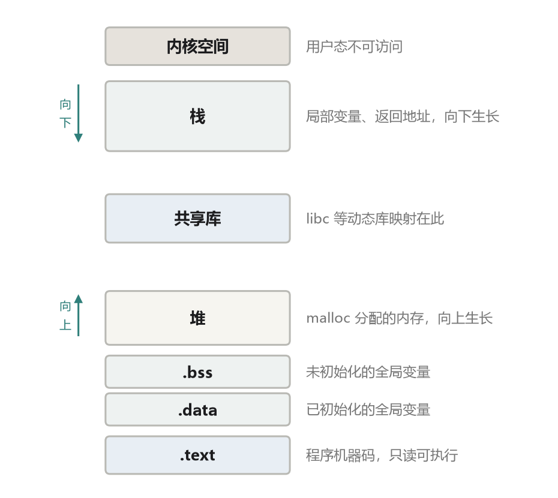
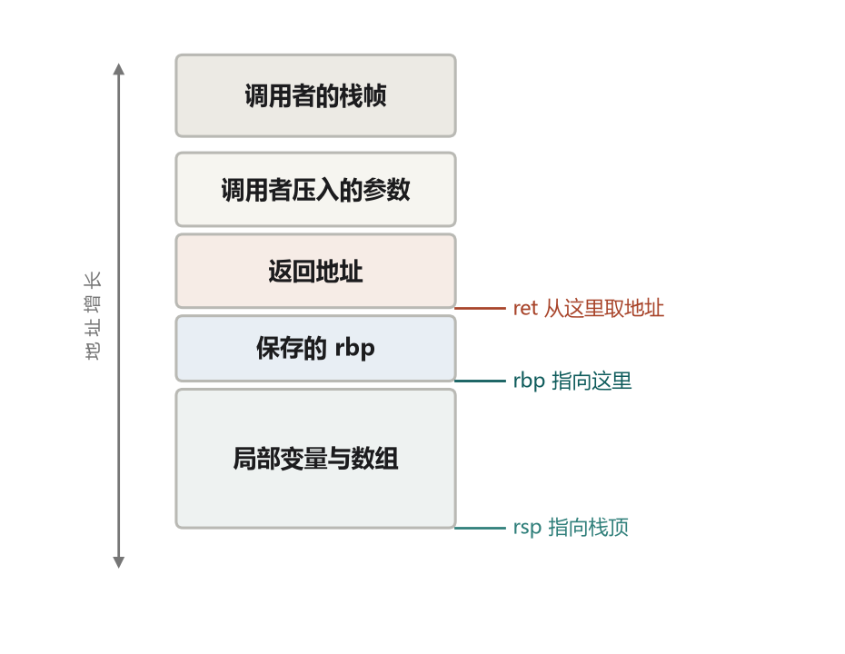

# 第二章　内存的秩序

写 C 语言的人大多遇到过一种错误，程序在某个函数里读了一个字符串，没检查长度，直接拷进一个固定大小的数组。跑测试的时候一切正常，上线之后某一天，进程毫无征兆地退出了，日志里只有一行 "Segmentation fault"。

更奇怪的事情发生在它被人故意触发的时候。同样的越界，如果拷进去的内容是精心构造的，程序不但不会退出，还会跳到一个它原本永远不会执行的地方去。要理解这件事，必须知道一个函数被调用时，内存里到底发生了什么。

这一章讲的是地址空间。它是一张地图，标着哪块地方放代码，哪块放全局变量，哪块放临时数据，每块地方允许什么操作。后面几章的所有内存类漏洞，都发生在这张地图的某个角落。

## 2.1 一块被切开的地址空间

第一章说过，进程看到的是一整块连续的虚拟地址。这块空间在 64 位系统上通常有几十 TB，绝大部分是空的，真正用到的部分被切成若干段，每段有自己的用途和权限。

最底下（或者说最低的地址）放的是程序本身的机器码，这一段叫代码段，也叫 `.text`。它的权限是只读和可执行，写入会直接触发异常。这个设计的意义很大，代码是程序里最不应该被改动的东西。

代码段上面是已初始化数据段，存放有初值的全局变量和静态变量，比如 `int counter = 1;`。再往上是一段叫 `.bss` 的区域，存放没有初值或者初值为零的全局变量。操作系统在加载程序时会把这块区域清零，而且不占用可执行文件的空间，一个几 MB 的全局数组在文件里可能只占几字节。

再往上，是运行时才长长的一段，叫堆。程序调用 `malloc` 或者 `new` 时，分配器从这一段里划出一块给它。堆向上生长，越用越高。

地址空间的最高处是栈。函数调用时的局部变量、参数、返回地址都放在这里。栈向下生长，和堆相向而行，中间的空隙就是两者共用的剩余空间。

还有一些区域不属于这个进程自己的东西。共享库被映射到地址空间的中间某处，动态链接器把 `printf` 这样的函数从 C 库映射进来。地址空间的最顶端是内核区，用户态的代码无法访问，只有陷入内核之后才能碰到。

<figure>

<figcaption>图 2-1　一个进程的虚拟地址空间。代码段只读可执行，数据段与 .bss 存放全局变量，堆向上生长，栈向下生长，共享库映射在中间，最顶端的内核区用户态不可访问。</figcaption>
</figure>

之所以要这样切分，是为了让不同性质的数据有不同的权限。代码只读，这样可以防止程序把自己改掉；栈和堆可读可写但不可执行（现代系统上），这样可以防止写进去的数据被当成指令执行。第七章会讲，这条规则曾经不存在，后来才被加上，而加上之后攻击者立刻找到了绕过的方法。

分段的另一个好处是效率。程序启动时不需要真的把整个可执行文件读进内存，操作系统只建立映射，等某块内存真正被访问时才从磁盘读入对应的页。一个几百 MB 的程序，可能只有几十 MB 真正被用到过。

## 2.2 指针就是地址

C 语言里最容易让人迷糊的东西是指针，但只要接受一件事，它就变得很朴素。指针的值就是一个数字，这个数字是某个字节在地址空间里的编号。

```c
int a = 42;
int *p = &a;
printf("%d\n", *p);   /* 输出 42 */
```

`&a` 取的是 `a` 这个变量所在位置的地址，`p` 里存的就是那个数字。`*p` 的意思是"去这个地址上读一个 int"。在机器码层面，这几行分别对应取地址、存指针、按指针访存三种指令，没有更多玄机。

数组和指针的关系同样简单。`int arr[10];` 在栈上划出 40 个字节，`arr` 这个名字在大多数表达式里会退化成指向第一个元素的地址，`arr[i]` 等价于 `*(arr + i)`，也就是"从起始地址往后数 i 个 int，然后取那个位置的值"。

这套规则有一个后果，就是编译器不检查 `i` 有没有超出 10。它只负责算出地址，然后读写，至于这个地址是不是还在数组里，它不知道也不问。C 语言在设计时把这当成一种效率优势，程序员知道自己在做什么，不需要运行时替他把关。这个假设在很多年里成立，直到程序开始处理来自网络的数据。

## 2.3 函数调用时发生了什么

调用一个函数，机器层面要做四件事。把参数放到约定的位置，把返回地址保存起来，跳转到函数的第一条指令，函数执行完再跳回返回地址。

x86-64 上，前六个整型参数分别放在 `rdi`、`rsi`、`rdx`、`rcx`、`r8`、`r9` 六个寄存器里，更多的参数压到栈上。返回值放在 `rax`。跳转由 `call` 指令完成，它做两件事，把下一条指令的地址压入栈，然后把程序计数器改成目标地址。压进去的那个地址就是返回地址，函数执行到 `ret` 时，处理器从栈顶弹出它，放回程序计数器。

栈因此成了函数调用的记账本。为了不把账记乱，编译器给每个函数安排一段自己的栈空间，称为栈帧，用 `rbp` 寄存器标记它的起点。

一个典型的函数开头是这样的。

```asm
push   rbp              ; 保存调用者的帧指针
mov    rbp, rsp         ; 当前栈顶成为本帧的基点
sub    rsp, 0x20        ; 留出 32 字节给局部变量
```

结尾是相反的动作。

```asm
mov    rsp, rbp         ; 收回局部变量占的空间
pop    rbp              ; 恢复调用者的帧指针
ret                     ; 弹出返回地址并跳转
```

这个约定带来一个非常整齐的布局。以 `rbp` 为基准，`rbp-8`、`rbp-16` 这样的负偏移是局部变量，`rbp+8` 是返回地址，`rbp+16` 往后是调用者压进来的参数。局部变量和返回地址挨得很近，中间只隔着一个保存的 `rbp`。

<figure>

<figcaption>图 2-2　x86-64 上的栈帧。局部变量位于 rbp 的负方向，返回地址位于 rbp+8。数组越界向高地址写时，最先遭殃的往往是保存的 rbp 和返回地址。</figcaption>
</figure>

把这个图记住，第六章会反复用到。一个 10 字节的数组如果被写进 40 字节的数据，多出来的 30 字节会顺着地址往上盖，盖掉相邻的局部变量，盖掉保存的 `rbp`，再往上就是返回地址。函数执行到 `ret` 时，弹出来的已经不是原来那个地址了。

## 2.4 一个具体的例子

把上面这些东西落到一段真实的代码上，看看编译器做了什么。

```c
int add(int a, int b)
{
    int c = a + b;
    return c;
}

int main(void)
{
    return add(1, 2);
}
```

用 `gcc -O0 -S` 生成的汇编大致是这样。

```asm
add:
    push   rbp
    mov    rbp, rsp
    mov    DWORD PTR [rbp-0x14], edi   ; 参数 a 放进本帧
    mov    DWORD PTR [rbp-0x18], esi   ; 参数 b 放进本帧
    mov    edx, DWORD PTR [rbp-0x14]
    mov    eax, DWORD PTR [rbp-0x18]
    add    eax, edx
    mov    DWORD PTR [rbp-0x4], eax    ; 结果写入局部变量 c
    mov    eax, DWORD PTR [rbp-0x4]
    pop    rbp
    ret

main:
    push   rbp
    mov    rbp, rsp
    mov    esi, 2
    mov    edi, 1
    call   add
    pop    rbp
    ret
```

可以看到，即使是最简单的加法，参数也被从寄存器搬到了栈上。这是关闭优化时的典型结果，编译器为了调试方便，让每个变量都能在内存里找到位置。开启优化之后这些搬运会消失，但那是另一回事，讲漏洞时通常假定没有优化，因为有问题的那类代码本来就写得很笨。

注意 `main` 里 `call add` 之前的两行，`mov esi, 2` 和 `mov edi, 1`，参数是按约定放进寄存器的。`add` 一进来就把它们存到 `rbp-0x14` 和 `rbp-0x18`，于是参数和局部变量挤在同一块栈空间里，离返回地址不远。

## 2.5 堆，手动管理的内存

栈上的空间在函数返回时自动回收，编译器知道每个函数需要多少，在编译期就安排好了。但有些东西的大小要到运行时才知道，比如读进来一段长度未知的文本，或者一个可以动态增删的列表。这类内存从堆上分配。

```c
char *buf = malloc(1024);
if (buf != NULL) {
    strcpy(buf, "hello");
    free(buf);
}
```

`malloc` 向分配器要 1024 字节，分配器从堆里找一块够大的空闲区域，返回它的起始地址。这块区域前面通常有几个字节的头部，记录着它的大小和状态，`free` 就是靠这些信息把区域还回去并与相邻的空闲块合并。

堆的管理比栈复杂得多，因为申请和释放的顺序是任意的。反复申请释放不同大小的块，会在堆里留下许多碎片，分配器要花时间去找合适的空隙。为了效率，不同的分配器用了各种技巧，比如按大小分类的空闲链表、为小对象预留的内存池。

从安全的角度看，堆的麻烦在于它是数据密集区，里面既有程序的数据，也有分配器自己的记账信息。如果一次越界写恰好改掉了某个块的头部，那么下一次 `free` 时分配器就会按照被改过的信息去操作链表，可能把一个任意地址写到任意位置。这类攻击在 2000 年代非常流行，后来分配器加了一堆校验才把门槛抬高。

<figure>

<figcaption>图 2-3　堆块的典型结构。用户拿到的指针指向数据区，头部记录块大小与前后块的位置，分配器依赖这些信息做合并与复用。头部一旦被越界写入破坏，后续的分配与释放就可能落到攻击者指定的地址上。</figcaption>
</figure>

## 2.6 为什么边界没人检查

读到这里，很多人会有一个疑问。既然越界会出事，为什么不在每次数组访问时检查一下下标。

答案有两层。

一层是历史。C 语言诞生在 1972 年，那时候的机器只有几十 KB 内存，编译器要在有限的资源里榨出每一点性能。给每次访存加一次比较和跳转，在当时的硬件上代价可观，而且写 C 的人普遍认为自己是在写系统软件，边界该由自己保证。

另一层更根本。C 语言里数组和指针几乎是一回事，一个函数收到 `int *p` 这样的参数时，根本不知道 `p` 指向的数组有多长。要检查就必须把长度一起传进来，这改变了语言的基本形态。后来的语言做了不同的选择，Java、Python、Go 在数组访问时都会检查下标，越界直接抛异常；Rust 更进一步，在编译期用所有权和借用规则把大部分越界挡在门外。

代价是性能。检查本身不贵，现代处理器上的分支预测让它的开销很小，但完全消除越界还需要改变数据的表示方式，比如带上长度、加上哨兵。C 和 C++ 生态里积累了几十年的代码不能这样改，于是只能靠工具和规范去补，编译器的栈保护、地址随机化、静态分析都属于补丁式的办法。

这一段历史解释了一个现象。直到今天，每年披露的严重漏洞里仍有相当大的比例是内存越界，问题不在程序员不够小心，而在这门语言把"相信程序员"写进了设计里。当程序的输入来自互联网，这个信任就没有依据了。

## 2.7 一张有权限的地图

把这一章收一下。

进程的内存不是一团混沌，它有明确的区段划分，每段有固定的用途和权限。代码只读，栈和堆可读写但不可执行，内核区用户态碰不到。这些权限由页表描述，由处理器在每次访存时检查，违反就触发异常。

同时，栈上的布局是可预测的。局部变量、保存的帧指针、返回地址按固定顺序排列，偏移量由编译器算好。一个数组越界写，只要方向对，就一定会经过返回地址。

## 2.8 地址是怎么被翻译的

2.1 说进程看到的是一块连续的虚拟地址，页表负责把它变成物理地址，但没说翻译具体怎么做。这件事值得拆开看，因为后面很多防护都是往这张表里加一位。

x86-64 上一个虚拟地址只有 48 位有效，高 16 位是符号扩展。这 48 位被切成五段。

```text
 47      39 38      30 29      21 20      12 11        0
+----------+----------+----------+----------+-----------+
| PML4 索引| PDPT 索引|  PD 索引 |  PT 索引 | 页内偏移  |
+----------+----------+----------+----------+-----------+
    9 位       9 位       9 位       9 位      12 位
```

翻译一次要做四级查表。`cr3` 寄存器存着第一级表的物理地址，取虚拟地址的 47 到 39 位当下标，在那张表里取出一个 8 字节的表项，里面是下一级表的物理地址；再用 38 到 30 位当下标，如此四轮，最后拿到物理页的基址，加上低 12 位偏移，就是物理地址。

每级表有 512 项，每项 8 字节，正好一页 4 KB。四级下来覆盖 2 的 48 次方，256 TB。2020 年之后的部分处理器支持五级页表，地址宽度加到 57 位，能寻址 128 PB，为的是给持久内存和大型数据库留出空间。

表项里的位有明确含义。

| 位 | 名称 | 作用 |
|---|---|---|
| 0 | P | 为 0 时该项无效，访问会触发缺页 |
| 1 | RW | 0 只读，1 可写 |
| 2 | US | 0 只有内核能访问，1 用户态也可以 |
| 63 | NX | 为 1 时这一页不可执行 |

中间还有 A（accessed）和 D（dirty）两位，由处理器在访问时自动置位，操作系统回收内存时靠它们判断这一页最近有没有被碰过。第 7 位叫 PS，置 1 时表示这一项直接指向一个 2 MB 或 1 GB 的大页，后面几级表不用查了，代价是权限粒度变粗，一个 2 MB 的区域只能整体设成可写或不可写。

查四次内存太慢，所以处理器里有一组缓存专门存最近的翻译结果，叫 TLB。以 Skylake 为例，一级数据 TLB 有 64 项，二级的共享 TLB 有 1536 项，命中只要一个周期。不中就要走完四级，虽然每一级都会命中普通缓存，加起来仍然要几十个周期。进程切换要换 `cr3`，旧的翻译全部作废，为了减少这个开销，表项里带一个 PCID 字段给每个进程编号，切换时不必整个刷新。

48 位地址还有一个怪癖，叫规范地址。处理器只看低 48 位，高 16 位必须全部等于第 47 位的值，否则就是非规范地址，访问立即异常。`0x00007fffffffffff` 再往上一个字节就跳到 `0xffff800000000000`，中间那一段永远不可用。这也就是为什么 64 位程序里的指针经常以 `0x00007f` 开头，以及为什么内核空间的地址都以 `0xffff` 开头。

看真实的地址布局不用写代码，读 `/proc/self/maps` 就行。

```text
55d3c2f1d000-55d3c2f1e000 r--p 00000000 08:02 1048600  /usr/bin/cat
55d3c2f1e000-55d3c2f20000 r-xp 00001000 08:02 1048600  /usr/bin/cat
55d3c2f20000-55d3c22000 r--p 00002000 08:02 1048600  /usr/bin/cat
55d3c22000-55d3c23000 r--p 00003000 08:02 1048600  /usr/bin/cat
55d3c23000-55d3c24000 rw-p 00003000 08:02 1048600  /usr/bin/cat
55d3d5c0000-55d3d5e1000 rw-p 00000000 00:00 0        [heap]
7f0e2a0b6000-7f0e2a0bb000 r--p 00000000 08:02 525356   /usr/lib/x86_64-linux-gnu/libc.so.6
7ffd3a1b5000-7ffd3a1d6000 rw-p 00000000 00:00 0        [stack]
7ffd3a1f9000-7ffd3a1fa000 r-xp 00000000 00:00 0        [vdso]
```

每行的字段是起止地址、权限、文件内偏移、设备号、inode、路径。一个可执行文件被映射了五次而不是一次，因为代码段要 `r-x`，只读数据要 `r--`，数据段要 `rw-`，权限不同就不能放在同一个映射里。这就是 2.1 讲的分段在系统里的实际样子。

另一个值得注意的细节是，这一段里到处都是空洞。两行之间的地址可能跳开一大截，那段区域没有映射，碰一下就是段错误。`[vdso]` 那一行是内核放进去的一页代码，后面 3.8 会提到它。

启动时映射建好了，物理页却还没分配。第一次访问某个地址会触发缺页异常，内核这才去分一个物理页；如果是文件映射，就从页缓存里取。这叫按需调页。它在安全上的意义是，程序里一段从未执行过的代码，可能压根没有被读进内存。

## 2.9 结构体在内存里的样子

协议解析、文件格式解析的代码里到处是结构体。开发者照着文档把字段一个个写下来，然后对整块内存做一次 `memcpy`，以为内存排列和文档一致。多数时候并不一致。

C 的对齐规则两条就说得完。每个成员的偏移必须是它自身对齐值的整数倍；结构体总大小必须是最大成员对齐值的整数倍。

```c
#include <stdint.h>
#include <stdio.h>
#include <stddef.h>

struct msg {
    uint8_t  type;
    uint32_t len;
    uint8_t  body[3];
};

int main(void)
{
    printf("size=%zu type=%zu len=%zu body=%zu\n",
           sizeof(struct msg),
           offsetof(struct msg, type),
           offsetof(struct msg, len),
           offsetof(struct msg, body));
    return 0;
}
```

在 x86-64 上输出 `size=12 type=0 len=4 body=8`。文档里的三个字段加起来是 1+4+3 共 8 字节，实际占 12。`type` 后面塞了 3 个字节的填充，`body` 后面又补了 1 个，为了让这个结构体的数组在内存里每个元素都从 4 的倍数开始。

调一下顺序就能省出 4 字节。

```c
struct msg2 {
    uint32_t len;
    uint8_t  type;
    uint8_t  body[3];
};
```

`sizeof` 变成 8。字段一个不少，只是把对齐要求高的放到了前面。把 `uint8_t` 换成 `uint64_t`，差距更夸张，一个 `{uint8_t, uint64_t, uint8_t}` 占 24 字节，重排之后是 16。

对齐要求来自硬件。x86 允许非对齐访问，但一次跨缓存行的访问要拆成两次；ARM 在严格配置下遇到非对齐访问直接抛异常。编译器为了两头都安全，默认按自然边界排布。

真正麻烦的地方在于跨边界。把线上收到的字节直接 `memcpy` 进结构体，如果线上格式是紧凑的 8 字节而结构体是 12 字节，字段就会错位，写进 `len` 的其实是对方 `body` 的前四个字节。这类 bug 在解析二进制格式时非常常见，编译器不会报错，因为两边都是合法的代码。

反过来，加 `__attribute__((packed))` 让结构体紧凑，代码看起来对了，代价是每次访问成员都可能非对齐。在 x86 上慢一点，在 ARM 上可能直接崩溃。协议代码里更稳的写法是逐字段读写，或者用专门的序列化函数，不要指望编译器把你的结构体排成你想要的样子。

填充字节里是上一次用过的内存残留，这一点也和安全有关。用 `memcmp` 比较两个结构体时，填充区的垃圾会让本该相等的值比出不相等；把整个结构体发出去时，填充区会把栈上的残留数据一起泄漏。内核里这类“未初始化填充”泄漏出过好几个 CVE。

填充区的存在还有一个副作用。同一个结构体在 32 位和 64 位下大小不同，`long` 和指针的宽度变了，对齐要求也跟着变。按 `sizeof` 算出长度再跨机器传输，两边很容易对不上，表现出来的现象是“本地好的包一到服务端就解析错位”。

这两件事放在一起，构成了缓冲区溢出的全部条件。可预测的布局让攻击者知道该写多少字节才能碰到返回地址，可写的栈让这个写入能够发生，而返回地址决定了函数执行完之后去哪里。第三章会补上最后一块拼图，操作系统怎样把权限切成等级，让一个普通程序没办法直接做危险的事，以及它用来分隔等级的这道门为什么经常关不严。
