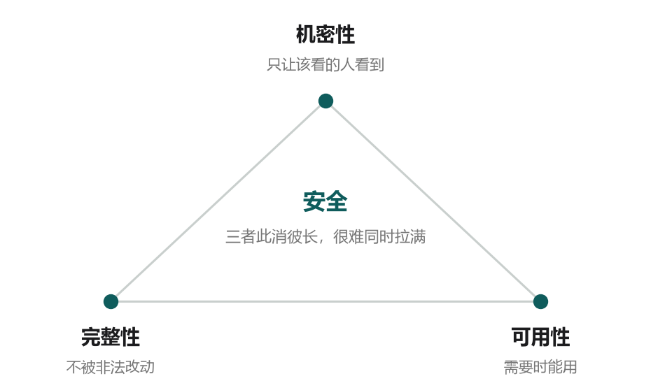
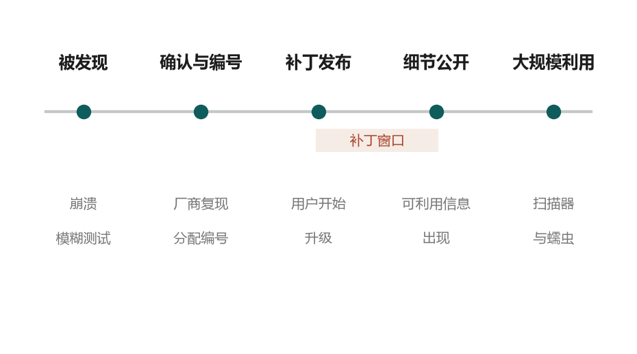
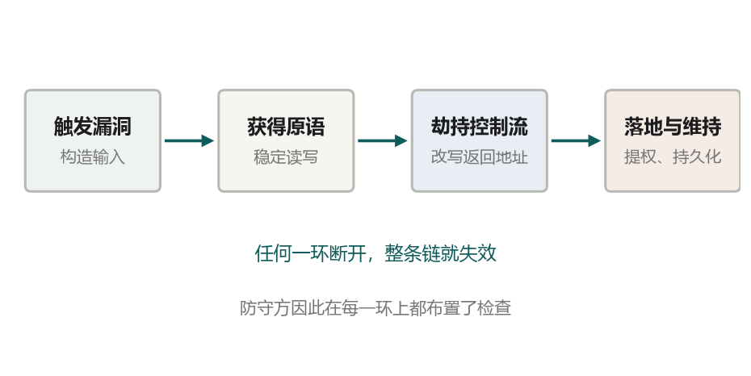

# 第五章　漏洞是什么

2008 年，一个十七岁的高中生用一个浏览器插件，把某社交网站上一个知名人物的私人照片批量下载了下来。事后调查发现，问题出在一个很普通的参数上。那个接口本该只返回当前用户有权查看的相册，但它接受了一个由客户端传来的用户编号，并且没有检查这个编号是不是本人。

代码写得不算马虎，功能测试也全过了。问题在于写代码的人做了一个假设，客户端传来的编号是可信的。这个假设在他写代码的那天也许成立，但接口一旦暴露在互联网上，任何假设都要重新审视。

漏洞这个词经常被用在很宽泛的场合，系统有漏洞、制度有漏洞、说法有漏洞。在计算机安全里，它有一个相对明确的含义，系统在某方面的实际行为，偏离了设计者以为的行为，并且这个偏离可以被用来造成损害。

## 5.1 安全到底在保什么

讨论漏洞之前要先明确保护的对象。安全领域有一套用了四十多年的分类，把目标拆成三条。

机密性是说信息只应该被该看到的人看到。泄露用户数据库、偷看别人的聊天记录、从内存里读走密钥，都是在破坏机密性。

完整性是说信息不应该被非法改动。篡改转账金额、往网页里插入脚本、替换软件更新包，破坏的是完整性。

可用性是说系统在需要的时候能用。DDoS 攻击、勒索软件加密文件、删库跑路，破坏的是可用性。

<figure>

<figcaption>图 5-1　安全的三个目标。真实的攻击往往同时破坏两条以上，勒索软件既加密文件破坏可用性，又以公开数据威胁机密性。</figcaption>
</figure>

这三条经常互相拉扯。把系统锁得越死，可用性越差；为了方便而放宽权限，机密性就受损。安全工程的大部分工作不是把某一项做到极致，而是在具体场景下找到平衡点。

## 5.2 先想清楚对手是谁

一句"我的系统安全吗"没法回答，因为没有参照。一个放在宿舍里、只连着校园网的旧笔记本，和一个存着几百万用户资料的服务器，需要的防护完全不同。

所以做安全的第一步是建立威胁模型。要回答四个问题。我在保护什么，谁想动它，他们能从哪儿进来，进来之后能造成多大损失。

拿学生最常见的场景举例。资产是笔记本里的作业、论文、聊天记录和几个网站的登录状态。对手可能是宿舍里好奇的同学、公共 Wi-Fi 上的抓包者、随机投放的勒索软件、以及专门盯着学生邮箱的钓鱼者。入口是物理接触、不安全的网络、下载的破解软件、邮件附件。损失从作业丢失到身份被盗用。

把这张表列出来，很多建议就变得有针对性了。全盘加密能防物理接触，但防不了钓鱼；双因素认证能防口令泄露，但防不了本地勒索软件。反过来，如果不做这一步，就只能照着"十条安全建议"盲目执行，既费劲又抓不住重点。

同一个词在不同威胁模型下含义也不同。企业内部说"内部网络是可信的"，指的是员工不会主动攻击；对攻击者来说，这句话等于"拿到任意一个员工账号就能横着走"。2013 年塔吉特百货的数据泄露就是这么发生的，攻击者先入侵了一家空调供应商，再借对方的网络访问权限进入收银系统。

## 5.3 漏洞是假设失效的地方

把形形色色的漏洞放在一起看，它们的共同点是某个假设被打破了。

最常见的假设是"输入是规整的"。开发者设想用户会在输入框里填一个正常的名字，不会填一万个字符，不会填一段 SQL，不会填一个负数。程序按正常输入写逻辑，遇到异常输入就露出了破绽。

第二类假设是"事情按顺序发生"。两个线程同时访问一份数据，开发者假设先检查后使用之间没人插进来。第八章会看到，这个缝隙足够大。

第三类假设是"这个地方的数据不会被当成那个东西用"。一段用户输入被送进 SQL 解释器，解释器把它当成语法；一个文件名被传给 shell，shell 把它当成命令；一个序列化字符串被反序列化，反序列化过程把它当成对象构造指令。数据跨越了它本不该跨越的边界，就变成了代码。

还有一类更麻烦，是设计层面的缺陷。协议本身没考虑认证，密码学算法的使用方式有漏洞，权限模型画错了边界。这类问题不是修一个函数能解决的，往往要改整个架构，所以存活时间特别长。前面讲的 ARP，后面要讲的 DNS，都属于这一类。

## 5.4 内存安全与逻辑漏洞

工程界习惯把漏洞分成两大类，虽然边界并不严格。

内存安全漏洞指的是程序在访问内存时越界、用了已经释放的空间、释放了两次、或者按错误的类型解释一段数据。缓冲区溢出、释放后使用（use-after-free）、双重释放、类型混淆都在这一类。它们的共同点是能让攻击者读写不属于自己的内存，一旦能稳定控制读写，距离执行任意代码就只有一步。

逻辑漏洞指的是程序逻辑本身有问题，但每次内存访问都合法。越权访问、竞态条件、认证绕过、业务规则被绕开，都属于这一类。它们往往更难被自动化工具发现，因为"正确"的标准写在人的脑子里，而不是编译器的规则里。

两类漏洞的比例可以从公开数据里看出一点。微软和谷歌都曾公开表示，他们每年修复的严重漏洞里大约七成是内存安全问题。这也是为什么最近十年业界在推 Rust 这类语言，它用编译期的规则把大部分内存错误挡在门外。但换语言是几十年尺度的工程，现有的 C 和 C++ 代码还得继续跑很多年。

## 5.5 一个漏洞的一生

漏洞从被发现到被利用，通常要走一条固定的路。

有人发现了问题，可能是在审计代码，可能是 fuzzing 跑出了一个崩溃，也可能是逆向时看到一段可疑的逻辑。接下来是验证，确认它能被触发，能造成什么影响。如果发现者是善意的，会联系厂商或者通过协调机构报告。厂商确认、分配编号、写补丁，同时通知下游的分发商。补丁发布之后，按惯例会给用户一段时间升级，然后公开细节。

CVE 编号就是这套流程的产物。它的格式是 CVE 加年份加序号，一个编号对应一个公开披露的漏洞。配套的 CVSS 分数用几个维度打出一个 0 到 10 的分，衡量利用难度和影响范围。这个分数经常被厂商拿来做宣传，但它只是一个粗略的参考，同一个 7.5 分在不同系统上的实际风险可能差很多。

<figure>

<figcaption>图 5-2　漏洞从发现到被大规模利用的时间线。补丁发布与用户完成升级之间的那段窗口，是防守方最被动的时候。</figcaption>
</figure>

最危险的一段是"补丁已发布、用户还没升级"。这时候漏洞的细节往往已经公开，攻击者可以照着补丁反推出问题所在，写出利用代码，而大量系统还停留在旧版本。很多大规模的入侵都发生在这几天到几周里。

比这更麻烦的是零日漏洞，也就是厂商还不知道、没有补丁的漏洞。它只能被少数人掌握，通常用在针对性很强的行动里。零日很贵，在黑市上价值几十万到上百万美元，所以不会浪费在普通目标上。

## 5.6 从漏洞到控制权

发现一个能让程序崩溃的输入，离入侵还很远。中间要跨过好几道坎。

第一道是可控性。崩溃说明程序访问了非法地址，但要利用它，攻击者得能控制访问的地址和写入的内容。一个只能让程序退出的越界读，价值远低于一个能改写返回地址的越界写。

第二道是可靠性。利用代码要在目标机器上稳定成功，不能十次里成功三次。地址随机化、编译选项、库版本都会影响结果，攻击者通常要针对具体环境调整。

第三道是现代缓解机制。栈保护、不可执行内存、地址随机化、控制流完整性，一层层加上去，把一个简单的溢出变成了需要串联多个技巧的工程。第七章会详细讲这场军备竞赛。

第四道是权限。就算拿到了代码执行，也只是当前进程的权限。要读别的用户的数据、要装驱动、要在重启后还在，还得继续往上爬，这就是第三章讲的提权。

<figure>

<figcaption>图 5-3　从漏洞到实际控制的链条。每一环都需要单独解决，任何一环断了，整条链就失效。防守方也因此在每一环上都设了关卡。</figcaption>
</figure>

把这条链看清楚，就能理解防守为什么会分层。只堵住其中一环，攻击者换一条路就绕过去了；每一环都提高一点成本，累积起来才让对方觉得不划算。

## 5.7 为什么修不完

软件行业发展了七十多年，漏洞不但没减少，每年披露的数量还在增加。原因不复杂。

系统越来越复杂。一个现代浏览器有几千万行代码，一个操作系统上亿行，任何一个人都不可能把它们全部理解。复杂系统里，组件之间的交互数量随组件数平方增长，而漏洞往往就藏在这些交互的缝隙里。

经济激励不对。写功能能赚钱，写安全不赚钱。产品经理催上线，测试资源有限，安全评审经常被放到最后一轮。等到出事，成本由用户承担。

遗留代码拖后腿。银行的核心系统、工厂的控制软件、医院的影像设备，很多还跑着二十年前写的代码，改一行要评估半年。这些系统不能停，也不能换，只能靠外围的隔离去限制它们的影响范围。

人的认知有边界。开发者只能考虑到自己想到的情况，而攻击者只需要找到一个没想到的。这个不对称决定了防守方永远处于被动。

## 5.8 一个漏洞编号里有什么

5.5 提到 CVE 编号和 CVSS 分数，这两个东西实际工作中天天要读，值得拆开看。

CVE 记录本身字段很少，编号、状态、描述、参考链接。描述通常两三句话，说的是某个产品的某个版本里，某个函数没有检查某个条件，导致某个后果。真正影响判断的信息在别处。

第一处是 CWE，也就是弱点类型。CVE 说的是这一个洞，CWE 说的是这一类洞。常见的有 `CWE-787` 越界写、`CWE-79` 跨站脚本、`CWE-89` SQL 注入、`CWE-416` 释放后使用、`CWE-20` 输入验证不当。MITRE 每年发一次 Top 25，2022 年的榜单里 `CWE-787` 排第一，`CWE-79` 第二，`CWE-89` 第三。排名的依据是 NVD 里各弱点对应的 CVE 数量和严重程度加权，所以它反映的是“过去两年披露得多”的分类，不是“最危险”的分类。设计层面的问题在榜单上几乎没有位置，因为它们的 CVE 数量少。

第二处是 CVSS 向量。一条完整的记录长这样。

```text
CVSS:3.1/AV:N/AC:L/PR:N/UI:N/S:U/C:H/I:H/A:H   9.8
```

斜杠隔开的是八个度量，每个取一个值。

| 度量 | 取值 | 本例含义 |
|---|---|---|
| AV 攻击途径 | N/A/L/P | 网络可达，不需要先进内网 |
| AC 攻击复杂度 | L/H | 低，不需要特殊条件 |
| PR 所需权限 | N/L/H | 不需要任何账号 |
| UI 用户交互 | N/R | 不需要受害者点任何东西 |
| S 影响范围 | U/C | 只影响这一个组件 |
| C/I/A | H/L/N | 机密性、完整性、可用性都受影响 |

八个值代进公式，基础分是 9.8。Log4Shell（CVE-2021-44228）把 S 取成 C，算出来是 10.0。按分数分档，7.0 到 8.9 叫高，9.0 以上叫严重，4.0 到 6.9 叫中。

这套分数的用处在排序，不在判断。一个 9.8 的洞如果在内网、在一个没人用的模块上，实际风险可能低于一个 7.5 但暴露在公网上的洞。

第三处是 NVD 的分析状态。一条记录会经历 `Awaiting Analysis`、`Analyzed`、`Modified` 几个阶段，中间状态意味着分数和 CWE 都是预估的，可能被改。批量披露的日子里，大量记录长时间卡在第一个状态，自动化工具读到的分数其实是空的。

第四处是“有没有被利用”。CISA 从 2021 年底开始公开维护一个已知被利用漏洞目录（KEV），进入目录的条件是有确凿的在野利用证据。目录到 2024 年超过一千条，美国联邦机构被要求按期限修复其中的漏洞。KEV 的价值在于它回答了 CVSS 回答不了的问题，这个洞是不是已经有人在用了。另一个补充数据是 EPSS（Exploit Prediction Scoring System），用统计模型给出 30 天内被利用的概率，取值 0 到 1，经常出现“CVSS 9.8、EPSS 0.001”这种组合。

把这四样放在一起看，才能排出修补顺序。只有分数，会先修一堆没人打的洞。

评分体系本身也在变。CVSS 2.0 时代只有一维的“低中高”，3.0 把度量拆成基础、时序、环境三组，2023 年 11 月发布的 4.0 又把时序那一组换成威胁度量，可以直接把“已经有公开的利用代码”作为一个输入。不换的原因是旧向量串还在大量系统里流转，数据库、工单、合规报表都按 3.1 解析，整个生态换一次要好几年。

## 5.9 一个越界读的代价

前面把漏洞分成了内存安全和逻辑两类，也说了越界写能拿到控制权。有一个案例值得完整看一遍，因为它属于最容易被低估的那一类，越界读。

2014 年 4 月 7 日公开的 Heartbleed（CVE-2014-0160），影响 OpenSSL 1.0.1 到 1.0.1f。

TLS 有一个心跳扩展（RFC 6520），用来检测连接是否还活着。客户端发一个心跳请求，里面写着“我带了 N 字节数据”，服务端原样回送这 N 字节。

出问题的几行代码在 `tls1_process_heartbeat` 里。

```c
/* 简化后的逻辑，省略了错误处理 */
payload = p[1] << 8 | p[2];               /* 对端声明的长度，最大 65535 */
buffer  = OPENSSL_malloc(1 + 2 + payload + 16);
bp = buffer;
memcpy(bp, pl, payload);                  /* 按声明长度拷，不核对实到字节 */
```

正确的做法是先确认 `payload` 等于实际收到的字节数，代码里没有这一步。攻击者发一个字节的数据，把长度字段填成 65535，服务端就回 65535 字节，其中六万五千多字节是从进程内存里顺着往下读出来的。

一个 TLS 服务进程的内存里有私钥、会话密钥、用户刚提交的表单、其他连接的明文。每次能读 64 KB，反复读不同偏移，可以把一大片内存拼出来。它不需要写权限，不破坏完整性，只破坏机密性，但足以致命。这是越界读（CWE-125）的教科书案例。

为什么能读到别人的数据。服务端为每个连接分配缓冲区，连接关闭后那块内存被还回分配器，却没有被清零，下一次分配就拿到了上一个连接留下的内容。心跳请求读的是“当前缓冲区之后的字节”，那片区域里正好躺着刚被释放的会话数据、刚解完密的请求体。想减少这种泄漏，可以在释放前清零，但清零有性能代价，而且库里的分配点成百上千，很难一处不漏。这也是为什么“用完就清”在密码学代码里是一条硬规定，而不是优化项。

几个可以查证的数字。受影响版本从 1.0.1（2012 年 3 月发布）到 1.0.1f，1.0.1g 修复；Netcraft 在 2014 年 4 月的扫描显示约 50 万台 HTTPS 服务器受影响；加拿大税务局在漏洞公开后下线了申报服务，900 个社会保险号被窃；公开四天后出现利用代码，一周内出现批量扫描。OpenSSL 当时只有两名全职开发者，项目年收入不到 200 万美元，事件之后 Linux 基金会成立了核心基础设施计划，专门给这类被全世界依赖、但长期没人出钱的项目输血。

这个案例留下三条教训。漏洞的严重程度和它的技术复杂度没有关系，三行代码、一个少掉的判断，影响半个互联网。越界读常被当成“只能造成崩溃”，实际上它是信息泄漏最直接的手段。依赖的深度要算清楚，一个库被几千个产品静态或动态链接，补丁发布不等于事情结束，重新编译、打包、部署要花几个月。

下一章从最经典的一类漏洞讲起。它诞生于 1970 年代，被公开描述于 1996 年，至今仍然出现在新写的代码里。它的原理简单到可以用十几行代码演示，破坏力却足以拿下整台机器。
