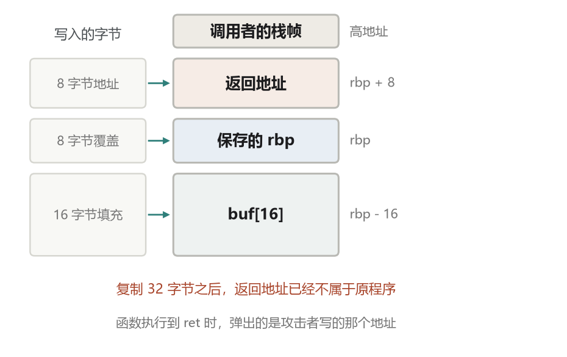
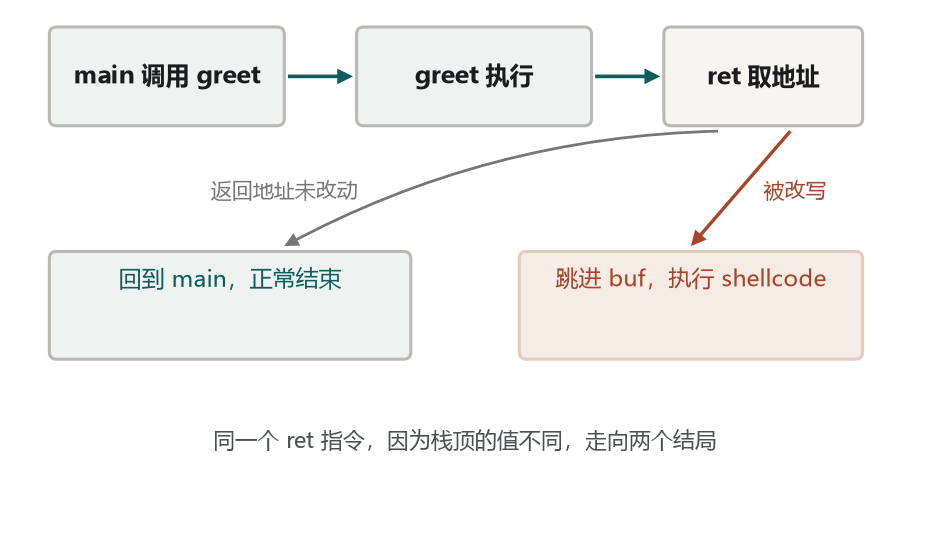
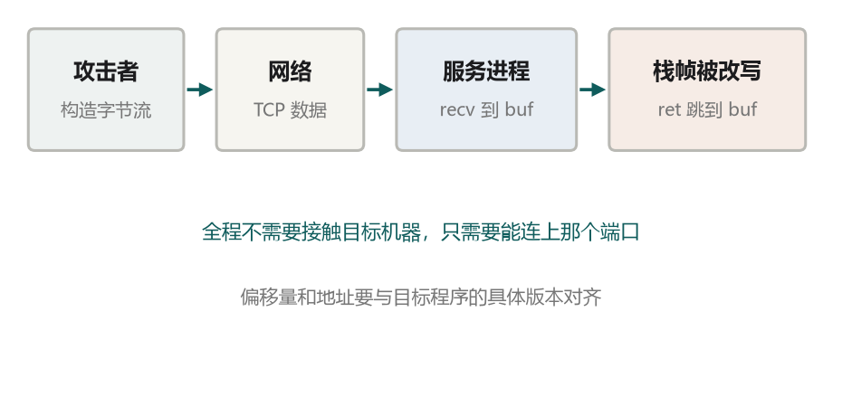
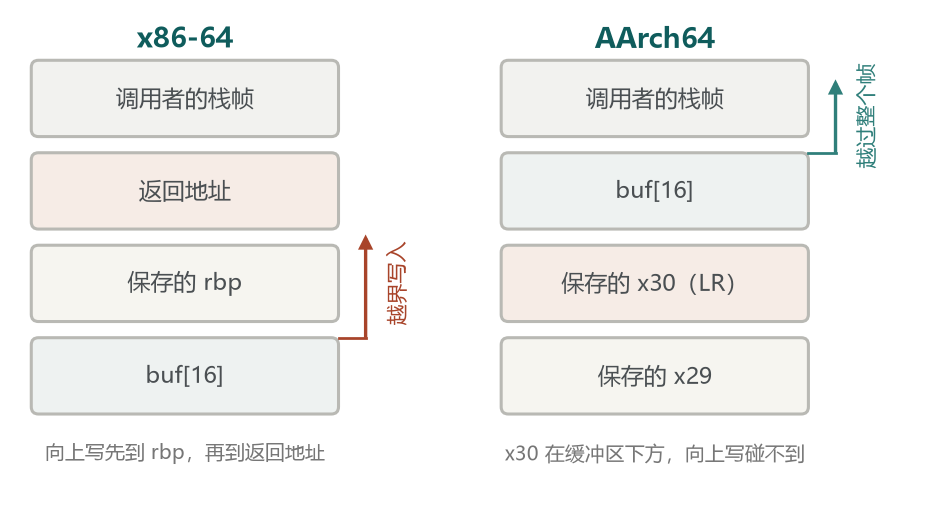

# 第六章　越界写入

1996 年，一本叫 Phrack 的电子杂志第 49 期上出现了一篇长文，标题是《Smashing The Stack For Fun And Profit》。作者署名 Aleph One，文章从一段十几行的 C 代码开始，一步步演示如何让程序跳到一段本该永远不被执行的代码上。那篇文章没有提出新理论，它做的事情是把学术界和地下圈子都早就知道的东西完整地写了出来，并且写得任何人都能照着做。

三十年过去，这类漏洞依然是每年披露名单上的常客。原因在第二章已经说过，C 语言不检查数组边界，而栈上的布局又是可预测的。这一章把这件事故意做一遍，看看从一行越界写到一个 shell 之间，究竟发生了哪些步骤。

## 6.1 一个有问题的函数

```c
#include <stdio.h>
#include <string.h>

void greet(char *name)
{
    char buf[16];
    strcpy(buf, name);
    printf("hello, %s\n", buf);
}

int main(int argc, char **argv)
{
    greet(argv[1]);
    return 0;
}
```

编译并运行。

```bash
gcc -O0 -fno-stack-protector -o greet greet.c
./greet Alice
```

输出是 `hello, Alice`。`strcpy` 从 `name` 指向的位置逐字节复制，直到遇到一个值为 0 的字节，它不知道 `buf` 只有 16 字节，也不关心。

现在换一个长一点的输入。

```bash
./greet AAAAAAAAAAAAAAAAAAAAAAAAAAAAAAAA
```

程序输出乱码，然后以段错误退出。三十个 A 覆盖了 `buf` 之外的东西，至于覆盖了什么，得看栈上的布局。

用调试器看一眼。在 `greet` 的 `printf` 那一行停下来，打印 `rbp` 和 `buf` 的地址。

```text
(gdb) break greet
(gdb) run AAAA
(gdb) p/x $rbp
$1 = 0x7fffffffe2b0
(gdb) p/x &buf
$2 = 0x7fffffffe2a0
```

差值刚好是 16。`buf` 从 `rbp-16` 开始，占 16 字节，紧接着就是保存在 `[rbp]` 里的调用者帧指针。再往上 8 个字节，就是返回地址。

<figure>

<figcaption>图 6-1　一次 32 字节的复制如何覆盖整个栈帧。前 16 字节填满数组，接着 8 字节改写保存的 rbp，再 8 字节改写返回地址。第三段才是真正要控制的部分。</figcaption>
</figure>

所以偏移量是这么算的，16 字节填满数组，8 字节覆盖保存的 `rbp`，第 25 到 32 字节落在返回地址上。这也解释了刚才那段乱码，`printf` 打印 `buf` 时，字符串已经越过了数组的边界，一直读到栈上第一个 0 字节为止。

实际做利用时不会去数汇编，而是用一种更省事的办法定位。构造一串有规律的字节，每四个字节一换，比如 `AAAABBBBCCCCDDDD`，把它发进去，看程序崩溃时 `rip` 的值是多少。如果 `rip` 变成了 `0x4444444444444444`，说明返回地址正好落在第四组，偏移就是 24。这种模式串在调试器插件里可以直接生成和计算，比人肉数栈快得多。

偏移量还会因为编译选项而变。加了优化之后，编译器可能把局部变量挪到寄存器里，或者调整栈帧的大小，同一个源程序在不同版本下算出来的数字不一样。这也是为什么利用代码总要针对具体的二进制文件去调，换个发行版就不灵了。

## 6.2 把返回地址改成什么

崩溃只是开始。真正的问题是，返回地址被改成一个精心选择的值之后，程序会跳到哪里去。

最直接的想法是跳到 `buf` 本身。`buf` 里放的是我们输入的字节，如果这些字节是一段能起 shell 的机器码，那么函数返回时就会执行它。

这段机器码有一个专门的名字，叫 shellcode。它的任务通常很朴素，调用 `execve` 启动一个 `/bin/sh`。

```asm
xor    rdi, rdi              ; 清空
mov    rbx, 0x68732f6e69622f ; "/bin/sh" 的字节
push   rbx
mov    rdi, rsp              ; rdi 指向字符串
xor    rsi, rsi              ; argv = NULL
xor    rdx, rdx              ; envp = NULL
mov    al, 59                ; execve 的系统调用号
syscall
```

这段汇编编译出来只有二十几个字节，塞进 16 字节的数组当然放不下，但真实程序里的缓冲区通常大得多，几百字节很常见。

<figure>

<figcaption>图 6-2　正常返回与劫持后的返回。函数执行到 ret 时从栈顶取出被改写的地址，程序计数器跳进数组内部，处理器开始把数据当指令执行。</figcaption>
</figure>

于是输入变成三段。前面 24 字节只是用来走到返回地址的填充，接着 8 字节把返回地址改成 `buf` 的起始地址，剩下的字节是 shellcode。`greet` 执行到 `ret` 时，弹出这个伪造的地址，跳到 `buf`，开始执行 shellcode，一个 shell 就起来了。

实际构造时还有两个细节。一是地址里经常出现 0 字节，而 `strcpy` 遇到 0 就停，所以输入不能带 0。二是要准确知道 `buf` 在内存里的地址，差一个字节就跳错地方。

对付第一个问题的办法是选一段不含 0 的 shellcode，或者换一个能带 0 的输入函数。对付第二个问题的办法更粗糙，在 shellcode 前面铺一大片空操作指令，也就是 NOP，只要跳进这片区域里的任何位置，都会一路滑到 shellcode。这片区域叫 NOP sled，雪橇。

## 6.3 从本地到远程

上面这个例子需要在本机运行程序，还要用调试器查出地址。真实世界里更有价值的情况是远程利用，攻击者只通过网络发一段数据，就能在别人的服务器上执行代码。

路径并不复杂。服务器上有一个程序在监听端口，收到数据后放进一个栈上的缓冲区，处理完再回一个响应。如果这个缓冲区没有做长度检查，那么发过去的数据就会覆盖栈帧，和刚才的例子一模一样。区别只在于数据来自网络而不是命令行。

<figure>

<figcaption>图 6-3　远程溢出的数据通路。攻击者构造的字节流穿过网络进入服务进程的缓冲区，越界部分覆盖返回地址，服务进程在函数返回时执行攻击者的代码。</figcaption>
</figure>

真实的代码不会写得像 `greet` 这么直白。缓冲区通常嵌在一个结构体里，旁边放着长度、类型、状态这些字段，读数据之前还会先做几步处理。看一段更像生产代码的样子。

```c
struct request {
    uint32_t magic;
    uint32_t length;
    char     payload[256];
};

int handle(int sock)
{
    struct request req;
    if (recv(sock, &req, sizeof(req), 0) != sizeof(req))
        return -1;
    char body[512];
    memcpy(body, req.payload, req.length);
    return process(body);
}
```

这段代码读起来是有防护的，`recv` 检查了长度，`memcpy` 也传了长度。问题在于 `req.length` 是对方发来的字段，`recv` 只保证收到了 `sizeof(req)` 个字节，不保证 `length` 小于 256。发送方把 `length` 填成 4000，`memcpy` 就会从 `payload` 开始往外拷 4000 字节，把 `body` 和它后面的栈帧一起盖掉。

这类写法在协议解析代码里极其常见。长度字段在协议头里，解析器信任它，因为“格式是这么定义的”。可格式只规定了字段的位置，没规定字段的值必须合理。1988 年的 Morris 蠕虫用的就是这类漏洞，它攻击 `fingerd` 服务，那个服务用一个固定大小的缓冲区接收请求，用的函数是 `gets`。`gets` 比 `strcpy` 更糟，它连目标缓冲区有多大都不知道，读到换行就停，读到多少写多少。蠕虫发一个超长请求过去，就能在那台机器上执行一段代码，然后继续往外扩散。

2001 年的 Code Red 也是同样的路子，利用 IIS 里一个索引服务的缓冲区溢出，十四小时感染了三十多万台机器。

这些案例有一个共同点，受害机器上的软件版本很统一。攻击者只要针对一个版本调好偏移和地址，就能一次打穿成千上万台。

## 6.4 一类问题，很多张面孔

栈溢出是最容易讲清楚的一种，但"越界写入"这个类别里还有很多变体。

差一错误（off-by-one）常见于循环条件写错，`for (i = 0; i <= len; i++)` 多写了一个字节，这个字节刚好落在相邻变量的最低位。单独看不致命，但如果相邻的是长度字段或者指针的低字节，就能引发连锁反应。

整数溢出是另一条路。程序先算出一个长度，用它申请内存，再把数据拷进去。如果这个长度在计算时溢出变成一个很小的数，申请到的空间远小于实际需要，拷贝时就会冲出去。这类漏洞在图像解析、压缩解压、协议解析的代码里特别多，因为这些地方的长度字段来自外部输入。

堆上的溢出同样存在。第二章讲过堆块头部记录着大小和链表指针，一次越界写如果盖住了相邻块的头部，下一次释放时分配器就会按照被篡改的信息去操作，可能把一个任意值写到任意地址。这类利用比栈溢出复杂，但在现代系统上更常见，因为栈的保护更早就成熟了。

还有一种情况是空间被释放之后又被人使用，叫释放后使用。程序 `free` 了一块内存，却没有把指针清空，之后又通过这个指针读写。如果这期间同一块内存被分配给了别的对象，那么原来的指针就指向了别人的数据。攻击者可以通过控制这块新分配的内容，间接控制旧指针指向的东西。

## 6.5 为什么这条路走得通

把上面的过程抽象一下，栈溢出能成立需要三个条件同时满足。

数据被写到了不该写的地方。这是 `strcpy` 这类函数造成的，它们不检查边界，把长度控制的权力交给了输入。

写进去的数据被当成了指令。这依赖冯·诺依曼结构，指令和数据放在同一个存储器里，没有本质区别。只要程序计数器指向那片数据，处理器就会照着解码执行。这个设计带来的是通用性，代价是数据有了变成代码的可能。

地址是可预测的。攻击者需要知道该把返回地址改成什么，如果每次运行栈的位置都不一样，猜中的概率就很低。

这三条里，第二条和第三条后来都被针对性地削弱了。操作系统把栈标成不可执行，让放进去的字节没法被当成指令跑；地址随机化让栈的起始位置每次都变；编译器在栈帧里插入一个随机数，函数返回前检查它有没有被改过。

## 6.6 换一种架构

前面所有偏移量都按 x86-64 算。同样的 C 代码编到 ARM64（也叫 AArch64）上，栈帧不一样，能改到的东西也不一样。

差异的根源在返回地址放哪。x86 的 `call` 把返回地址压进栈，所以栈上的溢出早晚会碰到它。ARM64 的 `bl` 指令把返回地址写进一个寄存器 `x30`，也叫链接寄存器 LR。叶子函数不需要把 LR 存到栈上，因为它不再调用别的函数，`ret` 直接用 `x30` 跳回去。

```asm
; 叶子函数，不碰栈
add:
    add    w0, w0, w1
    ret                     ; 直接跳 x30

; 非叶子函数，保存 x29 和 x30
greet:
    stp    x29, x30, [sp, #-32]!   ; 先减栈，再存一对寄存器
    mov    x29, sp
    add    x0, sp, #16             ; buf 在 sp+16
    bl     strcpy                  ; x1 里是传进来的 name
    ldp    x29, x30, [sp], #32     ; 先取，再加栈
    ret
```

`stp` 是成对存储，一次把两个寄存器写进栈，`[sp, #-48]!` 里的感叹号表示先减后存。这一对指令替代了 x86 的 `push rbp` 加 `sub rsp, N`。

关键的差别在于顺序。保存的 `x29` 和 `x30` 在 `sp+0` 和 `sp+8`，十六字节的缓冲区在 `sp+16` 到 `sp+31`。一次向高地址的 `strcpy` 溢出，填满缓冲区之后下一个字节落在 `sp+32`，也就是调用者的栈帧，而不是保存的 LR。换句话说，AArch64 上最直觉的那条路，改返回地址，经常走不通。

<figure>

<figcaption>图 6-4　两种架构的栈帧对比，图中自下而上为地址增长方向。x86-64 的返回地址在局部变量上方，向上溢出会直接覆盖它；AArch64 把保存的 x29 与 x30 放在栈帧最低处，向上溢出越过整个帧，碰不到返回地址。</figcaption>
</figure>

ARMv8.3 在 2016 年又加了一组指针认证指令，叫 PAC。函数入口用密钥给 `x30` 算一个签名塞进高位，返回前验证，不匹配就跳到非法地址。密钥存在只有内核能写的系统寄存器里，改了栈上的 `x30` 也出示不了合法签名。苹果从 A12 和 M1 开始大量使用这套机制，安卓阵营从 ARMv9 开始跟进。

因为返回地址改不动，ARM64 上的栈溢出利用更多转向函数指针、C++ 虚表指针、`setjmp` 保存的寄存器组。这些东西的位置往往和缓冲区相邻，覆盖它们的效果不打折扣。同一个漏洞在两个架构上要用两套完全不同的思路，这是跨平台分析里最费时的部分。

32 位 ARM 是另一种情况。返回地址在 `r14`，非叶子函数用一条 `push {r4, r7, lr}` 把它和几个寄存器一起压栈，栈帧往往比 x86 更紧凑。这种写法下返回地址经常和局部变量只隔几个字节，溢出很容易得手，历史上 ARM 路由器和安卓设备上的栈溢出因此格外多。

除了返回地址，参数走的路也不一样。x86-64 用 `rdi`、`rsi`、`rdx`、`rcx`、`r8`、`r9` 传前六个整数参数，第七个开始才上栈；AArch64 用 `x0` 到 `x7`，第九个之后才上栈。一个把第七个参数当成缓冲区指针的函数，在两个架构上的栈布局完全不同，同一份利用脚本换一个平台就废了。

## 6.7 一个堆溢出的真实案例

前面讲的都是栈。2021 年 1 月公开的 sudo 漏洞（CVE-2021-3156，代号 Baron Samedit）是堆溢出，触发方式简单到一条命令。

```bash
sudoedit -s '\' $(python3 -c 'print("A"*1000)')
```

在 1.9.5p1 及之前的版本上，这条命令会让 sudo 段错误。sudo 有一个 `-s` 选项表示以 shell 模式运行，`sudoedit` 是它的编辑模式。参数解析函数在处理 `-s` 之后要对命令行做一次转义还原，把反斜杠后面的字符处理掉。计算缓冲区大小时按 argv 的字符数算，但转义处理时多写了一个字节，末尾的反斜杠让这次写入越界。

一字节的溢出为什么也算严重。因为堆上的相邻块是连着用的。溢出的那个字节破坏了下一个块的头部字段，sudo 之后还要继续解析参数、分配内存、复制字符串，每一次分配和释放都会用到被改过的头部。Qualys 在研究报告里给出的路径是，先用这一字节把下一个块的 size 改小，让分配器把一块更大的区域划给后续的字符串拷贝，然后通过精心构造的参数把内容写到分配器以为空闲的区域里，最终拿到 root。

几个可以查证的事实。受影响版本从 1.8.2（2011 年）到 1.9.5p1，跨度十年；修复版本 1.9.5p2 在 2021 年 1 月 26 日发布；利用条件是本地用户，不需要额外权限，主流 Linux 发行版和 macOS 都受影响。Qualys 在报告里说明，这个 bug 从引入到被发现隔了十年，代码审查和 fuzzing 都没抓到，因为触发路径要经过三层参数解析，单看任何一层都是对的。

和栈溢出比，堆溢出的可控性更差，但影响面一样。它的触发往往藏在正常功能的边界情况里，一个带反斜杠的参数、一个超长的用户名、一个空指针和空字符串的区别。fuzzing 对这类问题的发现率取决于输入语料的构造，参数组合爆炸的时候覆盖率上不去。

观察堆的损坏比观察栈难。栈上的溢出当场就会让 `ret` 跳飞，堆上的破坏要到下一次分配或释放才发作，崩溃的地方和原因隔得很远，栈回溯里看不出关系。glibc 提供了一些自检开关，能把这个时间差缩短。

```bash
$ MALLOC_CHECK_=3 ./prog
free(): invalid next size (fast)
Aborted
```

`MALLOC_CHECK_` 让分配器在每次操作后多查一遍头部的一致性，代价是堆操作慢一倍左右。glibc 2.29 之后 tcache 自带了双重释放检测，报错信息是 `free(): double free detected in tcache 2`。这些信息在排查时很有用，但它们只在损坏已经发生之后才叫，不会告诉你损坏是在哪一行写进去的。想把因果连起来，得用 AddressSanitizer 这类工具在每次写内存时做边界检查。

三十年前那篇文章里，利用的思路是覆盖返回地址，跳到自己的代码。今天这条路上有三道墙，所以做法变成了用一个字节破坏堆的记账信息，让分配器替自己完成写入。目标没变，工具变了。

这些措施在 2000 年代陆续铺开，一度被认为能终结缓冲区溢出。实际结果是攻防双方都换了打法。下一章讲这场军备竞赛，看防守方加了什么，攻击方又是怎么绕过去的。
