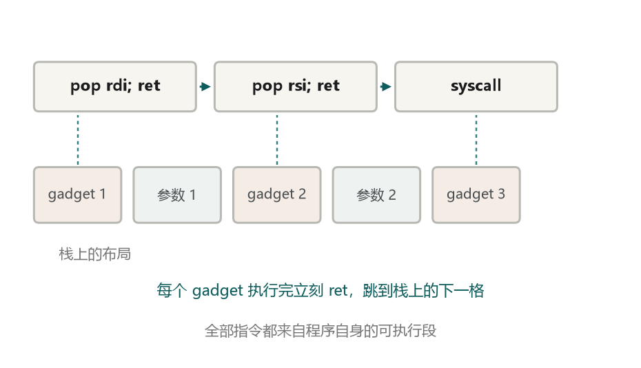
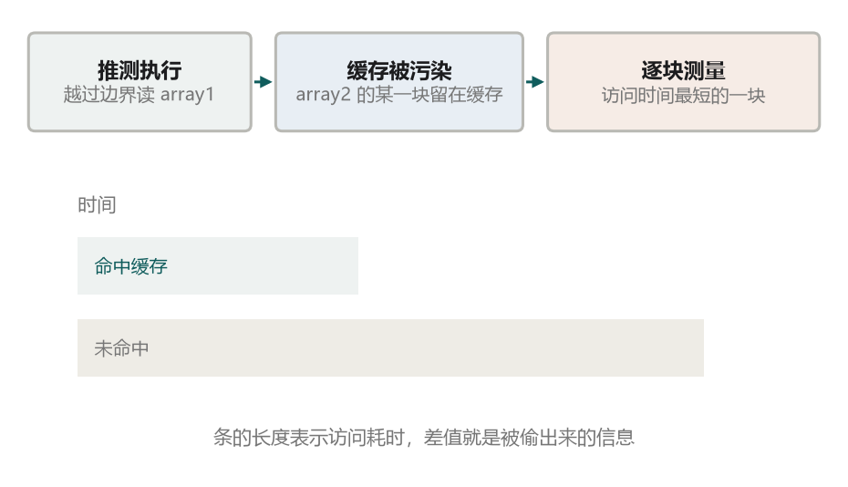

# 第七章　军备竞赛

上一章结尾提到的三种防护，在 2000 年前后陆续进入主流系统。当时不少人认为缓冲区溢出要成为历史了，微软在 2004 年的 Windows XP SP2 里默认打开了栈保护，Linux 发行版在 2005 年前后默认开启了地址随机化，处理器厂商在硬件里加了不可执行位。

结果是攻击没有减少，只是变复杂了。攻击者把原来的思路拆成几步，每一步绕开一种防护。这一章讲这几种防护的原理，以及它们各自是怎么被绕过去的。看完之后你会有一个大概的判断，为什么内存安全问题到今天还在修，而不是已经被"解决"了。

## 7.1 让栈不能执行

第一种防护最直接。既然攻击者往栈上写机器码然后跳过去执行，那就让栈不可执行。

做法是在页表的权限位里加一位，表示"这一页可读可写但不可执行"。处理器取指令时如果发现当前页没有执行权限，立刻触发异常。这一位在 x86 上叫 NX，在 AMD 的文档里叫 EDB，各家操作系统的叫法不同，原理一致。

这项技术不难，难在兼容性。有些程序会在运行时生成代码，比如即时编译器（JIT），它们需要往一块内存里写指令再执行。这类程序在 NX 下会直接崩掉。于是操作系统提供了折中方案，允许程序主动申请一块"可写也可执行"的内存。这个口子后来成了新的攻击目标，因为攻击者可以想办法让程序把 shellcode 写到那块区域里去。

<figure>

<figcaption>图 7-1　栈不可执行之后的替代方案。返回地址被改成库函数 system 的入口，紧接着的八个字节被当作它的返回地址，再往后是参数指针，指向 "/bin/sh"。</figcaption>
</figure>

对普通的栈溢出，NX 确实挡住了"跳到栈上执行"这条路。但当时代码里已经存在大量可执行的东西，也就是系统库。攻击者想到，既然不能自己写代码，那就借用现成的。

## 7.2 借用现成的函数

C 库里的 `system` 函数可以执行一条 shell 命令。如果攻击者能在栈上安排好参数，再把返回地址改成 `system` 的地址，那么函数返回时就会跳进 `system`，把参数当成命令执行。

这个手法叫 ret2libc。

栈上的布局需要仔细安排。`ret` 弹出返回地址之后，栈顶就指向下一个 8 字节。按照 x86-64 的调用约定，`system` 的第一个参数放在 `rdi` 里，而不是栈上，所以还得先找到一个能把栈上的值弹进 `rdi` 再返回的指令片段。这类片段叫 gadget。

布局从低地址往高地址排下来是这样。先是走到返回地址为止的填充，然后是 gadget 的地址，接着是 `"/bin/sh"` 的地址，最后是 `system` 的地址。图 7-1 的四个格子就是这个顺序。

程序返回到第一段 gadget，它把栈顶的值弹进 `rdi`，然后 `ret` 到 `system`。`system` 看到 `rdi` 里是 `"/bin/sh"`，就起一个 shell。

这个思路一旦成立，攻击者就不再需要自己写代码了。他要做的是在已有的程序里找片段，把它们串起来，让机器按照自己的意思执行。这种利用方式后来被系统化，有了一个名字，返回导向编程，也就是 ROP。

## 7.3 让地址猜不准

第二种防护针对的是"地址可预测"这个前提。

如果每次运行程序时栈的起始地址都一样，攻击者在本机调试一次就能知道该往返回地址里写什么。地址空间布局随机化（ASLR）做的事情是，在程序启动时把栈、堆、共享库的基址随机偏移一段，让每次运行的布局都不同。

Linux 上可以用一条命令看到效果。

```bash
$ cat /proc/sys/kernel/randomize_va_space
2
```

值为 2 表示完全随机化。把这个值改成 0 再运行一次程序，栈地址每次都一样；改回 2，地址每次都变。

ASLR 的强度取决于随机位数。32 位系统上地址空间只有 4 GB，可随机的位数有限，攻击者可以反复尝试，用几万次失败换来一次命中。64 位系统上地址空间大得多，暴力破解不再现实。

这让攻击者转向另一个方向，先想办法泄漏一个地址，再根据这个地址推算出其他位置。一次越界读、一个格式化字符串漏洞、一段打印调试信息的代码，都可能成为泄漏点。现代漏洞利用几乎都是先用一个漏洞泄漏地址，再用另一个漏洞写入。这也是为什么"只泄漏不写入"的漏洞仍然被评级为高危。

## 7.4 在返回地址旁边放个哨兵

第三种防护针对的是覆盖行为本身。编译器在每个栈帧的局部变量和返回地址之间插入一个随机值，函数返回前检查这个值有没有变。变了就说明有人越界写了，程序立刻终止。

这个值叫栈保护符，也叫 canary，金丝雀。名字来自煤矿里用鸟检测瓦斯的老办法。

canary 的弱点在于它需要被检查。如果程序在检查之前就把控制权交给了别处，或者攻击者能想办法不破坏 canary 而改到返回地址，它就失效了。前一种情况对应异常处理、长跳转这类机制，后一种情况对应"只改指针不改栈"的利用方式。

另外，canary 只能保护返回值，保护不了局部变量。如果一个函数里有一个函数指针，位置在数组的下方，那么越界写可以改掉这个指针，函数通过指针调用时就被劫持了，canary 一点忙都帮不上。

<figure>

<figcaption>图 7-2　一条 ROP 链。每个 gadget 只做一件小事，执行完立刻 ret 到下一个。攻击者用这种方式拼出任意逻辑，全部代码都来自程序本身合法的可执行页。</figcaption>
</figure>

ROP 之所以难防，是因为它用的全是合法代码。没有一段字节是攻击者写进去的，所有指令都来自程序自己的代码段，权限检查完全通过。防守方后来想到的办法是检查返回地址的合法性，也就是控制流完整性（CFI），规定每次间接跳转只能去几个预先确定的目标。这个技术在近几年才逐步落地，硬件层面的支持（Intel 的 CET、ARM 的 BTI）是 2020 年之后的事。

## 7.5 当漏洞出现在处理器里

前面讲的都是软件层面的攻防。2018 年公开的两个漏洞把战场拉到了硬件。

现代处理器为了跑得快，会在还没确定要不要执行某条分支的时候，先猜一个方向往下执行，这叫推测执行。猜对了节省时间，猜错了把结果丢掉，看起来没有副作用。

问题在于，"丢掉结果"并不彻底。推测执行时读过的内存会被放进缓存，而缓存的状态可以被测量。攻击者先让处理器推测性地读一个它本来无权访问的地址，再通过测量哪块缓存被加载过来，反推出那个地址上的内容。

```c
/* 概念示意，不是可运行的利用代码 */
if (untrusted_index < array1_size) {
    char secret = array1[untrusted_index];   /* 推测执行会越过边界读 */
    char probe = array2[secret * 4096];      /* 用读到的值影响缓存 */
}
```

这段代码看起来无懈可击，边界检查就在前面。但处理器会在检查结果出来之前就推测执行分支里的两条语句，于是 `array1` 被越界读了一次，读到的值又影响了 `array2` 的哪一块进入缓存。攻击者随后遍历 `array2`，测量访问时间，最快的那一块对应的下标就是被偷出来的字节。这个方法叫 Spectre，同一时期公布的 Meltdown 用了类似的思路，直接读内核内存。

<figure>

<figcaption>图 7-3　推测执行留下的痕迹。越界读的结果被丢弃，但它导致的缓存状态保留了下来，攻击者通过访问时间的差异把它读出来。</figcaption>
</figure>

这两个漏洞的影响范围几乎覆盖了当时所有主流处理器。修补方式一部分靠微码更新，一部分靠修改操作系统内核的页表隔离策略，代价是性能下降。它们在概念上的意义比具体影响更大，因为它说明"程序逻辑正确"不等于"硬件行为正确"，安全边界可以低到电路这一层。

## 7.6 防护的代价

前面这些措施没有一项是免费的。

不可执行位几乎不影响性能，但它要求所有 JIT 引擎都把代码写进特殊申请的内存，浏览器因此多了一套复杂的权限管理，漏洞也跟着多了不少。地址随机化在程序启动时多花几毫秒，代价小到可以忽略，但它不保护那些被固定地址的共享库，也不保护自己泄漏了地址的程序。栈保护符每函数多两条指令，开销不到百分之一，代价是它只看得住返回地址。

控制流完整性的代价最大。它需要在编译时算出每个间接跳转的合法目标集，在运行时逐个比对，性能损失从几个百分点到十几不等。更麻烦的是兼容性，一些老程序用了非常规的跳转技巧，在 CFI 下直接跑不起来。所以这个技术落地得慢，很多系统至今只开了一部分。

这引出一个常被忽略的问题。防护措施本身也是代码，也会出错。一个配错的隔离策略会让服务起不来，一个误报的检测规则会把正常业务拦下来，一次强制升级会把旧设备变成砖头。安全的成本不只是性能，还包括可用性、兼容性和维护人力。做决策时要把这些算进去，而不是看到“开启防护”就勾上。

## 7.7 换个地基

几十年下来，业界的共识逐渐清晰。在 C 和 C++ 这种语言上，靠一层层补丁去防内存错误，成本会越来越高，而收益递减。每加一种防护，攻击者就找一种绕过，防守方再打一个补丁，循环往复。

另一条路是换语言。Java 和 Go 在运行时检查数组下标，越界直接抛异常；Rust 在编译期用所有权和借用检查，把大部分悬垂指针和越界访问挡在编译阶段。代价是这些语言有自己的约束，性能模型和内存管理方式与 C 不同，不能直接替换现有的每一处代码。

现实的做法是分层。新的组件尽量用内存安全的语言写，旧的组件加沙箱、加隔离、加监控。操作系统的内核也在往这个方向走，Linux 内核开始接受 Rust 写的驱动，Android 把大量系统组件从 C 换成了 Rust，谷歌公开的数据显示新代码里的内存安全漏洞比例明显下降。

这条路很慢，但方向是明确的。只要还有大量 C 代码在跑，缓冲区溢出和它的各种变体就不会消失。它们会继续出现在固件、驱动、老旧的网络服务里，成为每年漏洞名单上的固定成员。

## 7.8 怎么知道开了哪些防护

前面讲的防护，落到具体一个二进制文件上，可以用几条命令查清楚。做实验之前先查一遍，能省掉很多“为什么我的溢出没生效”。

pwntools 里的 `checksec` 把五项信息打包在一起。

```text
$ checksec --file=./greet
    Arch:     amd64-64-little
    RELRO:    Partial RELRO
    Stack:    No canary found
    NX:       NX enabled
    PIE:      No PIE (0x400000)
```

四项防护各自对应一个编译或链接选项，也各自能用一个系统工具单独验证。另有一项 Fortify 不在这个输出里，后面单独说。

PIE 和 ASLR 的关系容易搞混。PIE 是编译期决定的事，让可执行文件本身能被加载到任意地址；ASLR 是运行期的策略，由内核决定要不要随机。只有两个都开着，程序基址才会变。

```bash
$ readelf -h ./greet | grep Type
  Type:   EXEC (Executable file)
$ readelf -h ./greet_pie | grep Type
  Type:   DYN (Position-Independent Executable file)
```

`EXEC` 表示基址固定，反汇编里看到的地址就是运行时的地址。`DYN` 表示位置无关，加载时才决定基址。

NX 看栈段的标志。

```bash
$ readelf -lW ./greet | grep GNU_STACK
  GNU_STACK      0x000000 0x0000000000000000 0x0000000000000000
                 0x000000 0x0000000000000000  RW     0x10
```

`RW` 表示可读可写不可执行。如果这里出现 `RWE`，说明栈可执行，需要加 `-z noexecstack` 重新编译。

Canary 看符号。

```bash
$ nm ./greet_canary | grep stack_chk
                 U __stack_chk_fail@GLIBC_2.4
```

有 `__stack_chk_fail` 就说明插了检查，函数里能看到 `fs:0x28` 的读取。保护分三档，`-fstack-protector` 只保护有大局部数组的函数，`-strong` 把有取地址的局部变量的也算进去，`-all` 保护所有函数，代价逐档上升。

RELRO 看动态段。

```bash
$ readelf -dW ./greet | grep -E 'BIND_NOW|FLAGS'
 0x000000000000001e (FLAGS)   BIND_NOW
```

有 `BIND_NOW` 加上 `GNU_RELRO` 段，就是 Full RELRO。差别在于 GOT 在重定位完成之后是否被改成只读。Partial RELRO 只保护 `.got`，`.got.plt` 仍然可写，而函数调用的跳转目标就存在 `.got.plt` 里。这就是为什么一次任意写能改掉某个函数的落点。

另一项叫 Fortify，看 `_chk` 系列符号。`-D_FORTIFY_SOURCE=2` 把 `strcpy`、`memcpy` 这些调用在编译期换成带长度检查的版本，能挡住一部分固定大小的栈拷贝。它对编译器看得见目标大小的拷贝有效，对 `malloc` 出来的缓冲区基本无效。

主流发行版的编译器默认已经开了不少。Debian 9 和 Ubuntu 17.10 之后的默认构建参数里就包含 `-fstack-protector-strong`、`-D_FORTIFY_SOURCE=2`、`-Wl,-z,relro` 和 PIE。所以在一台新系统上随手 `gcc` 出来的程序，checksec 的结果往往是全开。实验里要关掉，得显式加参数。

```bash
gcc -O0 -fno-stack-protector -no-pie -z execstack -o greet greet.c
```

这条命令把四项防护全关了，正好对应上一章那个能跑通溢出的版本。

`checksec` 看不到的东西也要心里有数。它只读文件，不读运行环境。内核的随机化级别是另一个开关，`cat /proc/sys/kernel/randomize_va_space` 返回 2 才是完全随机，返回 0 时 PIE 编译出来的程序每次也都加载到同一个地址。库的版本也要看，`ldd --version` 给出的数字决定了 libc 里可用的 gadget 和 `system` 的偏移，Ubuntu 20.04 是 2.31，22.04 是 2.35，后者的 gadget 位置几乎全变了。同一份利用代码在一台机器上能跑、在另一台上错三个字节，原因就在这些地方。

## 7.9 影子栈与清单

ROP 难防的地方在 7.4 说过，它用的全是合法代码，权限检查全过。控制流完整性想解决这个问题，做法是给每个间接跳转配一份合法目标清单。

清单怎么来，决定了这个技术好不好用。粗粒度的做法只检查“目标是不是一个函数的开头”，不管是从哪个调用点来的。这种检查能被绕，攻击者把若干合法函数开头串起来，拼出一套不打算提供的功能，这类手法叫面向调用的编程（COOP）。细粒度的做法是每个调用点一份清单，检查严格，但兼容性差、开销大。

另一条思路更直接，只保护返回地址。处理器维护一份影子栈，`call` 时把返回地址同时写进普通栈和影子栈，`ret` 时比对两边，不一致就报错。普通栈上的返回地址可以被覆盖，影子栈在用户态没有写权限，改了也没用。

Intel 在 2016 年公布了这套机制，叫 CET，包含影子栈和保护间接跳转的 IBT。硬件支持从 2020 年的 Tiger Lake 开始，Windows 11 把它作为“硬件强制的栈保护”提供，默认关闭，需要应用主动声明兼容。Linux 侧的支持从 5.18 进主线（2022 年），glibc 到 2.39 才补齐运行时，浏览器这类大型应用是最近几年才逐步打开的。

ARM 那边的对应物是 PAC 加 BTI。PAC 是指针认证，用密钥给返回地址签名，实现上比影子栈便宜，不需要额外的一块内存，也不用改调用约定；BTI 是分支目标识别，作用相当于 IBT，要求间接跳转落在合法的入口上。苹果从 A12 开始对几乎所有返回地址签名，安卓在 ARMv9 设备上默认开启。

局限也一样明显。影子栈只保护返回地址，函数指针、C++ 虚表、`longjmp` 的跳转缓冲区都在普通内存里，一次任意写照样能改。这类不碰返回地址的利用方式统称数据导向攻击（DOP），在影子栈铺开之后变成了主流。IBT 要求每个间接跳转的目标以一条特殊指令 `endbr64` 开头，老代码没有这条指令，直接跑会崩，兼容性只能靠重编译解决。粗粒度 CFI 的清单太大，拦截效果有限。谷歌在 Android 内核上做的细粒度 CFI 公开过 1% 到 2% 的性能损失，这已经是做得比较好的情况，通用的用户态 CFI 到现在还没有一个既严格又能直接跑的方案。

清单和影子栈都没有把路堵死，它们做的是把利用从“写几个字节就行”抬高到“要找到一整套配合的 gadget 和内存布局”。成本抬到什么程度对手才放弃，取决于对手是谁，而不是取决于防护本身有多先进。

还有一件事值得看清楚。ROP 能成立的前提是代码里有足够多的 `ret` 结尾的小片段。一个几 MB 的 libc，用 `ROPgadget --binary libc.so.6` 列出来的条目以万计，几乎任何一串操作都能找到对应的拼法。库越大，gadget 越多，防护越难把清单列全。这也是为什么“把代码缩小”在安全上往往比“多加一层检查”更有效，需求里那些没人使用的功能，在防护这里都是要花成本看住的东西。

下一章换一个方向。前面讲的问题都发生在内存里，接下来要讲的漏洞不碰内存，它们利用的是时间。
