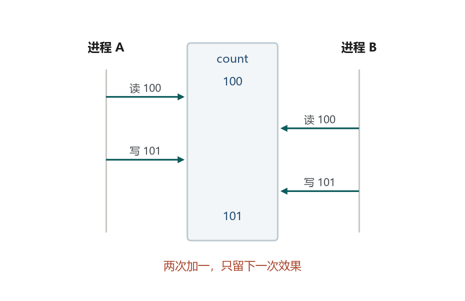
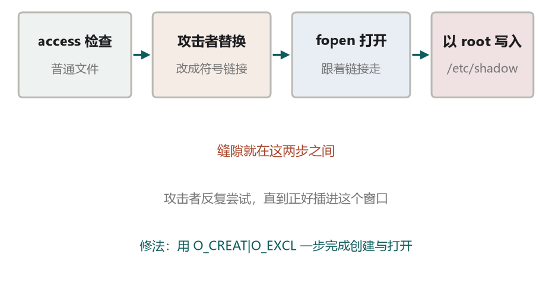
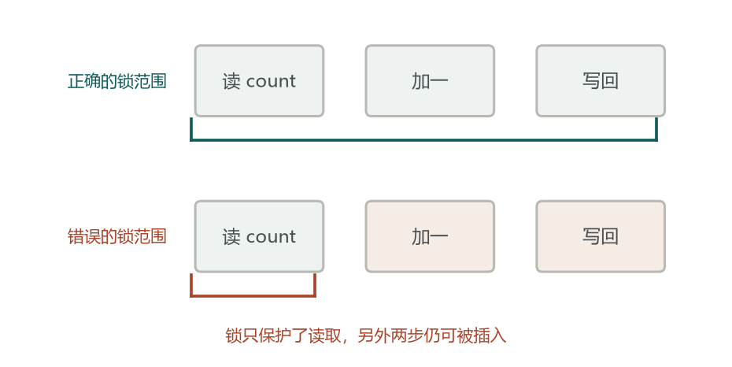

# 第八章　时间的裂缝

前面几章的漏洞都发生在空间上，写多了字节，越过了边界。这一章讲另一类问题，程序占用的空间完全正确，出问题的是它做事的顺序。

一个典型的场景。两个进程都要把一份计数加一，它们各自做了三件事，读出当前值，加一，写回去。如果两个进程严格轮流执行，结果是对的。

```text
进程 A: 读 count → 100
进程 A: 加一     → 101
进程 A: 写回     → 101

进程 B: 读 count → 101
进程 B: 加一     → 102
进程 B: 写回     → 102
```

但如果中间被打断，结果就不一样了。

```text
进程 A: 读 count → 100
进程 B: 读 count → 100
进程 A: 加一     → 101
进程 A: 写回     → 101
进程 B: 加一     → 101
进程 B: 写回     → 101
```

两次加一，结果只加了一次。这种错误叫竞态条件（race condition），问题的根源是"读"和"写"这两个动作之间存在一个可以被别人插进来的空隙。

## 8.1 缝隙有多大

第一章讲过，操作系统把 CPU 时间切成很短的时间片，轮流分给各个进程。切换的时机不由程序决定，可能发生在任何两条指令之间。多核处理器上更直接，两个线程真的在同时跑。

所以那三行看起来连续的代码，在机器层面是三条互不相干的指令，中间随时可能被换走。

更麻烦的是，现代的编程语言把这种空隙藏得更深。一行 `count += 1` 在 Python 里看起来是一个动作，实际上它要做读取、加法、写回三件事。在 `await` 或者线程切换点上，这些步骤都可能被切开。JavaScript 是单线程的，很多人因此以为不会有竞态，但一次 `await` 之后，另一段代码可能已经改掉了你要用的变量。

<figure>

<figcaption>图 8-1　两次加一被交错执行。两个进程都读到了 100，都写回了 101，其中一次修改凭空消失。程序没有任何一行代码写错，错的是顺序。</figcaption>
</figure>

这类问题的特点是不稳定。同样的输入，跑一百次可能九十九次正常，第一百次出错。测试很难复现，日志里也看不出破绽，所以它在开发阶段经常活下来，直到线上并发量上去才暴露。

## 8.2 检查与使用之间

竞态里有一类特别常见，叫检查与使用之间的时间差（time-of-check to time-of-use，TOCTOU）。程序先检查某个条件成立，然后根据检查结果去做事，而条件在这两步之间被改掉了。

文件操作里最容易出这种事。设想一个以 root 身份运行的服务，要把用户提交的内容写进一个临时文件。

```c
if (access("/tmp/report", W_OK) == 0) {   /* 检查：可写吗 */
    FILE *f = fopen("/tmp/report", "w");  /* 使用：打开写入 */
    fputs(content, f);
    fclose(f);
}
```

看起来没问题。但 `/tmp` 是所有用户都能写的目录，攻击者可以在这里放一个符号链接，让 `/tmp/report` 指向 `/etc/shadow`。

第一次运行时，`/tmp/report` 是一个普通文件，`access` 检查通过。就在检查和 `fopen` 之间，攻击者把文件换成一个指向 `/etc/shadow` 的符号链接。`fopen` 打开的时候，内核会跟着链接走，于是 root 权限的进程把用户提交的内容写进了系统口令文件。

<figure>

<figcaption>图 8-2　检查与使用之间的替换。access 检查的是一个普通文件，fopen 打开时那个路径已经变成了指向系统文件的符号链接。</figcaption>
</figure>

这类漏洞在 1990 年代非常多，几乎每个用 `/tmp` 的程序都被检查过一遍。修法有几条。一是让检查和打开变成同一个动作，用 `open` 的 `O_CREAT | O_EXCL` 标志保证文件是新建的，不是别人准备好的。二是不用可预测的文件名，用 `mkstemp` 生成随机名字并直接返回文件描述符。三是干脆换一个只有自己能写的目录。

核心思想是同一个，不要先看一眼再动手，要么一步做完，要么动手前先确认拿到的东西和看到的是同一个。

## 8.3 让概率站到自己这边

竞态的利用有一个现实困难。缝隙往往只有几十纳秒，正常的调度很难正好插进去。所以攻击者不会傻等，他们想办法把概率放大。

最粗暴的办法是重复。一个本地提权的竞态漏洞，跑一万次可能成功一次，那就写个循环跑一百万次。在自动化工具面前，这种成本可以接受。

精细一点的办法是控制节奏。攻击者可以先用一个耗时的操作把目标进程卡住，比如让它去读一个很慢的设备，或者访问一个通过网络挂载的目录，然后在它卡住的这段时间里完成替换。

更精细的办法是主动制造延迟。Linux 上有个叫 FUSE 的机制，允许用户态程序实现一个文件系统。攻击者可以让某个路径的读取故意慢下来，精确到毫秒，把目标进程卡在检查和使用之间的那一刻。

这类手法说明一件事，竞态的安全性不能靠"时间太短来不及"来论证。只要攻击者能观察、能干预、能重试，缝隙就会被撑开。

## 8.4 锁与原子操作

防守的基本手段是让关键的那几步不能被切开。

最直接的是锁。进入临界区之前加锁，离开时解锁，同一时刻只有一个线程能进去。操作系统和语言库都提供了这类原语，互斥量、读写锁、信号量。

锁的难点不在加，而在加对。锁的粒度太粗，性能会掉；太细，容易出现死锁；嵌套调用时还可能重复加锁。更麻烦的是，有些地方看起来该加锁，实际上不该加，加了反而制造了新的竞态。

另一条路是把操作变成原子的。现代处理器提供了比较并交换（compare-and-swap）这类指令，可以在一条指令里完成"如果值还是 A 就把它改成 B"。用这种指令实现计数器，就不需要锁。编程语言里的原子类型、无锁队列，底层都是这个。

文件操作有自己的原子性工具。`rename` 在同一个文件系统内是原子的，所以常见的做法是先把内容写进一个临时文件，写完再 `rename` 到目标位置。这样任何时刻读到的要么是旧文件，要么是新文件，不会是写了一半的东西。

数据库提供了另一套工具。把几条语句放进一个事务，数据库保证它们对外表现为一个整体。不过事务的隔离级别是个坑，默认的“可重复读”在很多数据库里并不能防止两个事务同时读同一个值、各自加一、再各自写回。这种丢失更新需要靠行锁（`SELECT ... FOR UPDATE`）或乐观锁解决。乐观锁的思路是给每一行加一个版本号，更新时带上读到的版本，`UPDATE ... WHERE id = ? AND version = ?`，影响行数为零就说明别人先改了，重试一次。

这两套做法各有代价。悲观锁在竞争激烈时会把大量请求堵在等锁上，乐观锁在冲突频繁时会反复重试。选哪一种要看实际的冲突比例，而不是看哪一种听起来更安全。

## 8.5 竞态不只是内存问题

把视野放宽一点，竞态出现在所有"先查询再修改"的地方。

电商的优惠券，同一张券被两个请求同时核销，各自查到"未使用"，各自改成"已使用"，券就被用了两次。银行的转账接口，两个请求同时从同一个账户扣款，余额检查都通过，最后透支。航空公司的选座，两个用户同时选中同一个座位。

这些问题的技术原理和前面的例子一模一样，只是发生在业务逻辑层。它们往往比内存漏洞更难修，因为涉及数据库事务、分布式锁、幂等设计，改动代价大，而且很难在不影响性能的前提下做对。

数据库提供了事务这个工具。把几条操作放进一个事务，数据库保证它们要么全部生效，要么全部不生效，中间状态对外不可见。跨服务的情况更复杂，需要分布式事务或者补偿机制，这一块至今没有既简单又可靠的方案。

<figure>

<figcaption>图 8-3　锁保护的范围要覆盖整个"读、算、写"过程。只锁住其中一步，等于没锁。</figcaption>
</figure>

## 8.6 一类容易被忽略的漏洞

竞态条件在漏洞榜单上的存在感不如缓冲区溢出，因为它的利用不稳定，写论文不好看，写报告也不够戏剧化。但它在真实入侵里出现的频率并不低，尤其在本地提权这一步。

原因很实际。一个系统里往往有几十个以高权限运行的脚本和服务，它们大多写于很多年前，作者没有考虑过并发。只要能找到一个"检查权限"和"使用文件"之间的缝隙，就能从普通用户跳到 root。这类漏洞在各类 CTF 比赛里也是常客，因为它的思路干净，不需要处理复杂的二进制。

更重要的是，竞态教给人一个思维方式。程序不只是"做什么"，还有"什么时候做"。很多安全问题不是某一行代码写错了，而是几行正确的代码按错误的顺序执行了。

## 8.7 把丢掉的加一跑出来

前面几节讲的是“可能发生”。写一段代码亲手丢一次，比看十遍时序图有用。

用 Python 的 asyncio 最简单，因为 `await` 是一个明确的让出点。

```python
import asyncio

count = 0

async def worker(n):
    global count
    for _ in range(n):
        v = count               # 读
        await asyncio.sleep(0)  # 让出控制权
        count = v + 1           # 写回

async def main():
    await asyncio.gather(worker(1000), worker(1000))
    print("期望 2000，实际", count)

asyncio.run(main())
```

输出是 `期望 2000，实际 1000`，一次不少全丢了。两个协程交替执行，每一次都是 A 读到 count、让出、B 读到同一个值、让出、A 写回 `v+1`、B 写回同一个 `v+1`。两个加一只生效了一个。这个结果是确定的，不是偶尔出现。

把 `await` 那行拿掉，输出变成 2000。因为解释器在一个循环体内部不会主动切换，`count += 1` 的加载、相加、存回三条字节码之间没有检查点。这也说明一件事，竞态是否出现取决于切换发生在哪里，而不是代码看起来是否并发。

CPython 有全局解释器锁，很多人以为它顺带解决了竞态。它解决的是两个线程同时改坏解释器内部数据结构，不解决两个线程同时读改写一个变量。3.13 开始提供实验性的无 GIL 构建，这个话题又被翻出来一遍。

修法之一是把读和写包进锁。

```python
lock = asyncio.Lock()

async def worker(n):
    global count
    for _ in range(n):
        async with lock:
            v = count
            await asyncio.sleep(0)
            count = v + 1
```

输出 2000。锁的范围必须盖住读和写两步，只锁住写，等于没锁。

如果只是一个计数器，不需要锁，用原子操作就行。

```c
#include <stdatomic.h>
atomic_int count = 0;

void bump(void) { atomic_fetch_add(&count, 1); }
```

在 x86 上编成一条 `lock xadd` 指令，处理器保证它在多个核心之间原子，不需要软件层面的互斥。一台 8 核机器上跑一千万次，原子版本比加锁版本快两个数量级，差距来自锁等待时的调度和缓存行来回弹。

这个实验给出的判定标准很实用。不看代码里有没有多线程，而看有没有一个共享状态被两次访问夹住。

语言层面也有现成的工具。Go 的编译器带一个数据竞争检测器，加 `-race` 就能在运行时报出没加锁的共享访问。它的做法是记录每一次读写和同步事件，检查有没有两次访问之间缺少先后关系，报错时会打出两个 goroutine 的调用栈，直接指到出错的两行。代价是内存涨五到十倍、速度降到几分之一，所以一般只在测试环境开。同类工具在 C/C++ 里有 ThreadSanitizer，用法是编译时加 `-fsanitize=thread`。

锁和原子操作之外还有第三样东西，内存屏障。编译器和处理器都可能把写操作的顺序换掉，先写的后到，加屏障才能保证别人先看到数据再看到标志。这类错误比丢一个加一更难查，因为它只在特定硬件上出现，在 x86 上测半年也可能一次不犯。

## 8.8 用一个系统调用消灭缝隙

8.2 的符号链接攻击，修法里最彻底的一条是把检查和打开合并成一次系统调用。Linux 5.6（2020 年 3 月）加的 `openat2` 就是为这件事设计的。

它的第三个参数是一个结构体。

```c
struct open_how {
    __u64 flags;    /* 与 open 的 flags 相同 */
    __u64 mode;     /* 新建文件时的权限 */
    __u64 resolve;  /* 路径解析的限制 */
};
```

`resolve` 是新增的部分，每一位关掉一种路径解析行为。

| 位 | 含义 |
|---|---|
| `RESOLVE_NO_SYMLINKS` | 路径中任何一段是符号链接就失败 |
| `RESOLVE_BENEATH` | 不允许跳出给定目录 |
| `RESOLVE_IN_ROOT` | 把给定目录当成根，`..` 到顶就停 |
| `RESOLVE_NO_XDEV` | 不允许跨越挂载点 |

用它打开一个“必须是普通文件、不能是链接”的路径。

```c
struct open_how how = {
    .flags   = O_RDWR | O_CREAT,
    .mode    = 0600,
    .resolve = RESOLVE_NO_SYMLINKS | RESOLVE_BENEATH,
};
int fd = syscall(SYS_openat2, dirfd, "report", &how, sizeof(how));
if (fd < 0) { /* ELOOP 或 EXDEV，说明路径有问题 */ }
```

检查和打开在内核里是同一次路径遍历，中间没有可以插入的位置。攻击者就算在同一个目录里不停地换符号链接，也赶不上。

老办法是 `O_NOFOLLOW` 加 `openat`。

```c
int dir = open("/var/lib/app", O_PATH | O_DIRECTORY);
int fd  = openat(dir, "report", O_RDWR | O_CREAT | O_NOFOLLOW, 0600);
```

`O_NOFOLLOW` 只对路径的最后一段生效，中间任何一级目录是符号链接它不管。`openat2` 的全程检查是两者的实质区别。

还有两个容易溜过去的细节。`access()` 在 Linux 上用的是真实用户号，而 `open()` 用的是有效用户号，对一个 setuid root 的程序来说两者不一样，拿 `access` 的结果去决定要不要 `open`，依据和操作用的是两个身份。要修就换成 `faccessat2` 加 `AT_EACCESS`，或者干脆不做预检查，直接开，失败了再处理错误。

另一个是目录被换掉。程序先 `chdir` 进一个目录，之后所有相对路径都相对于它，攻击者把这个目录改名再放一个新的进去，程序就操作到了别的地方。解法是全程持有目录的文件描述符，用 `openat` 而不是 `chdir`，因为 fd 指向的是那个 inode，改名不影响它。

2021 年的 Linux 5.13 又加了一层，叫 Landlock。进程可以给自己加上“只能访问这几个目录”的限制，这个限制对子进程继承，且不可撤销。它和 seccomp 互补，一个管调用名，一个管路径。

同一个思路在文件创建上也有对应工具。`rename` 在同一文件系统内是原子的，8.4 已经用它做写时替换。如果要求目标不能已存在，就用 `renameat2` 的 `RENAME_NOREPLACE` 标志，一步完成检查与替换，不需要先 `stat` 再 `rename`。这个调用从 Linux 3.15（2014 年）开始提供。

写复现时还有一个小技巧。在调试器里给检查那一行下断点，让程序停住，手动把文件换掉，再继续跑。这不是真正的竞态，但它把一条难以触发的路径变成了每次都能走到的路径，写 PoC 时常用。能稳定复现之后，再回到多线程或 FUSE 的方式去抢真实的时间窗。

这一串机制的共同点是同一个思路，不要先看再动，把看和动做成一次不可分割的操作。操作系统能提供的原子性有多细，防护就能做得多严。也正因为这样，这类修补总是在内核里做，用户态再怎么小心，两个系统调用之间永远有一条缝。

下一章回到字符串。前面讲的漏洞都涉及字节的搬运，接下来要讲的漏洞涉及解释，同一段文本在不同地方被当成不同的东西，混乱就从这里开始。
