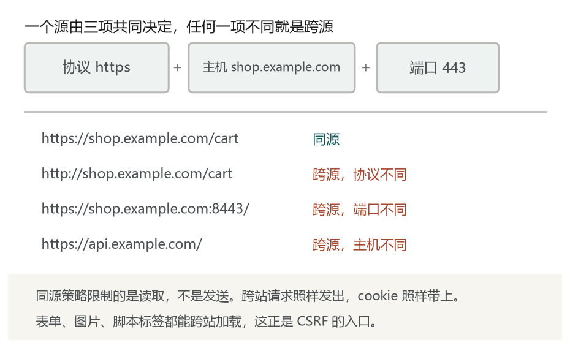
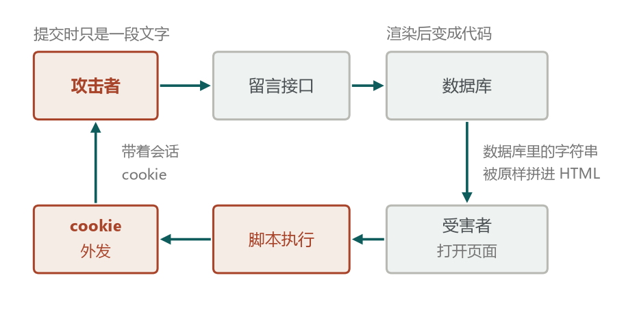
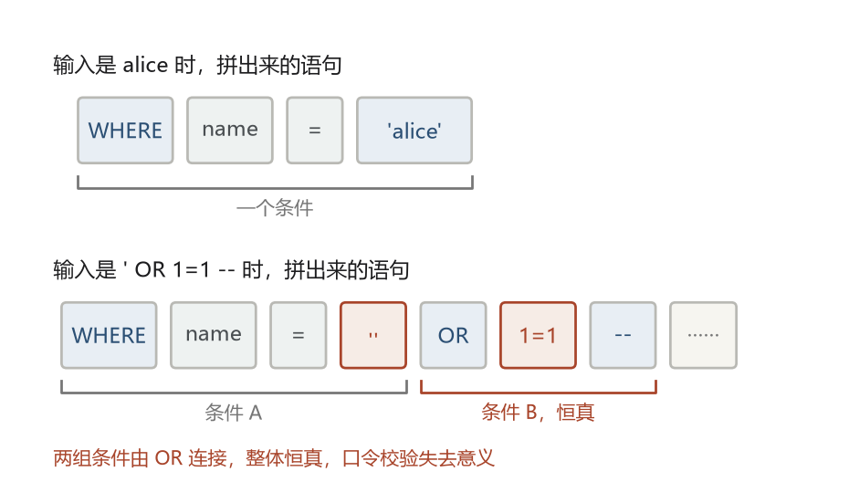
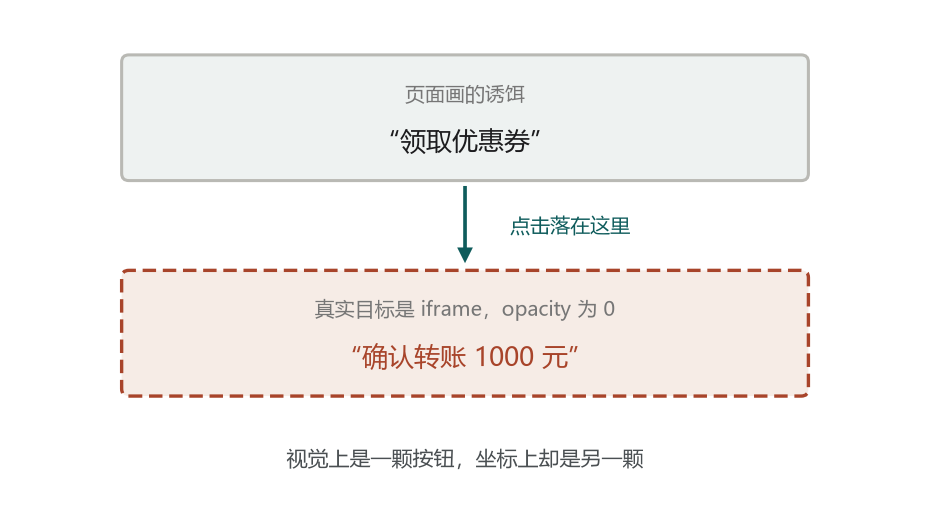

# 第十一章　网页背后的攻防

打开一个网页，你实际上在自己机器上启动了一个别人写的程序。

这件事听起来夸张，但描述是准确的。服务器把一段文本通过网络送到浏览器，浏览器解析它、布局它、执行里面的脚本。脚本能读页面内容，能发网络请求，能读本地存储，能拿到你的屏幕尺寸、时区、装了哪些字体。整个过程没有安装步骤，没有权限确认，也不需要你信任那个网站，你只是点了一个链接。

浏览器为此准备了一套限制。这些限制决定了一个网页能做什么、不能碰什么，也决定了网页攻击者要绕开的是哪一道墙。这一章按这道墙的顺序来讲，先看同源策略划出的边界，再看三种常见的越界方式，最后看这些攻击共同的形状。

## 11.1 网页是一门混在一起的语言

一个 HTML 文档里同时存在三种东西。结构用标签写，样式用 CSS 写，行为用 JavaScript 写。它们可以混在同一个文件里，也可以分散在几十个文件里，由浏览器按顺序拼接成一个整体。

这种混合是有代价的。浏览器读到 `<script>` 标签时，会暂停解析，把里面的内容交给 JavaScript 引擎执行，执行完再继续。也就是说，一段从网络上下来的文本，在解析的过程中就会变成正在运行的代码。

浏览器给了这段代码相当大的活动空间。它可以读写当前页面的每一个节点，可以在页面里画任何东西，可以把你的输入发到任何地址，可以读取这个站点存在浏览器里的数据。它不能直接读你的硬盘，不能启动别的程序，不能随便访问别的网站的数据。

最后这条限制是整个 Web 安全的地基。没有它，任何一个网页都能读你的网银页面，你打开的每一个标签页都在别人的监视之下。

浏览器还把这层防护做进了进程模型。渲染页面的部分跑在一个独立进程里，这个进程处在操作系统的沙箱中，没有直接读写文件系统和打开设备的权限，一切需求都得通过受限的接口转交出去。想越过沙箱必须先找到一个内核漏洞，这也是浏览器漏洞在地下市场里价格最高的原因。

## 11.2 同源策略

1995 年，Netscape 在自己的浏览器里加了一条规则，脚本只能访问与它来源相同的资源。这条规则后来写进了所有浏览器，名字叫同源策略（same-origin policy）。

“源”由三样东西决定，协议、主机名、端口。三者全部相同才算同源，路径和查询参数不参与判断。

<figure>

<figcaption>图 11-1　同源由协议、主机、端口三项共同决定，任何一项不同即为跨源。同源策略限制的是读取，不是发送，跨站请求照样会发出。</figcaption>
</figure>

`https://shop.example.com/cart` 和 `https://shop.example.com/order` 同源，路径不同不影响。换成 `http://` 就跨源，协议变了。换成 `https://api.example.com` 也跨源，主机名变了，尽管它们在同一个域下。加上 `:8443` 同样跨源。

这条规则保护的是一批“属于某个源”的东西。跨源的脚本不能读另一个源的页面内容，不能读它的 `localStorage`，不能读它的 cookie，也不能读 `fetch` 请求的响应正文。

它不保护的东西同样值得列清楚。

跨源的请求是可以发出去的。`fetch` 在默认情况下会发出请求，只是读不到响应；表单提交、``、`<script>`、`<link>` 这些标签更是从来不管同源，它们本来就设计成能引用任意站点的资源。请求能发出去这一条，是下一节 CSRF 的全部前提。

想让跨源读取合法发生，需要服务器明确同意。CORS 就是这套机制，服务器在响应头里列出允许的来源，浏览器核对之后才把响应正文交给脚本。头写得太宽，比如直接回一个星号，等于把同源策略关掉一半。

它也不保护同一个站点内部的不同部分。`a.example.com` 和 `b.example.com` 是跨源的，但两个子域往往由同一个团队维护，一个子域被拿下，另一个也很难独善其身。设置 cookie 时如果不加限制，子域可以往父域写 cookie，这个口子叫 cookie tossing，能让一个子域的脚本影响到兄弟子域。

它更不保护你自己。如果攻击者能让你的页面执行他的脚本，那段脚本就在你的源里，同源策略对它没有任何约束，因为它已经站在墙内了。

## 11.3 XSS

让别人的脚本在自己的页面里执行，这类漏洞叫跨站脚本（Cross-Site Scripting, XSS）。名字里的“跨站”有点误导，攻击者的脚本最终运行在受害网站上，跨的是信任的边界，不是域的边界。

按注入的位置分三种。

反射型最常见。搜索框把关键词回显在页面上，服务器没有转义，你把一个带脚本的链接发给别人，对方点开，脚本就在那个网站的域下执行了一次。这类漏洞需要受害者点链接，属于一次性。

存储型更危险。用户提交的内容被存进数据库，之后每个打开这个页面的人都会中招。论坛的帖子、商品评论、个人签名、文件名，任何被保存又被渲染的地方都可能是入口。一个存储型 XSS 在流量大的站点上等于一次批量入侵。

DOM 型发生在浏览器内部。服务器返回的 HTML 是干净的，前端脚本自己从 `location.hash` 或者 `document.referrer` 里取出内容，用 `innerHTML` 塞进页面。数据从未经过服务器，服务端的过滤规则完全看不到它。

<figure>

<figcaption>图 11-2　存储型 XSS 的数据流。攻击者提交的字符串在数据库里只是一个字段，被原样拼进 HTML 之后才变成标签和脚本，受害者一打开页面就执行。</figcaption>
</figure>

脚本能做什么，取决于它运行在谁的页面里。它能读 `document.cookie`，因为在浏览器看来它就是本站的代码，本站的 cookie 当然对它开放。它能把页面改成任意样子，包括弹出一个假的登录框。它能以你的身份发请求，能读你正在编辑的内容，能记录你的每一次按键。

一个足够短的利用就长这样。

```html

```

`src=x` 加载失败，触发 `onerror`，里面的脚本把当前站点的 cookie 拼进一个地址发出去。整段内容在数据库里只是一个字符串，被拼进页面之后才变成了标签、属性和代码。

对付它的第一道措施是 HttpOnly。服务器在设置 cookie 时加一个标记，浏览器就不让 JavaScript 读到这个 cookie，`document.cookie` 里不会出现它。这挡住了“偷走会话凭证”这条最常见的利用链。

但它挡不住 XSS 本身。脚本仍然可以在页面里发请求，浏览器仍然会自动带上那个 cookie，于是攻击者可以做任何这个用户能做的事情，只是没法把凭证带到别处慢慢用。HttpOnly 把“永久盗号”降级成了“当场操作”。

第二道措施是内容安全策略（Content Security Policy, CSP）。服务器回一个响应头，声明这个页面允许从哪些地址加载脚本，是否允许内联脚本，能否用 `eval`。策略写得好，注入的 `<script>` 会因为不在白名单里而不执行，内联的事件属性如 `onerror=` 也会被拒绝。CSP 不是过滤器，它是浏览器层面的执行约束，所以不依赖后端把每一个输入都想全。

两道措施的定位不一样。HttpOnly 减少损失，CSP 阻止执行。真正把 XSS 挡在门外的是输出编码，把用户内容放进 HTML 时，把 `<`、`>`、`&`、引号转成实体，让它永远只是文字。

## 11.4 CSRF

浏览器有一个习惯，请求某个站点的资源时，会自动带上那个站点的 cookie。这是设计使然，HTTP 本身没有会话的概念，全靠这个机制把请求和登录状态对上。

跨站请求伪造（Cross-Site Request Forgery, CSRF）利用的正是这个习惯。

你在银行网站登录着，另一个标签页打开了攻击者的页面。那个页面里有一行 ``。浏览器加载这张图片时，向银行发了这个请求，并且自动带上了你的会话 cookie。银行看到的是一个带着有效凭证的请求，于是照办。

图片加载失败无所谓，请求已经发出。表单也可以，而且不受同源限制，一个隐藏的表单加上一行自动提交的脚本就够了。

CSRF 和 XSS 的区别在于能力边界。XSS 让攻击者在你的源里执行代码，能读能写；CSRF 只能让浏览器替你发一个请求，攻击者看不到响应。所以 CSRF 通常用来做“改变状态”的事情，转账、改密码、加管理员，而不是偷数据。

防御的核心是让请求带上一个攻击者猜不出来的东西。服务端在表单里放一个随机令牌，和当前会话绑定，提交时校验。攻击者的页面能发出请求，但不知道令牌，因为同源策略不让它读你页面里的内容。

SameSite 是浏览器层面的一条补充规则。cookie 带上 `SameSite=Lax` 之后，跨站的 POST 请求不会再携带它，只有从外部链接点进来的顶级导航才带。主流浏览器已经把 Lax 设成默认值，这一条让大量老式 CSRF 直接失效。严格模式 `SameSite=Strict` 更彻底，连从外部点链接进来都不带，代价是用户体验会受影响。

## 11.5 SQL 注入

前面两类攻击发生在浏览器和服务器之间，SQL 注入发生在服务器和数据库之间。

登录功能的第一版通常长这样。用户输入的用户名和口令被拼进一条 SQL 语句，交给数据库执行。

```python
def login(name, password):
    sql = ("SELECT id FROM users WHERE name = '"
           + name
           + "' AND pass = '"
           + password + "'")
    row = db.execute(sql).fetchone()
    return row is not None
```

输入 `alice` 和 `123456`，最终执行的是 `WHERE name = 'alice' AND pass = '123456'`，逻辑正确。

输入 `' OR 1=1 --` 作为用户名，语句变成这样。

```text
SELECT id FROM users WHERE name = '' OR 1=1 --' AND pass = ''
```

第一个引号把字符串提前闭合，`OR 1=1` 成了新的条件，末尾的两个减号把后面剩下的部分注释掉了。数据库不认识“用户名”这个概念，它只按语法解析这条语句，于是返整张表，登录成功。

<figure>

<figcaption>图 11-3　同一段输入拼进 SQL 后，引号的配对关系被改变，数据里的一部分成了新的条件，末尾的 `--` 又把剩余语句注释掉，整体恒真。</figcaption>
</figure>

真正的危害不止登录绕过。用 `UNION SELECT` 可以把别的表的数据拼进查询结果，一次拿到整库的用户表和口令哈希。用分号可以追加语句，删表、加管理员账号。看不到回显的时候还有盲注，靠页面反应快慢一个比特一个比特地问出数据。

修复的办法不是过滤引号。过滤总会漏，编码方式一变、数据库一换、参数换个位置，规则就失效了。

正确的做法是让数据和语法彻底分开。

```python
def login(name, password):
    sql = "SELECT id FROM users WHERE name = ? AND pass = ?"
    row = db.execute(sql, (name, password)).fetchone()
    return row is not None
```

占位符让数据库先把语句解析成一个结构，确定了哪里是条件、哪里是值，然后把参数填进那些位置。填进去的内容永远被当作值，即使里面全是引号和 OR，也只是一个奇怪的字符串。

这叫参数化查询，也叫预编译语句。它之所以有效，不是因为过滤得干净，而是因为值根本没有机会参与语法分析。

还有一条常被忽略的措施。数据库账号的权限应该只够这个应用使用。一个只读的查询接口不该有 `DROP` 权限，一个业务库的账号不该能读系统表。参数化挡住注入，最小权限限制注入成功之后的破坏范围，两者不冲突。

## 11.6 同一种错误的其他形状

同样的错误会以别的名字出现。

服务端模板注入（Server-Side Template Injection, SSTI）发生在模板引擎上。模板引擎的用途是把数据填进页面模板，正常写法是模板固定、数据可变。如果开发者把用户输入当成模板本身去编译，输入 `{{7*7}}` 就会看到页面返回 49，这说明表达式被求值了。再往前一步，攻击者可以顺着模板引擎提供的对象访问路径，一路摸到执行系统命令的函数。根子和 SQL 注入一样，用户输入进入了语法。

服务端请求伪造（Server-Side Request Forgery, SSRF）发生在“服务器替你去取一个地址”的功能上。图片下载、网页预览、webhook 测试、PDF 导出，都需要服务器去访问一个 URL。攻击者把地址填成 `http://127.0.0.1:6379` 或者 `http://169.254.169.254/`，服务器就带着自己的网络位置和内网权限去访问了。前者可能是一个只监听本机的管理服务，后者是云厂商的元数据接口，里面常有临时凭证。SSRF 的本质是信任错位，请求来自内网，被访问的服务就默认它是可信的。

回头看这一章的防护措施，会发现它们都在做同一件事，在每一层的边界上重新声明“这段内容是什么”。

参数化查询声明参数是值。输出编码声明这段文本是文字而不是标签，而且编码方式要看上下文，放进 HTML 文本、放进属性、放进 JavaScript 字符串、放进 URL，需要的转义规则各不相同。CSP 声明这个页面只信任这些脚本。SameSite 声明这个 cookie 不该被别的站点带着跑。最小权限声明这个进程只该碰这些数据。

这些措施都放弃了“识别坏输入”这个思路。原因是黑名单永远列不全。你要过滤 `<script>`，别人用 ``；你过滤 `onerror`，别人用 `<svg onload>`；你过滤所有标签，别人用编码后的实体绕过。

所以 Web 攻防的形状可以概括成一句话。同一个字符串，在 SQL 层被当成语法，在 HTML 层被当成标签，在 shell 层被当成命令，在模板层被当成表达式。攻击者做的事是让一段内容在他希望的那一层被解释成他希望的东西，防守方要做的是确保每一层都只把它当数据看。

## 11.7 看不见的那一层

同源策略管的是脚本能不能读别的源，而有一类攻击不需要读任何东西，只需要让人点一下。

2008 年，Jeremiah Grossman 和 Robert Hansen 公开了点击劫持（clickjacking）。做法是在真页面上盖一个透明的框，框里装的是另一个站点，用户看到的按钮是底下那个页面画的，点下去的事件却落在了上面那一层。

```html
<style>
  iframe { position: absolute; top: 0; left: 0;
           width: 100%; height: 100%; opacity: 0; z-index: 9; }
  .bait  { position: absolute; top: 120px; left: 80px; }
</style>
<button class="bait">领取优惠券</button>
<iframe src="https://bank.example/transfer?to=x&amount=1000"></iframe>
```

`opacity: 0` 让 iframe 完全透明，`z-index` 保证它盖在诱饵按钮上方。用户看到的是一颗普通的按钮，鼠标坐标却落在银行转账页的确认键上。整个过程中没有任何脚本读到过跨源内容，同源策略全程没有被绕过，它根本不适用。

<figure>

<figcaption>图 11-4　点击劫持的两层。视觉上只有一颗诱饵按钮，实际接收点击的是被 `opacity: 0` 藏起来的 iframe，整个过程不涉及跨源读取，同源策略管不到这个方向。</figcaption>
</figure>

2009 年 Twitter 上出现过一个蠕虫，用户在任意网页上点一下就会发出一条推文，靠的也是这个。2010 年前后 Facebook 的点赞按钮被大规模利用，业内给了个名字叫点赞劫持（likejacking）。

防守的办法是告诉浏览器“这个页面不允许被框”。最早的响应头是 `X-Frame-Options`，取值 `DENY` 或 `SAMEORIGIN`，2008 年底开始在 IE8 里出现，后来其他浏览器跟上。它的缺陷是不支持多个来源的白名单。后来 CSP 加了一条指令 `frame-ancestors 'self' https://partner.example.com`，能写多个来源，并且优先级高于 `X-Frame-Options`。

查一个站点有没有设，一行命令就够。

```bash
curl -sI https://example.com | grep -iE 'x-frame-options|content-security-policy'
```

浏览器里还有一条前端手段叫 frame busting，用脚本检测 `window.top !== window.self` 然后跳出。它不可靠，因为 iframe 可以用 `sandbox` 属性禁止脚本执行，那种情况下 busting 代码根本不会跑。

还有一类变体不靠点击。拖拽劫持把一段预先选中的文本拖进 iframe 里的输入框，光标劫持用 CSS 把输入光标画在诱饵输入框的位置，用户看到自己在打字，字符却进了另一个页面。两种手法的共同前提是浏览器把“用户鼠标在哪里”当成可信输入，而鼠标指针的样子和位置是页面可以画的。

这一层上还有另一个常常被写错的接口，`postMessage`。它是跨源页面之间唯一被允许的通信方式，发送方调 `otherWindow.postMessage(data, targetOrigin)`，接收方监听 `message` 事件。规范要求接收方自己检查 `event.origin`，浏览器不替它检查。

```js
window.addEventListener('message', (e) => {
  if (e.origin !== 'https://app.example.com') return;   // 必须写在最前面
  handle(e.data);
});
```

漏写这一行的站不少。一旦漏了，任何能把页面嵌进 iframe 的人都能向它发消息，而接收方的代码往往在做“根据消息设置 location”或者“根据消息渲染 HTML”这类事情，等于把一个跨源写入口开在了自己的源里。

## 11.8 侧信道把墙推回了进程

同源策略是逻辑上的隔离，它规定脚本能读什么，但没有规定两个页面能不能住在同一个进程里。2018 年之后，这个区别变得关键。

2018 年 1 月 3 日，谷歌 Project Zero 和多个学术团队同时公开了一组 CPU 层面的攻击，统称 Spectre，另有一个只影响英特尔等部分芯片的变种叫 Meltdown。编号分别是 CVE-2017-5753（边界检查绕过）、CVE-2017-5715（分支目标注入）和 CVE-2017-5754（Meltdown）。

它们的共同点是利用推测执行。CPU 遇到分支时会先猜一个方向并把后面的指令提前跑掉，猜错就丢弃结果。丢弃的是架构状态，寄存器和内存的可见值会回滚，但缓存不会。被回滚的那次读取已经在缓存里留下了痕迹，攻击者用一段能精确计时的代码去测哪块内存更快，就能一个字节一个字节地把本该读不到的值推出来。

在浏览器里，这意味着同源策略被绕过了。攻击者的页面本身没有权限读别的源的数据，但只要它和受害者页面共享进程、共享缓存，它就能通过计时把那些数据侧着读出来。判断依据不是“能不能读”，是“快还是慢”。

浏览器的回应分两步。短期是把能用来计时的接口调粗，把高精度时间戳的分辨率压下去，并暂时关掉了允许线程间共享内存的 `SharedArrayBuffer`。长期是把隔离落到进程上，Chrome 在 2018 年 7 月的 67 版全平台默认开启了站点隔离（Site Isolation），每个站点一个渲染进程，跨站 iframe 单独跑在别的进程里（OOPIF）。谷歌当时给出的代价是内存占用增加一成上下。

即便如此，进程隔离也只挡一部分。后续的变体能够在同一进程内、甚至跨核通过缓存争用推断数据。想要拿到更强的保证，页面得进入跨源隔离（cross-origin isolated）状态，条件是同时返回两个响应头，`Cross-Origin-Opener-Policy: same-origin` 和 `Cross-Origin-Embedder-Policy: require-corp`。只有在这个状态下，浏览器才重新放开了 `SharedArrayBuffer` 和高精度计时器。

修 Spectre 的难处在于它不是一个 bug，是性能优化的副作用。分支预测和乱序执行支撑着过去二十年处理器性能的主要增长，全部关掉可以让它消失，但那等于把 CPU 退回上个时代。软件侧的做法是在敏感边界上插屏障指令，用 `lfence` 把推测挡住，代价是那几行代码慢一个数量级。所以实际选择往往是接受残留风险，把最关键的东西放到不容易被计时探测的位置，而不是等一个彻底的修复。

这一节和前面几节放在一起看，边界的位置变过一次。1995 年的问题是脚本能不能读另一个源的文档，答案是加一条规则。2018 年的问题是两个页面共用一个缓存，这条规则完全看不见，于是边界从“源”下沉到了“进程”和“缓存”。边界一旦下沉，上面所有的规则都得重新审一遍。

<div class="chapter-end"></div>
