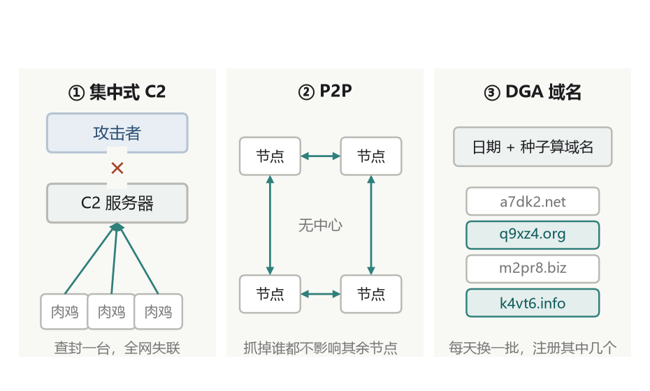
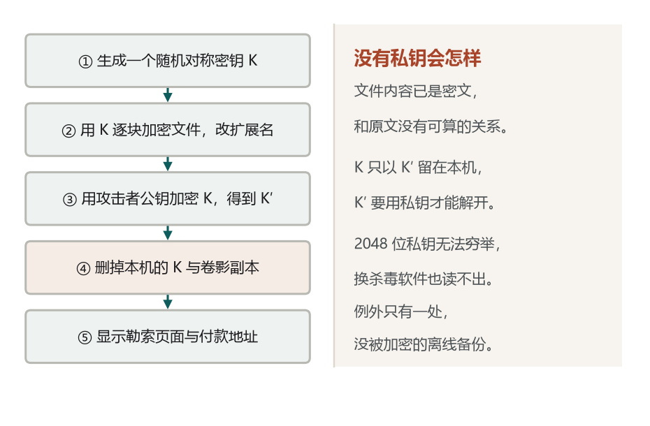
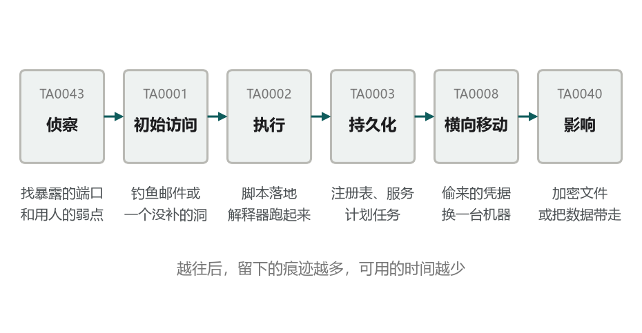

# 第十四章　木马、僵尸网络与勒索软件

2019 年的一天凌晨两点，一家医院的影像系统打不开了。值班的技师以为网络断了，重启，还是不行。服务器上所有文件都被改成同一个后缀，桌面上多了一个文本文件，里面写着付款地址、金额，和一个不断减少的倒计时。

这类事情今天已经不算新闻。但把时间往前推二十年，恶意程序的目标不是数据本身。病毒想让机器出故障，蠕虫想让自己传播得更远，木马想安安静静待着。勒索软件第一次把你离不开的东西直接当成人质，它的商业模型比技术更狠。

这一章沿着一条时间线往下走，进门，扎根，连成一片，最后收钱。

## 14.1 进门之后

木马的名字来自特洛伊木马。它不负责传播，负责骗人开门。伪装的方式很朴素，改个图标，起个像正经软件的名字，挂在一个假冒的下载站上，或者塞进一个号称能破解收费软件的压缩包里。有的样本会给自己签一个证书，名字取得和某家知名公司只差一个字母，安装的时候用户看一眼就点过去了。

进门只是第一步。机器一重启就没了，等于白干，所以木马落地之后第一件事是持久化（persistence），让自己活过重启。常见的路有四条。

注册表自启，在 Windows 的 Run 键下面加一项，用户登录时自动执行。这是最老的一条，也是检测方盯得最紧的一条。

注册成服务，或者 Linux 上的 systemd 单元，开机就跑，不依赖谁登录。它比 Run 键更稳，因为服务可以在用户登录之前启动。

计划任务，注册一个定时触发的任务，触发条件可以是开机、登录、空闲，或者每十分钟一次。好处是它能藏在一个看起来正常的任务名下面，混在系统自带的维护任务里。

DLL 侧加载（DLL side-loading）是这几年最流行的一种。正常程序启动时会到某个目录里找它需要的 DLL，如果搜索顺序可以被影响，把恶意 DLL 放在前面，正常程序就会替攻击者把它加载进来。整个过程的执行者是一个签过名的正规软件，白名单机制在这里直接失效。

持久化解决还在不在，远控解决能干什么。一个完整的远控（RAT，remote access trojan）通常带着这些功能，文件管理、命令行、屏幕截图、键盘记录、剪贴板读写、摄像头与麦克风、下载并执行新模块。听起来和正规的远程管理软件没有区别，技术上确实也没有多大区别。区别在授权，用户知不知道自己被管，数据发到哪里去。

## 14.2 从一台到一片

单台机器的价值有限。攻击者想要的是一批机器同时听话，这个东西叫僵尸网络（botnet），每一台被控机器叫肉鸡（bot）。

肉鸡能做的事很多，发起流量攻击、群发垃圾邮件、当跳板隐藏真实来源、跑挖矿程序、给店铺刷单。这些活自己养机器成本很高，租一批现成的便宜得多，于是僵尸网络本身就成了可以按小时出租的生意。

僵尸网络的关键不在数量，在指挥。被控机器要能收到命令，这条通道又不能被掐断。通道叫 C2（command and control），它的形态变过四次，每一次都是被打击出来的。

最早用 IRC。肉鸡登录一个频道，攻击者在频道里发指令，实现起来简单到几十行代码。问题也明显，整个网络依赖一台服务器，端掉这台服务器，全网失联。

后来换成 HTTP。肉鸡定时向一个网址发请求，把指令藏在返回的网页或者图片里。这样做的好处是流量看起来像正常上网，能混在代理日志的噪声里，也不容易被防火墙按端口拦掉。

再后来是 P2P。没有中心服务器，每台机器既是客户端也是节点，指令在节点之间转发。抓掉任何一台，剩下的照常工作。代价是指令传播慢，延迟高，而且节点之间那些不寻常的连接模式本身就是可以被识别的特征。

最后是 DGA（domain generation algorithm）。肉鸡不需要知道固定地址，它按一个算法算出一批域名，逐个去试，攻击者注册其中任意一个就能接上。算法和种子可以写死在样本里，也可以由上一个域名下发。防守方要拦住它，就得把每天生成的那批域名提前屏蔽，这是一场成本不对等的消耗。

<figure>

<figcaption>图 14-1　三种指挥通道。集中式便宜好用，一台服务器被查封就全线失联；P2P 与 DGA 把成本推给了防守方。</figcaption>
</figure>

## 14.3 两个案例

Torpig 是 2009 年一篇论文里的主角，它的前身叫 Mebroot，感染的是硬盘的主引导记录。主引导记录在操作系统之前运行，所以它比任何开机自启都更早拿到控制权。Torpig 主要偷银行凭据，办法是把自己注入浏览器进程，在用户登录网银的时候替换页面、截获表单，用户看到的是真网站的样子，填进去的东西先进了木马的手里。

Stone-Gross 等人在 CCS 2009 上发表《Your Botnet is My Botnet》，做了一件在当时很少见的事。他们逆出了 Torpig 的域名生成算法，提前把它未来几周要用的域名注册下来，于是 C2 落到了研究者手里。接下来十个月，他们以前所未有的完整度看着这个僵尸网络运转，约 18 万台主机被感染，窃取到 8,310 个账户，涉及 410 家机构。

这个案例的方法论值得记住。接管 C2 之后，研究者拿到的是攻击者视角的全部数据，哪些机器在什么时间发了什么、哪些凭据被用过。这比在一台机器上做取证要清楚得多。

Conficker 走的是另一个方向。2008 年 11 月出现，利用的是 Windows Server 服务的路径规范化漏洞，编号 MS08-067。它也靠 DGA 找 C2，早期版本每天生成 250 个域名，后续版本涨到了 5 万个。Torpig 那套提前注册的办法在这里直接失效，要抢注的域名太多，成本压不住。

Conficker 还做了两件很少见的事。它通过 P2P 在感染机器之间互相更新，一个变种被清理掉，旁边的节点会把新版本送回来。它还主动封掉杀毒软件和系统更新的域名解析，让机器既不能更新也查不了资料。各国 CERT 和厂商组成了 Conficker Working Group 联合封堵，算是把它按住了，但它在网络上的残留持续了很多年。

两个案例摆在一起，说明 C2 的设计和成本直接相关。集中式便宜、快、好管理，也最好打。DGA 加 P2P 贵、慢、难维护，但也难打。攻击者在两者之间的选择，取决于他打算干多久。

## 14.4 勒索：把密钥拿走

勒索软件的加密流程不长，但每一步都有讲究。

样本跑起来，先在本机生成一个随机的对称密钥 K。对称加密快，一个 GB 级的文件几秒钟就能处理完，这是勒索软件能在几分钟内锁死一台服务器的原因。文件被逐块加密，写回原位置，扩展名改掉。

接下来，用攻击者的公钥把 K 加密成 K′。公钥就写在样本里，谁都能拿到，但拿它解不开任何东西。K′ 被发到攻击者的服务器上，本机的那份 K 被抹掉。

最后一步经常被忽略，清理。删除卷影副本，关掉系统还原，停掉备份服务，清掉日志。Windows 的"以前的版本"功能靠的就是卷影副本，很多人以为自己有备份，其实备份和原文件躺在同一块盘上，一起被删了。

<figure>

<figcaption>图 14-2　加密与密钥的去向。对称密钥负责速度，公钥负责让受害者拿不到密钥，两步配合之后，文件在数学上就和原文断了关系。</figcaption>
</figure>

为什么没有密钥几乎不可能恢复。K 是随机的 256 位，穷举没有意义。K′ 只有私钥能解，私钥在攻击者手里。文件内容是原地覆盖的，磁盘上不留明文。三条叠在一起，除了找攻击者要，就只剩备份一条路。

有些实现为了提速，只加密每个文件开头的几兆字节，剩下的留着。这类样本给了取证一点点空间，因为部分文件可能还能读出片段，但完整恢复依然要靠密钥。

也有实现干脆不加密，只把文件搬到一个隐藏目录，然后显示勒索页面。这种"假勒索"恢复起来容易得多，前提是你知道去哪儿找。

付钱也不保证能拿回东西。有的团伙收了钱不发工具，有的工具本身有缺陷，解到一半失败，有的只解密一部分文件当作催款手段。多数执法机构和安全厂商因此不建议支付，理由不只是道义，付款会让这条链继续运转，也会证明这家机构愿意付。

## 14.5 一条产业链

2013 年的 CryptoLocker 是个转折点。它之前，勒索软件要受害者汇款、发短信、买充值卡，收款环节是整个流程里最脆弱的一环，一笔跨境汇款能查到人。CryptoLocker 引入比特币支付，跨境、即时、不可撤回，收款问题一次性解决。它索要的金额按今天的标准看很小，几百美元，但付款率高得让这门生意迅速产业化。

2017 年的 WannaCry 把勒索和蠕虫合到一起，用 EternalBlue 在局域网里横向传播，一天之内波及一百多个国家的几十万台机器。它的加密实现有缺陷，也因为一个意外的域名注册而被停掉，第十七章会细讲这段。

2020 年之后，主流玩法变成双重勒索（double extortion）。先偷数据，再加密。加密可以被备份化解，数据泄露不能。受害者即使有完整备份，也要面对"不付钱就公开客户名单"的压力。有的团伙还加第三层，直接给受害者的客户和媒体打电话，把压力转嫁给别人的生意伙伴。

分工也越来越细。有人专门做初始访问，把打进某家公司网络的入口卖给下游，这个角色叫初始访问代理（initial access broker）。有人专门写加密器和后台，按订阅卖给具体执行的人，这叫勒索软件即服务（RaaS），执行方拿大头，开发者抽成。有人专门负责谈判，有人专门负责洗钱，通过混币服务、场外交易和虚假业务把币换成现金。

这条链上每个人都只做一段，谁都不掌握全貌。执法打掉一个环节，其他环节很快能找到替代，这也是为什么抓捕个案对整体趋势的影响总比预期小。

## 14.6 攻击链与落点

把一次完整的入侵按时间顺序排开，就有了攻击链（kill chain）的说法。MITRE 的 ATT&CK 把它拆得更细，给每个阶段编了号，还附上了真实样本里见过的具体手法。

<figure>

<figcaption>图 14-3　攻击链的六个阶段与对应的 ATT&CK 战术编号。顺序不是死的，但从左往右大致就是一次入侵的时间线。</figcaption>
</figure>

侦察阶段找暴露的端口，找员工的公开信息。初始访问靠钓鱼邮件、暴露在公网的远程桌面、没打补丁的边界设备。执行阶段让代码跑起来。持久化保证重启之后还在。横向移动用偷到的凭据换一台更有价值的机器。影响阶段加密文件，或者把数据带走。

对防守方，这条链的价值在于总有一环可以拦。但真正有效的落点不多，而且大多不在链的末端。

备份要离线。这句话被说烂了，可每次事件里还是有人栽在上面。能恢复的前提是备份没有被同一套凭据访问到，没有挂在同一个域里，最好有一份是物理隔离的。

凭据要分层。横向移动靠的是凭据复用，一个普通员工账号不应该能登录数据库服务器，管理员账号不应该用来收邮件。

分段要做。勒索软件在同一个网段里跑得最快，网络隔离能把一次事件限制在一个区域，剩下的区域还有时间反应。

暴露面要清。暴露在公网上的远程桌面和 VPN 是这两年最常见的入口，很多机构并不知道自己有多少台机器在公网上应答。

监控要能看见异常。加密会在几分钟内产生大量文件写操作，这个特征在行为层面是拦得住的，第十五章讲这类手段。

勒索软件把数据可用性变成了人质。防守的重点因此从能不能挡住，扩展到挡不住的时候能不能恢复。这个转变看上去像是退让，其实更接近现实，挡不住是常态，恢复能力才是底线。

## 14.7 落地的位置

14.1 里那四条持久化的路都很抽象，到具体系统上是一组确定的路径。知道它们在哪里，排查才有起点。

Windows 上最常被挂的有五处。用户级的 `HKCU\Software\Microsoft\Windows\CurrentVersion\Run`，管理员级的 `HKLM\SOFTWARE\Microsoft\Windows\CurrentVersion\Run` 和 `RunOnce`，启动文件夹 `%APPDATA%\Microsoft\Windows\Start Menu\Programs\Startup`，服务列表，以及计划任务。

```powershell
Get-ItemProperty 'HKCU:\Software\Microsoft\Windows\CurrentVersion\Run'
Get-Service | Where-Object { $_.StartType -eq 'Auto' }
Get-ScheduledTask | Where-Object { $_.TaskPath -notlike '\Microsoft\*' }
```

三条命令分别看自启键、自启服务和第三方计划任务。最后一条把系统自带的维护任务过滤掉，否则输出会有几百行。

还有一处不在这个列表里，WMI 事件订阅。它在系统里注册一个永久的事件消费者，不落地文件，不在 Run 键里，重启之后还在，触发条件可以是“每五分钟”或者“某个进程启动”。查它要专门看 `root\subscription` 命名空间下的 `__EventFilter` 和 `CommandLineEventConsumer` 两类对象。

Linux 上的对应物更分散。`crontab -l` 看当前用户的定时任务，`/etc/cron.d/` 和 `/etc/cron.*` 看系统的，`systemctl list-unit-files --state=enabled` 看开机服务，`~/.config/autostart/` 看桌面会话的，`~/.bashrc` 和 `~/.profile` 看登录时执行的命令。

这里面有一个特别隐蔽的位置，`/etc/ld.so.preload`。这个文件里每行写一个共享库路径，动态链接器会把它们预先加载进每一个新启动的进程。写进去一个恶意库，之后所有程序都带着它，包括 `ps`、`ls`、`top` 这些用来查问题的工具。用户态看不到任何异常进程，因为库本身就在那些进程里。

DLL 侧加载的检查点不一样。它不是“多了什么东西”，而是“某个正规程序加载了一个不该在那里的库”。要查这个，得把进程加载的模块列出来，看路径和签名。

```powershell
Get-Process | ForEach-Object { $_.Modules } |
  Where-Object { $_.FileName -notlike 'C:\Windows\*' } |
  Select-Object FileName, FileVersionInfo
```

一个签过名的程序从临时目录或者用户目录里拉进来一个没有签名的 DLL，这个组合本身就是信号。

服务还有一处常在检查里被漏掉，安装路径没有加引号。Windows 创建进程时会先试整串路径，不行再从第一个空格处断开逐个试，于是一个叫 `C:\Program Files\Backup Tool\svc.exe` 的路径，可能被实际执行的是 `C:\Program.exe`。后者如果可写，一个普通用户就能提权。

排查这类问题有一条通用原则，只看白名单内的位置。把自己机器上正常的自启项列一遍存下来，之后只看新增的部分。一个全新安装的系统里，这三类自启项加起来往往不到三十条。未加引号的服务路径用一行命令就能筛完，把 `PathName` 不以引号开头且含空格的项列出来逐条看即可。

## 14.8 加密那一步

14.4 讲了加密的流程，没讲为什么选那些算法。选择的理由都是工程上的。

对称部分用 AES 的计数器模式或者 ChaCha20，因为这两个都是流式的，可以按块并行，不需要把整个文件读进内存。一个几十 GB 的数据库文件，分组密码的链式模式必须串行处理，流式模式可以开八个线程同时跑。勒索软件能在几分钟内锁死一台服务器，靠的就是这个。

密钥封装用 RSA 或者椭圆曲线。RSA 的优点是实现到处都有，代价是公钥长度大、加密慢，但这一步每个文件只做一次，慢也无所谓。有的家族改成直接用一个固定的对称密钥包一层，把密钥写死在配置里，代价是拿到样本就能解开，所以主流还是非对称。

文件选择也有技巧。全盘加密最彻底但最慢，所以很多家族只加密特定扩展名的文件，跳过系统目录和可执行文件，因为这些文件加密了反而会让机器彻底不能用，受害者就没法看到勒索页面了。也有一些只加密每个文件的前一兆字节，理由是大部分文档看不了开头就等于废了，而后面的数据不用处理，速度可以快好几倍。

2021 年之后出现了一个新目标，虚拟化层。攻击者拿到 hypervisor 的管理权限之后，直接停掉所有虚拟机，再加密它们的磁盘文件。对受害者来说，一次事件从“一台服务器”变成了“整个机房”。ESXi 上的具体命令很简单，`esxcli vm process list` 列出虚拟机，再逐个 `kill`，剩下的就是加密 `.vmdk`。一个熟练的操作员半小时内能停掉一整个集群。

加密速度的量级也解释得清很多现象。带 AES-NI 的普通桌面 CPU 单个核心跑 AES 能到每秒几百兆字节，一块 NVMe 盘顺序读写在三到五 GB/s，叠加八个线程之后，瓶颈从 CPU 移到了磁盘。这也意味着勒索软件能多快锁死一台机器，取决于磁盘带宽而不是算法开销，而加密过程中那串密集的写入和改名，正好是防御方最好抓的特征。

恢复这条路也有分工。有些家族的实现有缺陷，密钥没有正确地被抹掉，内存转储里还能找到；有些家族的加密器有 bug，对大文件截断处理错，能用统计方法部分恢复。这些都不靠猜密钥，靠的是实现出错。

2016 年，荷兰警察、欧洲刑警组织和几家安全厂商一起开了个叫 No More Ransom 的网站，把各家能做出来的解密工具集中放在一个地方，现在已经有一百多种，覆盖了很多已经停止活跃的家族。它的前提是密钥或算法缺陷已经被找到，对新的、实现正确的家族没有用。

对自己机器上的卷影副本，有一条命令值得记住。

```powershell
vssadmin list shadows
```

如果输出里还有几天前的快照，那就有机会。但要注意，大多数现代家族在加密之前会先把这个列表清空，这也是为什么备份不能和原数据放在同一台机器上。

<div class="chapter-end"></div>
