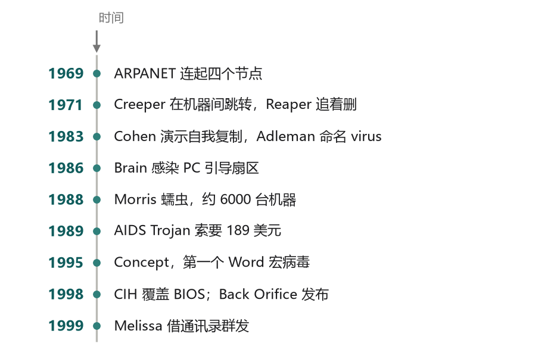
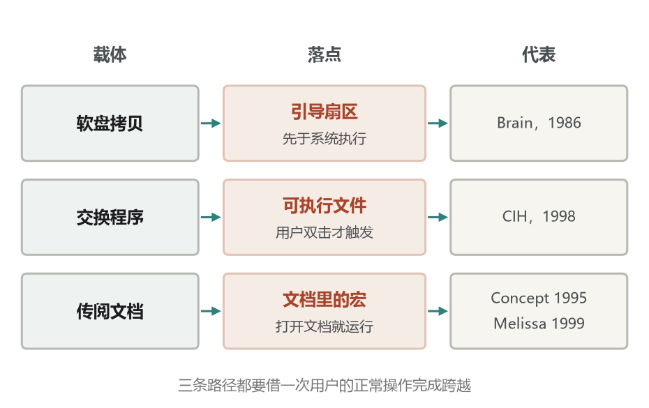

# 第十九章　从恶作剧到产业（1969-1999）

1988 年 11 月 2 日傍晚，几所大学的计算中心几乎同时出现了同一种症状。机器负载莫名其妙地往上走，登录变得很慢，邮件队列越堆越长。管理员敲下 `ps`，看见同一台机器上跑着好几个一模一样的进程，杀掉一个，过一会儿又冒出两个。

再往下查，问题不在本机。那些进程正顺着网络上的漏洞往别的机器上复制自己，而别的机器也在往这台机器上复制。当晚连在网上的机器总共六万台上下，第二天统计，大约六千台被卷了进去，占十分之一。

在这件事之前，"恶意程序"在多数人心里还是个玩笑，是机房里的人互相捉弄的把戏。在这件事之后，它成了一个需要立法、需要公司、需要预算的东西。这一章讲的就是中间这三十年，一段会自我复制的代码，怎么从实验室里的演示，变成一门有人愿意掏钱的生意。

## 19.1 四个节点

1969 年之前，程序要跨机器传播只能靠人搬，磁带、纸带、软盘，一份一份地拷。传播速度取决于人的脚步，传播范围取决于这个人认识谁。这个限制听起来很笨，却是当时最有效的隔离，机器的世界和人的世界之间只隔着一段物理距离。

ARPANET 在 1969 年连起四个节点，把这层隔离拆了。机器之间可以直接传文件、发消息，距离在协议这一层被抹平。一台机器上的程序可以在几秒钟内出现在另一台上，中间不需要任何人搬东西。

1971 年，BBN 公司的 Bob Thomas 写了一个小程序，跑在 TENEX 操作系统上。它会在机器之间跳转，跳过去之后在终端上打出一行字，"I'm the creeper, catch me if you can"。它不删文件，不偷数据，只是把自己传下去，然后显示这句话。

这是第一个会自我复制的程序，也是一次公开的、故意的挑衅。作者想证明的是"我能做到"，不是"我要害你"。这个动机在之后的三十年里反复出现，每一次都以更贵的代价收场。

Creeper 出现之后，Ray Tomlinson 写了另一个程序，叫 Reaper，功能是追着 Creeper 跑，找到就删掉。两段代码在同一批机器上互相追赶，看上去像一场游戏。

这场游戏定下了后面几十年的格局。Reaper 是第一份杀毒软件，而它必须和 Creeper 一样会自我复制，才追得上。防守方要和进攻方一样快，这个要求从第一天就存在，从来没有松动过。今天的安全产品之所以要每天更新、要云端下发规则、要在几分钟内响应一个新样本，根子就在 1971 年的这段代码里。

Creeper 还留下另一样东西。它证明了程序可以在机器之间移动，而移动不需要主人的同意。网络在设计时解决的是"数据怎么到达"，没有解决"到达的东西是谁、该不该执行"。这个空白后来被填过很多次，每一次都填得不完整。

## 19.2 给它一个名字

1983 年，南加州大学的一堂研讨课上，Fred Cohen 演示了一个会自我复制的程序。他在系统里放进去一小段代码，看着它把自己附到别的程序上，一个变两个，两个变四个。演示只有几分钟，但它把一件事从传闻变成了可以重复的实验。

他的导师 Leonard Adleman 给这种东西起了名字，computer virus。这个名字选得准。生物学里"病毒"的几个特征，需要宿主、靠复制传播、不一定要杀死宿主，搬到程序上竟然都成立。名字出来之后，讨论的方式就变了。

在此之前，一台机器出问题，人们会说是程序有 bug，系统不稳定，有人动了手脚。之后，同一个现象有了一个类别，可以被统计、被比较、被写进法律条文。命名的力量经常被低估。一个东西没有名字的时候，它只是一连串互不相关的事故；有了名字，它才成为一个需要对付的对象，才有预算、有产品、有职位。

三年后，巴基斯坦的一对兄弟写了 Brain。他们在拉合尔卖软件，发现自己的程序被人拷来拷去，一分钱收不到。他们的应对办法是写一个程序，把自己装进软盘的引导扇区，屏幕上留下店名和电话。谁拷走他们的软件，就会把这段广告一起拷走。

Brain 是第一个感染 IBM PC 引导扇区的病毒。引导扇区是软盘最前面的一小块区域，机器启动时先读它，再从它跳到操作系统。这个位置的特殊之处在顺序。任何查毒的程序都要等操作系统起来才能运行，而引导扇区里的代码在操作系统之前就已经跑完了。想检查它的人，永远比它晚一步。

阿尔维兄弟本意是防拷贝，结果造出了第一个被广泛传播的 PC 病毒。这里有个反复出现的模式，一段代码只要获得了自我复制的能力，作者就失去了对它的控制。它去了哪里，感染了谁，被谁改过，加过什么料，都不再由写它的人决定。防拷贝和破坏的差别，在代码跑起来之后就不重要了。

## 19.3 那一晚的三条路

回到 1988 年 11 月 2 日。放出这个蠕虫的是康奈尔大学的研究生 Robert Morris。它的传播设计很清楚，三条路径同时使用，任何一条成功就够了。

第一条是 sendmail 的调试模式。当时的 sendmail 为了便于管理员排错，留了一个让远程把命令送进调试接口的功能。蠕虫把一段命令塞进去，让收信的机器执行，于是拿到了一个 shell。

第二条是 fingerd 的 gets。finger 服务用来查某个用户的信息，它用一个叫 `gets` 的函数读输入，而这个函数不检查长度。输入太长，就会写到缓冲区外面，覆盖掉函数的返回地址。这是缓冲区溢出（buffer overflow），当时它只是三条路里的一条，后来成了几十年里最重要的一类漏洞。

第三条是 rsh 的信任关系。早期的机器为了省事，配置了彼此信任，一台机器上的用户不输密码就能在另一台上执行命令。蠕虫读了信任列表，顺着这些关系往外走，顺手试了一批常见口令。

它不需要用户点开任何东西，不需要人配合，机器只要在线就会被试一遍。一次没有人打算造成破坏的实验，最后变成了大规模事故，每个环节都只多做了一点点不该做的事，叠起来就是六千台机器。

六千台，占当时互联网的十分之一。这个比例在今天不可想象。它没有携带破坏数据的载荷，事故的原因很朴素，复制得太快，每台机器上的进程越堆越多，机器被自己的访客压垮。

事后追责走到了法庭。Morris 成为美国 1986 年《计算机欺诈与滥用法》下第一个被定罪的人，判三年缓刑、四百小时社区服务、一万零五十美元罚金。这个判决在当时争议很大，一部分人认为他只是做了个实验，另一部分人认为损失是实实在在的。不管怎么看，它确立了一件事，写代码的人和把代码放出去的人要负责。

这一晚留下两个先例。技术上的那个是，三条互不依赖的路径同时用，每条都不需要精妙，只需要存在；法律上的那个是，恶意代码第一次有了刑法上的位置。后来的蠕虫、木马、勒索软件，都是在这两个先例上继续加码。

## 19.4 一百八十九美元

1989 年，一批软盘被寄到世界各地，收件人是参加过某次生物学会议的研究者。一共两万张，信封里附了说明，说这是一份关于艾滋病的调查软件。

软盘跑起来，屏幕上出现一段话，大意是这台机器里的文件名已经被加密，要恢复得寄 189 美元到一个巴拿马的信箱。随后它做了一件更要紧的事，把自己的程序写进 AUTOEXEC.BAT，也就是每次开机都会执行的那个批处理文件，然后把硬盘上的文件名换成一串看不懂的字符。

这是第一个勒索软件，后来被称为 AIDS Trojan。它用的加密是对称的，密钥就写在程序里。有人把程序拆开，密钥就在那儿，文件名立刻能改回来。第一代勒索软件的技术水平就是这样，它连一个说得过去的收款渠道都没有，受害者得去邮局汇款，寄到一个没人能追溯的信箱。

它失败了，失败的原因不在加密强度。勒索这门生意的核心不是"我加密了你"，而是"只有我能解开"。这句话要成立，需要三件东西同时存在，足够强的加密、足够匿名的收款方式、足够可信的承诺。1989 年只有第一件勉强算有，后两件都不存在。真正让勒索变成产业的是二十多年之后出现的加密货币，那是另一个故事。

它把一种新的逻辑摆到了桌面上。以前的恶意代码要毁掉你的东西，现在它只是把你的东西关起来，然后开价。破坏变成了筹码，数据变成了人质。这个转变在当时没有引起多大反响，两万张软盘寄出去，付钱的人很少，讨论了一阵就过去了。要让所有人认真对待它，还需要十几个更贵的事故。

## 19.5 从文件到固件，从破坏到控制

1991 到 1995 年，病毒开始成批出现。Tequila 是这一时期的代表之一，多态，每一次感染都换一副样子，靠比对特征码的检测开始吃力。写这种东西的人在当时大多介于好奇和炫耀之间，很少有人想到要从里面挣钱。

Michelangelo 让这件事第一次变成了公众话题。报纸上写着 3 月 6 日会有大批电脑的数据被抹掉，电视上请专家教观众怎么备份。那天过去了，实际中招的机器远少于报道的数字。后果比病毒本身更值得记，恐慌是有成本的，它会推动采购，也会让人们对下一次警报变得麻木。此后每次大规模预警，都有人拿 Michelangelo 举例。

1995 年出现了 Concept，第一个 Word 宏病毒。它的意义在载体。以前的病毒住在可执行文件里，只要不运行程序就没事；宏病毒住在文档里，而文档本来就是拿来传阅的。一个 Word 文件在 DOS、Windows、Mac 上都能打开，宏也都能跑，病毒第一次不用关心底下是什么系统。

1998 年，台湾学生陈盈豪写了 CIH。它能覆盖主板的 BIOS，4 月 26 日发作。这把破坏的位置往下挪了一层，从硬盘上的文件挪到主板上的固件。重装系统没有用，机器根本点不亮。受害者得把主板送去返修或者换芯片，那一年不少主板厂商的售后部门排起了长队。

同一年，Back Orifice 发布。它是一个远程控制后门，装上去之后，控制端可以在图形界面里看受害机器的屏幕、翻文件、开摄像头。它的传播方式并不高明，但它让"远程控制"这个概念第一次进入公众讨论。破坏是看得见的，控制是看不见的，后者更难被发现，也更难取证。

1999 年，Melissa 出现。它用 Word 宏把自己附在文档里，文档一打开就调用 Outlook 的通讯录，给前 50 个联系人各发一封。收信人看到的是熟人发来的文件，多半会打开，于是继续往外发。邮件服务器在几个小时里被自己的用户打爆，不是因为流量来自外面，而是因为流量来自内部。

Melissa 的传播速度第一次由"地址簿有多大"决定。它不用扫描网络，不用找漏洞，只需要一封看起来正常的邮件。这个思路第二年就被用到了极致。

<figure>

<figcaption>图 19-1　1969 到 1999 年的主线。传播介质从网络跳到软盘、可执行文件、文档，破坏位置从文件挪到固件，动机从证明自己能做，变成让人掏钱。</figcaption>
</figure>

产业也是在这十几年里长出来的。1987 年 G Data 成立，1988 年 McAfee 成立，1989 年 Symantec 进入这个市场。到九十年代末，反病毒已经是一个有销售额、有渠道、有展会的行业。

它卖的东西很简单，一份记录了已知病毒特征的文件，配上一个能扫硬盘的引擎。检测靠特征码，意味着必须先有人中招，样本被收集、被分析、被写进库，其他人才受到保护。这个模式决定了产业的节奏，攻击靠新奇，防守靠积累，每次有人拿出没见过的东西，整个行业就要重新追一遍。

<figure>

<figcaption>图 19-2　早期病毒的三条传播路径。介质不同，落点不同，共同点是都要借一次用户的正常操作完成跨越。</figcaption>
</figure>

这段历史留下了什么。传播的介质从软盘换到邮件，破坏的位置从文件换到固件，动机从"让人看见"变成"让人付钱"，技术和法律各留下了一批先例。手法一直在变，结构没变，一段能自我复制的代码，加上一条不需要主人同意的路径，就足以让整个网络替它跑腿。

## 19.6 蠕虫之后长出来的制度

1988 年 11 月的那一晚之后，变化最快的不是技术，是组织。美国国防高级研究计划局（DARPA）委托卡内基梅隆大学的软件工程研究所（SEI）建一个协调中心，专门接收事件报告、发布预警。这个机构在 1988 年 12 月就开始运转，名字叫 CERT 协调中心，后来成了全球应急响应体系的模板。

它存在的理由很朴素。蠕虫爆发那晚，各校管理员都在处理同一件事，但彼此不知道对方在干什么，也不知道别人已经找到了什么。信息不共享，同样的分析就要重复六千遍。协调中心干的事就是当那个传话的人，把一份报告变成一份公告。

到 1990 年，各国已经建起来的团队觉得需要互相通气，于是成了一个叫 FIRST 的组织，成员是各单位的应急响应小组，每年开会，共享处置流程和工具。这个结构一直用到今天，国内各高校和大型企业的应急响应团队也在类似的框架里。

配套的还有文档。1998 年发布的 RFC 2350 给了一份“站点安全策略”的模板，告诉你一个单位在对外公布自己的安全联系方式时应该写清楚哪几件事，包括服务范围、响应时间、加密方式、怎样报告事件。这份文档今天看很平常，但在当时它把“出了事找谁”从一个口头约定变成了可以引用的规范。

制度长出来的速度比想象中慢。按 CERT 自己公布的统计，1988 年收到的报告是个位数，1990 年是二百多起，1994 年到了两千三百多起，六年里数量级换了两次。真正被报上去的只是冰山一角，大多数单位宁愿自己处理也不愿意承认机器被感染，因为承认了就意味着要写报告、要向上解释、要花时间重装系统。应急响应从一开始就面对这个问题，技术上能查清楚，组织上却不一定能说出口。

立法比技术慢一拍，方向却是同步的。英国在 1990 年通过了《计算机滥用法》（Computer Misuse Act），把未经授权访问计算机定为犯罪。推动它的是 R v Gold and Schifreen 案，两人在 1985 年猜出了英国电信 Prestel 系统的管理员口令，进了系统看了一眼，既没偷钱也没改数据，上议院最终以当时的《伪造与变造法》套不上为由维持了无罪判决。法律出现了空隙，五年后补上。中国在 1994 年发布《计算机信息系统安全保护条例》，1997 年修订刑法时加上了第二百八十五条和第二百八十六条，把非法侵入和破坏计算机信息系统写进了刑法。

这些制度的设计思路都差不多，把“未经授权”当成关键词。不看你用什么工具，不看你造成了多大后果，先看你有没有得到许可。这个思路之所以能沿用三十多年，是因为它不需要法官懂技术。

## 19.7 特征码与它的反制

第一批查毒软件的技术很笨，也很有效。它把每个已知病毒里一段固定的字节抄下来，存进一个文件，扫硬盘时逐字节比对。这段字节叫特征码（signature）。比如某段病毒代码在文件偏移 0x2A0 处总是出现

```text
E8 00 00 00 00 5B 83 C3 1C
```

扫描器就记住“在这个位置看到这九个字节，判定为这一种”。比对速度快，误报少，代价是它只能认出已经被完整拆解过的那一种。病毒作者改一个字节，特征码就失效，库里的那一条就白写了。

于是出现了两种反制。一种是完整性校验，把每个可执行文件的校验和存进一个数据库，启动时重新算一遍，对不上就报警。这个方法不看病毒长什么样，只看文件变没变，因此能抓住一切改动，代价是任何正常更新也会报警，用一段时间之后用户就学会了点“忽略”。这套工具的代表是 1992 年在 Purdue 大学出现的 Tripwire，本来是给系统管理员用的。

另一种是多态（polymorphism）。病毒把自己的主体用一把随机密钥加密，剩下的一小段解密器每次都换写法，用不同的指令和跳转把同一件事写成不同的字节。1992 年有人把一个叫 Mutation Engine 的模块单独发布出来，别的病毒作者不需要自己写变形逻辑，把主体丢给它就可以了。从此“每一次感染都是一个新文件”成了常态，靠固定字节比对的库跟不上。

防守方的应对是把比对的位置抬高一层。不看具体字节，看结构，比如一个程序是否把自己的代码写进另一个可执行文件，是否修改了引导区的固定位置。这类规则叫启发式（heuristic）。启发式能抓住变种，代价是开始误报。

这条手艺的演变可以用一句话概括，攻击方花力气让两个样本看起来不同，防守方花力气找它们相同的地方。多态把“字节相同”废掉了，防守方就去找“行为相同”；加密把“内容可读”废掉了，防守方就去找解密之后必然出现的那段代码。今天的安全产品仍然是这两条路的组合，只是比对的东西从九个字节变成了成千上万个特征和调用序列。

中间还有一个小东西值得记一下。1993 年出现了一份叫 WildList 的名单，只收录“确实在野外感染过真实机器”的病毒，由几位研究者人工确认。它诞生的原因是当时的病毒数量开始失控，厂商宣传里动辄“能查几万种”，而那几万种里大多数只存在于实验室，从来没有人遇到过。把范围收窄到“确实在传播的”，测试才有意义。这个思路后来变成了所有安全测评的默认前提，样本得是真的，得是在用的，不然数字再大也说明不了什么。

进入 2000 年之后，这套结构还在，推动它的人换了。写代码的人不再只是为了证明自己能做，有人开始算投入产出。
