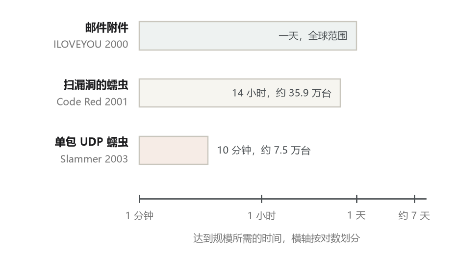
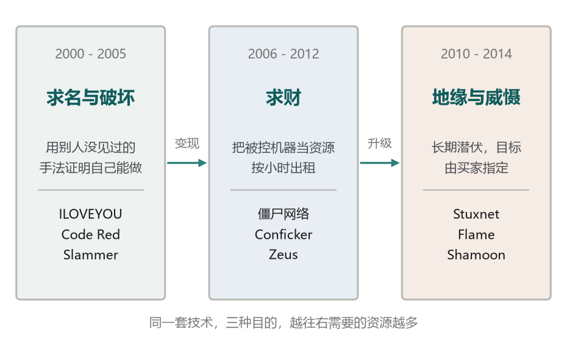

# 第二十章　从破坏到变现（2000-2014）

2000 年的一个工作日，一家公司的邮件服务器在上午十点前后开始变慢。管理员打开队列，看见几千封信堆在那里，主题全是同一句 ILOVEYOU，发信人全是本公司的人。

信里有一个附件。点开的人说，他之所以点，是因为发信人是同事。附件运行之后，这封信从收件人的通讯录里再发一遍，收件人依然是熟人。到下午，队列里的信已经多到服务器处理不过来。

这一封信在一天之内传到了世界各地，损失以十亿美元计。写它的人没有被判刑。这件事把这个十年的调子定下来了，技术不复杂，后果很贵，而规则追不上。

## 20.1 一个附件

ILOVEYOU 的附件是一个 VBScript 文件。VBScript 是 Windows 自带的脚本语言，不需要编译器，双击就由系统里的宿主程序解释执行，跟打开一个网页差不多。它做的事情只有三件，读一遍 Outlook 的通讯录，给里面每个人发一封同样主题的信，把自己复制到系统目录并写注册表，让机器下次开机时再跑一遍。

三件事都不需要什么技术。通讯录是现成的，发信的功能是现成的，开机自启也是操作系统提供的。手边全是现成的零件，拼起来用的只是一个普通用户就有的权限。

写它的是菲律宾的 Onel de Guzman。案子查到人，人找到了，最后没有定罪，因为当时菲律宾的刑法里找不到一条能套上去的罪名。盗窃要有被偷的财物，破坏要有被损坏的东西，一封自动发出去的邮件两头都不占。损失以十亿美元计，法律上一片空白。

这件事的后果不在技术层面。它让所有人看见，一条写得很粗糙的脚本，只要踩中了"熟人"这个机制，就能造成比精心设计的病毒大得多的损失。传播的瓶颈从来不是代码质量，是有多少人愿意点开它。

在此之前，病毒要自己找路，翻软盘、改引导区、附到可执行文件上。ILOVEYOU 不找路，它让用户替它找。通讯录本身就是一张画好的传播图，里面每一个名字都附带着一层信任，发信人越熟，附件越安全。这个转换后来被反复利用，钓鱼邮件、假冒同事的附件、伪装成发票的压缩包，都是同一个机制的变体。

## 20.2 十四小时与十分钟

2001 年 7 月，Code Red 出现。它利用的是 IIS 里一个索引服务的缓冲区溢出，不需要用户点任何东西，扫到就进。十四小时之内，约 35.9 万台机器被感染。

这类程序叫蠕虫（worm）。它和病毒的区别在于不需要宿主文件，自己就是一个完整的程序，靠网络在机器之间移动。病毒要等人拷一个文件、插一张盘，蠕虫不用等，它自己找下一台。

传播逻辑很贫乏。生成一批 IP 地址，挨个试，能进就复制一份过去，新的那一份继续扫。它的全部聪明之处在于不需要人。一个人手工入侵一台机器要花几个小时，蠕虫一秒钟能试几百上千个地址，效率差着好几个数量级。机器越多，扫描越快，这构成了一个正反馈，前几万台总是最慢的部分，后面的规模是滚出来的。

2003 年的 Slammer 把这件事推到了极限。整个蠕虫 376 字节，一个 UDP 包就能完成全部传播动作，打的端口是 SQL Server 的 1434。十分钟，约 7.5 万台机器。峰值时全网每秒有 5500 万个地址被扫描，这个数字来自 Moore 等人在 2003 年 USENIX Security 上的测量。

为什么它比 Code Red 快那么多。Code Red 走 TCP，每次攻击要先握手，速度被往返时延和连接数卡住；Slammer 走 UDP，一个包发出去就走，不建连接，不等回应。它还小到能塞进一个数据包，不需要下载文件，落地就在内存里跑起来，硬盘上什么都不留。省掉的每一步，都换成了速度。

<figure>

<figcaption>图 20-1　三种传播方式达到数万台规模所需时间的量级对比。横轴为对数刻度，柱长只表示量级差别，不是精确的速度曲线。</figcaption>
</figure>

同一年还有 Blaster，走的是 Windows 的 RPC DCOM 接口；2004 年有 Sasser。这两种都在几天里传遍全球，共同点是都用了一个已经发过补丁的漏洞。补丁发了，装的人不够多，中间那段时间就是蠕虫的窗口。

窗口期这个概念后来成了安全运营里最常用的一个词。从漏洞公开到大规模利用之间的时间，从几个月缩到几天，再到几小时。防守方的动作必须挤进这个窗口，否则做什么都晚一步。这也是为什么"打完补丁再观察观察"这种习惯在 2003 年之后变得很贵，观察的那几天正好是别人的工作时间。

这几只蠕虫都不赚钱。它们不偷东西，不留后门，也不问受害者要钱，看上去只是为了让写它的人出名。但它们把一件事做实了，互联网上的机器比想象中多得多，其中一大半长期不打补丁，而且彼此之间连得比主人以为的更紧。这个底子铺好之后，后来的木马、僵尸网络、勒索软件都不需要重新找路，直接在上面跑。

## 20.3 出租的机器

2006 到 2008 年，出现了一件比蠕虫更值得注意的事，被感染的机器开始被当作资源出租。

一台中了木马的电脑，可以用来发垃圾邮件、点广告、对某个网站发起流量攻击。租的人按小时付费，不需要懂任何技术，只要会转账。控制这些机器的人也不亲自使用，他卖的是服务。风险和收益就这样分了家，写代码的人、租机器的人、下单的人，谁也不认识谁。

被控制的机器集合叫僵尸网络（botnet）。每台机器上跑一个小程序，定期向一个固定的地址要指令，这个地址叫命令与控制服务器。要发垃圾邮件，就把内容和收件人列表下发；要打某个网站，就让所有机器同时访问它。对目标来说，来访的是几千台分布在世界各地的正常电脑，每一台的流量都不算异常，加起来就足以让服务瘫痪。拦截单个来源没有意义，封禁会连正常的用户一起封掉。

2008 年的 Conficker 把对抗手段往前推了一步。它用域名生成算法（domain generation algorithm，DGA）来决定去哪里取指令，每天按固定规则算出一批域名，随机挑几个连。执法部门查封一批，第二天它就算出另外一批。感染规模达到数百万台。

这件事说明反制的瓶颈变了。以前是找样本、写特征、下发更新；现在是找基础设施，而基础设施是算法生成的，查封的速度永远赶不上生成的速度。防守方后来学会的办法是提前算出它未来会用的域名，一次性全部注册或者拉黑，等于用同样的算法和它赛跑。

2010 年的 Zeus 走的是另一条路，它不加密文件，也不搞破坏，只做一件事，在浏览器和银行网站之间偷凭据。用户看到的页面完全正常，输入的用户名、密码、短信验证码在提交之前被截下来，发给远端的服务器。银行那边的风控看到的是正常的登录，因为确实是从用户的机器上发出来的。

到这为止，攻击的目的已经很清楚，钱。技术手段服务于变现效率，能自动化的都自动化，能量产的都是生意。Zeus 的样本在地下论坛上被拆开、被改进、被卖掉，一份能偷某几家银行凭据的配置单独定价。凭据本身也成了商品，一批邮箱密码、一批信用卡号，按条卖，买的人拿去撞库或者刷卡。

## 20.4 国家的手

同样在 2010 年，另一种动机的样本出现了。

Stuxnet 里有四个当时没人知道的漏洞，能跨过物理隔离，能改写西门子 S7-315 和 S7-417 控制器里的逻辑，让纳坦兹的离心机在正常范围之外反复变速。

物理隔离在业内叫气隙（air gap），意思是两台网络之间根本没有连线。理论上任何来自外面的代码都过不去。Stuxnet 过气隙的办法不是技术，是 U 盘，它利用 Windows 解析快捷方式时的漏洞，U 盘一插进内网机器就自动执行，不需要人点开任何文件。

那四个漏洞在业内叫零日（zero-day），指厂商还不知道、因此也没有补丁的漏洞。一个零日已经很贵，四个放在同一个程序里，说明写它的人不缺资源，也不打算重复使用。事实上它在每台机器上只做一小段判断，条件不满足就沉下去，安全公司拿到的样本里大部分代码从没被执行过。

恶意代码第一次被当成武器，用在物理世界上。前面那些蠕虫破坏的是数据，Stuxnet 破坏的是钢铁。它也第一次把"谁写的"这个问题摆到了台面上，能让一段代码长成这样的，只有拿工资的团队。

2011 年，RSA 被攻破。入口是一封钓鱼邮件，收信人是员工，附件是一个看起来正常的表格。攻击者进去之后拿走了 SecurID 令牌的种子。双因素认证的全部安全性建立在"种子只有我和服务器知道"这个前提上，种子一旦泄露，那个会跳数字的小硬件就只剩下装饰作用。

值得记的是这件事的路径。攻击者没有去破解那个令牌的算法，算法是公开的，破不了。他绕过去，把做算法输入的那颗种子偷了出来。安全体系里最难守的从来不是算法，是算法的原料放在谁手里。

2012 年出现了 Flame，一个体积以 MB 计的工具，功能是长期潜伏、录音、截屏、记录键盘、把数据传回去。它不像武器，更像一台被塞进别人办公室的监听设备。同年的 Shamoon 相反，它进了沙特阿美的网络之后，把硬盘上的数据抹掉，让业务停摆。

三种动机在两年内同时出现了。偷钱的、偷情报的、纯粹为了让你停下来的。它们用的技术有重叠，背后的组织方式完全不同。前者是生意，中间那种是情报机构，最后那种是报复或者威慑。

这三种里，最难防的是中间那种。生意人有成本约束，收益不够就收手；搞破坏的人干完一次就暴露了意图，防守方知道该防什么。情报机构不一样，它不急着变现，可以用几个月等一个合适的时机，可以只在一台机器上待着不动，可以写一段永远不会被复用的代码。用做生意的标准去衡量它，会得出"这么干不值"的结论，而对方根本不按这套标准算账。

## 20.5 把加密做对

2013 年的 CryptoLocker 是把 1989 年那件事做对了的版本。

它用 RSA 公钥加密文件。公钥加密的特点是，用公钥加密的东西只能用配对的私钥解开，而公钥可以随便发，私钥只在攻击者手里。受害者就算把程序拆开，也拿不到能解开文件的东西，拆开只能看到一把锁，看不到钥匙。1989 年的 AIDS Trojan 用的是一把钥匙开一把锁的对称加密，钥匙就在程序里，谁拆谁知道。

付款方式是比特币，收钱不需要去邮局，也不需要暴露一个能追查的账户。受害者在规定时间里付一笔钱，私钥发过来，文件解开。

三件东西终于凑齐了，够强的加密、够匿名的收款、对手上数据的控制。勒索从一次失败的实验变成了一门可复制的生意。CryptoLocker 之后，勒索软件的作者发现了一个比偷数据更稳定的收费方式，数据还在原地，只是打不开了，用户为"拿回自己的东西"付钱的意愿远高于为"不被公开"付钱。

同一年，Target 的数据泄露走的是另一条路。攻击者没有正面攻 Target，他们拿到了给 Target 做空调维护的一家供应商的账号，从那一侧接进内网。防守方把边界修得再厚，也挡不住一个拿着合法凭据、从正确方向走进来的人。供应链这个词从此有了具体的含义，你的安全边界取决于所有能连上你的人。

2014 年的 Heartbleed 让所有人重新认识了一类漏洞。OpenSSL 在处理心跳请求时，没有检查对方声明的长度，攻击者可以要到比实际内容更多的一段内存，服务器会照做。这段内存里可能有别人的密码，也可能有服务器的私钥。问题的方向反过来了，不是攻击者往你的内存里写东西，而是他让你把内存读出来给他看。读，比写安静得多，日志里什么都不留，被读过的机器也不会留下任何痕迹。

同年的 Sony Pictures 被攻击，数据被公开，机器被抹掉。动机既不是钱也不是情报，更像是羞辱。这件事提醒人们，攻击者的目标可以只是让受害者难堪，而这种目标没有谈判空间。

<figure>

<figcaption>图 20-2　2000 到 2014 年，攻击的主导动机从求名转向求财，再转向地缘。分类按当时最突出的动机划分。</figcaption>
</figure>

这十四年的线索是动机。2000 年写 ILOVEYOU 的人想要的是被看见，2013 年写 CryptoLocker 的人想要的是被支付，2010 年放出 Stuxnet 的人想要的是别人的离心机停下来。同一套技术，三种目的，后面那种需要的资源最多，也最难防。

到 2014 年，三条线各自成型。犯罪集团学会了用加密收钱，情报机构证明了恶意代码可以改变物理世界，而供应链这个入口已经在 Target 那样的案子里露过一次面。

下一个十年，这三条线会拧到一起。勒索软件会用上情报机构泄露出来的工具，供应链会成为最划算的入口，而付款这件事会被拆成一条分工明确的流水线。
