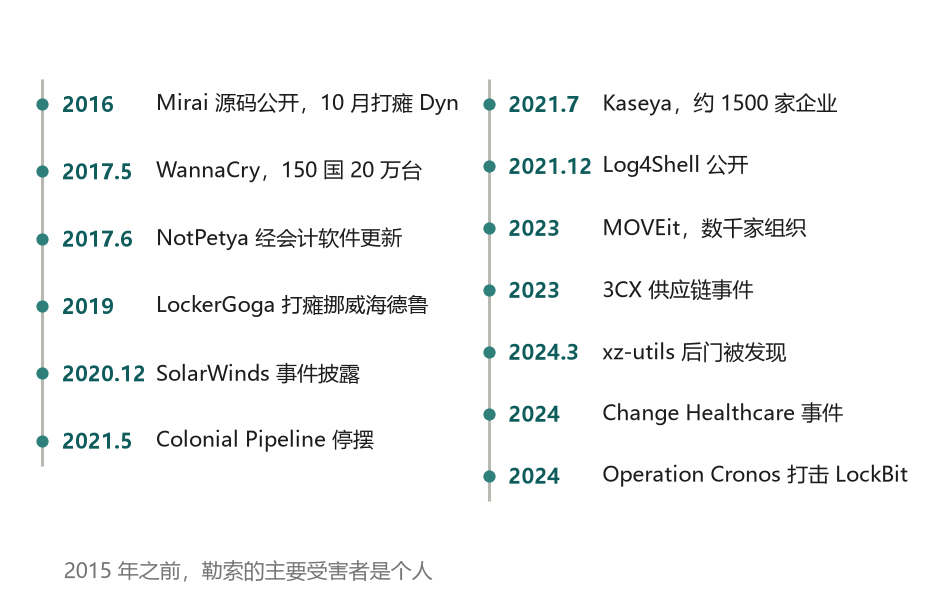
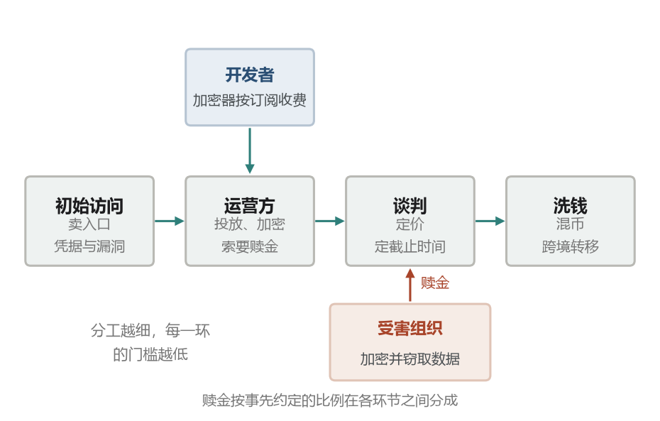

# 第二十一章　勒索时代（2015-2026）

2021 年 5 月，美国东南部的加油站开始排队。车龙从路口拐上主干道，有的站挂出手写的牌子，说没油了。原因不在炼油厂，也不在码头，而在一家运营输油管道的公司。它的网络被人加密了，管道随即停摆。

公司最后付了约 440 万美元的赎金，其中一部分后来被追回。这笔钱和一条管道每天的流水比起来不算多，但它买回来的东西很具体，是让油重新流动起来的时间。

这十年，勒索从"我电脑里的文件打不开"变成了"一座城市的政务系统停摆""一片地区的医院改用纸笔"。要理解这个变化，得看清三件事，谁在被攻击，入口在哪里，以及敲诈这件事是怎么被拆成工种的。

## 21.1 一条管道停了

勒索软件不是这十年才有的东西。2013 年的 CryptoLocker 已经证明了它能赚钱，但那时它盯的是个人，一台电脑，几百美元，受害者交钱是因为照片和论文没有备份。

产业化的转折点是受害者变了。医院、市政、管道、制药厂，这些机构的共同点是有不能停的业务，有预算，也有保险。对它们来说，停一天的损失远高于一份赎金，于是付钱成了账面上最理性的选择。

Colonial Pipeline 这次事件把这个逻辑摆到了所有人面前。被加密的是公司的业务网络，输油管道本身没有坏，但公司选择先停下来。管道停摆的直接后果不是数据丢失，是加油站没油，是航班要额外带燃油，是普通人排队两小时加半箱。

勒索的计量单位从此变了。以前算的是"多少份文件被加密"，现在算的是"多少天业务中断"。这两个数字背后是完全不同的谈判筹码，后者可以直接换成钱。

这也是勒索在这个十年爆发的结构性原因。个人用户付几百美元，机构付几百万美元，而做决定的不是掉钱的人。一笔赎金在账上是一行支出，业务停摆一周是一整年的数字。这种算术一旦成立，付钱就成了默认选项，而默认选项会决定攻击者把谁写进目标名单。

## 21.2 从摄像头开始

2016 年，Mirai 的源码被公开。这份代码做的事很简单，扫描互联网上开着远程登录端口的设备，用一批出厂默认口令挨个试，试进去就把自己装上去，然后等指令。

它瞄准的不是服务器，是摄像头、路由器、网络硬盘这类设备。这些东西的共同点是出厂口令常年不改，固件常年不升级，装上去之后没人再看第二眼，坏了就换一台。对攻击者来说，这是一批免费的、无人看管的、永远在线的机器。

源码公开之后，任何人都能改一改再用。这一年的 10 月，一批这样的设备被指使去攻击 Dyn 的 DNS 服务，推特、GitHub 等一大批网站跟着打不开。

这里需要说清楚 DNS 是什么。人在浏览器里输入的是名字，机器之间通信用的是地址，DNS 就是那本把名字翻成地址的电话簿。电话簿被砸了，网站本身的服务器好好的，用户也找不到它。攻击一个点，影响一片，这就是挑 DNS 服务商下手的原因。

<figure>

<figcaption>图 21-1　2015 到 2026 年的主线。勒索的受害者从个人换成机构，入口从漏洞换成更新通道和人，作案方式从一个人换成一条流水线。</figcaption>
</figure>

Mirai 留下的东西比它造成的故障更持久。它证明了物联网设备是一支现成的军队，几十万台设备的带宽加在一起，足以让任何一家公司的基础设施撑不住。它也提醒了防守方一件事，家里那台从来不更新的摄像头，在别人眼里是一台可以调用的机器。

这件事还改变了对"目标"的定义。以前挑目标要看它里面的数据值不值钱，现在只看它有多少台在线、口令没改过的设备。设备越便宜、越不起眼、越没人维护，越容易被选中。摄像头、路由器、机顶盒这些词从此频繁出现在安全报告里，不是因为它们变危险了，是因为它们被接进了网络，而接进来之后没人管。

## 21.3 一个补丁没打

2017 年 5 月 12 日，WannaCry 开始传播。它用的是 EternalBlue，一个针对 Windows 文件共享协议 SMB 的漏洞利用工具，编号 MS17-010，据信来自美国国家安全局的工具库，在此前被泄露到公网。

几天之内，一百五十个国家的约二十万台机器被加密。英国国家医疗服务体系受影响最重，预约取消，急诊转院，医生用纸笔记录。这些医院不是没有预算，是那些设备的软件更新要经过厂商认证，一台影像设备打补丁可能要停机、重新校准、重新走审批，于是补丁永远排在待办列表的最后。

这次事件里有一个偶然。一个英国研究员在研究样本时发现，WannaCry 会去访问一个看起来随机、但当时还没有人注册的域名，如果访问成功，它就停止传播。他把这个域名注册了下来，扩散随之被切断。这个开关是写代码的人留下的，不是防守方设计的。

补丁早就发了，工具在它之前就公开了，中间那段时间里唯一该做的事就是装补丁。装不上，因为太多机器不能随便重启。这一点比蠕虫本身更值得看，安全上的很多问题最后都卡在同一个地方，知道该做什么，但没有办法在不影响业务的前提下做到。

靠运气止住的灾难不能算解决。一个月后，NotPetya 出现，走的完全是另一条路。

它通过乌克兰一款会计软件的更新通道传播。这款软件的用户全是乌克兰的企业，它在更新时从厂商的服务器下载新版本，而攻击者拿到了那条通道，把恶意代码塞进了更新包。用户什么都没做错，他们只是像过去几年一样，点了"立即更新"。

NotPetya 伪装成勒索软件，弹窗要钱，但它的加密是不可逆的，付了钱也解不开。它的目的从来不是钱，是让装了这款软件的机器全部报废。这次的损失以百亿美元计，是历史上最贵的一次恶意代码事件。

更新通道这个入口之所以可怕，在于它绕过了所有的信任判断。防火墙允许它出去，用户主动点它，杀毒软件看着它从官方地址下载，签名对得上，域名对得上。你把边界修得再厚，也是自己打开门请它进来的。

## 21.4 谁在维护这段代码

2020 年 12 月披露的 SolarWinds 事件，把更新通道这条路走到了尽头。被植入后门的是这家公司自己的产品更新包，客户名单里有一批美国政府部门和大企业。恶意代码在更新里躺了几个月，只对少数目标激活。

2021 年 7 月，Kaseya 的 IT 管理工具被 REvil 利用，约 1500 家企业受影响。这些企业大多没有直接用过 Kaseya，它们用的是外包出去的 IT 服务商，而服务商用了这个工具。中小企业不自己养 IT 团队，把这块外包出去，服务商手里通常有一套工具，能一次性给几百家客户的机器推软件、推更新。攻下这套工具，等于一次拿到了几百家客户的钥匙。一次攻击，顺着服务商往下走，一片客户跟着中招。

2023 年有 3CX 的供应链事件，同年还有 MOVEit。后者是一款文件传输软件，很多机构用它跟外部交换数据，Cl0p 利用它的漏洞，数千家组织的数据被窃走。软件本身没有恶意，它只是被放在了数据流的必经之路上。

2021 年 12 月的 Log4Shell 是另一种形态。程序运行时会写日志，记录谁在什么时候做了什么，写日志靠一个现成的库。出问题的就是一个 Java 日志库，几乎所有 Java 服务都在用它，而它处理日志内容的方式允许攻击者塞进一段会被执行的东西。一个被几百万个系统共用的组件，一处错误，等于全行业同时出现同一个漏洞。这不是有人投毒，是所有人共用同一段代码的必然结果。

2024 年 3 月的 xz-utils 后门是这些年里最不像攻击的一次。有人花两年多时间，以一个热心贡献者的身份参与一个开源压缩库的维护，一点点取得信任，最后试图在代码里放进一个后门。发现它的是微软的工程师 Andres Freund，他在测一个看起来无关的性能问题的时候注意到了异常。这个后门对应的编号是 CVE-2024-3094。

这件事之所以让人不安，是因为它在流程上完全合法。没有漏洞，没有钓鱼，没有恶意附件。攻击用的是开源社区的运作方式本身，一个人的时间、耐心和贡献记录，换来了提交代码的权限。防守方习惯检查代码里有没有错，很少检查写代码的人是谁、他为什么要做这件事。

## 21.5 分工

2019 年，LockerGoga 打在挪威海德鲁身上。这家公司的铝厂生产线被迫改成手动操作，工人拿着纸质流程单在现场跑。同一年，美国好几个城市的政务系统被勒索，有的城市最后付了钱。

到 2023 年，勒索已经是一个有品牌、有加盟、有客服的行业。LockBit 是其中最大的一个 RaaS 品牌，RaaS 是勒索软件即服务（ransomware as a service）的缩写。想干这一行的人不需要会写代码，加盟之后拿到现成的加密器和后台，自己去找目标，得手之后按比例分成。

2024 年初，多国执法机构联合发起 Operation Cronos，对 LockBit 的基础设施进行了一次系统性打击。

同年，Change Healthcare 被 ALPHV/BlackCat 攻击，影响蔓延到美国大量的药房和医院。一家做医疗账单清算的公司出问题，开不出处方，收不到款，链条上下游一起停。

<figure>

<figcaption>图 21-2　勒索产业的分工。找入口、写工具、投放、谈判、洗钱各自独立，任何一环都可以外包，也都可以被替换。</figcaption>
</figure>

这个行业的分工和别的行业没什么不同。有人专门找入口，手里攒着一批能进内网的凭据，按条卖；有人专门写加密器和控制后台，按订阅收费；有人负责投放和运维；有人专门谈判，知道该给受害者多少时间、该在什么时候让步；还有人负责把钱洗干净。每一环都能单独定价，每一环的人都不需要认识其他环的人。

分工带来两个后果。一是门槛降低，不会写代码的人也能干这行；二是韧性变强，某一环被执法打掉，其余环节可以立刻找替代。Operation Cronos 之后，LockBit 的品牌受损，但同一批人换个名字还能继续，因为上游的入口和下游的洗钱通道都还在。

勒索的手法本身也在变。早年的勒索只加密，受害者手里有备份就不付钱；后来的做法是先窃取再加密，备份救得了文件，救不了已经流出去的数据。受害者面对的不再是"你的文件打不开"，而是"你的文件在我这里，三天后公开"。这个转变把备份这个最有效的防守手段削掉了一半。

有些团伙走得更远，干脆不加密，只偷，然后拿公开做唯一威胁。这样省掉了加密这一步，也避开了"受害者有备份"这个变量，代价是必须真的拿到有价值的数据，所以他们的目标往往是病历、合同、客户名单这类东西。

谈判是这条链上最像正常生意的一环。负责谈判的人手里有受害者的规模、行业、能调动的预算，也有不付钱会发生什么。他们的工作不是吵架，是定价，把"停几天"换算成一个对方能接受、又不会低到让同伙不满意的数字。

从 1989 年那两万张软盘算起，勒索走了三十多年。第一次失败，是因为没有加密、没有收款渠道、也没有可信的承诺；第二次成功，是因为三样东西都齐了，还多了一样东西，一条能把攻击拆成工种、把赎金拆成分成的产业链。

这段历史留下了什么。入口从漏洞转到了信任，更新通道、外包服务商、开源项目的维护权限，这些东西的共同点是它们本来就应该被信任。受害者从个人换成了机构，因为机构有预算、有保险、有不能停的业务。作案的人从一个变成了一个行业，每一环都能外包，每一环也都能被替代。

防守的重心也跟着挪了。查漏洞、打补丁还是基本功，但只做这些已经不够。现在要回答的问题更麻烦，谁有权限把代码送进我的机器，他凭什么被信任，以及这份信任上一次被验证是什么时候。
