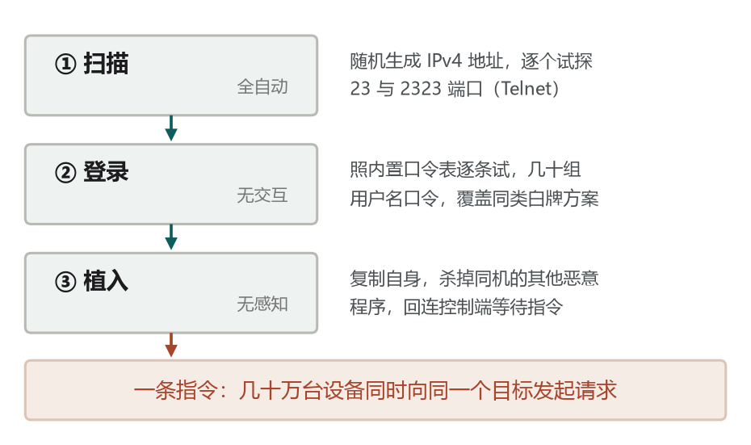
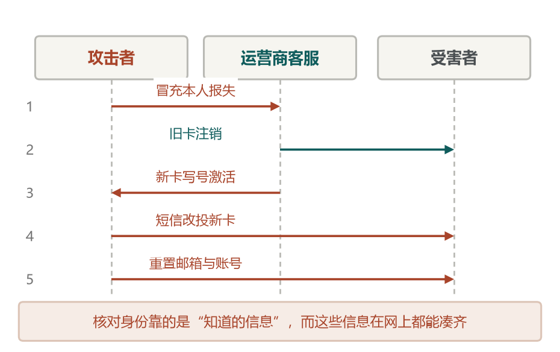

# 第二十二章　物联网与移动端

2016 年 10 月 21 日早上，美国东部不少人发现常用的网站打不开了。Twitter、Spotify、GitHub、Reddit，一批彼此不相关的服务同时失效，而家里的宽带其实是通的。问题出在一个大多数人没听过的地方。一家叫 Dyn 的 DNS 服务商负责把域名翻译成 IP 地址，那天它的服务器被海量请求压垮了。

流量来自几十万台设备。事后有人拆开固件看，发现这些设备多半是摄像头和家用路由器，型号杂乱，散在上百个国家。主人对此一无所知，设备就摆在客厅或者店铺的角落，指示灯正常亮着，网速也没变慢。

一个叫 Mirai 的程序把这些设备编成了一支军队。它的源码在攻击发生前几周被人贴到论坛上，此后两年里衍生出的变种数以十计。这一章讲两块新的战场。一块是几十亿台连上了网、却没有人维护的设备，另一块是你每天带在身上、睡觉时放在枕头边的那台手机。

## 22.1 一支由别人的家电组成的军队

Mirai 的做法朴素得有点意外。它只有三件事要做，找设备、进设备、等命令。

找设备靠扫描。它随机生成 IPv4 地址，挨个去连 23 和 2323 端口，这两个端口是 Telnet 的常用位置。有响应就说明对面有台机器在等登录，记下地址。这一步没有任何技巧，快慢只取决于网络带宽。

进设备靠一张口令表。表里存着几十组用户名和密码，都是厂商出厂时的默认值，`root` 配 `xc3511`，`admin` 配 `admin`，诸如此类。它拿这张表逐个试，试通了就把自己复制过去，然后向控制服务器汇报，进入待命。整张表不长，但覆盖面惊人。那几年市场上大量的摄像头和路由器用的是同一批白牌方案，芯片和固件来自少数几家方案商，出厂口令自然也是同一套。

进入之后它还会做一件事，把这台设备上别的恶意程序杀掉，独占总线。这个细节说明编写者对生态很熟。同一个弱口令能进来的不止他一个，先来的得把门关好。

规模就是这么来的。一份口令表同时打开了几十个厂商的门，攻击者不需要针对任何一个型号做研究，只需要把这张表试遍全网。等这样的设备攒到几十万台，只要发一条指令，它们就同时向同一个目标发起请求。这类攻击叫分布式拒绝服务（Distributed Denial of Service，DDoS），原理在第十章讲过，新的是执行它的成本。租一个这样的僵尸网络，价格比雇一个实习生一个月还低。

源码公开之后，变种出现得很快。有人扩充口令表，有人换掉通信协议，有人把新的路由器漏洞加进武器库。一个 2016 年的程序在几年后仍然活跃，原因不在代码写得好，而在它攻击的那类设备一直没有变化。

## 22.2 为什么这些东西永远不更新

一台笔记本的寿命是三到五年，一台手机是两到四年，一台装在门框上的摄像头是八年，一个埋在墙里的智能开关可能二十年不换。设备活得越久，它身上的软件就越像一件没人管的旧家具。

更新这件事在手机上已经变得无感。系统在夜里下载补丁，重启一次就好了。物联网设备没有这套东西。它通常没有屏幕，没有应用商店，也没有自动更新通道。厂商要修一个漏洞，得先发布新固件，再指望用户去官网下载一个 bin 文件，用浏览器登录设备管理页手动上传。绝大多数用户这辈子不会打开那个页面。

有些设备连这条路都没有。它们由方案商提供芯片和软件开发包，贴牌厂改个外壳和 logo 就出货，出了问题谁负责说不清。方案商说我只卖模块，贴牌厂说软件是上游给的，销售说我只管卖。四层关系里每一层都能把责任推给隔壁，最后承担后果的是买它的那个人，而他根本不知道自己买的是一台能联网的计算机。

经济账也很直白。一台家用摄像头的出厂价本来就不高，毛利只有几个点。召回、测试、分发固件的成本远高于这批货的利润，理性的厂商会选择把资源投到下一代产品上。这不是恶意，只是激励结构摆在那里。

结果是一个漏洞的生命周期等于设备的寿命。2016 年被 Mirai 用过的那批口令，几年之后仍然能在大量在线设备上试通。设备没有变，攻击者的工具也没必要变。

用户看不见风险，这一点比不更新更麻烦。摄像头不会提示你它的管理页面暴露在公网上，也不会告诉你固件是三年前的。你打开手机 App 看到画面正常，就认为一切正常。安全状态和设备状态在这里第一次彻底脱钩。

## 22.3 端口映射把内网搬到了公网

家里的网络本来有一层被动防护。光猫或路由器做地址转换（NAT），内网设备拿到 `192.168.x.x` 这样的地址，外部想主动连进来是连不上的，因为外面根本不知道这个地址怎么走。这一层不是为安全设计的，它只是 IPv4 地址不够用的副产物，但它确实挡住了大量随机的扫描。

问题出在一个需求上。厂商希望你能在外面用手机看家里的摄像头，于是需要一个从公网进来的入口。

最省事的做法叫通用即插即用（Universal Plug and Play，UPnP）。它本来是让设备接入家庭网络时自动配置的协议，其中有一个功能叫互联网网关设备（IGD），允许内网设备向路由器申请一条端口映射，大意是“请把公网的某个端口转发到我这里”。路由器收到请求，一般不做身份核验就照办，因为协议设计时假设内网是可信的。

于是设备在启动时自己给自己开了一个洞，用户毫不知情。有些固件更直接，出厂就写好无条件申请映射，装上去那一刻，家里的摄像头就在公网上有了地址。

剩下的工作交给扫描器。Shodan、Censys 这类服务常年爬全网，把每个开放端口上返回的横幅记录下来，连设备型号和管理页面标题一起收录。有人在上面搜某个型号的摄像头，能搜出几万台，连登录框都摆在页面上。配合默认口令，从公网到画面只有两步。

还有一条路是厂商的云中转。设备不直接暴露端口，而是主动连到厂商的服务器，用户通过云端看画面。这条路把暴露面从你家挪到了厂商的机房里，安全性取决于那套转发服务的实现，而用户没有办法审计它。选设备的时候，这一项比参数表上的分辨率重要得多。

<figure>

<figcaption>图 22-1　物联网僵尸网络的招募与使用。扫描和试口令是自动的，一台设备从被扫描到加入待命队列通常只需要几秒，用户端没有任何可观察的变化。</figcaption>
</figure>

## 22.4 手机，一个被围起来的市场和一个没围起来的市场

手机上的攻击面比摄像头复杂得多，因为它装着你的全部生活。

Android 的开放性带来一个结构性差异，应用的安装来源不止一个。应用商店、厂商商店、第三方市场、浏览器里下载的安装包，甚至聊天软件里收到的文件，都能装进系统。这在部分市场是常态，因为官方商店覆盖不到某些应用。门槛一低，二次打包就出现了。正规应用被拆开，塞进几行代码，重新签名，放到小网站上等人下载。

这些附加代码大致做三件事。一是扣费，在后台替你订购增值业务，或者向特定号码发短信，账单一两个月后才显出异常。二是刷量，在后台模拟广告曝光和点击，把广告主的钱转到自己账上，用户只觉得电池掉得快。三是偷银行，这一类做得最细。

银行木马的常见手法是屏幕覆盖加无障碍服务。屏幕覆盖（overlay）是在真正的银行 App 上面盖一层外观一模一样的界面，你输入账号密码，其实输进了一个假窗口。无障碍服务（AccessibilityService）本来是给视障用户读屏和模拟点击用的，权限极大，能读屏幕上所有文字，也能代替用户点击。恶意应用会编一个理由让你手动打开它，之后就能在你不知情的时候读到短信里的验证码，甚至在转账页面替你按下确认。

iOS 走的是另一条路。应用只能从 App Store 安装，每个应用都在沙箱里运行，代码必须有签名，上架前要过审核。这条路把批量作恶的成本抬得很高，流氓应用很难混进去。

但封闭不等于安全。2021 年，谷歌 Project Zero 公开了一组针对 iPhone 的利用链，代号 FORCEDENTRY。攻击方式不需要用户做任何操作。手机收到一条构造过的 iMessage 消息，系统在解析消息里的图片时触发漏洞，代码就在手机上跑起来了，全程零点击。漏洞出在图像解码模块里，攻击者把一小段虚拟机程序塞进了一张图片的数据流里，让解码器把它当作数据解释，而不是当作代码检查。

苹果在 iOS 14.8 中修复了这个问题。这套利用被用于针对记者、律师和活动人士的定向监控。它说明的事情很清楚。封闭抬高了攻击的成本，但没有封顶。批量撒网的攻击被挡住了，愿意为一个具体目标投入几个月的团队仍然进得去。

## 22.5 短信验证码是怎么被接管的

有一个场景在过去几年反复出现。某天早上手机突然没信号，重启、换位置、拔卡重插都没用。半小时后，邮箱密码被改，接着是社交账号，然后是银行 App。

这不是手机坏了，是号码被搬到别人的卡上了。

手机号在今天承担了身份的角色。几乎所有网站都支持用手机号注册，忘记密码时发一条短信，登录新设备时发一条验证码，转账时再发一条。运营商那一侧，补换卡的流程是标准化的。用户报失，客服核对身份，然后给一张新卡，旧卡作废。

核对身份的依据，通常是姓名、身份证号、服务密码、最近的联系人或者账单地址。这些东西里，姓名和身份证号在各类泄露数据里能买到，联系人可以从社交关系推出来，账单地址有时候就写在快递单上。信息凑得差不多，一个声音镇定的电话就能让客服走完流程。更省事的办法是买通营业厅或代理商的员工，跳过核对直接开卡。

补卡成功那一刻，受害者手里的卡失去注册，所有短信转到攻击者那里。接下来的动作有固定顺序。先用短信重置邮箱，因为邮箱是大多数账号的根。再从邮箱重置绑定的其他服务。银行往往排在最后，因为动钱需要时间窗口，而前面的账号能提供转账需要的资料。

<figure>

<figcaption>图 22-2　SIM 卡交换的时序。攻击者打通客服电话之后，受害者在整条链路上再没有一次被验证的机会，因为后端的身份判断依据已经被替换掉了。</figcaption>
</figure>

这里的失败点不在技术，在流程。客服被要求“帮客户解决问题”，而验证一个自称失主的人的成本，高于直接把卡补给他。风控在这类场景里几乎不起作用，因为从系统角度看，一切都是合法的，号码还是那个号码，短信还是那条短信。

防守要分两头做。运营商侧有号码锁和转网 PIN，开启之后补卡必须提供额外凭据，国内也可以打客服电话问一下有没有类似的服务。用户侧的做法更简单，别把短信当成唯一的第二因素。硬件密钥、认证器应用生成的动态码都不经过运营商，号码被搬走也拿不到。高价值账号用单独邮箱注册，且不用手机号作为找回途径。

## 22.6 把家里的网络收拾一遍

知道原理之后，能做的事其实不多，但每一件都有效。

先看暴露面。登录路由器管理页面，找到端口映射和 UPnP 两项，把不认识的一条条删掉，把 UPnP 关掉。再用手机流量（不要用家里的 WiFi）访问一下自己的公网 IP，看看有没有什么东西回应你。这一步花十分钟，能看到大部分问题。

然后改口令。设备的管理密码、WiFi 密码、路由器后台密码，全部换成长随机串，写进密码管理器。摄像头这类设备如果支持创建子账号，就给日常查看用的账号只读权限。

固件该更新就更新一次，尤其是路由器和 NAS。这两个东西常年在线，一旦被拿到权限，攻击者就站在了你家网络的中心，能看到所有设备的流量。

网络分段值得做。大多数路由器支持访客网络，把智能插座、摄像头、扫地机器人全塞进去，并打开“禁止访客访问内网”。这样一台设备被攻破，攻击者只拿到一个孤岛。

手机那一侧，只从官方商店装应用，关掉“允许安装未知来源”。每隔几个月翻一遍权限列表，特别注意无障碍、设备管理、通知读取这三项，非必要的全部关掉。银行类应用最好只在一台设备上装，不要装在经常折腾的机器上。

第二因素选什么也有讲究。短信验证码能被 SIM 卡交换绕过，认证器应用的动态码好一些，硬件密钥把域名绑进了签名，钓鱼站点拿到也没用。这三者的差别不在强度数字上，而在“谁的服务器参与了这个过程”。短信要经过运营商，动态码只在你和设备之间，硬件密钥连你的手机都不经过。

## 22.7 一台摄像头里到底装了什么

拆开一台一百块的云台摄像头，里面是一块小小的 ARM 板、一颗闪存、一个 Linux。固件就以镜像的形式存在那颗闪存里，几百 KB 到几 MB，用 `binwalk` 跑一遍能看到里面包着一个压缩过的只读文件系统。

启动脚本一般放在 `/etc/init.d/rcS`，里面除了一堆初始化，总有一行是拉起 telnet 服务。命令长得像 `telnetd -l /bin/sh`，意思是“开一个登录端口，登录成功直接给 shell”。这一步是出厂就写好的，目的通常是方便产线测试，量产时没删。系统里的账号表 `/etc/passwd` 也常常是默认的，root 一行后面要么是空密码，要么是一个全行业都知道的哈希。

直接连上去能看到的东西比想象中多。文件系统里通常没有日志，没有防火墙，没有自动更新程序，大部分目录是只读的。也就是说，即使厂商后来想修一个漏洞，这台设备也没有接收补丁的通道。

公网访问那一头靠的是 UPnP。它是建立在 HTTP 上的一个简单协议，内网设备向路由器发一个 SOAP 请求，请求体大致长这样

```text
POST /upnp/control/WANIPConn1 HTTP/1.1
SOAPAction: urn:schemas-upnp-org:service:WANIPConnection:1#AddPortMapping

<NewRemoteHost></NewRemoteHost>
<NewExternalPort>8080</NewExternalPort>
<NewProtocol>TCP</NewProtocol>
<NewInternalPort>80</NewInternalPort>
<NewInternalClient>192.168.1.64</NewInternalClient>
```

翻译过来就是“请把公网的 8080 转发到我家的 80 端口”。路由器收到之后一般不做任何验证就照办，因为协议设计时假定了内网可信。整个请求是明文，不签名，不鉴权，谁在内网里都能发。

还有一条线接向供应链。不少设备的固件升级是从一个固定地址下载一个压缩包，走明文 HTTP，下完直接解压覆盖。中间任何一个能改流量的环节都能把包换掉，设备不会校验签名。这就是为什么第二十三章里的更新通道问题不只存在于大企业，它也在你家客厅里。

口令表之所以能一把钥匙开千把锁，是因为这些设备本质上不是一万个产品，而是几个方案。芯片厂提供参考设计，方案商写一遍固件，贴牌厂换外壳和 logo，同一条代码因此出现在十几个品牌下。厂商为了远程售后，往往在固件里留一个固定的维护账号，出厂时既不改也不告诉用户，用户在管理页面上也删不掉。Mirai 那张口令表能覆盖那么多设备，就是因为它抓的是这几套方案的共同点。

研究自己的设备是合法且有用的。把固件拉下来、解开、看启动脚本，能回答三个具体问题，它开了哪些端口，它用什么口令，它怎么升级。这三个问题的答案直接决定它应该放到哪个网段。

## 22.8 手机的权限模型绕在哪里

安卓的权限分了几档，普通的比如联网、震动，装上就有；危险的比如相机、通讯录、短信，要弹窗问一次；还有一些不属于“权限”但比权限更宽的东西，比如无障碍服务、悬浮窗、设备管理器，它们不在安装时申请，而是要求用户自己去设置里手动打开。最后这一类是问题所在。

无障碍服务（AccessibilityService）是给视障用户读屏和代替点击用的，它能看到屏幕上所有文字，也能在任意界面替用户点按钮。悬浮窗（SYSTEM_ALERT_WINDOW）能让一个应用把自己的界面盖在任何应用上面。短信读取权限能拿到验证码。三样东西分开看都不致命，叠在一起就是完整的盗刷链，假界面盖在真银行 App 上拿到密码，无障碍服务读出屏幕内容并代替点击，短信权限拿走验证码，最后一步转账完成时用户什么都没看到。

安卓在补这个口子。从 Android 12 开始，系统在权限弹窗、安装界面这类敏感页面上会隐藏其他应用的悬浮窗，防止“盖住确认按钮”；Android 13 对从非应用商店安装的应用默认关闭无障碍开关，需要用户先到应用信息页里解除限制。这两条改动的方向很一致，把“用户自己打开的开关”挪到更难误触的位置。

防御的思路和其他地方一样，不指望系统拦住，而是自己能看见。每隔几个月打开设置看三个列表，无障碍、设备管理、通知读取，不认识的删掉。通知读取这一项容易被忽略，因为验证码现在大多显示在通知栏里，读了通知就等于读了验证码，不需要短信权限。

装应用的渠道比权限更要紧。二次打包的应用在官方商店里很少，在小网站、聊天群、网盘分享里很常见，它们的功能往往与正版完全一致，区别在于多了后台服务。安卓上可以在开发者选项里看正在运行的服务，一个手电筒应用带着一个常驻的网络服务，这件事本身就能说明问题。

安卓自带的应用扫描会在侧载时把安装包上传比对一遍，它对已知样本有用，对刚改过的样本没用。平时用它挡一层，剩下的靠渠道习惯。

iOS 的封闭把这条路堆得很高，但没有封顶。应用必须签名、必须过审、必须在沙箱里跑，批量作恶的成本很高。代价是用户看不到任何东西，一旦被针对，手里没有任何可以检查的地方。两类系统的取舍在这里很清楚，一个把风险暴露在外面让人自己判，一个把风险收起来交给平台。

两头各有一个代价。开放的这一侧，用户需要自己知道去哪个设置页面看什么；封闭的那一侧，用户除了相信平台没有别的选择。两种设计下最有效的动作其实是同一个，不装来路不明的东西，因为这是唯一一个完全由自己控制的变量。

这一类战场的共同点，是被攻击的东西没有人负责。摄像头是别人家的，手机号是运营商的，应用的签名是开发者的。责任分散在一条很长的链上，每一环都只承担一点点后果，而用户在链条的末端，独自承担全部。下一章要讲的供应链，把这条链拉得更长。
