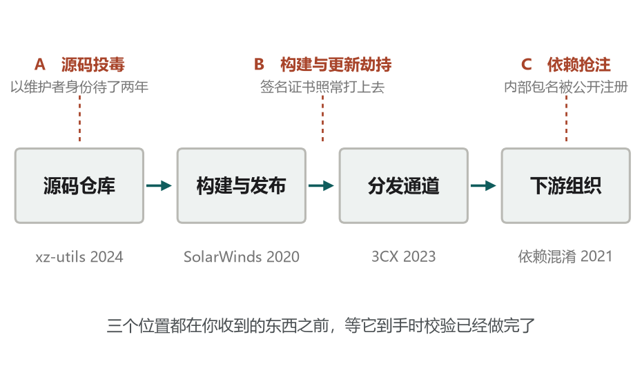
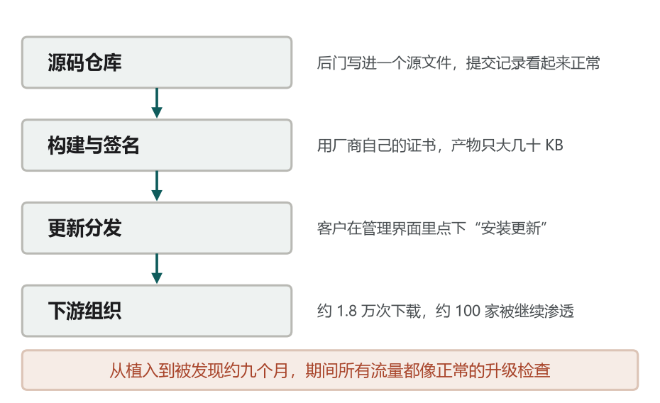

# 第二十三章　供应链与国家行为体

2020 年 12 月，一家专门做安全检测的公司公开承认自己被入侵了。被偷走的东西很特殊，是他们用来测试客户网络的攻击工具。这相当于一个锁匠家里的万能钥匙被人拿走了。

调查顺着入侵路径往上走，走到一个谁都没料到的地方。入口不是某个员工的邮箱，也不是某个忘记打补丁的服务器，而是一款几乎每家大机构都在用的网络管理软件。它的厂商叫 SolarWinds，软件叫 Orion。攻击者没有去攻客户，而是攻了客户的供应商，然后借供应商的更新通道，一次进入了几万个组织。

这条路子不新鲜，但它把一件事讲清楚了。你今天用的每一行代码，绝大部分不是你写的。编译它的工具不是你装的，打包它的流水线不是你搭的，分发它的服务器不是你的，签名它的证书不是你的。整条链上任何一个环节被人插手，你收到的就仍然是“官方更新”，只不过内容已经换过了。

## 23.1 一份签过名的更新

Orion 这类软件的位置很特殊。它装在运维人员的机器上，用管理员权限去监控服务器、交换机、路由器，被监控的设备需要主动向它汇报。也就是说，它天然坐在网络的中心，手里握着大量设备的凭据。

攻击者拿到构建服务器的权限之后，没有立刻动手。他们把后门代码写进了一个源文件，让它跟着正常的编译流程走。最终生成的更新包体积只大了几十 KB，数字签名用的是厂商自己的证书，看上去完全合法。客户在管理界面里看到“有新版本可用”，点一下安装，后门就进了内网。

后门本身写得很克制。启动后先休眠十几天，确认自己不在沙箱或者分析环境里，再解析一个看起来像正规厂商的域名，用 HTTPS 往外发心跳。它的通信被伪装成 Orion 自身的升级检查流量，混在正常业务里。不扫描内存、不写注册表、不开端口，一切都在合法进程里完成。

微软和多家厂商在 2020 年 12 月陆续披露细节。约一万八千个客户下载了带后门的版本，其中约一百家被进一步渗透，包括多个美国政府部门和一批大型企业。从植入到被发现，前后约九个月。

九个月里，攻击者在那些网络里做的事情很少。他们新建账号，读取邮件，导出文档，用系统自带的管理工具横向移动。这种打法有个名字，叫 Living off the Land，直译是“靠山吃山”。不落任何可执行文件，只用 PowerShell、WMI、计划任务这些本来就存在的东西，让日志里看到的全是正常运维行为。检测这类活动靠的不是特征码，而是行为基线。

## 23.2 三种注入点

供应链攻击这个词被用得很宽，实际上能下手的环节就那么几个。把它们分开看，防守的着力点才清楚。

第一种是源码。攻击者想办法把自己的代码提交进项目仓库，让别人编译的时候带上。这条路最难，因为开源项目的每一行改动都留在公开的提交历史里，有人看就能看出来。但也正因为难，成功一次的价值极大。

2024 年 3 月，一个叫 xz-utils 的压缩库被发现藏了后门。这个库几乎存在于所有 Linux 发行版里，通过 OpenSSH 的间接依赖被加载到 sshd 进程中。后门能让掌握特定私钥的人，在 SSH 认证阶段执行任意代码，而且是在通过身份验证之前。

事情的经过值得细看。一个使用 “Jia Tan” 这个名字的账号从 2021 年开始参与这个项目，提交补丁、回复邮件、帮着处理积压的问题列表。项目原本的维护者常年独自支撑，压力很大，有人愿意接手是好事。两年多之后，这个账号拿到了提交权限，然后开始往仓库里放东西。

后门没有写在 C 代码里，而是藏在测试用的压缩样本文件中。这些二进制文件本来就该是乱码，没人会去读。构建脚本在打包时把其中的一段数据解出来，拼进库文件。所以从源码看，一切正常，只有当你真的去编译并反汇编产物时，才会看到不该出现的代码。

发现它的人是偶然的。一位数据库开发者在自己机器上测 SSH 登录的性能，发现比平时慢了半秒，用性能分析工具查下去，才看到时间花在了一个不该有耗时逻辑的地方。那时带后门的版本刚被几个发行版收进测试仓库，还没有大规模推开。差几周，这事就是另一个结局。

第二种是构建与分发。源码是干净的，但编译它的机器、打包它的流水线、存放安装包的服务器、负责推送更新的通道，任何一个被拿下，结果都一样。SolarWinds 走的就是这条。2023 年另一款通信软件的桌面客户端被植入恶意代码，溯源追到它依赖的另一个软件的安装包上，同样是这条路。

第三种是依赖解析。现代项目的依赖树极深，一个应用直接依赖几十个包，间接依赖上千个。包管理器按名字去公共仓库拉取，如果攻击者抢先在公共仓库注册一个你内部在用的包名，构建系统可能就把他的包拉下来了。2021 年有人做过一次实验，在多家大公司的内网里成功触发了这条路径，方法是把公司内部包名逐个在公开仓库注册，写上会自动回连的代码。同一类问题还有拼写抢注，把常用包名改一两个字母，等人打错。

<figure>

<figcaption>图 23-1　一条软件供应链上的三类注入点。它们的共同点是都在“你信任的那一侧”之前，等到东西送到你手上时，所有校验都已经由上游替你做完了。</figcaption>
</figure>

把这三种放在一起，会发现一个共同结构。信任是沿着链条传递的，你信任的是签名，而签名只证明“这个东西来自那个厂商”，不证明“那个厂商的内部没有被人动过”。

## 23.3 从上游到下游的一次传播

一次典型的供应链事件，传播路径可以画成一条直线，但每一段的性质不同。

最上游是源码仓库。这一段的防守靠人，靠提交评审，靠维护者数量。xz 那个项目长期只有一个人在维护，这个状态本身就是风险，攻击者选它不是因为代码好下手，而是因为人少好接近。

中间是构建与发布。这一段是整条链上最不透明的地方。大部分厂商的构建环境不对外开放，客户拿到的只有最终产物。你能验证签名，验证不了“这个签名是在什么环境下打上去的”。

再往下是分发。安装包放在哪里，通过什么协议下载，更新是主动推送还是被动拉取，这一段的攻击面在传输和存储。镜像站、CDN、内部的软件分发服务器，每一层都是可以被替换的位置。

客户这一侧处在链条末端。这一段的防守完全取决于客户自己有没有做二次校验，以及有没有能力发现“这个更新包的行为和上一个不一样”。

<figure>

<figcaption>图 23-2　一次供应链事件的传播链。攻击者只需要在上游成功一次，后面每一跳都由受害组织自己完成，包括那次“确认安装”的点击。</figcaption>
</figure>

传播之所以高效，是因为每一跳都是自动的。运维平台自动检查更新，包管理器自动解析依赖，容器在启动时自动拉取镜像。攻击者不需要说服任何人，他只需要让系统按设计工作。

## 23.4 谁在做这些事

供应链攻击不是只有国家行为体在做，但把这条路走到极致的，通常是有长期预算和耐心的团队。它们的特征很一致。

时间尺度不同。普通犯罪团伙关心的是几周内变现，国家级行动可以为一个目标准备两年。xz 里那个账号潜伏了两年多才拿到权限。SolarWinds 的攻击者在内网待了九个月，做的事只是读邮件。

目标不同。它们要的不是钱，是位置。电网的调度系统、水务的阀门控制、电信的骨干设备、政府的人事数据库，这些东西的价值在于“需要的时候能用上”，平时保持安静最好。

手法上偏爱合法工具。震网（Stuxnet）是这一类里最早被完整分析的样本，2010 年被发现时，它已经在伊朗的铀浓缩设施里运行了一段时间。它通过被感染的 U 盘进入隔离网络，利用 Windows 的多个未修补漏洞横向传播，最后修改西门子 PLC 的控制逻辑，让离心机在正常转速下悄悄损坏，而监控画面显示一切正常。它的驱动器用了一张偷来的合法厂商数字签名证书，所以在当时的系统里看起来是可信的。

2015 年 12 月，乌克兰几家配电公司的控制系统被远程操作，断路器被依次拉开，约二十二万用户停电。攻击者还同时擦掉了运维工作站上的系统，并对客服中心发起电话洪水，让用户打不进来。2016 年 12 月，同一个国家的输电设施又遭遇了一次，这回的恶意程序直接讲工业协议，能够对变电站设备下发开关指令，模块化设计，换掉一个模块就能适配另一套设备。

2023 年到 2024 年被反复公开讨论的一个案例，重点不在破坏，而在“提前进去待着”。多家厂商和政府机构在报告中描述，有团队在关键基础设施网络里长期驻留，用的全是系统自带工具，跳板是大量已经停止更新的家用路由器和防火墙。这类设备在第二十二章讲过，它们没有日志、没有监控、没人看，正好适合当中转站。报告给出的判断是“预先部署”，意思是现在不做事，等需要的时候再做。

这个思路其实很古老。军事上叫前沿存在，把弹药提前埋到将来可能用的地方。区别只在于，埋的不是弹药，是一个能远程登录的账号。

## 23.5 让更新变得可疑

防守这一侧没有一招制胜的办法，能做的都是提高攻击者的成本，并且让“被改动过”这件事变得可发现。

第一件事是锁住依赖。项目里记录完整的依赖树和每个包的哈希，装的时候只按记录来，不接受“最新版本”。这一步能挡住依赖混淆和大部分抢注，因为构建系统不再去公共仓库按名字现找。

第二件事是让构建可复现。同样的源码、同样的编译器版本、同样的环境，在任何一台机器上编译出来的产物应该逐字节相同。做到了这一点，任何人都可以自己编译一遍，把结果和官方发布的二进制对比，不一致就说明有问题。这件事在开源世界里推了很多年，进展缓慢，因为编译器、时间戳、文件顺序都会带来差异，但方向是对的。xz 那个后门能被迅速确认，一部分原因就是有人能本地重编并对比。

第三件事是 SBOM，软件物料清单。它是一份随软件发布的清单，列出这个软件里包含哪些组件、各是什么版本。出了事的时候，你能在几分钟内回答“我用没用这个版本”，而不是花两周翻服务器。

第四件事是签名和证书透明。签名保证产物来自持有私钥的一方，证书透明（Certificate Transparency）把每一张签发的证书都记进公开日志，让“有人偷偷签了一张证书”变得可查。这两个机制都只能证明来源，不能证明内容干净，所以它们必须和可复现构建一起用。

第五件事落在收尾环节。更新装上去之前做二次校验，重要系统分批灰度，别让一万台机器在同一分钟更新。运维平台、备份系统、监控系统这类“坐在网络正中间”的东西，单独划区，限制它能往哪里发流量。出网（egress）方向的日志要留着，一个只应该在内部通信的服务器突然去连一个陌生域名，这是能看见的。

这五件事的成本依次上升。锁依赖几乎不花什么钱，可复现构建需要持续投入，出网监控要求网络侧有可见性。多数组织只做到了第一件。攻击者挑的永远是最弱的那一环，所以知道自己哪几道是空的，比以为它们都存在更重要。

## 23.6 信任的传递性

回到开头那个问题。为什么一份签过名的更新会带着后门。

因为签名证明的不是“安全”，是“连续”。它证明这个东西确实来自那个持有私钥的实体，不证明那个实体内部没有人被收买、构建机没有被人登录、流水线没有被人插进一句脚本。整条链上，每一环都只能替下一环担保它自己那一小段，而客户看到的只有最后那个签名。

这也解释了为什么国家级行动偏爱这条路。它不需要找到你的漏洞，只需要找到你的供应商的漏洞，而供应商的数量比你少得多，防御也往往比你薄。攻击的杠杆率在这里最高。

能做的应对，说到底就是缩短信任链，并且在每一段上留一个能自己验证的检查点。做不到全部，就至少做到知道自己哪一段是空的。
