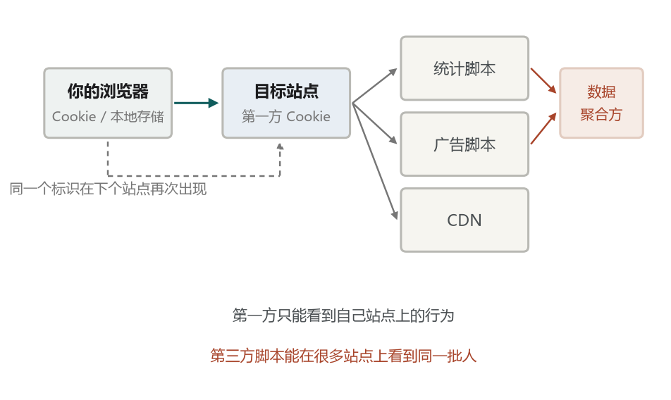
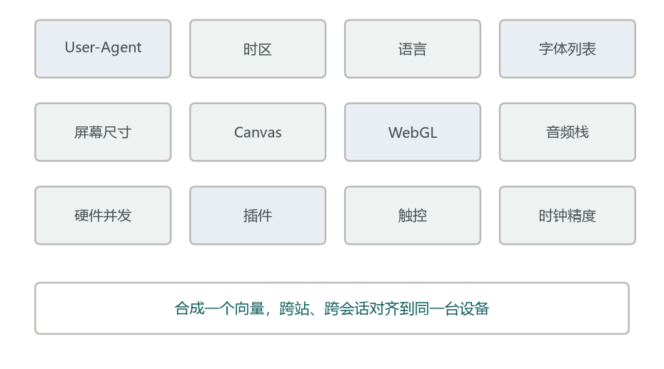

# 第二十五章　数据与隐私：上网时被记录了什么

凌晨两点，你在手机上点开一个链接，一篇讲怎么装 Python 的教程。页面不到一秒就开了，你滚了两屏，觉得讲得太浅，关掉。整个过程没登录，没输入任何字。

第二天下午，你打开另一个完全不相关的网站，侧边栏挂着一款机械键盘的广告，型号恰好是昨晚那篇教程页面边上闪过一眼的那一款。

这件事不需要解释成玄学，也不用归到“大数据”这种含糊的说法上。一次网页访问留下的东西是可以逐项列出来的，列完之后你会发现，能被抹掉的部分比想象中少，剩下的部分比想象中结实。

## 25.1 一次请求带出去的东西

浏览器要拿到那个页面，先发一个 HTTP 请求。请求行只有三段，方法、路径、协议版本，长这样。

```text
GET /tutorial/install.html HTTP/1.1
Host: example.com
User-Agent: Mozilla/5.0 (Windows NT 10.0; Win64; x64) ...
Accept-Language: zh-CN,zh;q=0.9
Referer: https://www.google.com/
Cookie: sid=8f3a...; _ga=GA1.2.114...
```

`User-Agent` 说明浏览器、版本、操作系统。`Accept-Language` 说明语言偏好。这两个字段是协议规定的，本意是让服务器挑一个合适的版本返回，副作用是它们拼在一起已经很像一个签名。

`Referer` 告诉服务器你是从哪个页面点过来的。站点拿它做防盗链和来源统计。它的麻烦在于会带上上一页的完整 URL，而 URL 里经常有搜索词、文章编号、一次性的会话参数。

Cookie 是另一套机制。服务器在第一次响应里用 `Set-Cookie` 塞给你一个字符串，浏览器存进本地，此后每次向同一个域名发请求都自动附上。HTTP 本身没有状态，服务器记不住上一条请求是谁发的，所以给你发一张号码牌，下次凭牌认人。登录态靠它，跨页面追踪也靠它。

IP 地址不写在请求头里，但在网络层，服务器一定看得到，不然响应送不回去。它大致能定位到城区一级，精度取决于运营商怎么分配地址池。移动网络的出口往往是一个城市共享的池子，精度更差；家宽相对稳定，几周不变。

五样东西凑齐之后，一条完整的记录就成形了。谁来过，从哪来，用什么设备，大致在哪，什么时候。单看每一项都平平无奇，拼在一起就是可以长期存档的档案。

这条记录落在服务器的一行访问日志里，格式通常是“IP、时间、方法、路径、状态码、UA、来源”。一家中等规模的站点每天写几百万行，日志一般保留一到三个月，用来查故障和做统计。日志本身不是监控系统，但它足够回答一个问题，某个 IP 在过去两个月里看过哪些页面。

有意思的是普通人往往在两种极端之间摇摆。一种认为“我又不重要，没人会看我”；另一种认为“我全程被盯着，无处可逃”。实际情况更接近中间。没有人盯着你实时看，但数据被批量采集、长期保存、随时可以检索和关联，而在某个具体时刻，它会被调用一次，用在一条广告、一次风控、一通电话上。

## 25.2 清掉 Cookie 之后还剩什么

多数人的第一反应是清 Cookie，或者开无痕窗口。这两件事有用，但作用范围比想象的小。

无痕窗口做的是会话隔离。关闭窗口时清掉这一轮的 Cookie 和本地存储，不让上一轮的痕迹留到下一轮。它不隐藏 IP，不改变 User-Agent，也拦不住页面里的脚本读取你的屏幕尺寸和显卡型号。

真正难处理的是浏览器指纹（browser fingerprinting）。2010 年，电子前哨基金会（EFF）的 Peter Eckersley 做过一次系统测量。他收集了四十多万名访问者的浏览器特征，包括 User-Agent、插件列表、字体、时区、屏幕分辨率、是否接受 Cookie，然后看这些特征的组合有多独特。结论是 83.6% 的浏览器在这组特征下是唯一的，把 Flash 和 Java 能读到的插件信息也算进去之后升到 94.2%。也就是说，不用 Cookie，光凭“这台机器长什么样”，样本里绝大多数人只有一个。

信号源分成几类。

User-Agent 能读出的东西比表面上多。除了浏览器和系统版本，移动端常常带机型代号。字体列表是更强的信号，一台机器上装了什么字体，取决于系统语言和装过哪些软件，中文 Windows 和英文 Windows 的字体集合差别很大。屏幕尺寸与像素比、时区、语言列表、是否开启“减少动态效果”，几行 JavaScript 就能全部读出来。

Canvas 是 2012 年之后流行起来的一类做法。让浏览器在离屏画布上画一段文字或者一个渐变，把像素数据取出来做哈希。显卡、驱动、字体渲染引擎、抗锯齿设置的细微差别都会体现在像素里，人眼看不出，哈希值完全不同。WebGL 走同一条路，只是把渲染交给 GPU，读的是显卡型号、驱动版本和一组浮点运算的结果。

音频也常被借来用。`AudioContext` 生成的波形在最后几位上有设备相关的抖动，处理一下就能当一个标识。

这些信号加起来，不需要任何本地存储就能认出你。清完 Cookie 之后，网站第一次见你，画一次画，读一次字体，比对一下 Canvas 哈希，就知道是昨天那个人。

防御方向上是有的。Firefox 从 2020 年起默认开启增强跟踪保护，对 Canvas 读取做拦截或提示。Tor Browser 走得更彻底，把所有用户的 User-Agent、时区、窗口尺寸统一成同一个值，让指纹失去区分度。这类做法的思路叫混进人群，代价是放弃一部分个性化，页面可能按错误的语言或者错误的屏幕宽度渲染。

<figure>

<figcaption>图 25-1　一次页面加载里，数据在哪些方之间流动。实线是本次访问产生的请求，虚线是同一个标识在下一个站点上再次出现。</figcaption>
</figure>

## 25.3 页面里住着的第三方

一个页面上跑的代码，大部分不是这个网站自己写的。

打开开发者工具的网络面板，刷新一次，能看到几十到上百个请求，域名远不止一个。正文来自主站，字体可能来自某个公共 CDN，评论系统是第三方提供的，统计是第三方的，广告是第三方且还要再嵌套几层。视频播放器、客服悬浮窗、分享按钮，每一个都是一段别人写的 JavaScript。

它们与你正在读的页面处在同一个执行上下文里，这一点决定了它们能做什么。它们能读 DOM，也就是页面上全部文字；能读 `document.cookie` 里没有标 HttpOnly 的部分；能读 `window.location`；能画 Canvas；能往任意地址发请求，图片、`fetch`、`sendBeacon` 都行。

跨站串联就是这么来的。你在 A 站看了一篇租房的文章，A 站页面里挂着某个广告联盟的脚本，脚本上报“这个标识看了 A 站的这个页面”。三天后你打开 B 站，B 站接了同一个联盟，脚本读到同一个标识，于是推送一条租房广告。整个过程不需要两家网站共享 Cookie，标识本来就存在第三方的域名下。

2016 年，普林斯顿的 Steven Englehardt 和 Arvind Narayanan 做过一次百万站点量级的测量，发现少数几家公司的脚本出现在非常大比例的网站上，它们的观察视角接近全网。2017 年同一组人又发表了一项工作，指出部分会话回放（session replay）类脚本会把用户在页面上敲进去的内容一并上传，包括填到一半的密码和信用卡号。原因很朴素，这类脚本记录的是 DOM 状态，而输入的字符就在 DOM 里。

<figure>

<figcaption>图 25-2　浏览器指纹的几类信号。图中每一格只表示“这一项会被读到”，格子的多少不代表真实熵值；各路信号合成一个向量之后，跨站、跨会话都能对齐到同一台设备。</figcaption>
</figure>

商业上，这类脚本的说明文字通常写“帮助优化用户体验”。它确实能让产品经理看到用户在哪个位置卡住。它同时也是一份没有告知用户的输入记录。

这种结构还有一个附带的风险。第三方脚本一旦被入侵或者被上游篡改，影响会沿着引用关系扩散到所有接入它的站点。2018 年的 Ticketmaster 事件就是这一类，攻击者把代码塞进了一个客服聊天组件的供应商，脚本在支付页面上运行，读取用户填进表单的银行卡信息。站点自己的代码一行没改，出事的是它引用的那一行 `<script>`。

于是出现了“脚本越多，责任越模糊”的局面。站点说自己只引了一个 SDK，SDK 方说自己只做了一个统计功能，广告联盟说自己只是竞价。用户看到的却是一个整体，一个他以为只属于一家公司的页面。

## 25.4 手机上的标识符

手机比浏览器更容易被长期识别，因为它有一个靠近硬件的编号。

IMEI 是设备出厂时写入的 15 位号码，烧在基带里，恢复出厂设置也不会变。早期 Android 应用可以随便读，用途从崩溃统计到广告投放都有。它的问题是不可重置，一个 IMEI 对应一台物理设备，卸载重装还是同一个号。2019 年的 Android 10 收紧了这个权限，普通应用读到的是占位符，只有系统应用和运营商相关应用能拿到真值。

iOS 那边早期用一个 40 位的 UDID，2012 年前后被废弃。替代品是广告标识符 IDFA，用户可以重置，也可以在设置里打开“限制广告跟踪”，打开之后应用读到的是一串全零。这套设计把决定权交给了用户，但大部分用户不会去动那个开关。

2021 年 4 月，iOS 14.5 上线应用跟踪透明度（App Tracking Transparency）。跨应用跟踪必须先弹窗征求同意，不点允许就拿不到 IDFA。上线后各家广告技术公司测到的同意率大致在两成上下，Meta 在财报电话会里明确说这一改动会影响它的广告收入。

Android 侧的对应物叫 GAID，同样可以重置，同样有退出个性化广告的开关。2022 年谷歌公布了 Privacy Sandbox on Android 的计划，方向是把个体标识换成在设备本地完成的兴趣归类，只把粗粒度的分组交给广告主。

还有一类标识符没有被任何系统限制，就是手机号。它本来就要求实名，是账号体系里最常用的一把钥匙，而且不能重置、不能更换得太频繁。一个号码在几十个应用里当过主键，跨平台的关联就自然成立。这也是为什么一个号码泄露的后果，比一个邮箱泄露严重得多。

一边收紧，一边是广告业的替代方案，统称归因（attribution）。既然拿不到稳定标识，就换用概率。同一个用户在手机上看到过一条广告，几天后在网页上下单，两边的时间、IP 段、设备型号、系统版本、屏幕尺寸可以喂进一个匹配模型，算出这次转化有多大概率来自那条广告。这类做法不追求认准一个人，只追求统计上算得准，因此绕开了针对标识符的监管。用户拿到的保护，比表面上看到的薄。

## 25.5 数据经纪与匿名化的失败

有一类公司不做产品，只买卖数据。

货源包括公开信息、合作方共享、从应用和网站收集的行为数据，以及从泄露里流出来的库。加工方式是把同一个人在不同来源里的记录合并进一个档案，档案里可能有姓名、住址、电话、家庭成员、消费能力、常去的商场、有没有车、有没有孩子。这类生意在美国是合法的，Acxiom、LexisNexis、Experian 都做这块；欧洲的通用数据保护条例（GDPR）加了不少限制，但没有让它消失。

卖出的时候通常附带一句“已做匿名化处理”，也就是删掉姓名和身份证号，只留一串编号加行为记录。这句话在法律上常常够用，在技术上经常不成立。

1997 年，当时在 MIT 的 Latanya Sweeney 做了一件很朴素的事。她拿到一份据称已匿名化的医院就诊记录，里面有出生日期、性别、邮编，没有姓名。她又买了一份选民登记册，里面有姓名、地址、出生日期、性别。两份数据按这三个字段对齐，她认出了马萨诸塞州州长的就诊记录。她的结论是美国人口里大约 87% 可以被“邮编、性别、生日”三项唯一确定。

2006 年，AOL 公布六十多万用户的搜索记录用于研究，用户 ID 换成了编号。纽约时报的记者顺着编号下的搜索词，几天内就找到了其中一位 62 岁的女士，她在搜自己的名字、自己住的镇、自己养的狗。

2008 年，Narayanan 和 Shmatikov 发表了针对 Netflix Prize 数据集的去匿名化工作。Netflix 放出五十万用户的评分记录参加比赛，只保留编号。研究者把这些评分和公开的 IMDb 评分做对齐，靠“哪几部冷门片打了同样的分”这类模式把编号还原成人，还能顺带推断出政治倾向。

三次的结论是同一条。匿名化删掉了一个字段，剩下的字段组合起来仍然指向唯一的人。删得越多，数据越没用；删得越少，越容易被还原。这个矛盾没有干净的解，所以现在的主流合规思路换成了目的限制，不问数据能不能匿名，只问拿它做什么，超范围就罚。

## 25.6 泄露之后，以及能做的一点点

数据攒到一定规模，就会泄露。泄露的后果不是立刻被盗，而是一点点被用掉。

最直接的一层是撞库（credential stuffing）。攻击者拿到一批邮箱加口令，去别的站点挨个试。前提是人在多个网站用同一个口令，而这个前提几乎总成立。一次泄露里的一万条记录，能打开另一批站点上的几百个账号，这些账号再被拿去撞下一批。2019 年流传的 Collection #1 就是多个泄露库拼起来的集合，规模在七亿多条邮箱记录的量级。

泄露通常不是被人通知才知道的。公开的泄露库在地下论坛流传几个月之后才有人整理成可查询的集合，很多人是在某个查询站点上看到自己的邮箱出现了三次，而那三次对应的口令他都还记得。知道自己泄露了，和知道该改哪一个，中间还差着一层判断。

第二层是精准诈骗。有了姓名、电话、订单信息、收货地址，一通电话的可信度就完全不同了。对方能说出你上周买了什么、寄到哪儿、孩子叫什么，这些细节不是编的，是查的。这类话术的重点不在吓唬，而在“他确实知道”。

第三层是身份冒用。有身份证号、有手机号、有银行卡尾号，能做的事比想象中多。某些平台的实名认证、补办某些卡片、申请小额贷款，用的都是这几样。

能做的事不多，但都是结构性的。

一是把账号分层。三四个邮箱承担不同角色，重要的几个（银行、主邮箱、学校）用一个不对外公开的地址，购物和论坛用另一个。泄露发生时，牵连范围被限制在一层里。手机号同理，别用一个号码注册一切。

二是把口令分开。一个口令只用于一个站点，交给口令管理器生成和记住。这条听起来麻烦，实际是把“记住几十个口令”换成“记住一个主口令”。

三是做隔离。日常浏览和登录重要账号用不同的浏览器，或者同一种浏览器的不同配置文件，Cookie 与本地存储不共享。已知出现在泄露库里的账号不要在那边登录。

四是减少授权。手机权限、浏览器通知、第三方登录时那句“允许访问通讯录”，每一条都是一个数据入口。默认拒绝，用到再开。

这些做法改变不了大环境。它们只改变一件事，某一环出问题时，损失会不会沿着同一个口令、同一个手机号、同一个浏览器扩散到全部。

还有一条不那么技术性的经验。把“我在哪些地方留下过真实信息”当成一份需要定期维护的清单，比记一堆安全口号有用。清单上有银行、社保、学校、手机号、常用的两三个邮箱，其余的地方尽量用一次性的身份。这份清单越短，出事时需要处理的东西越少。
