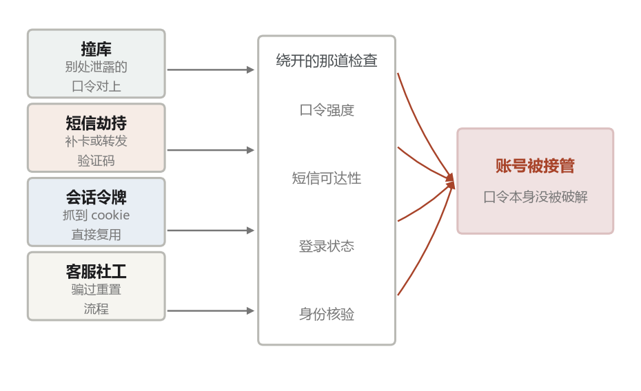
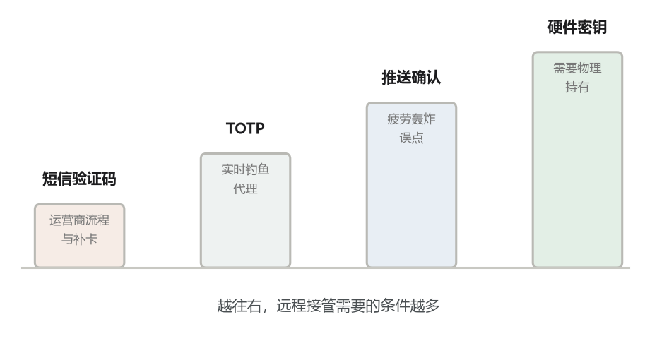

# 第二十六章　手机与账号：被盗之后

2020 年 7 月 15 日下午，一批粉丝量巨大的账号在几分钟里发了同一条推文，内容是一个比特币地址，说打钱过来可以返双倍。奥巴马、拜登、马斯克、比尔·盖茨、苹果官方账号、Uber，都在名单里。推文被删得很快，但那几十分钟里已经有人打了钱，链上记录合计十几万美元的比特币。

推特事后公布的调查里有一个细节。攻击者没有破解任何一个人的口令，也没有攻破推特的服务器。他们拿到的是内部管理工具的权限，而进入这个工具的路径是电话。几名员工被盯上，攻击者用 SIM 交换把他们的手机号接管，再用这个号码过二次验证、走账号恢复流程。

这个案子放在开头，是因为它把两件事串在了一起。账号的防线通常建在手机上，而手机本身的防线建在运营商那边，那一段你既看不见也管不着。

## 26.1 四条进入的路径

账号被接管，绝大多数落在这四条路上。

撞库。攻击者手里有一批从别处泄露的邮箱和口令，拿去目标站点批量试。它利用的是口令复用，人在十几个站点用同一个口令，任意一个站点泄露，其余全部暴露。撞库的规模可以很大，也可以很精准。精准的做法是先拿到某个人的常用网名，在几个公开泄露库里查一遍，得到一个他大概率的密码模式，再针对性地试变体。工具会自动把“名字+生日”“名字+年份”“首字母大写加123”这几十种排列都试一遍，命中率比随机猜高几个数量级。

SIM 交换。攻击者先收集目标的姓名、身份证号、手机号、最近的通话对象、账单地址，然后冒充本人联系运营商，声称手机丢了要补卡。客服核对的几项信息都能从泄露数据或者社交关系里凑齐。补卡成功之后，所有发到这个号码的短信都进了攻击者的手机，包括验证码和密码重置链接。更省事的版本是买通营业厅或代理商的员工，跳过核对直接开卡。

会话令牌窃取。很多系统在登录成功之后发一个 Cookie 或者 token，此后靠它认人，不再每次校验口令。这个令牌一旦被拿走，攻击者不需要口令也不需要验证码，直接把令牌塞进自己的浏览器就能用。拿令牌的常见方式是信息窃取类恶意程序（infostealer），它们专门翻浏览器的 Cookie 数据库和本地存储；另一种是会话固定，让受害者的浏览器用上一个攻击者已知的会话 ID。

客服社工。直接打给目标公司的客服，冒充账号本人，说自己换了手机、忘了密保、收不到验证码，要求人工协助重置。2023 年 9 月，拉斯维加斯的米高梅国际酒店集团被入侵，起点就是攻击者打给 IT 服务台的十分钟通话。他们冒充一名员工，问到了凭据，随后在内部横向扩散了几天。同一个月，凯撒娱乐据报支付了上千万美元的赎金。

<figure>

<figcaption>图 26-1　四条常见的接管路径，以及每一条绕开的是哪一道检查。四条路的共同点是不与密码本身的强度正面对抗。</figcaption>
</figure>

四条路有一个共同特征，它们都不去和口令的复杂度较劲。撞库靠复用，SIM 交换靠号码，令牌窃取靠本机，社工靠人。防守如果只盯着“把口令设复杂一点”，等于只挡住了第一条的一半。

账号被盯上，通常不是因为你重要，而是因为你的账号在市场上有一个可估算的价格。一个有真实好友的社交账号、一个能发推的企业官号、一个绑了银行卡的支付账号，价格差很多。企业邮箱排在最前面，因为它能向内网发信，而内网信任企业邮箱。账号的价值决定攻击者愿意为它花多少时间，这也解释了为什么个人被盯上时，常见的是低成本手法，而员工被盯上时，会出现持续几周的定向社工。

## 26.2 手机丢了之后的顺序

发现不对劲到做完处置，中间这段时间决定了损失的大小。顺序不是随便排的，每一步挡的东西不一样。

第一步，处理号码。打运营商客服挂失，或者用另一台设备登录运营商 App 办停机。这一步拦的是 SIM 交换和补卡，因为号码一旦被停，新卡就开不出来，短信验证码这条路先断了。同时把手机上的支付类应用做临时冻结，支付宝和微信都有网页端或者亲友协助的冻结入口。

第二步，改主邮箱的口令。主邮箱是账号体系的中枢，几乎所有其他账号的重置邮件都发到这里。改口令必须从一台干净的设备上做，最好不是丢失的那台，也不是任何一台最近登录过可疑链接的机器。改完之后立刻检查这个邮箱的转发规则和自动回复，很多人被入侵后第一件事就是设一条“把所有邮件转发到某个地址”，此后你改了密码，对方照样收得到。

第三步，踢出所有会话。改口令不一定让已登录的设备下线，很多系统只在下次登录时校验新口令。所以要在安全设置里找到“已登录设备”或“活跃会话”，把不认识的逐一终止。这一步挡的是令牌窃取，因为令牌的有效性独立于口令。

这里有一个容易被忽略的细节。手机丢失后，很多人第一反应是远程抹掉设备。抹掉本身没错，但它会让本地的证据一起消失，包括“什么时候被解锁过”“装了什么新应用”。如果手机里还有没同步的照片和聊天记录，这个动作也不可逆。更稳妥的顺序是先改口令、先踢会话，确认损失范围之后再决定要不要抹。

第四步，检查恢复方式。备用邮箱、备用手机号、安全问题、信任设备，这几项是恢复流程的入口，也是最常被忽略的地方。攻击者常常先改掉这几项，再慢慢处理别的。把它们全部替换成你能控制的，顺序是先加新的，再删旧的，避免中途把自己锁在外面。

第五步，逐个处理下游账号。邮箱恢复回来之后，用它去查各个站点上的登录记录，重点看有资金、有身份、有社交关系的那些。这一步不是在补漏洞，是在清点损失，因为被接管的账号可能已经被用来向你的联系人发过消息，或者绑定了新的支付方式。

这五步做完，通常要一两个小时。真正麻烦的是那些没那么快发现的情况。有人三个月后才发现自己的邮箱在给别人转发账单，中间所有银行流水都被看过一遍。

## 26.3 二次验证的强弱

二次验证（2FA）这个词被用得太宽，实际上不同做法之间的差距有几个量级。

最弱的是短信验证码。它的问题不在密码学，而在链路。短信走的是运营商网络，其中有一段基于七号信令（SS7）的老协议，设计于上世纪七十年代，当时没有考虑过鉴权。研究人员在 2014 年、2017 年多次演示过利用 SS7 的漏洞截获短信，成本需要接入运营商网络，不是普通人能做的。真正被大量使用的是 SIM 交换，它不需要任何技术，只需要一个能骗过客服的电话。第三是运营商内部人员，一条短信在到达你之前经过的系统比想象的多。

往上一档是基于时间的一次性口令（TOTP），也就是验证器 App 里每 30 秒变一次的那六位数字。它的算法在 RFC 6238 里定义，密钥在注册时通过二维码传给 App，此后完全离线计算，不经过任何网络。它挡得住 SIM 交换和短信截获，挡不住的是钓鱼。攻击者做一个和真实登录页一模一样的页面，你在上面输入六位数字，他立刻拿这六位数字去真站点登录。这个窗口有 30 秒，够用。

再往上是推送确认。登录时手机上弹一个框，问你“是不是你本人在登录”，点确认才放行。它比 TOTP 好一点的地方在于多了一个上下文，可以看到登录地点和设备。但 2022 年之后这类验证被集中攻击过一轮，手法叫 MFA 疲劳（MFA fatigue）。攻击者拿到正确口令后反复触发推送，深夜里连着弹几十次，用户嫌烦就点了同意。优步 2022 年 9 月那次入侵就是这么进来的，攻击者还在 Telegram 上联系了那名员工，教他怎么点。现在的改进版要求输入屏幕上显示的两个数字，叫数字匹配（number matching），它挡住了无脑点确认，挡不住被话术说服的人。

最强的是硬件密钥，FIDO2 标准的 U 盘或者支持 WebAuthn 的设备。它的关键在于绑定域名。密钥在注册时和站点域名绑死，浏览器在签名时会把当前域名放进签名内容里，钓鱼站点拿到的签名对应的是它自己的域名，拿到真站点上验不过。这是目前唯一在原理上对钓鱼免疫的形态。手机上的通行密钥（passkey）用的是同一套机制，只是把密钥存在设备的加密芯片里。

不管用哪一档，还有两件事得单独处理。一是恢复码。开启 TOTP 或硬件密钥时，系统会给一串一次性恢复码，用于手机丢失时救急，这串码必须离线保存，打印出来或者写在纸上，不要拍照存在云端相册里，因为那正是你会丢的那个账号。二是备份。硬件密钥一般要求注册两把，一把随身，一把放家里，两把都丢了同样进不去。

2019 年谷歌公布过一组实测数据，覆盖他们自己账号上一年多的攻击记录。短信验证码挡住了 100% 的自动化机器人、96% 的批量钓鱼、76% 的定向攻击；手机推送挡住了 99%、99%、90%；安全密钥三项都是 100%。这组数字说明的不是“短信没用”，而是它在面对真人定向攻击时会漏掉四分之一，而定向攻击正是最贵、最值得防的那一类。

<figure>

<figcaption>图 26-2　四种二次验证方式。台阶高度表示抵抗远程接管的能力，台阶旁的注记是各自最容易被突破的那一环。</figcaption>
</figure>

## 26.4 恢复流程是最薄的地方

前面那些防线有一个共同前提，你还进得去。

而攻击者真正的目标往往不是“进去”，是“以你的名义重置”。重置流程的设计目标是让忘记密码的人能回来，它必须在没有口令的情况下证明“你是你”。这个证明只能靠别的东西，备用邮箱、手机号、安全问题、身份证照片、人工客服的判断。这几样东西的安全性，通常远低于口令本身。

2012 年，连线杂志的记者 Mat Honan 被入侵过一次，过程后来被完整复盘。攻击者先打给亚马逊客服，用他公开在推特上的邮箱和一个伪造的信用卡号，骗客服把一个新的邮箱地址加进账户；然后用这个入口拿到信用卡后四位的显示；再打给苹果客服，用姓名、地址、信用卡后四位重置了 Apple ID 的口令。整个链条里没有一步是技术攻击。最后他的 iPhone、iPad、Mac 被远程抹掉，Gmail 和推特被接管，几年的照片没了。

这类链条的每一环单独看都合理。亚马逊帮客户加一个备用邮箱，苹果用信用卡后四位核验身份，都是正常的服务。问题在于它们被串起来之后，最弱的一环决定了整条链的强度。

自己的账号能做的改进不多。把恢复方式换成只有自己能控制的，不用公开可见的信息作为验证依据，比如不要用“母亲的姓氏”“出生的城市”这类能被查到的答案。开启登录通知，让每一次新设备登录都发一条提醒。对重要账号，把恢复邮箱设成另一个同样受硬件密钥保护的账号，避免它成为新的短板。

## 26.5 恶意应用长什么样

手机上的账号接管，很多时候起点是一个装进来的 App。

安装包本身可能没有问题，二次打包会把它改掉。正规应用被拆开，塞进几百行代码，重新签名，放到第三方市场或者聊天群里等下载。用户看到的图标、名字、界面都对，第一次打开也正常。

这类代码要做事，就得先要权限。几个权限组合在一起，性质会变。

无障碍服务（AccessibilityService）本来是给视障用户读屏用的，授予之后能读取屏幕上所有文字，也能代替用户点击。恶意应用会编一个理由让你手动去设置里打开它，比如“需要开启无障碍才能正常使用”。打开之后它就能读到银行 App 界面上的余额，也能在你转账时替你按下确认，还能在验证码短信弹出时把内容抓走。2023 年前后流行的几族安卓银行木马（Anatsa、Xenomorph 之类）用的都是这条路。

通知读取（NotificationListenerService）是另一条路。它不需要无障碍那么大的权限，但能读所有应用的通知，短信验证码在通知栏里的那条文本就在其中。很多双因素方案在这条路上失效，因为验证码是在通知里被读走的，不是从短信数据库里。

悬浮窗（SYSTEM_ALERT_WINDOW）解决的是“盖在上面”的问题。它能在别的应用之上画一层界面，做出和银行 App 一模一样的登录框。用户以为在输入账号密码，实际输进了一个覆盖层。

设备管理员（Device Admin）权限让应用难以被卸载，可以锁屏、可以抹数据，常常被用来做勒索或者防止受害者删除。

2022 年之后安卓在收紧这些口子。Android 13 给侧载应用加了一道“受限设置”，从浏览器或者聊天软件装进来的应用，默认不能开无障碍，需要用户在应用信息页里多点两步才能授权。这一步只是提高门槛，不是封死。真正的判断依据还是在用户这边，一个计算器不需要读屏权限，一个手电筒不需要读通知。

更普遍的一类问题不是恶意，是过度。一个修图软件要通讯录，一个天气应用要位置常驻，一个输入法要上传剪贴板。它们未必在作恶，但它们都在扩大数据的暴露面，而暴露面越大，出事的时候牵连越广。授权时问一句“它不给这个权限还能不能用”，答案通常是能。

安装来源也要看一眼。系统商店里的应用至少过了一道审核和签名校验，网页上弹出来的“安卓版下载”多数没有。同一个应用在官方渠道和第三方下载站上的文件，大小往往差几十 KB，差的那些字节就是被塞进去的部分。

真正难防的一类连权限都不需要。一个应用只要求“显示在其他应用上层”和一个后台服务，就能在你打开银行 App 的那一刻知道自己该上场了，因为前台应用的包名是公开信息。它不读屏，不读短信，只负责在正确的时机把正确的界面盖上去。这类攻击的防线不完全在手机上，还在银行那一侧，比如转账限额、收款人白名单、大额转账的延迟到账。
