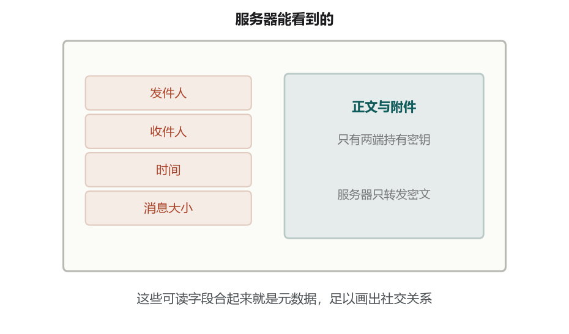
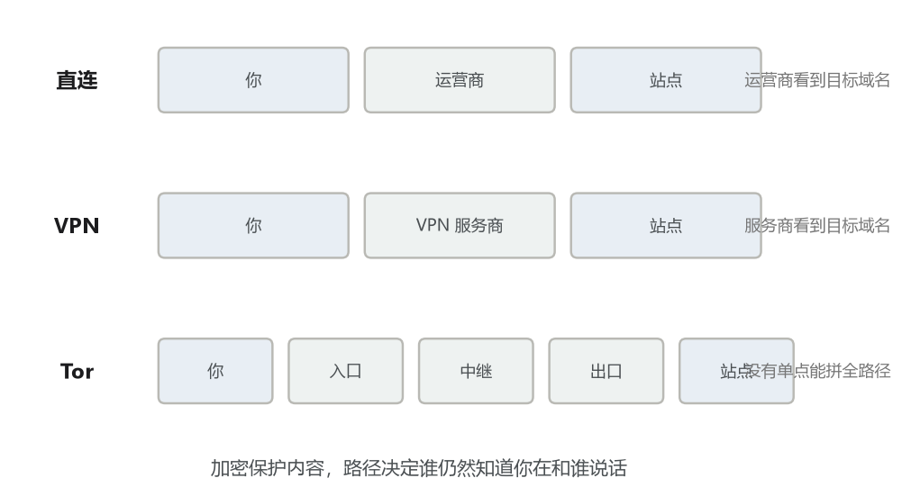

# 第二十七章　加密通信与匿名：挡住了谁

晚上八点，你在寝室群里发了一句“周三晚上七点，老地方”。这句话从你的手机出发，到你室友的屏幕亮起来，中间经过的机器比一顿饭的参与者多得多。

先到附近的基站，经过运营商的核心网，出省或者出国，进到服务商的机房，落盘或者转发，再顺着另一条路回到他的手机上。如果这个群用的是普通聊天软件，这条路径上的每一段都能把内容看一遍，也能把“谁在什么时候给谁发了多长的消息”记下来。

加密改变的是这条路上谁能看到什么。它不改变路径，也不改变参与者。这一点决定了几乎所有关于隐私工具的讨论，讨论的核心其实是“你把信任交给了谁”。

## 27.1 端到端加密把钥匙放在哪

先分清两种加密，它们的边界差得很远。

第一种是传输层加密，也就是浏览器地址栏那把锁，或者聊天软件连服务器时的那一层，协议是 TLS。它保护的是“你的手机到服务器”这一段。服务器收到之后要解密，因为要处理内容、要存储、要做检索。所以它挡住的是路上的窃听者，比如同一个咖啡馆 Wi-Fi 上的其他人，或者运营商链路上做流量分析的人。它挡不住服务器，因为服务器本来就有钥匙。

第二种是端到端加密（end-to-end encryption，E2EE）。密钥只在通信的两端存在，服务器转发的是一段它自己也解不开的密文。WhatsApp 从 2016 年 4 月起默认全量开启，用的协议来自 Open Whisper Systems，也就是后来改名的 Signal 基金会；Signal 自己、苹果的 iMessage、谷歌的部分产品，用的是同一类设计。

TLS 那一层也有它自己的盲区。握手开始时客户端要告诉服务器“我要访问哪个域名”，这个字段叫 SNI，为了兼容老旧中间设备，它在 TLS 1.3（RFC 8446，2018 年）里仍然默认明文。所以路径上的观察者看不到内容，但看得到你去的每一个域名。后来提出的加密客户端问候（ECH）把这个字段也包进密文，但它需要客户端和服务器同时支持，目前只在部分浏览器与 CDN 之间跑通。DNS 同理，传统查询是明文的，而 DNS over HTTPS 和 DNS over TLS 把这一步也包了起来。加密一层一层往上包，但每包一层都得两边同时改，这就是为什么十年过去，路上仍然看得到你访问了哪些站。

这套设计的核心是一个叫双棘轮（Double Ratchet）的机制。每发一条消息，双方的密钥都往前推一步；每条消息用的密钥都不一样，用完就丢。这样做的结果是，即使某一条消息的密钥在某天被拿到，也解不开之前和之后的消息。这叫前向保密（forward secrecy），代价是双方必须都在线同步状态，离线太久的消息会积压。

密钥怎么来的，是这套体系最容易出错的地方。Signal 协议里的 X3DH 用一组长期身份密钥加上一次性预共享密钥做协商，好处是发送方不需要接收方在线也能算出会话密钥。麻烦在于身份的确认。协议保证的是“这条消息确实来自持有某个公钥的人”，不保证“这个公钥属于你以为的那个人”。第一次通信时，如果服务器换掉了对方的公钥，中间人就能插在中间。所以 Signal 提供了安全码比对，双方对着屏幕念一串数字确认。这一步几乎没人做，于是端到端加密的实际强度，取决于你对“联系人列表里的那个人”的信任。

<figure>

<figcaption>图 27-1　一条端到端加密的消息在服务器上剩下什么。信封上的字段仍然可读，信封里的内容不可读；这些可读字段合起来就是元数据。</figcaption>
</figure>

## 27.2 内容之外，还有元数据

端到端加密只保护内容。它不隐藏的是信封。

一封加密消息在服务器上留下的记录至少有这些。发送方的账号或者设备标识、接收方的账号、发出时间、投递时间、消息大小、消息类型（文字、图片、语音、位置）、会话频率。群聊里还有成员名单和变更记录。这些东西合起来叫元数据（metadata），它不需要解密任何内容。

元数据的解释力比很多人以为的强。知道两个人每天凌晨通信半小时，知道某个账号在某个时间点和十几个陌生号码轮流通话，知道一台设备在三天里上传了 2 GB 的加密流量，这些都不需要看到内容。2013 年斯诺登披露的文件里有一句话被反复引用，大意是他们靠元数据就能干掉很多人。这句话可以争论，但方向是对的。

各家对这个问题的处理不一样。Signal 在 2018 年引入了密封发件人（sealed sender），把“谁发的”这层信息也加密起来，服务器只知道消息投给谁，不知道从哪来；代价是抗滥用变难，所以只在对方也在通讯录里时启用。WhatsApp 的元数据保留范围在它的隐私政策里写得比较细，包括账号注册的手机号、最后一次上线时间、通信对象和频率，这些在多次隐私政策争议中被反复讨论。

还有一个更隐蔽的缺口，备份。端到端加密保护的是传输和服务器上的消息，很多产品默认把聊天记录备份到云端，而备份这一层可能不是端到端加密的。苹果的 iCloud 备份长期如此，备份里包含聊天记录，密钥由苹果持有，只有 2022 年底推出的高级数据保护（Advanced Data Protection）把备份也纳入了端到端范围，而且默认不开。这意味着一个账号被接管之后，攻击者不需要破解任何加密，直接从云端备份里把几年的聊天读出来。

这也是理解加密产品时最实用的一条判断。加密在哪里结束，数据就在哪里重新变成明文。你要找的是那个交接点，以及谁手里握着交接点的钥匙。

2021 年初 WhatsApp 修改隐私政策，要求用户同意与母公司共享部分账号数据，引发了一轮规模不小的迁移，Signal 和 Telegram 在几天内上了几千万次下载。有意思的是那次争议涉及的不是消息内容，而是元数据和商业数据。这恰好说明一件事，用户对内容的保护已经建立了预期，对元数据的归属还没有。

## 27.3 VPN 把信任搬了个地方

“用 VPN 就安全了”这句话被广告重复了太多次，值得拆开看。

VPN 做的事实上只有一件事。它在你和设备之间建一条加密隧道，把你所有的流量先送到 VPN 服务器，再由那台服务器替你访问外面的世界。本地的网络看不到你访问了什么，因为隧道里的内容是密文；出口处的目标站点看到的是 VPN 服务器的 IP，不是你的。

所以它的效果是把信任从本地网络转移到 VPN 服务商。在公共 Wi-Fi 上，这个转移是有意义的，因为你会把信任从一个不知道是谁的热点，换成一家至少签了服务条款的公司。在家里，意义小一些，因为你的运营商本来也只看到域名和流量特征，而这些信息在 VPN 之后同样被 VPN 商看到，一点没少。

它挡不住的清单很长。钓鱼网站还是钓鱼网站，它骗的是你，不是网络。恶意软件下载下来照样运行，因为 VPN 不检查内容。浏览器指纹照样有效，因为你换的是 IP，不是显卡。账号在网站上的登录状态照样被记录，因为那是网站自己的日志。手机上的应用照样能读通讯录和位置。VPN 改变的只是网络路径这一层。它连“网络路径”这件事都只改了一半，本地运营商仍然看得到你在连某个 VPN 服务器、什么时候连、传了多少数据，只是看不到终点在哪。在限制 VPN 的网络里，这个“看不看得到”本身就够用了。

还有一类问题出在实现上。免费 VPN 的商业模式通常不是卖服务，而是卖数据，这和它的技术能力天然匹配，因为它居中转发，什么都能看到。即使是付费产品，日志政策也只是政策，没有技术手段能向用户证明“我们真的没记”。要想核实，只能靠第三方审计报告，而审计的范围和频率由厂商决定。

实现上的细节还会把本来该挡的东西漏出去。最常见的是 DNS 泄漏，隧道只包了 TCP 流量，DNS 查询仍然走本地网络，于是你访问的域名先被本地运营商知道了一遍。IPv6 泄漏是同一类问题，隧道只处理了 IPv4，而设备同时有一条 IPv6 路由，流量就从另一条路出去了。这类问题不是设计缺陷，是配置没盖全，但用户看不出来，因为浏览器里一切正常。

<figure>

<figcaption>图 27-2　三种路径下，同一个请求在哪一跳上暴露了目标。VPN 只是把观察点从运营商挪到了服务商，Tor 才是把路径拆成没有单点能拼全的几段。</figcaption>
</figure>

## 27.4 Tor 的三层与那个出口

Tor 要解决的问题比 VPN 更具体，它想让没有任何一个节点能同时知道“你是谁”和“你访问谁”。

这个想法不新。1995 年美国海军研究实验室的 Paul Syverson、Michael Reed 和 David Goldschlag 发表了洋葱路由（onion routing）的设计，动机是让情报人员的网络活动不暴露来源。2002 年 Tor 项目开始实现，2004 年放出可用的客户端，后来转成非营利组织运营，资金来源包括美国政府的科研资助和各路捐款。今天它同时服务于记者、维权人士、执法机构和安全研究者，用户构成比宣传里的复杂得多。

做法是把路径拆成三跳。客户端先选一个入口节点（guard），再选一个中间节点（middle），最后选一个出口节点（exit）。三跳的名单从公开的目录服务里取，全球有数千个由志愿者和组织运行的中继。客户端和入口之间的链路用三把钥匙逐层加密，就像套了三层信封：入口拆掉最外面一层，只知道上一跳是客户端、下一跳是中间节点；中间节点拆掉第二层，只知道前后两个邻居；出口节点拆掉最后一层，拿到明文请求，替你去访问目标。

所以出口节点是整条链上唯一看到明文的环节。如果目标站点用的是 HTTPS，出口看到的也只是 TLS 密文加上域名，安全性由 HTTPS 那一层保证。如果是明文 HTTP，出口节点能看到完整的请求和响应，包括你提交的表单。历史上确实出现过出口节点抓取流量、注入广告、替换下载文件的事情，这不是理论风险。

和 VPN 相比，差异在于“有没有单点”。VPN 有一个中心，那个中心同时知道你的 IP 和你访问的域名。Tor 把这个中心拆开，入口知道你是谁但不知道你去哪，出口知道你去哪但不知道你是谁。代价是速度和稳定性，三跳绕行让延迟成倍上升，视频基本看不了，而且入口节点的选择有讲究，选得不好会削弱匿名性。

Tor 能挡的和不能挡的都很清楚。它挡不住你自己泄露身份，比如在匿名访问的同时登录了实名账号，或者浏览器窗口大小和字体暴露了指纹（Tor Browser 专门做了统一化处理来对付这一项）。它挡不住全局流量分析，一个能同时看到你入口流量和出口流量的对手，可以靠时间和体积的相关性把两端对上，这是学术界反复研究过的攻击方向，防御手段有限。它也不承诺抗审查，因为入口节点的 IP 是公开的，可以被封。针对封锁，社区做过域前置（domain fronting）之类的绕行，靠把请求伪装成访问大厂域名的流量，2018 年几家大厂陆续关掉了这个特性。

入口节点的选择值得单独说一句。Tor 要求客户端长期固定一个入口节点，几个月不换，原因是频繁换入口会给你制造更多被关联的机会。这个设计假设入口节点是诚实的，而入口恰恰是唯一知道你真实 IP 的那一跳。所以“Tor 安不安全”这个问题没法抽象回答，它取决于你面对的是谁。防广告商和防一个有资源做全网流量关联的对手，是完全不同的两件事。

隐写是另一条思路，把信息藏进图片、音频或者正常流量的时序里，让“有没有通信”这件事本身看不出来。这条路在实验室里成立，在真实场景里受限于带宽和鲁棒性，只能承担很小的信息量。抗审查工具也一样，桥接节点、可插拔传输、流量伪装，每一层都在跟封锁方互相试探，没有哪个方案能长期稳定。它们解决的是“能不能发出去”，不是“发出去之后谁看不到”，这两件事经常被混在一起。

## 27.5 先问信任交给了谁

把这几个工具放在一起看，会发现它们不是“安全等级”的排列，而是信任结构的不同。

不加密的通信，信任交给路径上的所有人。TLS 把路径上的窃听者去掉，信任交给服务器。端到端加密把服务器也去掉，信任交给对方的设备和对联系人身份的确认。VPN 把本地网络的信任换成服务商的信任。Tor 把信任分散给三个互不知情的节点，代价是性能，以及仍需信任目录服务和出口处的 HTTPS。

同一件工具在不同位置的价值完全不同。VPN 在酒店 Wi-Fi 上防的是同一个网段里的其他人，这个威胁真实存在；在自家宽带上，它主要的作用是换一个地区的 IP。Tor 在需要隐藏“谁在访问”时有用，在只需要绕过地域限制时是杀鸡用牛刀，还慢。

所以面对一个号称保护隐私的产品，可以先问四个问题。它在哪一段加密，密钥在谁手里。它记录什么，日志保留多久，有没有第三方能验证。它的威胁模型是什么，防的是运营商、服务器、局域网里的邻居，还是防一个能同时看两端的对手。最后一个，也是最容易被跳过的一个，它靠什么赚钱。前三个问题的答案都能写在官网上，第四个问题的答案通常写在财报里。

这四个问题对同一件产品会得出不同结论。一个聊天软件可能内容加密做得极好，元数据却全量保留；一个浏览器可能隐藏了 IP，指纹却原样暴露；一个“隐私搜索”可能确实不记账号，但记了查询词和 IP 的对应关系。产品很少在所有维度上都好，宣传语选的通常是最好的那一维。

回到开头那条消息。加密之后，路上的机器只能看到一个信封，看不到里面的字。发信人和收信人、时间和频率、信封的大小，仍然在外面。想把这些也藏起来，就得换一套路径，而那套路径本身又需要新的信任。这是一个层层外推的过程，没有一步能免费。信任不会消失，只会换一个持有者。

更彻底的设计是混合网络（mixnet），比如学术界的 Loopix，靠延迟和乱序把时序相关性打掉，代价是消息要等几十秒才到。这条路在需要对抗强流量分析时才有意义，日常通信用它不划算。安全工具的选择始终是一次权衡，抛掉的是速度、便利或者钱，换回来的是某一类对手看不到你。先想清楚对手是谁，再选工具，顺序反了就会买一堆用不上的东西。
