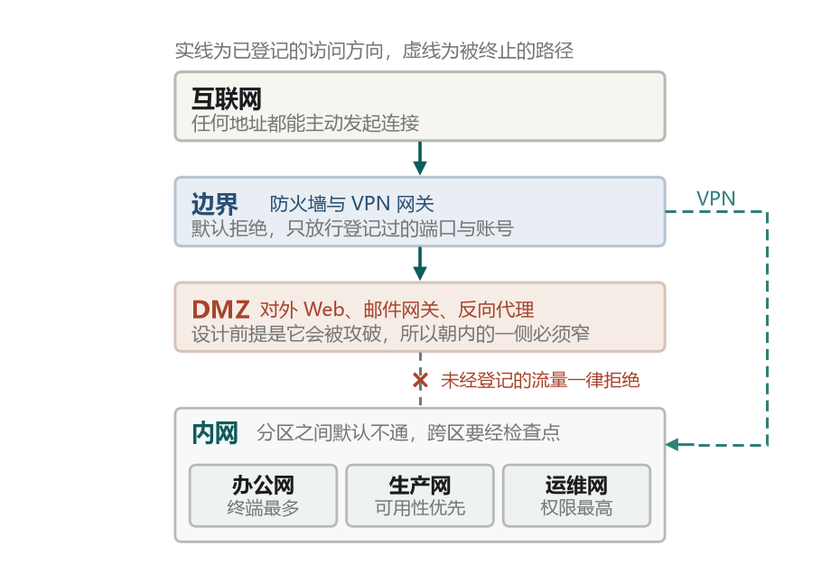
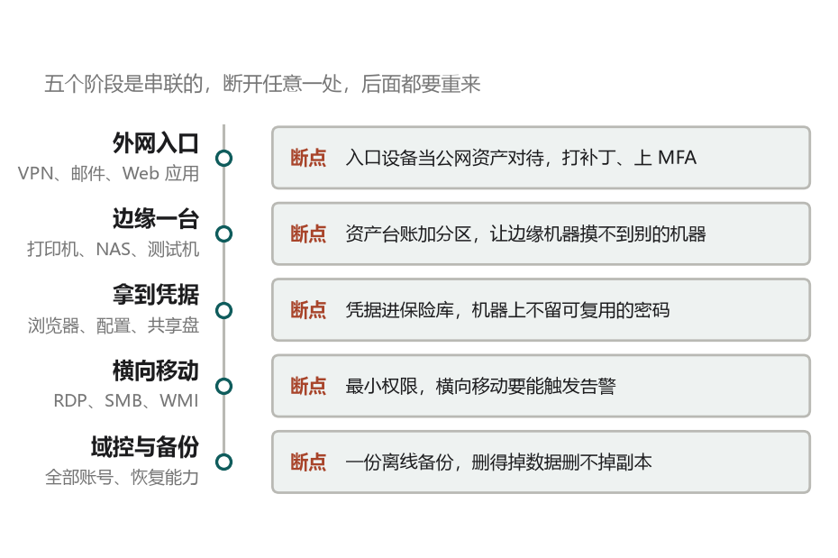

# 第二十八章　企业网络长什么样

入职第一天拿到笔记本，IT 让你装一个客户端，告诉你公司 wiki 的地址是一串内网 IP。在家连不上，得先在手机上点一下确认，再打开 VPN。到了办公室，同一个地址秒开。隔壁工位的同事能打开薪酬系统，你打开是一句 403。

同一栋楼，同一根网线，两台机器的可达范围完全不同。家里的路由器后面，所有设备互相看得见，谁都能 ping 通谁的打印机。企业网络不是一个大内网，它是一堆被切开的小网，切口上放着检查点。切口画在哪里，为什么画在那里，是这一章要讲的事。

先说范围。这里讲形状，不讲打法。知道分区怎么划，防守方才知道检查点该往哪儿放，刚入行的人看得懂那张拓扑图，才谈得上在上面找问题。某台设备具体怎么被拿下，不属于这一章的内容。

## 28.1 分区画的是信任边界

企业网络的拓扑图一般画成几个方块。最外面写着互联网，中间一层叫 DMZ（demilitarized zone，隔离区），里面是内网，内网又切成办公、生产、研发几块。这张图在新员工眼里基本是装饰，因为日常只用得上其中两三个地址。可每一条线都对应一组防火墙策略，策略背后是一个判断，这两个区之间的流量该不该默认放行。

办公网是员工终端待的地方。机器数量最多，补丁水平最不齐，钓鱼邮件落地也在这里。这一区的威胁模型假设终端一定会中招，所以策略应当写成只允许往外访问少数几个服务，不允许主动去访问生产网。

生产网跑业务系统，可用性优先，变更要走审批。它对办公网应该是单向的，业务系统可以被访问，办公终端不能反过来直接连数据库端口。很多事故的起点就是这个方向没设，一台中了挖矿木马的电脑在整段扫 3306。

DMZ 放的是必须被互联网直接访问的东西，门户、邮件网关、反向代理、对外的 API。设计这一区的前提是承认它会被攻破。所以它朝内网的那一侧必须是窄口，最好根本不连，需要数据时由内网主动去取，而不是让 DMZ 里的机器能自由地往里连。

运维网放堡垒机（bastion host）、虚拟化管理平台、服务器的带外管理口、交换机和路由器的管理界面。这一区权限最高，能重装任何一台机器，能改任何一条策略，所以能进去的人最少，进去的路径也最短。

研发网放源码、构建流水线、镜像仓库。它特殊在产出物要部署到生产网，一次投毒就能跨区传播，所以它既要防外面的攻击，也要防内部有人往构建脚本里塞东西。

分区还会往下切一层。访客 WiFi 和员工 WiFi 分开，有线口只给登记过的机器用，研发的测试机单独一个网段，会议室的投屏盒子不许和办公终端互通。802.1X 这类认证让"插上网线就能上网"不再成立，代价是每换一次工位都要重新配置。云上同理，同一个账号下的不同 VPC 默认不通，通不通取决于安全组写了什么。

分区的好处用一句话说得完，一台机器失守不等于全部失守。代价是运维复杂度，以及跨区申请带来的摩擦。摩擦是故意留的，它让"从办公网直接连数据库"这种事需要有人签字，而不是顺手就做了。

技术上落地分段靠 VLAN、访问控制列表、防火墙策略，云上还有安全组和微分段。手段不重要，重要的是规则写在哪儿、谁改得动、改完有没有记录。规则只存在某个人的记忆里，这条分区迟早会消失。

判断一个网络有没有真的分区，不用看拓扑图，看两件事。从一台普通办公终端发起连接，能不能摸到 3306、6379、9200、445 这些端口。跨区访问的例外清单上，有没有申请人和到期日。例外没有到期日，三年之后它就成了默认策略，也没有人记得它当初为什么被放行。

<figure>

<figcaption>图 28-1　企业网络的分层，内网只画了三块作例。每一层之间的连线都是一组显式规则，VPN 是最典型的"绕过 DMZ 直进内网"的通道，因此它本身也是边界上最该被重点看护的设备。</figcaption>
</figure>

## 28.2 身份比位置更重要

分区管的是"从哪来"，身份管的是"你是谁"。企业里这两件事一直叠着用，最近十年重心在往后者移。

AD 与 LDAP。Windows 域（Active Directory）是国内企业最常见的一套，本质是一个目录服务，存账号、存机器、存组，认证走 Kerberos。员工开机输一次密码，之后访问文件服务器、邮箱、内网系统都不用再输，靠的是域控签发的票据。方便的另一面是集中，域控里存着所有账号的凭据材料，拿到域控就等于拿到全公司的身份。这也是入侵路径的最后一步总指向域控的原因。

SSO。单点登录（single sign-on）把"一个账号登录所有系统"扩展到外部服务，协议常见的是 SAML 和 OIDC。它的风险和域控同构，只是范围更大。一家公司如果有两百个应用接了 SSO，其中一个没开多因素认证，那个应用就是整个身份体系的后门。

堡垒机。运维人员不直接 SSH 到服务器，先登录堡垒机，由它转发，会话全程录制，命令留档，服务器密码由堡垒机托管，运维本人并不知道真实密码。它的价值不在防入侵，而在两件事：把"谁能登哪台机"变成一张可以审计的表，以及出事之后能回放。

VPN。远程办公的入口，模型很朴素，验证一次身份，然后你就在内网了。这个模型的问题在 2021 年被反复演示。当年 5 月，美国输油管道公司 Colonial Pipeline 遭勒索，公开调查和国会听证披露的入口是一个已经不用、但仍然有效的 VPN 账号，密码此前在泄露数据里出现过，账号没有绑定多因素认证（multi-factor authentication，MFA）。一条旧密码，换来六天的停运和一笔赎金。

零信任（zero trust）。这个词被厂商用得很滥，它原本的意思很朴素，不要因为流量来自某个网段就信任它。NIST 在 2020 年发布的 SP 800-207 把它写成了一套参考架构，核心是三点，每次访问都验证身份与设备状态，权限按当前任务给而不是按岗位给，会话短且可撤销。落地形态通常是身份代理加微分段，而不是买一台设备插在网里。

企业内部还有一类账号不挂在人身上，叫服务账号（service account）。它给某个程序用来连数据库、调接口、拉备份，口令通常写在配置文件里，很少改，权限往往给得比需要的大，因为没人愿意为它逐项申请。域环境里最危险的就是一个被加进了高权限组、口令十年没换、还带着"永不过期"标记的服务账号。审计时专门查这一类，比查员工账号的收益高得多。

这一节最实用的判断标准在入职和离职两头。新员工的权限是"和同组的人一样"，还是"完成他头三个月的工作所需要的"。离职当天账号是否真的停用，共享账号、测试账号、供应商账号有没有人管。很多入侵用的不是偷来的密码，是没人记得还在生效的账号。

## 28.3 内网幻觉

有一类错误配置在企业里出现的频率高得离谱：Redis 监听全部网卡且没有密码。MySQL 的 root 允许任意主机登录。Elasticsearch 的 9200 端口对内网敞开。Jenkins 允许匿名注册。Kubernetes 的 dashboard 挂在 NodePort 上。Tomcat 的 manager 页面还在用默认口令。打印机的 Web 管理页、NAS 的共享目录、服务器的带外管理口、监控系统的默认账户，都一样。

这些配置有一个共同点，装的时候图省事，装完没改，理由是它在内网。

"反正在内网"背后是一个假设，内网是可信的。这个假设在二十年前勉强成立，那时候能连进内网的人基本就是本单位职工。现在不成立。内网里有员工的个人手机、访客 WiFi 连着的设备、业务部门自己买的云主机、外包团队带进来的笔记本、供应商远程维护的通道。其中任何一个被攻破，攻击者就站在"内网"里了，而那些没有密码的 Redis 会被他当成免费跳板。

设备的出厂口令有一份公开的清单，型号一查就能对上。装设备的人在赶工期，改口令这一步经常被跳过，改完之后写在一张纸条上贴在机柜门内侧。这张纸条的价值，比很多技术手段都高。

还有一层误解是把 NAT 当成隔离。NAT 只改地址，不控制方向，它让外面的机器主动连不进来，但里面的机器可以连出去，里面的机器之间互相完全自由。把一台数据库藏在 NAT 后面，和把它放在公网上，区别只是攻击者要多走一步。

影子 IT 让这件事更难。市场部为了做活动自己买台云服务器，财务用共享表格同步数据，研发在办公室角落架一台机器跑内部服务。这些东西不在资产台账上，也就没人给它打补丁、没人检查它的配置。出事的时候，安全团队是第一次听到这台机器的名字。

这类问题不需要复杂的手段就能发现。从一台普通办公终端跑一次端口扫描，十分钟能把整个网段的开放端口列出来，攻击者进来之后做的第一件事就是这个。很多勒索事件的复盘里都能看到同一个动作，进门、扫段、找到无密码的数据库、把数据打包带走、再加密。

判断标准可以写得很直白。如果一个服务的全部防线是"它在内网"，那它实际上没有防线。真正的防线有四样，认证、授权、传输加密、可达性控制，至少要有其中一半，而且是在配置里能查到的。

## 28.4 一条入侵路径的形状

把前面的东西串起来，一条典型的入侵路径长这样。

入口在边界上。暴露在公网的 VPN 设备、邮件网关、还没来得及下线的测试站点、外包公司做的活动页面。攻击者在这一步做的事很枯燥，扫描、比对版本、找公开的利用代码、试几个默认口令。这一层的成败取决于一件很朴素的事，你的边界设备有没有及时打补丁。

第二个落脚点往往不是服务器，是一台没人管的边缘设备。打印机、NAS、监控摄像头、会议室的投屏盒子、仓库的扫码枪网关。这类设备的固件几年不更新，默认口令很少改，出了事也不在应急名单上。攻击者喜欢它们，因为没有人看它们的日志。

第三步是拿凭据。浏览器里保存的密码、配置文件里的明文、Git 历史里被删掉但还留着的密钥、共享盘上那张写着"服务器密码"的表格、内存里还没过期的票据。企业里密码复用比个人更严重，因为系统太多，人只能用同一套。拿到一个普通账号，往往能试通另外五个系统。

第四步是横向移动（lateral movement）。用的是系统自带的管理功能，远程桌面、文件共享、WMI、计划任务、组策略。这些工具本来就该存在，杀毒软件不会拦，流量看起来和运维人员的操作没有区别。区别只在时间和来源，而这些要等日志集中起来才看得出。

第五步是终点，域控和备份。拿到域控意味着能签发任何人的票据，能把程序推到每一台机器上执行。2017 年的 NotPetya 就是借这条路径，从乌克兰一家会计软件的更新通道一路铺到全球，马士基重装了几千台服务器和几万台电脑，损失以亿美元计。拿到备份则意味着受害方没有退路，所以勒索团伙进门之后常把备份当作第一目标。

这条路径上的每一步都不是瞬间完成的。公开的入侵时间线里，攻击者从进门到拿走数据，中间常隔着几周甚至几个月，因为他们也要试错，一次只推进一小步。防守方真正缺的往往不是设备，是有人每天看一眼日志。

这条链是串联的。任何一处断开，后面几步都要重来。所以防守的目标不是"挡住所有攻击"，而是让每一步都要花时间、留痕迹。攻击者真正怕的从来不是某一件设备，是时间。

<figure>

<figcaption>图 28-2　一条入侵路径的五个阶段，右侧是每一步对应的断点。链条是串联的，断开任意一处，后面的阶段都要从头再来。</figcaption>
</figure>

## 28.5 防守方的五个抓手

落到可执行的动作，防守方手上有五样东西。它们的共同点是都不新，难的是维持。

资产台账。"我们有哪些机器"这个问题，多数公司答不全。台账至少要能回答四件事：这台机器谁负责、跑什么版本、暴露在哪个网段、有没有备份。没有台账，漏洞公告来了只能靠猜，应急的时候只能靠人肉去问。

最小权限。服务账号不用域管，日常账号不是本地管理员，数据库账号按库授权，供应商的账号有到期日。这条原则之所以有效，是因为漏洞消灭不完，权限决定漏洞被利用之后能波及多远。

分段。前面讲过，横向移动必须跨区，跨区必须过检查点。分段的另一面是让异常流量有地方显形，办公网里突然出现大量 445 连接，这件事本身就该报警。

日志集中。终端和服务器上的日志要推到一台攻击者不容易删掉的机器上，留存期至少覆盖"被发现"这件事。行业统计里从入侵到被发现的中位数以月计，所以日志留 90 天是底线，不是上限。攻击者进门之后常做的几件事里，清日志排在很前面。

备份离线。一份不可写、不能从域内删除的副本，加上定期的恢复演练。三份数据两份介质一份异地的原则在这里同样适用，不同的是企业版还要加一条，备份系统的管理账号不能和域账号共用。勒索软件找备份，比找人还熟练。

这五样东西平时看不出价值，出事那一天才知道缺了哪一样。有台账的团队两小时能列出受影响的机器，没台账的团队花两天做一张表，表还不全。区别不在技术，在事前有没有人愿意去做这件不出业绩的事。

评估一家公司的安全水平，不用看它买了什么设备，问五个问题就够。域控有几台，谁能登。上次从备份恢复演练是什么时候。日志存在哪，谁能删。离职员工的账号多久停用。办公网到生产网有几条例外，谁批的。五个问题答得清楚的团队不多，答不清楚的地方，就是攻击者会去的地方。

网络长什么样，决定了攻击者能走多远，也决定了你的检查点该设在哪一跳。下一步是知道对手在打什么。日常工作中被问得最多的一句话不是"我们被黑了吗"，是"这条漏洞公告跟我们有没有关系"。
