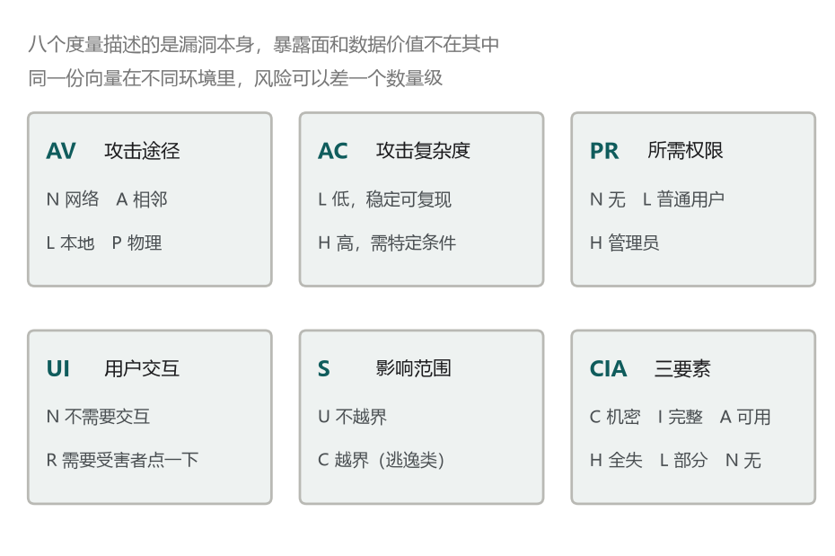
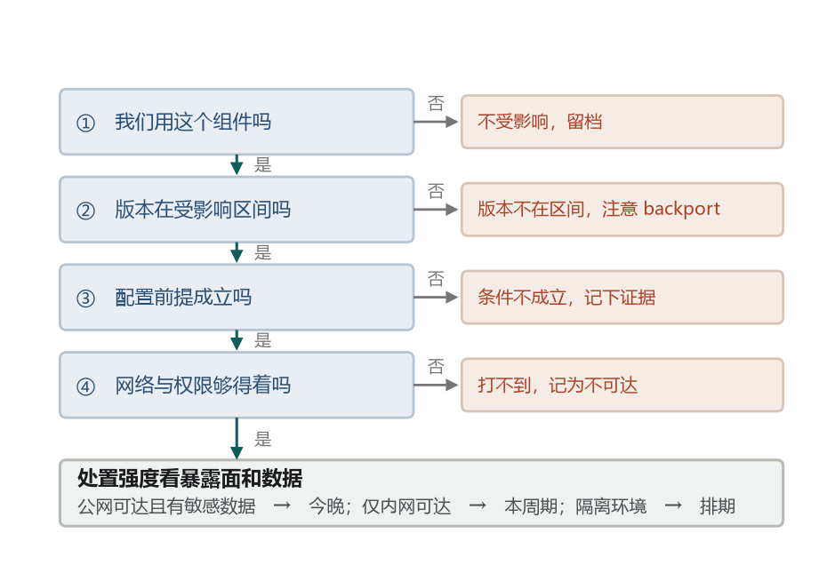

# 第二十九章　漏洞公告怎么读

早上九点，群里弹出一张截图。某个组件爆出远程代码执行漏洞，评分 9.8，下面跟着一句"我们有没有用这个"。十点要开会，你需要在这之前给出一个能站住的答案。

多数人这时候先看分数，然后凭印象回答"应该没用"或者"好像有几台"。两种回答都不合格，区别只在错得更快还是更慢。一个 9.8 分在隔离网里的测试机上，和一个 9.8 分在公网边缘的 VPN 网关上，是两件完全不同的事。

读公告是可以训练的。训练的内容不是背 CVE 编号，是知道一条公告里哪些字段决定结论，按什么顺序看，看到哪一步可以停下来。

## 29.1 一条公告里的六个字段

一份合格的漏洞公告，无论出自厂商、CVE 数据库还是国内平台，都包含同样几样信息。它们的可靠程度不一样，阅读顺序也不一样。

受影响产品与版本区间。先看这一栏。大部分公告在看到第三行的时候就可以关掉了，因为你没用这个产品，或者用的版本不在区间里。判断这一点依赖组件清单，那件事在后面单独说。

触发条件。漏洞要被触发，需要什么样的输入、什么样的配置、什么样的前置状态。有些洞只在特定模块开启时存在，有些只影响某一种部署方式。这一栏经常写得含糊，厂商也不愿意把利用条件写得太细，但它决定了你在第二步能不能排除自己。

权限要求。攻击者需不需要先有一个账号，需不需要本地登录，需不需要管理员身份。不需要认证的网络漏洞，和需要普通账号的漏洞，处置优先级差一档；需要管理员的，通常可以直接降到最后处理。

影响。最重的一档是远程代码执行（remote code execution，RCE），往下是认证绕过、信息泄露、拒绝服务。降一级紧迫性就降一级，但要看清泄露的是什么数据，是公开信息还是别人的会话令牌。

利用状态。有没有公开的 PoC（proof of concept，概念验证代码），有没有在野利用。这一项比分数重要得多。一个 9.8 分但没人知道怎么打的洞，和一个 7 分但已经在被扫的洞，后者要今晚处理。

修复版本。以及有没有官方缓解措施。有些公告会给出临时方案，比如关掉某个功能、加一条访问规则，这类信息通常放在正文靠后的位置，最容易被跳过。

公告的来源也会影响可信度。厂商自己的安全公告最准，它知道代码里发生了什么。CVE 记录和 NVD 的评分是二次整理，评分由分析员给出，和厂商的结论经常不一致。国内平台收录得全，但描述通常比原厂简略。安全厂商的技术博客最快，也最容易为了流量夸大影响。同一个漏洞，四处描述，读的时候要能分清哪句是事实，哪句是判断。

还有两样东西不写在公告里，但必须自己补上。一是暴露面，这台机器谁能访问到。二是数据，最坏情况下丢的是什么。这两项决定了同一条公告在不同公司里的处置强度，而它们只能由你自己回答。

## 29.2 CVSS 衡量的是漏洞，不是你的风险

CVSS（Common Vulnerability Scoring System，通用漏洞评分系统）现在有 3.1 和 4.0 两版并行。3.1 版 2019 年 6 月发布，4.0 版由 FIRST 在 2023 年 11 月发布。分数由一组向量算出来，形如 `AV:N/AC:L/PR:N/UI:N/S:U/C:H/I:H/A:H`，每一段是一个度量。

AV 是攻击途径。N 表示网络可达，A 表示相邻网络，L 表示本地，P 表示物理接触。N 和 P 之间的差距是数量级的，一个要穿过防火墙，一个要把手伸到机器上。

AC 是攻击复杂度。L 表示稳定可复现，H 表示需要特定条件、成功率不高。

PR 是所需权限。N 表示不需要账号，L 表示普通用户，H 表示管理员。这一项最容易被忽略，很多"看起来很严重"的洞需要管理员权限才能触发，而拿到管理员权限的人已经不需要这个洞了。

UI 是用户交互。R 表示需要受害者点一下或者打开一个文件，N 表示不需要。

S 是影响范围，指漏洞被利用后是否越过安全边界影响到别的组件。C 表示越界，这一项会把分数明显拉高。容器逃逸、虚拟机逃逸之所以分数高，就是因为它跨了那道边界。

C、I、A 分别是机密性、完整性、可用性。H 表示完全丧失，L 表示部分丧失，N 表示没有。

4.0 版做了调整，把攻击所需的前提条件单列成一项，把受影响的系统分成当前系统和后续系统两组，允许在向量里表达更多组合。改动有道理，但没有改变一件事，这些度量描述的是漏洞的技术特征。

一个具体的例子。同样一个 9.8 分的 RCE，装在公网边缘的反向代理上，任何能上网的人都能发起连接；装在机房深处的内网测试机上，只有同网段的人摸得到。技术特征是同一个，风险不是。风险大致由三样东西相乘决定，被利用的可能性、被利用之后的后果、以及暴露面。CVSS 只覆盖了中间那一项的一小部分。

评分不一致是常态。同一个 CVE，厂商给 7.5，NVD 给 9.8，两家都是按自己的理解填的向量。遇到这种情况，看哪一方给出了更具体的触发条件，通常更具体的那个更接近真实。分数用来排序，向量用来理解，两者都不是结论。

所以业界又补了两个指标。EPSS（Exploit Prediction Scoring System）由 FIRST 维护，给出的是未来 30 天内被利用的概率，取值 0 到 1，每天更新，比分数更贴近"现在会不会有人打"。另一个是厂商的威胁情报，告诉你某个洞是否已经被勒索团伙用作初始入口。

这两个指标也有短板。EPSS 依赖公开的利用信息，对还没被讨论的洞给的分很低。威胁情报的来源常常不透明，不同厂商对同一个洞的结论能差一个级别。它们的用法是修正排序，不是替代判断。

<figure>

<figcaption>图 29-1　CVSS 3.1 基础向量的八个分量，C、I、A 合在一格。分数只描述漏洞本身，暴露面和数据价值由环境决定，不在这条向量里。</figcaption>
</figure>

## 29.3 三步判断自己是否受影响

第一步是组件清点。你用的东西比你记忆里多。除了应用系统本身，还有它依赖的库、容器基础镜像、中间件、运维工具、办公软件的插件。清点有三个来源：包管理器与镜像清单、扫描器的结果、以及人。前两个快但会漏，第三个慢但能补上漏掉的部分，尤其是那些装在角落里的东西。

扫描器的盲区是固定的。它只能看到装在自己进程里的东西。嵌入式设备的固件、离线运行的工控机、没装客户端的机器、业务部门自己买的云主机，它都看不到。清单做完要做一次抽样核对，随便挑三台机器，手工查一遍，看扫描结果对不对得上。

SBOM（software bill of materials，软件物料清单）是这几年被推着做的一件事，本质是一份依赖清单，用 SPDX 或 CycloneDX 这样的格式记录你用了哪些组件、什么版本、谁引入的。它的价值在公告来的那一刻体现得最明显，没有它，回答"我们有没有用"这件事只能靠翻文档和问人。

第二步是版本比对。这里有一个坑，版本号小不等于受影响。Linux 发行版会把安全补丁打回旧版本号，Debian、Ubuntu、CentOS 都有这套做法。所以你看到一个旧的版本号时，不能只比对上游的版本区间，要去看发行版自己的安全公告里那个包的实际状态。容器镜像还有另一个坑，同一个 tag 会被重新构建覆盖，镜像的 digest 才是唯一标识。

第三个坑是组件存在不等于代码被执行。一个库被引入，可能只用到其中很少一部分功能，漏洞恰好在没被调用的分支里。这种事要具体分析，不能一概降低优先级，但可以作为排序的依据。

第三步是配置前提核对。同一款软件，默认配置和你的配置可能完全不同。漏洞需要某个功能开启、某个端口可达、某个账号存在。核对的顺序是先看公告里写的触发条件，再到实际环境里逐条验证，成立就记下来，不成立就记下不成立的证据。

三件事的耗时不一样。组件清点是以天计的工程，版本比对是以小时计的核对，配置前提是以分钟计的确认。所以真实的应急流程常常是反过来的，先花十分钟确认配置前提，能排除就先排除，排除不掉再查版本，最后才去补台账。台账的价值不在于应急当天做，在于平时就有。

三步走完，结论通常落在四个格子里。不受影响，没用这个产品或版本不在区间。理论受影响但实际不可达，配置不满足或网络不可达。受影响且有暴露。受影响且已经在被打。四个格子的处置完全不同，前两个留档即可，后两个要排期，最后一个要立刻动手。

<figure>

<figcaption>图 29-2　从一条公告走到结论的四道门。每一道门都可以让流程提前结束，四道都通过才需要处置。</figcaption>
</figure>

## 29.4 补丁与缓解

确定受影响之后，下一个问题往往不是"打哪个补丁"，是"什么时候能打"。

不能立刻打补丁的原因很具体：变更窗口要排期，业务方不接受工作日白天重启；新版本可能改了行为，某个依赖它的系统会挂；医疗设备、工控系统根本不允许随便更新；有些系统连重启都要提前一个月申请。这些约束是真的，不是借口。

应急处置的核心因此不是"快"，是有序。顺序上，先切断触发路径，再减少暴露面，最后才是检测。

切断触发路径最有效，比如关掉那个功能模块、禁用那个协议、把相关接口从公网摘掉。代价是业务少一块，但通常可控，而且副作用立刻可见。做这一类缓解之前要确认一件事，关掉之后业务方真的能用，否则会有人偷偷把它改回来。

减少暴露面包括加访问控制、限制来源地址、把服务挪到内网、临时加一层认证。它的效果取决于攻击者的位置，对已经在内网的人基本无效。

WAF 规则和特征检测放在最后。它们有用，但属于概率性防御，一条规则被绕过是常态，尤其是当攻击者能看到你的规则时。把 WAF 当成唯一防线，等于把结论建立在"对手不换招"这个假设上。

打补丁本身也有节奏。供应链上的补丁要走完整条链，上游修复、发行版打包、你的基础镜像重建、业务镜像重新构建、灰度、全量。这条链在国内通常要走三到七天，紧急情况下能压到一天，前提是流程事先演练过。

常规的补丁管理是另一套节奏。按月集中打一次，把资产按重要性分层，核心系统先在测试环境跑一周，边缘系统可以快一些。这套流程慢，但它可持续，不会每次都触发一次全员加班。应急流程是给少数情况准备的，如果一年触发二十次，说明常规流程本身有问题。

紧急变更流程应该提前写好，而不是事发当天现编。谁有权批准、可以跳过哪些测试、回滚怎么做、出事谁负责，这些问题在凌晨三点讨论不出结果。

临时缓解不是免费的。它会积累，会被人忘记，会在半年后变成一条没人说得清来历的防火墙规则。每加一条，记下它对应哪个漏洞、谁加的、什么时候可以撤。缓解措施没有到期日，它就会慢慢变成新的攻击面。

## 29.5 逐字段读一条真实公告

2021 年 12 月 9 日，Apache 基金会为一个 Java 日志组件发布了安全公告。这个组件叫 Log4j 2，几乎所有 Java 后端都会直接或间接地把它拉进来。公告对应的编号是 CVE-2021-44228，后来被叫做 Log4Shell。

为什么这个洞的影响面这么大，值得单独说一句。Java 生态里日志是基础设施，框架、中间件、大数据组件都会带它，而版本被上层锁定，用户往往不知道自己用的是哪一个。这就是供应链风险的典型形态，你以为在用一个框架，其实是框架在替你选依赖。

第一栏，受影响版本。log4j-core 2.0-beta9 到 2.14.1，修复版本 2.15.0。区间写得很清楚，读完这一栏，很多团队就可以开始查依赖树了，因为 Java 项目里很难完全不用日志。

第二栏，触发条件。日志里记录了一段攻击者可控的字符串，而这段字符串被当作查找表达式解析。把用户输入写进日志是极常见的写法，登录名、请求头、搜索关键词都会进日志。这一栏的真正含义是，只要有一处把外部输入写进日志，就可能被触发，不需要任何特殊配置。

第三栏，权限要求。不需要。网络可达即可。这是它拿到满分的原因之一。

第四栏，影响。远程代码执行，且影响范围越界。向量里 S 取 C，意思是攻击者可以越过被攻击进程的边界，让那个进程去加载外部内容。

第五栏，CVSS 向量 `AV:N/AC:L/PR:N/UI:N/S:C/C:H/I:H/A:H`，基础分 10.0。八个分量全部落在最严重的那一档，没有一项可以往下调。

第六栏，利用状态。披露当天就出现了公开的验证代码，随后几天是大规模扫描和真实的入侵。这一项把"理论严重"变成了"正在发生"。

值得单独看的是后续十天。12 月 14 日发布 2.15.0，修了主要路径，随后发现某些非默认配置下仍然可以利用，对应 CVE-2021-45046。12 月 17 日发布 2.16.0，把消息查找功能整体移除。12 月 18 日又披露 CVE-2021-45105，2.16.0 里存在拒绝服务问题，修复版本是 2.17.0。十天，三个 CVE。

这段后续比公告本身更值得记住。第一版修复不等于修对了，公告会连着来，应急预案要能连续跑第二次。缓解措施也在变，早期建议大家设置某个系统属性来关掉远程类加载，后来发现那只堵住了一条路，另一条走的是服务端返回的数据本身，属性管不了。

还有一个容易被忽略的细节。很多受影响的系统并不直接依赖 Log4j，是通过另一个框架间接引入的，版本还被框架锁死。这意味着你查自己的构建文件找不到它，必须查完整的依赖树，而且要在运行中的进程里确认实际加载的版本。

读公告的终点不是"这个洞严重不严重"，是"我们要不要今晚加班"。得出这个结论需要四样东西，组件清单、版本状态、暴露面、以及这条公告的利用状态。四样里缺一样，结论就只能靠猜，而靠猜得出的结论，通常在第二天被推翻。

公告读多了会发现另一件事。多数公告只告诉你结果，不告诉你这个漏洞是怎么被找到的。想知道，就得自己动手研究。这件事有门槛，也有明确的边界。
