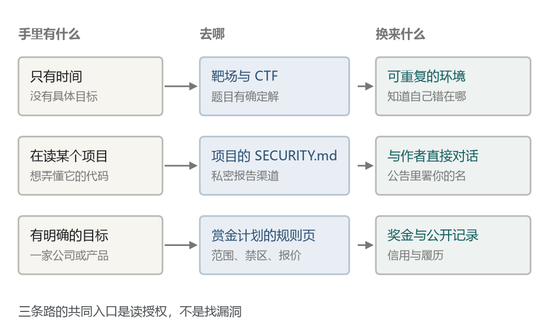
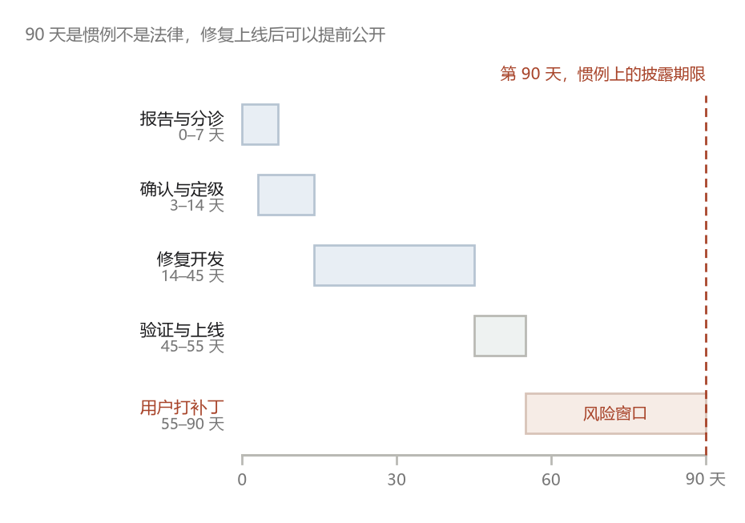

# 第三十章　安全研究怎么开始

一个学生在一家小公司的官网上发现了一个注入点，他很兴奋，写了一封邮件发过去，附了一张截图和一段能读到数据的链接。三天后对方回信，说无法复现。他把链接又发了一遍，这次没有回音。两个月后他发现那个页面改了，漏洞大概被修了，但他始终不知道是不是因为那封邮件。

这件事里他做错了三件事。用的是别人的账号，报告里没写清楚复现的前提，以及在自己拿到回复之前把链接发给了同学看。第三件严格说已经越界了。

安全研究这件事，技术上难，规则上更容易踩线。技术上的错误可以改，规则上的错误往往没有第二次机会。这一章讲三件事，走哪条路，授权包含什么，报告怎么写。时间线和越界的边界，都从这三件事上长出来。

## 30.1 三条能走的路

合法做研究的地方只有三类，厂商的赏金计划、开源项目的漏洞报告渠道、靶场和竞赛。

赏金计划（bug bounty）。公司公开一批资产，声明哪些可以测、哪些不能碰、每类问题给多少钱。国外的平台有 HackerOne、Bugcrowd，国内有补天一类的平台，也有公司自己做项目页。这条路的好处是授权明确，写在一份公开的规则里，按规则做就不会错。代价是竞争激烈，热门项目的一个低危问题可能在你之前已经被几十个人报过。

读规则是第一步，不是第二步。规则页上有三样东西必须看清，资产范围（哪些域名、哪些 App、哪些 API）、禁止事项（多数计划禁止拒绝服务、禁止社会工程、禁止接触真实用户数据）、以及已知问题列表（避免重复提交）。跳过这一步的人，通常在第一封邮件上就被封号。

开源项目的报告渠道。多数成熟项目在仓库里放一个 `SECURITY.md`，说明怎么私下联系维护者，GitHub 提供了私密漏洞报告功能，报告只有维护者能看到。这条路给不了多少钱，但你能直接和写这段代码的人对话，学到的东西比赏金多。编号由项目的 CNA 或 MITRE 分配，一个被确认的漏洞会写进项目的安全公告，署名是你的名字。

靶场和竞赛。CTF（capture the flag）是比赛，题目是人为构造的，目标是拿到一个字符串。靶场是自己搭的或被提供的一台机器，可以放开手打。两者的共同点是授权明确写在规则里，你可以做平时不能做的操作。区别也要清楚，CTF 题目为了可解会刻意留后门，真实系统不会；靶场里的顺利，不代表真实环境里找得到东西。

三条路可以叠加。多数人的顺序是靶场练手、CTF 检验、开源项目积累、赏金换钱。这个顺序不是规定，但它符合一件事，能力要和授权范围一起长。先在小范围里犯错，代价可控。

这三条路合起来覆盖了绝大多数合法的机会，也解释了另一件事。找人买漏洞、在论坛上接单、帮人打竞争对手，这些听起来像"行业内部"的事，没有一条能给你合法的授权链。钱可能来得快，代价是把一个技术问题变成了刑事问题。

## 30.2 授权到底授了什么

"我有授权"这句话在事后需要证据。证据的形式是邮件、平台工单、合同里的工作说明书，不是口头一句"你可以试试"。口头授权在出事之后没有效力，因为说这句话的人可能没有权限给你这个授权。

正式的授权文书在行业里叫规则清单（rules of engagement），公司内部走的是工作说明书加一份测试授权书，内容差不多，写范围、时间、手法、联系人和中止条件。没写过这种东西的客户，你需要提前把模板发过去，让它填、签字、盖章。这个流程本身就能筛掉一批"随便试试"的委托。

授权至少要写清五件事：

范围。具体到域名、IP 段、App 的包名、API 的地址。含糊的表述一定会出事，"我们公司的系统"是否包含子公司、是否包含收购来的老域名、是否包含托管在第三方云上的服务，这些边界在真实案例里都产生过争议。

最容易踩的一种越界是子域枚举。你把 `*.example.com` 扫一遍，其中一部分可能根本不在这份授权里，属于半年前收购的公司，或者属于某个把业务托管在你目标名下的第三方。

时间窗。从哪天几点到哪天几点。时间窗之外的操作没有授权，哪怕漏洞是真的，哪怕上次的授权还在邮箱里。

允许的手法。能不能爆破口令，能不能做社会工程，能不能做拒绝服务测试，能不能往生产环境上传文件。多数赏金计划明确禁止后三项，因为它们的副作用会落到真实用户身上。

禁止碰的数据。测试时用自己注册的账号，看到别人的数据就停手，不要为了证明影响把整张表导出来。这一条最容易在"我已经进来了"的兴奋里被忘掉，而它恰恰在法律上最要命。证明一个越权读取，读到一条属于自己另一个账号的记录就够了。

归属与保密。漏洞归谁，能不能公开，什么时候公开。多数计划要求修复前保密，违反保密条款可能直接取消奖励，严重的会被追责。

还有一条容易忽略的，你的身份。你是这家公司的员工，还是外部研究者，还是受雇于第三方的测试人员。身份不同，授权链不同。给客户做测试时，托管服务商的授权不算数，需要客户自己签字，云上的资产尤其如此，云厂商的赏金计划不覆盖租户的系统。

越界的判定不看意图。你只是想验证一下，和你想偷数据，在法条上可能落在同一条里。国内外的判例里都有研究者因为扫了范围外的一台主机而被追究，最后虽然多数以不起诉或和解结束，但中间的时间、律师费和心理成本都是真的。

<figure>

<figcaption>图 30-1　三条合法路径的入口条件。它们的共同前提是授权先于技术，顺序颠倒的代价通常不是失败，是违法。</figcaption>
</figure>

## 30.3 一份报告长什么样

报告是研究成果的载体。写得好的报告能让工程师在十分钟内复现，写得差的报告会在第一轮被退回，然后没有下文。

结构上包含六块：

标题。一句话说清问题类型和位置，比如"订单查询接口存在越权，可读取他人订单"。不要写"一个严重漏洞"，也不要写"速看"。

影响。谁能利用、需要什么前提、能达到什么效果、涉及多少数据。这一段决定优先级，工程师会先读它。写清"任意登录用户可读取全部订单，含手机号和收货地址"，比"存在越权"有用得多。

复现步骤。编号，从干净状态开始，写清前置条件（账号角色、浏览器、是否需要特定配置），每一步的请求和响应，预期结果和实际结果。截图要能看清地址栏和返回内容。时间和时区也写上，因为"我这边复现不了"最常见的三个原因是环境不同、数据不同、步骤被省略。

最小验证。证明问题存在所需的最少动作。拿到一个越权读取，读一条数据就够了，不需要遍历。最小验证的原则是，能证明的边界停在证明上。

修复建议。指向根因。如果问题是服务端没有校验资源归属，建议就写"在服务端校验订单所属用户"，而不是"过滤特殊字符"。工程师不一定会采纳，但这条建议会显示你理解了这个系统。

附件与脱敏。请求响应原文、日志、截图。脱敏的意思是删掉别人的手机号、身份证号、令牌、内网地址。报告本身也会流动，它走的是邮件和工单，别把它贴到群里。

报告的长度和严重程度不成正比。三页能说清的事写成三十页，只会降低它被读到的概率。判断标准很简单，一个没参与过这个系统的工程师，能不能只看你的报告，在测试环境里把现象重现一次。

被退回的原因通常只有四个：复现不了、影响说不清、重复、范围外。四个里有两个是写作问题，改起来不难。剩下的两个，一个需要你多做一步确认，一个需要你回到规则页重新读一遍。

## 30.4 时间线

漏洞从被发现到被公开，中间有一条不成文但相对稳定的时间线。

第 0 天，报告发出，平台或厂商的邮箱自动回复一个编号。

第 1 到 7 天，分诊。工程师确认能不能复现，判重，评级。这一段最容易被研究者误解，没有回音不等于被忽略，大公司的安全团队同时手上可能有几百个报告。

第 7 到 30 天，确认与修复。有些问题需要改架构，时间会更长。修复上线、验证通过，然后才谈公开。

行业里常见的披露期限是 90 天。这个惯例和 Google 的 Project Zero 有关，它长期以 90 天作为披露期限，后来另外给了补丁发布的宽限期。90 天不是法律，是压力，作用是给厂商一个可预期的截止时间。

这条时间线上还有两件容易被忽略的事。一是修复和披露不同步，厂商发布补丁的那天，攻击者也在读公告，所以真正的风险窗口在"补丁发布到用户打完"之间，这个窗口以周计。二是研究者的信用，同一个问题提交两次、把一个漏洞拆成五个提交、在厂商修复前又换一家平台报一遍，这些行为会被记录，平台上的信用分比你想象的更重要。

厂商不回应怎么办。第一步是再跟进一次，把复现步骤简化到最小，附上环境信息。第二步是找协调机构，国外是 CERT/CC，国内可以向国家信息安全漏洞共享平台（CNVD）或国家信息安全漏洞库（CNNVD）报送，由它们出面联系厂商。第三步才是公开，而且要评估公开的后果。

公开有一条底线，不要把还在被使用的系统的可用细节放出去。研究者公开的目的是推动修复和记录事实，不是给还没打补丁的用户制造事故。业界的做法是先给厂商和协调机构，等修复铺开之后再写技术分析，写的时候也不放可以直接复制运行的代码。

国内还有一条路是报送。CNVD 接受白帽子的报送，会给编号和致谢。这条路没有奖金，但它是一份可验证的记录，对求职有用。

署名和奖励是这条线上最不确定的部分。同一个漏洞，不同厂商给的钱可以差两个数量级，有些厂商给的是周边和致谢页上的一行字。把注意力放在学到什么上，比放在报价上划算。

<figure>

<figcaption>图 30-2　协调披露的常见时间线。90 天是惯例而不是法律，它的作用是把"等一等"变成一个可以计算的日子。</figcaption>
</figure>

## 30.5 越界的几种常见样子

越界很少是故意的。它通常发生在一个"顺手"的动作里。

扫了范围外的域名。做子域枚举时把所有子域都扫了一遍，其中三个不在计划范围内。判定上这已经是未授权扫描。

用了真实用户数据。为了证明注入能读到数据，导出了整张表。证明只需要一行，导出一万行就从验证变成了获取。

在等待修复期间公开了细节。写博客、发群里、在会议上讲。有些会议有披露政策，有些没有，讲之前要确认厂商是否已经修复并同意。

把漏洞卖给了中间人。这条路上没有"我只是介绍"的位置，参与交易本身就是风险。

为了测试影响了生产。跑压力测试、上传大文件、触发大量邮件。这类操作的副作用落在真实用户身上，多数计划明确禁止。

还有一个更隐蔽的，用研究的名义访问了不该访问的数据。你在测试中看到一个后台，进去了，里面有别的公司的合同。这一刻应该退出并报告，不是继续翻。

法律风险落到具体形态上，通常不是当场被抓，是事后取证。平台的工单、邮件、你扫描时留在对方日志里的源地址、浏览器的请求记录，都能把一次测试还原成一条时间线。这也是为什么授权文书要留着，它是唯一能解释"我为什么在那里"的东西。

这些行为的共同点是，技术上做到的事不等于被授权做的事。授权画的是边界，边界之内随便走，边界之外一步都不行。这个判断在事发当时往往只有几秒钟，而那几秒钟决定后面几年。

## 30.6 从哪里开始

真正开始的时候，第一步不是找漏洞，是读别人的漏洞。

公开的报告是最好的教材。HackerOne 的 Hacktivity 上有大量已公开的报告，从低危的信息泄露到复杂的业务逻辑问题都有，写法、复现步骤、厂商的回复都在。厂商的致谢页会列出研究者名字和漏洞类型，可以顺着找。Project Zero 的博客把每个漏洞的分析过程完整写出来，包括他们怎么想到的、走了哪些弯路。

读的时候不要只看结论，看推导。一个问题是怎么被注意到的，从哪个异常开始，怎么排除掉其他解释，最后怎么确认。这个过程比漏洞本身可迁移。

第二步是复现。找一个公开的漏洞，在自己的靶场里把它复现出来。复现的价值在于你会遇到所有文档里没写的东西，环境不对、版本不对、依赖缺一个、配置差一行。把这些坑填平的过程，就是能力长出来的过程。

第三步是记录。把你试过但没成功的方向写下来，为什么没成功，卡在哪。这份记录比成功的记录有用，因为它标出了你自己的边界。

第四步才是自己找。这时候你已经有了三样东西，一套能跑的环境、几条成功复现过的路径、一份知道哪里走不通的清单。找新问题的方法从这三样里长出来，而不是从某个工具里。

还有一个常见的坑是工具收集。装一堆扫描器、写一堆脚本、收藏几十个仓库，感觉自己已经在这行里了。工具只在你知道该拿它问什么问题的时候有用。同一个扫描器，一个人用它跑出三千条告警然后放弃，另一个人从里面挑出三条去手工确认，产出差得很远。

工具会变。今天流行的扫描器，三年后可能没人提起。留下来的是读代码的耐心、对异常的敏感，以及知道一件事该不该做的判断。最后这一条最难学，也最容易被跳过。
