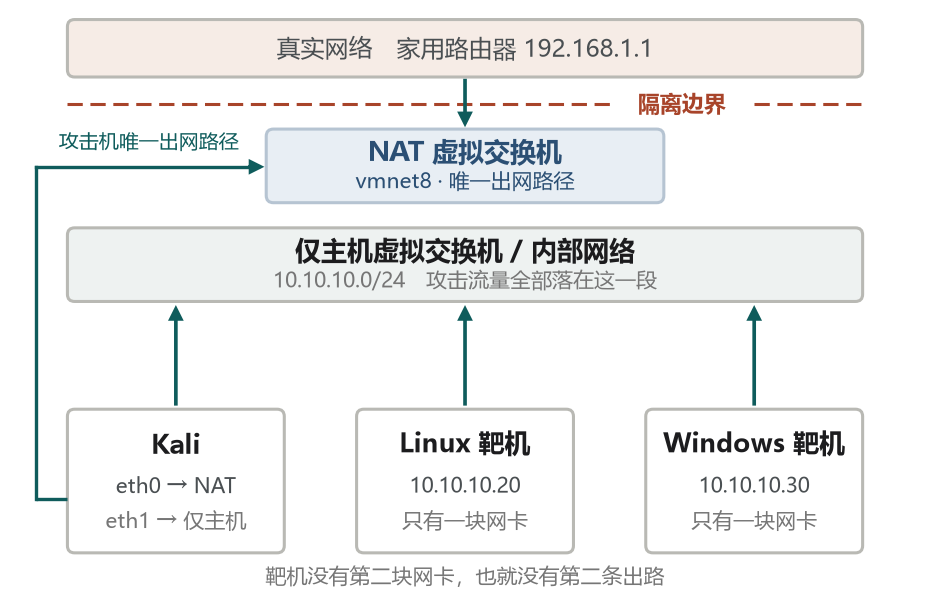
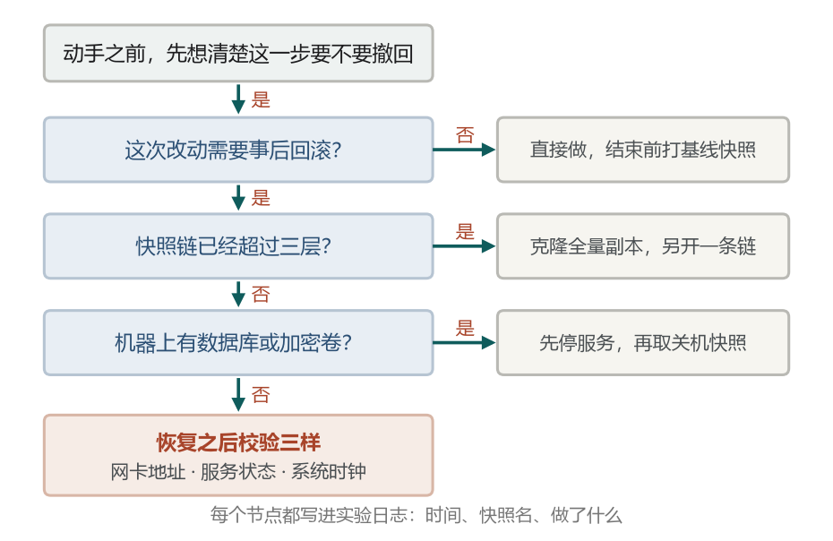

# 第一章　造一个安全的实验环境

装完 Kali 的第一个下午，多数人会做同一件事。打开终端，敲一条 `nmap -sn 192.168.1.0/24`，然后等结果。屏幕很快跳出十几个地址，路由器、电视盒子、打印机、某个不认识的摄像头。这种"看见"的感觉很容易上瘾，也很容易让人忽略一件事，这条命令发出的探测包已经落在了别人的设备上。

虚拟机默认的桥接模式（bridged）会让虚拟机像一台新接入的电脑，向家里的路由器要一个地址。它在网络上并不在你的电脑里，而在你和邻居、家人共用的那张网里。你扫到的那个"不认识的摄像头"，可能确实不是你的。

实验环境要解决的就是这个问题。它要同时满足三个条件，跑得动、坏了能立刻推倒重来、出了事漏不到真实网络。第三个条件最容易被跳过，也最难在事后补。

## 1.1 宿主机要求与资源规划

判断标准不是"能不能启动"，而是"三台虚拟机同时跑的时候还剩多少"。

| 角色 | 内存 | vCPU | 磁盘 |
| 宿主机 | 16 GB 起 | -- | SSD，留 80 GB 以上 |
| 攻击机 Kali | 4 GB | 2 | 40 GB |
| Linux 靶机 | 2 GB | 2 | 20 GB |
| Windows 靶机 | 4 GB | 2 | 60 GB |

磁盘格式也值得选一下。精简置备（thin）省空间，写入放大之后性能会掉；固定大小一次占满，启动快，适合确定要长期用的靶机。宿主机盘剩不到 15% 空闲时，虚拟机和快照都会明显变慢，这条线要盯住。

内存的数字要打个折。16 GB 的机器进系统后可用大约 13 GB，宿主机自己吃掉 4 到 6 GB，剩下的刚够开三台。要同时开一台域控加两台成员机，32 GB 才不难受。磁盘也要留余量，虚拟磁盘是稀疏文件，写多少长多少，快照占的也是这块空间。

CPU 的虚拟化扩展要打开。BIOS 里这一项经常默认关闭，Windows 上可以在任务管理器的性能页看 CPU 那一栏，确认"虚拟化"是已启用。Linux 上用一条命令判断。

```bash
grep -c -E 'vmx|svm' /proc/cpuinfo
```

返回值大于 0 说明处理器支持，`vmx` 是 Intel 的，`svm` 是 AMD 的。返回 0 时先回 BIOS 确认 VT-x 或 SVM 的开关，不要急着换机器。

嵌套虚拟化是另一层。Windows 11 靶机要求 TPM 2.0 和安全启动，想把虚拟化扩展透传进去，VMware 里要勾上"虚拟化 Intel VT-x/EPT 或 AMD-V/RVI"，Hyper-V 里对应的是 `Set-VMProcessor -ExposeVirtualizationExtensions $true`。没有这个，虚拟机里再开虚拟机就会报错。

还有一类冲突值得提前避开。装了 WSL2 或者 Docker Desktop 之后，Windows 会启用 Hyper-V 平台，VMware 和 VirtualBox 只能退到兼容模式，速度掉一大截。判断当前状态可以看 `bcdedit /enum {current}` 里的 `hypervisorlaunchtype`，或者 `systeminfo` 末尾的 Hyper-V 要求。

最后一个建议与资源无关。不要把靶场软件装在宿主机上。DVWA 用 XAMPP 装在每天上班的那台系统里，等于把一批已知漏洞放进自己的机器；如果监听地址是 `0.0.0.0`，同一个 Wi-Fi 下的任何人都能访问它。

## 1.2 虚拟网络与隔离原则

四种网络模式的差别，一张表能说清。

| 模式 | 虚拟机能否出网 | 谁能访问虚拟机 |
| 桥接 | 能，直接借宿主机所在网段 | 同网段的所有设备 |
| NAT | 能，经宿主机转发 | 宿主机，可配端口转发 |
| 仅主机 | 不能 | 只有宿主机 |
| 内部网络 | 不能 | 只有同一内部网络里的虚拟机 |

桥接的问题开头已经出现过。NAT 是更常见的选择，虚拟机有出网能力，装工具、更新软件包都不受影响，外面却看不见它。仅主机（host-only）只提供宿主机与虚拟机之间的链路，适合放靶机。内部网络（internal）连宿主机都不参与，只有挂在这个网络上的虚拟机互相可见，适合承载攻击流量。

看一台机器当前有几条腿，用 `ip` 就够。

```bash
ip -brief addr
ip route
ip route get 10.10.10.20
```

第一条列出所有网卡和地址，第二条看默认路由，第三条问内核"去某个地址会走哪块网卡"。第三条最有用，因为答案里带源地址，能直接告诉你这次连接会用哪个 IP 出去。

典型的错误配置是这样。攻击机有两块网卡，一块 NAT，一块仅主机，默认路由却指向了仅主机的网关。结果是装包全部失败，而 ping 靶机是通的，人会先去怀疑镜像源。`ip route get` 能在一秒内排除这种可能。

网络模式还有一个不常被提到的问题，网段冲突。VirtualBox 的仅主机网卡默认使用 192.168.56.0/24，如果家里的路由器恰好也发这个网段，宿主机到虚拟机、虚拟机到真实设备的路由就会打架，症状是"有时候能通有时候不能"。把虚拟网卡的网段改掉，比排查路由表省事。

隔离原则落到具体做法上，是让每一种流量有确定的出口。出网走 NAT，攻击流量走仅主机或内部网络，两者不共用一条腿。更严格的做法是在靶场里放一台 Linux 虚拟机当路由器，给它两块网卡，一块接内部网络，一块接 NAT，用 `nftables` 做地址转换。这样所有靶机都待在 10.10.10.0/24 里，只有一块网卡，也就没有第二条出路。

<figure>

<figcaption>图 1-1　一套只有一条受控出口的实验环境。靶机只在仅主机网段上，没有出网路径；攻击机的第二块网卡经 NAT 出网，虚线是实验网与真实网络的边界。</figcaption>
</figure>

## 1.3 快照策略与回滚

快照要解决的是"搞坏了怎么办"。判断标准很朴素，从按下回滚到能继续做实验，中间要不要人工干预。超过两分钟，人就会开始嫌麻烦，然后带着一个脏环境继续往下做。

先说快照不是什么。它不是备份。快照记录的是相对某个时刻的差异，原来那些磁盘块还在被引用，新的写入转到别处。磁盘文件一旦损坏，快照和当前状态一起没。真正的备份是把整个虚拟机目录复制到另一块物理盘上。

快照也不是越多越好。链式快照每多一层，读取时要合并的差异就多一层，几十层之后开机会明显变慢。节点应该做在真正需要的地方。

```text
00-clean        系统装完，还没联网
10-tooled       工具装完，更新过一轮
20-baseline     靶场服务启动，配置确认
30-pre-exploit  即将执行破坏性操作
```

命名里带序号和用途，比"快照 1""快照 2"有用得多。三个月后回来看，只有名字能告诉你这个快照里有什么。

几个容易踩的点。数据库类的靶机要先停服务再快照，否则恢复出来的数据文件可能停在半写状态。拍快照时勾选"包含内存状态"会保留运行中的进程，恢复快，文件也大；不勾选更干净，适合做基线。同一台机器反复回滚同一个快照，日志和临时文件会累积，到了某个时候要回到更早的节点重来。

图 1-2 把上面这些压成一条可以照着走的判断链。

<figure>

<figcaption>图 1-2　改动靶机之前的决策顺序。需要回滚、快照链过深、机器上有数据库，这三种情况各有不同的处理方式，走错一步后面的实验就不可信。</figcaption>
</figure>

还有一个习惯值得养成。破坏性操作之前先克隆一份完整副本，而不是指望事后回滚。回滚会把你这台机器上做过的所有改动一起丢掉，包括那些正确的部分。全量克隆要独立的磁盘空间，但可以保留两条并行的实验线。链接克隆省空间，代价是子机依赖父机的快照，父机一动，子机全部失效。

回滚之后还有一步常被忘掉，确认环境真的回到了你以为的状态。网卡地址、服务状态、时钟这三样在恢复后最容易出偏差，一条命令能看完前两样。

```bash
ip -brief addr && systemctl is-active ssh apache2 mysql
```

输出里如果服务显示 `inactive`，说明快照是在服务停掉之后拍的，先把服务拉起来再继续，否则后面所有的连接失败都会被误判成"打不进去"。

## 1.4 攻击机与靶机的分工

Kali 的定位是工具箱，不是服务器。

判断一台机器该放什么，问一句就够了，这台机器被攻陷之后攻击者能拿到什么。Kali 上如果存着真实的 SSH 私钥、浏览器登录态、公司 VPN 配置，那它就不再是工具，而是一把钥匙。靶场里的攻击机应该假设随时会丢。

工具升级的顺序是先快照再动手。`apt full-upgrade` 会动内核和一堆依赖，偶尔会把网卡驱动或者某个工具的 Python 环境搞坏，有快照就能退回去。

```bash
sudo apt update && sudo apt full-upgrade -y
systemctl status ssh --no-pager
```

第二条命令确认 SSH 状态。Kali 默认不启动 SSH 服务，需要时用 `systemctl start ssh` 拉起来。不打算从宿主机连进去就别开，少一个监听端口。

靶机这边，公开靶场有现成的。Metasploitable 2 是一个打包好的 Ubuntu 8.04 镜像，漏洞多到有点过分，适合练扫描和利用。Metasploitable 3 要用 Vagrant 和 Packer 现场构建，慢，但能选 Windows 版本。Web 类靶场用 Docker 跑最省事。

```bash
docker run -d --name dvwa -p 10.10.10.10:8080:80 vulnerables/web-dvwa
```

注意 `-p` 前面的地址。写成 `-p 8080:80` 表示绑定 `0.0.0.0`，同一网络里的任何设备都能访问；写成 `-p 10.10.10.10:8080:80` 只绑在仅主机网卡上。这两种写法的差别，只有在出事那天才看得出来。

Windows 靶机主要用于域环境实验，一台域控加一到两台成员机是比较好用的规模。评估版 ISO 有 180 天有效期，够用很久。

地址规划最好在动手前定下来，写成一张表。攻击机 10.10.10.10，Web 靶机 10.10.10.20，Windows 靶机 10.10.10.30，网关 10.10.10.1。然后每台机器上写 `/etc/hosts`，用域名而不是 IP 访问。原因很实际，写报告和翻日志的时候，`dvwa.lab` 比 `10.10.10.20` 好认，而 IP 会因为重建虚拟机变掉。

## 1.5 时钟、共享文件夹、剪贴板的坑

这三样东西的共同点是，装上之后更方便，而方便的那部分正好通向宿主机。

时钟。快照回滚之后，虚拟机的系统时间会停在快照的那一刻，除非装了 open-vm-tools 或者 VirtualBox 增强功能并开了时间同步。时间错乱的后果比想象中多。Kerberos 认证默认允许的偏差是 5 分钟，超了就是登录失败；TLS 证书有生效时间，时钟倒退到签发之前，所有 HTTPS 都会报错；日志按时间排序，时钟不对，你对事件顺序的推断就是错的。

```bash
timedatectl
date -u
```

两条命令看时区与 UTC 时间。做多机实验时把每台机器都设成 UTC，日志对齐会省很多事。

共享文件夹。VMware 的 HGFS 和 VirtualBox 的 vboxsf 会把宿主机的一个目录挂进虚拟机，把工具、样本、脚本直接放进去就行。问题在于，被攻陷的虚拟机对这个目录有完整的读写权限，一段勒索软件在虚拟机里跑起来，加密的是宿主机的文件。合理的做法是临时挂载，传完就关；或者改用网络传输，在仅主机网络上开一个临时的 HTTP 服务。

```bash
python3 -m http.server 8000 --bind 10.10.10.10
```

剪贴板和拖放。双向剪贴板等于一条从不可信环境到可信环境的文本通道。在靶机里看到一段命令，复制到宿主机粘贴执行，这个动作的风险不用解释。分析恶意样本时更麻烦，样本作者会故意在页面里放一条看起来像修复命令的东西。把剪贴板设成单向或直接关闭，代价是要手动敲几条命令，换来的是这条通道不存在。

## 1.6 把实验网和真实网彻底断开

前面几节各自处理了一部分，这一节把检查排成一个顺序，从硬到软逐层确认。

第一层是物理。实验专用的 USB 网卡几十块钱，插上之后实验流量走它，跟机器的无线网卡无关。更彻底的做法是实验期间直接禁用宿主机的 Wi-Fi，代价是查资料要换一台设备。

第二层是虚拟化配置。确认没有任何一块虚拟网卡是桥接模式。VMware 看虚拟网络编辑器，VirtualBox 逐台看虚拟机的网络设置，桥接那一项要为空。

第三层是路由。攻击机的默认路由只应该有一条，指向 NAT 网关。给靶场网段加一条静态路由，让发往 10.10.10.0/24 的包永远不经过默认路由，加完用 `ip route get` 逐条验证。

```bash
ip route get 10.10.10.20
ip route get 192.168.1.1
```

第二条应该是不可达或者超时。能通，说明这台攻击机还连着真实网络。

第四层是名称解析。DNS 查询本身就在暴露你在找什么。靶场的域名全部写进 `/etc/hosts`，或者在内网起一个 dnsmasq，把上游指向空。看一眼 `/etc/resolv.conf`，如果里面是运营商或者公共 DNS，那么在靶场上跑任何带域名解析的工具，查询都会发到公网。

第五层是应用。浏览器是最容易漏的一个。给靶场单独一个浏览器配置文件，代理设为直连；需要上真实网站时换另一个。否则某次顺手点开的搜索结果，会把真实站点的 Cookie 带进同一个浏览器进程。

最后是验证。断开之后，从靶机试着连外网、从攻击机 ping 真实网关，都应该失败。再用一个反向的方法确认没有包漏出去。

```bash
sudo tcpdump -i any -n -c 20 'not net 10.10.10.0/24 and not arp'
```

这条命令抓 20 个不属于靶场网段的包。抓不到东西，说明该断的都断了；抓到了什么，源地址会告诉你哪一层没关严。

顺手把宿主机的 IP 转发关掉。Linux 上 `sysctl net.ipv4.ip_forward` 返回 1，说明这台机器愿意替别人转发，虚拟机的包有机会经它出去；Windows 上对应的是"路由和远程访问"服务。这一步不是必需的，但它很便宜。

顺序上有一个细节。装工具、更新系统需要出网，所以先把环境在 NAT 下配置完，再切到隔离状态。切完之后如果确实还要装东西，在宿主机下载再传进去，比临时打开 NAT 安全。

环境立起来之后，下一个问题就出现了。靶机跑着，浏览器打不开页面，这时候你手里其实没有任何可判定的信息，只能靠猜。把“连不上”拆成几个能分别回答的小问题，需要一套工具，也需要知道每个工具给出的到底是哪一类证据。

<div class="chapter-end"></div>
