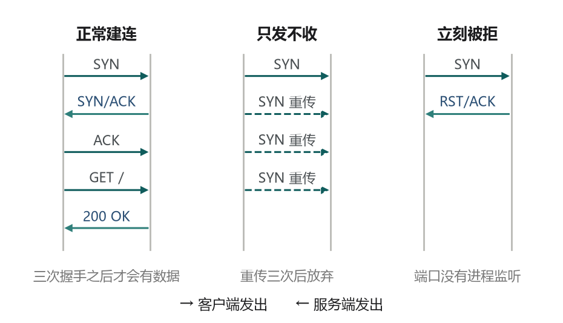

# 第二章　工具箱与网络诊断

靶机开机了，浏览器打开 `http://10.10.10.20`，页面显示无法连接。可能的原因有三个，网卡没起来，服务没起，防火墙把包丢了。多数人这时候开始在三个猜测之间来回试，重启服务、关掉防火墙、改配置，直到某个动作碰巧生效，然后记住那个动作。

这样攒下来的经验是错的。生效的可能是无关的一次重启，而下一次遇到同样的现象，你会重复一串没有根据的操作。

这一章要做的是把"猜"拆成几个能分别回答的问题。每个问题只问一件事，答案来自一条命令的输出，而输出里有一个能区分两种情况的特征。工具本身的用法在网上随处可查，值得记下来的是为什么用这个而不是那个，以及看到结果之后该怎么判断。

## 2.1 命令行基本功

一台机器在做什么，可以压缩成三个视角，谁在跑、在听什么、哪些文件带着特权。这三个视角足够回答大多数"这台机器正常吗"的问题，而在被攻陷的机器上，异常往往就藏在这三处。

进程的视角先看新鲜度。

```bash
ps -eo pid,ppid,user,etimes,cmd --sort=-etimes | head -15
```

`etimes` 是进程已经运行的秒数，`--sort=-etimes` 让它从新到旧排。系统服务一般已经跑了几万秒，几秒钟前冒出来的进程才值得看。这条命令不解释任何东西，它只是把注意力的落点从"所有进程"缩小到"最近起来的十几个"。

进程的详细状态在 `/proc` 下，每个进程一个目录。

```bash
ls -l /proc/1234/exe /proc/1234/cwd
tr '\0' '\n' < /proc/1234/environ | head
```

`exe` 指向实际执行的二进制，`cwd` 是它的工作目录，`environ` 是启动时的环境变量。`exe` 后面跟着 `(deleted)` 说明文件已经被删掉但进程还在跑，这是很典型的痕迹，删文件的人忘了进程还握着这个句柄。

网络的视角看监听地址。

```bash
ss -tulpn
ss -tanp state established
```

四个参数的意思分别是 TCP、UDP、只显示监听、显示进程。第一条命令的输出里，最右边一列监听地址决定了暴露面。`127.0.0.1:3306` 只有本机能连，`0.0.0.0:3306` 谁都能连，`::1` 和 `::` 对应 IPv6 的两种情况。同一个服务换个绑定地址，风险就差一个数量级，而这一点在配置文件里往往只是一行的差别。

第三是文件权限。除了常规的读写执行位，还有两个容易被忽略的位。

```bash
find / -xdev -perm -4000 -type f -ls 2>/dev/null
getcap -r / 2>/dev/null
```

`-4000` 是 SUID 位，程序执行时以文件所有者的身份运行。如果所有者是 root，那么这个程序里的任何命令执行都会以 root 身份完成。`-xdev` 不跨文件系统，避免扫进 `/proc` 和 `/sys`。`getcap` 列出带文件能力（capability）的程序，这是把 root 权限切片之后留下的另一类特权入口。

还有一类信息只在日志里。`journalctl -u 服务名 -n 50 --no-pager` 看最近 50 行，`journalctl --since "10 min ago"` 看一个时间窗。日志和进程列表对不上的时候，那份差异比日志本身更有价值。

判断的方法很简单，把三个视角叠起来看。一个由 root 启动、监听 `0.0.0.0`、位于 `/tmp` 或 `/dev/shm` 的进程，四个条件命中三个，基本可以直接查下去。全部正常的时候，也值得记一笔，因为"正常"是后面判断异常时的基线。

## 2.2 抓包与解读

抓包回答的是两个问题，包有没有到达，以及谁先不说话。

先记住一条最小可用的命令。

```bash
sudo tcpdump -i any -nn -s0 -w cap.pcap 'host 10.10.10.20 and tcp port 80'
```

`-i any` 监听所有网卡，`-nn` 关掉域名和端口名解析，`-s0` 抓完整的包而不是默认的截断长度，`-w` 直接写文件。写文件的版本比在屏幕上刷文字有用，因为同一个现象你往往要看三遍才能看懂，而屏幕上刷过去就没了。

想在终端里直接看内容，可以把载荷按 ASCII 打出来。

```bash
sudo tcpdump -i eth1 -nn -A 'tcp port 80 and (tcp[tcpflags] & tcp-push != 0)'
```

`tcp[tcpflags] & tcp-push != 0` 只匹配带 PSH 标志的包，HTTP 请求和数据基本都在这一类里，握手包会被过滤掉。

抓包文件长得很快。一个负载不高的页面来回几次就是几百 KB，跑一次目录爆破能到几十 MB。加 `-c` 限制包数，或者用 `-G` 按时间切割文件，比事后处理一个打不开的大文件省事。

捕获过滤和显示过滤要分清楚。BPF 语法写在 tcpdump 的参数里，由内核在收包时决定收不收，收少了后面补不回来。Wireshark 的显示过滤只影响分析时的呈现，包已经全在文件里。所以捕获阶段条件放宽，分析阶段再用窄条件筛选。

Wireshark 里常用的几条显示过滤器。

```text
ip.addr == 10.10.10.20 && tcp.port == 8080
tcp.flags.syn == 1 && tcp.flags.ack == 0
http.request
tcp.analysis.retransmission
tls.handshake.extensions_server_name
```

最后一条能从 ClientHello 里读出 SNI，这在只有加密流量的时候是少数还能看到的东西。

连接失败的现象可以归成三类，图 2-1 把它们放在一条时间线上对照。

<figure>

<figcaption>图 2-1　一次 TCP 连接在抓包里留下的形状。左边是正常握手，右侧三种异常分别对应链路丢包、端口无人监听、以及握手完成后没有应用层请求。</figcaption>
</figure>

第一种，SYN 有去无回。客户端按 1 秒、2 秒、4 秒的间隔重传 SYN，三次之后放弃。这说明包在路上被丢了，或者对面根本不存在，两种情况的抓包完全一样，得靠其他证据区分。

第二种，SYN 之后立刻收到 RST/ACK。这是"这个端口没有进程在监听"的标准回答，内核替不存在的服务回了一个拒绝。看到 RST 就不要再去怀疑防火墙了，防火墙丢包不会有回应。

第三种，三次握手完成，但之后没有任何应用层数据。这多半不是故障，是有人在扫端口，或者某个健康检查在探测可用性。

抓包文件里的时间戳是拼接时间线的基础。两端的时钟没有对齐，同一个包在两份抓包里会差上几分钟，按时间排序得出的因果就是错的。

抓包位置决定了你看到的是哪一半事实。在攻击机上抓，你看到的是自己发出去和收到的；在靶机上抓，你看到的是真实到达的。经过 NAT 之后，靶机看到的源地址是网关的地址，不是攻击机的。对比两边抓包时对不上，先怀疑 NAT，再怀疑丢包。

## 2.3 端口与服务识别

`ss` 是本机视角，`nmap` 是远端视角，两者给出的结论经常不一样，中间的差别就是防火墙。

nmap 的探测类型值得按代价排一遍。

| 参数 | 做什么 | 代价与前提 |
| `-sn` | 主机发现 | 低，内网走 ARP |
| `-sS` | SYN 半开扫描 | 需要 root，快，目标侧留下半开记录 |
| `-sT` | 全连接扫描 | 不需要 root，慢，目标应用日志里能看到 |
| `-sV` | 服务与版本探测 | 发真实探针，可能触发告警 |
| `-O` | 操作系统识别 | 需要一个开放端口和一个关闭端口 |

`-sS` 和 `-sT` 的区别不只是权限。SYN 扫描不完成握手，很多只记录完整连接的应用看不到它；全连接扫描会走完三次握手，日志里就是一次普通访问。做授权测试时选哪个，有时候取决于对方希望你留下什么记录。

三条命令覆盖从发现到识别的全过程。

```bash
sudo nmap -sn 10.10.10.0/24 --reason
sudo nmap -sS -p- --min-rate 1500 --max-retries 2 -oA scans/tcp-all 10.10.10.20
sudo nmap -sV -p 22,80,443 --version-all -oA scans/ver 10.10.10.20
```

`--reason` 会把每个端口的判定依据打出来，比如 `syn-ack` 表示收到了回应，`no-response` 表示重传之后什么都没有。没有这一列，你没法区分"端口关了"和"包被丢了"，而这两种情况的后续动作完全相反。

`-sn` 给出的空白结果要谨慎对待。目标不回应 ICMP 的时候，主机发现会给出一整段"不可达"，而机器其实活得好好的。加 `-Pn` 跳过发现阶段直接扫端口，代价是对每个不存在的地址都要等满超时。一段完全空白的结果，更可能是过滤，而不是整段网段都关机。

端口状态有五种，open、closed、filtered、unfiltered、open|filtered。`filtered` 在 UDP 扫描里最常见，因为 UDP 对关闭端口不一定回 ICMP，收不到回应既可能是开着也可能是被拦了。

扫描参数会直接影响结论。`--min-rate` 提得太高会丢包，丢包在结果里表现为 `filtered`，于是你会得到一个"全是防火墙"的假象。内网里这个值取 1000 到 2000 之间比较稳，跨网段要更低。

`-sV` 的输出里有两类结果要留意。`tcpwrapped` 表示 TCP 握手完成后对方立刻断开，通常是被访问控制拦了。版本号本身是猜出来的，探测器的指纹库对不上时会给出一个区间或者干脆留空，这时候它只能算线索，不能当作结论。

## 2.4 代理与隧道

隧道的用处是在两个不能直接通信的位置之间，借一台能同时看到两边的机器转发。

SSH 自带三种转发，方向不同，用途也不同。

```bash
ssh -N -f -L 8080:10.10.10.20:80 user@10.10.10.5
ssh -N -f -D 1080 user@10.10.10.5
ssh -R 9000:127.0.0.1:80 user@10.10.10.5
```

`-L` 是本地转发，连本机的 8080 相当于从跳板机发起去 10.10.10.20:80 的连接。`-D` 是动态转发，在本机开一个 SOCKS5 代理，所有走它的 TCP 连接都由跳板机发出。`-R` 是反向，把远端的 9000 映射回本地，适合从外向内回连。

三个参数一起用比较稳，`-N` 表示不执行远程命令，`-f` 表示后台，`-o ExitOnForwardFailure=yes` 表示端口绑定失败就退出。少了最后一个，端口被占用时 ssh 会静默继续，你以为隧道通了，其实连的是本机上另一个进程。

SOCKS 代理只能承载 TCP。这一点决定了扫描参数的选择。

```bash
proxychains4 -q nmap -sT -Pn -p 80,443 10.10.10.20
```

`-sS` 需要构造原始数据包，SOCKS 做不到，所以只能退回 `-sT`。顺带的结果是速度慢很多，且目标侧的应用日志里会留下完整的连接记录。这是用隧道换可达性必须付的代价。

验证隧道是否真的通，用 curl 来做，比 ping 可靠。

```bash
curl --socks5-hostname 127.0.0.1:1080 -m 5 http://10.10.10.20/
```

`--socks5-hostname` 让域名交给代理远端解析。换成 `--socks5` 会在本地解析，靶场里的域名本地根本解不出来，而且这个查询会发到你的真实 DNS 服务器上。

还有一种不需要 SSH 的转发，虚拟机软件自带的端口转发。VMware 的 NAT 设置里能把宿主机的 2222 映射到虚拟机的 22，VirtualBox 里叫端口转发规则。它只对 NAT 模式有效，而且配置藏在图形界面的菜单深处，搭好之后很容易忘。

隧道要记账。开了几条、从哪到哪、什么时候关的，写在实验日志里。忘记关的隧道在下一次实验里会变成一个解释不了的现象，比如"这台机器明明没开 8080，为什么能访问"。

## 2.5 脚本化

写脚本的触发条件很明确，同一件事做到第三遍。

最省事的是 bash 循环。下面这段把 10.10.10.1 到 10.10.10.40 扫一遍，只打印有响应的地址。

```bash
for h in $(seq 1 40); do
  code=$(curl -s -o /dev/null -m 2 -w '%{http_code}' "http://10.10.10.$h/")
  [ "$code" != "000" ] && echo "10.10.10.$h $code"
done
```

`000` 是 curl 连不上时的返回码，用它来区分"没有服务"和"服务返回了错误状态"。`-m 2` 限制单次请求最多 2 秒，没有这个参数，遇到不回应的地址会挂很久。

要并发就交给 `xargs`。

```bash
seq 1 254 | xargs -P 32 -I{} curl -s -o /dev/null -m 2 \
  -w "10.10.10.{} %{http_code}\n" "http://10.10.10.{}/"
```

`-P 32` 是同时跑 32 个。这个数字在靶场里够用，在有速率限制的真实系统上必须调低，否则你会在几分钟内被拉黑，而且给对方留下一份很难看的日志。

并发数不是越大越好。`-P` 提到两百之后，本地的文件描述符和临时端口会先耗尽，curl 开始报 `Could not resolve host`，看起来像 DNS 故障，实际是本地资源用完了。合理起点是 20 到 50。

请求多了以后，bash 的字符串处理就不够用了，换成 Python。

```python
import requests

BASE = "http://10.10.10.20"
s = requests.Session()
s.headers.update({"User-Agent": "lab-check/1.0"})

for p in ("/", "/login", "/admin", "/api/v1/status"):
    try:
        r = s.get(BASE + p, timeout=(2, 5), allow_redirects=False)
        print(r.status_code, len(r.content), p)
    except requests.exceptions.ConnectTimeout:
        print("连接超时", p)
    except requests.exceptions.ReadTimeout:
        print("读取超时", p)
```

几个细节值得说。`Session` 复用底层连接，省掉每个请求的三次握手。`timeout` 必须给，元组的两个数分别是连接超时和读取超时，只写一个数会让两者相同。`ConnectTimeout` 和 `ReadTimeout` 要分开捕获，前者是根本没连上，后者是连上了但对面不回应，这两种情况指向的原因完全不同。

`allow_redirects=False` 也是为了看到原始响应。跟随重定向之后，你看到的是最终页面的状态码，中间那次 302 消失了，而 302 的去向往往比最终页面更有信息。

## 2.6 脚本的边界

脚本化节省的是重复劳动，它不会替你判断。这条线划在哪里，值得先想清楚。

不该写成脚本的第一类，是会改变目标状态的动作。写入、提交表单、删除、修改配置，这些操作一旦放进循环，出错的代价是放大倍数级的。人在做这些动作时会犹豫，脚本不会。

第二类是需要看结果再决定下一步的。利用链就属于这一类，每一步的输出决定下一步的参数，中间还有需要临时判断的异常。把它写死成脚本，等于假设目标会按你预期的方式回应。

第三类是会影响别人的系统。真实环境里的速率限制、日志告警、运维值班，都不是脚本该无视的东西。

一个能用的脚本至少要有三样东西，超时、并发上限、失败重试上限。缺任何一个，最常见的结果是把自己卡死在一个不回应的连接上，或者把靶机打到没有响应，然后分不清是脚本写错了还是环境坏了。

靶场里也要有节制。Metasploitable 上的 `vsftpd` 被几十个并发连接压过去会直接不可用，重启才能恢复。这时候你会以为是自己的利用失败了，实际上是自己把靶机打坏了，后面几章的实验全部卡住。

输出要落地，格式要固定。一行一条，字段用逗号分隔，重跑时覆盖而不是追加。追加进一个不知道原来有什么的文件，等于把两次结论混在一起，之后没人能还原当时看到的是哪一次。

脚本本身也该进版本控制。改过什么、什么时候改的、为什么改，两周之后自己都记不住。同一个脚本两次运行结果不同的时候，能看出差异的只有版本控制。

最后一条与安全习惯有关。脚本里不要硬编码密码和令牌，实验环境也一样。脚本会被复制、被贴到聊天窗口、被放进笔记，写死在里面的东西会跟着走。从环境变量读，多写一行，少一个后患。

## 2.7 用 curl 把“打不开”拆成五段

浏览器只告诉你一件事，没打开。它不说卡在哪一层。curl 的 `-w` 能把一次请求的耗时按阶段拆开，每一段对应一层协议。

```bash
curl -sS -o /dev/null -m 5 \
  -w 'dns %{time_namelookup} tcp %{time_connect} tls %{time_appconnect} ttfb %{time_starttransfer} code %{http_code}\n' \
  http://10.10.10.20/
```

四个数字的含义分别是域名解析完成、TCP 握手完成、TLS 握手完成、收到第一个响应字节，都是相对于请求开始的累计秒数。`code 000` 表示连 HTTP 响应都没拿到。

四种典型输出，对应四种完全不同的原因。

```text
dns 0.002 tcp 0.003 tls 0.000 ttfb 0.014 code 200
dns 0.001 tcp 0.000 tls 0.000 ttfb 0.000 code 000
dns 5.000 tcp 0.000 tls 0.000 ttfb 0.000 code 000
dns 0.002 tcp 0.004 tls 0.000 ttfb 4.998 code 504
```

第一条正常。第二条 tcp 为 0，说明套接字根本没建起来，问题在三层或四层。第三条卡在 dns 上，五秒整就是 `-m 5` 的超时值，名字根本解不出来。第四条握手很快、首字节很慢，包到了，是应用自己慢。

HTTP 请求下 `tls 0.000` 是正常的，那一阶段没发生，不是错误。要看 TLS，把 URL 换成 `https://` 再跑一次。

`code 000` 的时候退出码比耗时更能定位。`echo $?` 取到的是 curl 自己的错误码，每个值对应一个明确的失败点。

| 退出码 | 含义 | 下一步 |
| 6 | 域名解不出 | 查 `/etc/hosts` 与 `resolv.conf` |
| 7 | 连不上，拒绝或不可达 | 对照 `ss -tulpn` 与路由 |
| 28 | 超时 | 看是卡在 dns 还是 ttfb |
| 35 | TLS 握手失败 | 用 `openssl s_client` 看细节 |
| 52 | 服务端空回复 | 应用崩了或协议不对 |
| 56 | 收数据时连接被重置 | 中间设备或对端 RST |
| 60 | 证书校验失败 | 看证书链与系统时间 |

`35` 和 `60` 分得清很关键。前者是双方没能完成握手，后者是握手完了但证书不合格。隔离网里最常见的是 `60`，而且多半是因为快照回滚之后系统时间倒退，证书显示“尚未生效”。

```bash
openssl s_client -connect 10.10.10.20:443 -servername dvwa.lab -brief
```

输出里看两行，`Verification` 和 `Verify return code`。为 0 才算通过，非 0 时后面跟着原因，`certificate has expired` 就是时间问题。

`-sS` 两个参数要一起用。`-s` 关掉进度条，`-S` 保留错误信息。只写 `-s` 的时候，连接失败会安安静静地什么都不输出，很容易被误判成“没反应”。`-o /dev/null` 丢掉响应体但会把内容读完，比 `-I` 可靠，后者发的是 HEAD，有些应用对 HEAD 的回应和 GET 不一样。

耗时表里还有一个信号值得看，`ttfb` 大而 `tcp` 小的时候，问题在靶机上而不在网络上。去靶机上看两条命令，`journalctl -n 30 --no-pager` 和应用日志的尾部，同时用 `ss -tanp state established` 看 `Recv-Q` 有没有堆积。堆积说明进程在读但处理不过来，不堆积说明它压根没读。

还有一种耗时长得像“网络慢”，实际上是一个固定的两秒。

```text
dns 0.003 tcp 2.001 tls 0.000 ttfb 2.010 code 200
```

两秒整，不是随机的。原因是域名同时有 AAAA 和 A 记录，客户端先试 IPv6，靶场里没有 IPv6 路由，等完超时才回退到 IPv4。用 `-4` 跑一次就能确认，耗时会归到毫秒级。这类延迟在浏览器里同样存在，而且很难通过 ping 发现，因为 ping 用的是你指定的那个地址。

测量时还要排掉 DNS 本身的干扰。同一条命令连跑三次，第一次包含解析，后两次走缓存。想排除这一项，把域名直接固定到一个地址上。

```bash
curl -sS -o /dev/null -m 5 --resolve dvwa.lab:80:10.10.10.20 \
  -w 'tcp %{time_connect} ttfb %{time_starttransfer}\n' http://dvwa.lab/
```

`--resolve` 只影响这一次请求，不改系统配置，比改 `/etc/hosts` 干净。

## 2.8 抓不到包的时候

`0 packets captured` 是最常见的挫败。它不意味着没有流量，只意味着你没站在能看见流量的位置，或者包在到达你之前已经消失了。排查顺序固定成五步。

网卡选错是第一位的原因。`ip route get 10.10.10.20` 会告诉你内核走哪块网卡，而 tcpdump 常被习惯性挂在 `eth0` 上。`-i any` 能覆盖大多数情况，但它靠的是在每个接口上挂一份捕获点，遇到隧道、VLAN、bond 子接口时仍会漏。

流量不在同一个网络命名空间。容器、netns、macvlan 都是这种情形，宿主机上看不到容器内部两个进程之间的包。要到容器自己的命名空间里抓。

```bash
pid=$(docker inspect -f '{{.State.Pid}}' dvwa)
sudo nsenter -t "$pid" -n tcpdump -i eth0 -nn -c 5 'port 80'
```

包在到达 tcpdump 之前就被丢了。内核的软中断队列溢出时，包根本没进协议栈。

```bash
nstat -az | grep -iE 'drop|overflow'
ethtool -S eth0 | grep -i drop
```

`nstat` 给的是累计计数，它是单调递增的，所以看的是“两次采样之间有没有增长”，而不是看值本身。`ethtool -S` 里的 `rx_missed_errors` 或 `rx_fifo_errors` 增长，说明缓冲区不够，要先降流量再排查。

tcpdump 需要 `CAP_NET_RAW` 和 `CAP_NET_ADMIN`。靶机上不想每次都 sudo，给二进制加能力比给它 SUID 位安全，前者只多两项能力，后者等于给了一个完整的 root shell。

```bash
sudo setcap cap_net_raw,cap_net_admin=eip /usr/bin/tcpdump
getcap /usr/bin/tcpdump
```

`eip` 三个字母分别是生效、可继承、保留，三个都给才不用 sudo。做完记得在快照里把这一步排除在外，实验结束时用 `setcap -r` 清掉。

tcpdump 自己跟不上。加载过大时，结尾会打一行 `N packets dropped by kernel`，这是明确证据，不是推测。两个办法，加大缓冲区或直接写文件。

```bash
sudo tcpdump -i eth1 -nn -s0 -B 8192 -w cap.pcap 'port 80'
```

`-B` 的单位是 KiB，默认 2048。提高到 8192 对靶场内的突发流量足够。

最后一个原因不常见但很能坑人，网卡卸载把多个小包合并成一个大段。屏幕上看到 64 KB 的 TCP 段，看起来像应用在一次发送大量数据，实际上是被 GRO 拼起来的。

```bash
sudo ethtool -K eth0 gro off gso off tso off
```

抓完记得把这三项开回去，关着的时候吞吐会明显下降，而下降又会被误认为是网络故障。

五步走完仍然没有包，回到最原始的问题，目标地址真的对吗。`ip route get` 给的源地址和你以为的不一样，就说明流量从另一块网卡出去了，那块网卡的另一端可能是一个你忘了关的隧道。

抓下来的文件不要靠肉眼看。先看规模，再决定怎么切。

```bash
capinfos cap.pcap | head -12
tshark -r cap.pcap -q -z io,stat,1,"tcp.port==80"
```

第一条给出包数、时长、平均速率，第二条按秒统计 HTTP 包量。流量是均匀的还是尖尖的，一眼就能看出来。尖尖的那个时间点拿去和靶机日志对照，往往能直接定位到出事的那一次请求。

还有一个日常开销上的细节。从宿主机 ssh 进靶机再在靶机上抓包，会把自己的会话抓进去，屏幕被刷满。加一条排除就够了。

```bash
sudo tcpdump -i any -nn -A 'tcp port 80 or (host 10.10.10.20 and not port 22)'
```

有了这套工具，下一步面对的是一个你完全不了解的目标。在发出第一个 SYN 之前，有大量信息可以在不碰对方一个包的情况下收集到，而那些信息往往决定了扫描该往哪里打。

<div class="chapter-end"></div>
