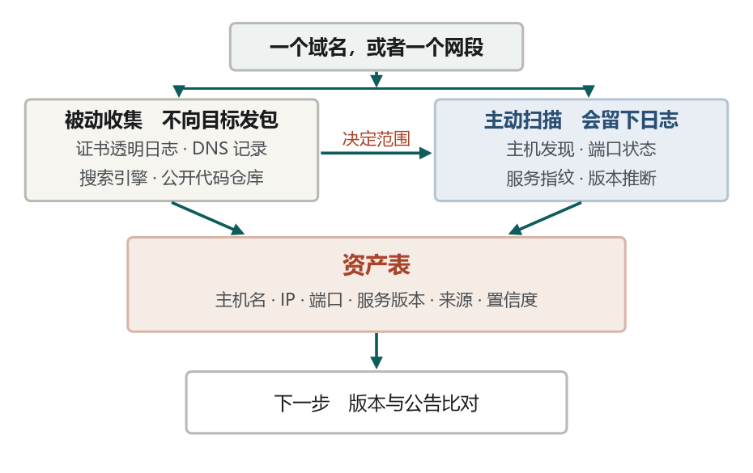
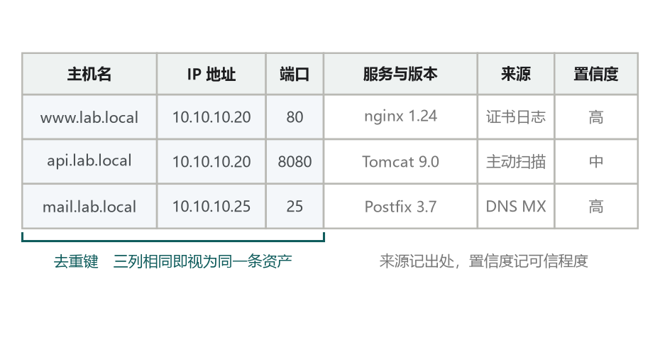

# 第三章　侦察与资产测绘

拿到一个域名之后的第一个小时，大多数人会打开终端敲 `nmap`。扫描跑完，屏幕上是一堆端口，然后人卡住了，因为不知道这些端口之间是什么关系，也不知道还有多少东西根本没被扫到。

真正决定后面全部工作的，是一张清单，而清单上的大部分内容可以在不向对方发任何一个包的情况下拿到。证书、DNS 记录、公开的代码仓库、招聘信息，这些东西本来就在那儿放着，只是没有人把它们拼起来看。

这一章讲的是怎么把"一个域名"扩成"一组资产"，以及当结果多到看不过来的时候，怎么把它整理成能用的表。侦察的目的不是收集，是缩小范围。一个没有被排除的选项会一直跟着你，到最后变成报告里那句没人敢下结论的"可能存在风险"。

## 3.1 被动收集

被动收集的定义很窄，全程不向目标发送任何数据包。你查的都是第三方持有的信息，目标那边看不到你。

证书透明日志是最好用的一个起点。为了让证书的签发过程可审计，主流浏览器要求每一张被信任的证书都提交到公开日志里，任何人都能查。查询的入口很多，`crt.sh` 提供 JSON 输出。

```bash
curl -s 'https://crt.sh/?q=%25.example.com&output=json' \
  | jq -r '.[].name_value' | sort -u
```

`%25` 是 `%` 的 URL 编码，加上它表示匹配所有子域。返回的 `name_value` 里常常不止一个名字，因为一张证书可以带上多个 SAN（subject alternative name）。很多组织在签发证书时会把内部系统名、测试环境域名一起写进去，一张证书就漏出十几个入口。这些名字里有相当一部分用 DNS 字典爆破永远猜不到。

DNS 记录是第二层。各种记录类型里，能泄露结构的是 MX、NS 和 TXT。

```bash
dig +short MX example.com
dig +short NS example.com
dig +short TXT example.com
```

MX 指向邮件服务商，从域名后缀能看出这家组织用的是自建邮件还是托管服务。NS 告诉你域名由谁解析，如果指向某个云厂商，托管在那家云上的其他资产也可能属于同一个组织。TXT 里信息最多，SPF 记录会用 `include:` 列出所有被授权发信的第三方平台，每一条都是一个 SaaS 服务；域名验证记录会写上"某平台-verify=xxx"，等于承认这家组织在用那个平台。

区域传送是一个值得试一次的动作，成本只有一次查询。

```bash
dig AXFR example.com @ns1.example.com
```

现代 DNS 服务器基本都拒绝，但拒绝的方式是 `Transfer failed`，一试就知道。如果碰巧成功，你会拿到整份区域文件，等于拿到了完整的子域列表。

还有一个不常被列进清单的角度是时间。域名注册时间、证书的首次签发时间、`SOA` 记录里 `serial` 的变化频率，这三样拼起来能看出一轮迁移发生在什么时候。组织改名、换云厂商之后，旧资产常常还留在原来的地址上没人管，这类被遗忘的机器恰恰最容易出问题。

招聘信息属于另一类公开材料。岗位描述里写的技术栈比任何指纹都准，因为它写的是接下来要维护什么。

搜索引擎和代码托管平台属于另一类。搜索语法能精确到目录和文件类型，`site:` 限定域名，`inurl:` 匹配路径片段，`filetype:` 挑文件格式，组合起来可以找出管理后台、导出的表格、备份文件。代码托管平台上的公开仓库更直接，配置文件里写死的内网域名、对象存储桶名、测试环境的地址，很多时候连提交历史都没有清理。

这类收集有两条底线。只看公开可见的内容，不尝试访问需要授权的仓库；不做违反平台条款的自动化抓取，用官方 API 和自己能承受的速率。被动收集不代表没有痕迹，你在别人的日志里仍然是一个 IP。

## 3.2 主动扫描

<figure>

<figcaption>图 3-1　被动与主动两条路径，以及它们如何汇入同一张资产表。被动收集的产出决定主动扫描的范围，顺序反过来会浪费大量时间在无关的地址上。</figcaption>
</figure>

主动扫描是唯一会让对方看见你的环节，所以它需要前提。授权范围写清楚，扫哪些网段、哪些端口、允许多大的速率，这些在动手之前就定了，而不是扫到一半再想。

扫描的顺序是从粗到细，每一步都为下一步缩小范围。

```bash
nmap -sn 10.10.10.0/24 -oA recon/alive
nmap -sS -p- --min-rate 1500 --max-retries 2 -oA recon/ports 10.10.10.20
nmap -sV -p 22,80,443 --version-all -oA recon/version 10.10.10.20
```

`-oA` 会一次生成三种格式，`.nmap` 给人看，`.xml` 给脚本解析，`.gnmap` 给老工具用。留下 XML 的意义在于所有结论都能从原始输出重算一遍，而不是靠抄一遍屏幕。

第一条做主机发现。同一个二层网络里，nmap 优先用 ARP，因为 ARP 请求一定会得到回应，比 ICMP 可靠得多；跨网段时才退回 ICMP 和 TCP 探测。第二条扫全部 65535 个端口，`-p-` 就是这个意思。第三条只对确认开放的端口做版本探测，因为版本探测要发真实的应用层探针，风险和耗时都比端口扫描高一个量级。

`--reason` 这个参数几乎每次扫描都该加。

```bash
nmap -sS -p 80,443,8080 --reason 10.10.10.20
```

它会把每个端口的判定依据打出来，`syn-ack` 表示收到了回应，`reset` 表示对方回了 RST，`no-response` 表示重传之后什么都没有。这三种依据指向三个不同的结论，而端口状态的字符串本身是看不出区别的。

UDP 服务很容易被整个漏掉，因为完整的 UDP 扫描太慢。挑常见端口是务实的做法。

```bash
sudo nmap -sU -p 53,123,161,500 --reason 10.10.10.20
```

DNS、NTP、SNMP、IKE 这四个覆盖了内网里最常见的 UDP 服务，其中 SNMP 的默认团体名问题到今天仍然常见。

限速是主动扫描里最容易做错的一环。`--min-rate` 设得太高，目标或者中间设备会开始丢包，丢包在结果里表现成 `filtered`，于是你会得到一屏"全被防火墙挡住"的结论，而实际上只是自己发得太快。内网里 1000 到 2000 之间比较稳，跨网段要更低。判断是不是自己打丢的，看 `--reason` 里 `no-response` 的比例，超过一半就该把速率降下来重扫一次。

脚本扫描可以再加一层，但只用 discovery 这一类。

```bash
nmap -sV --script "discovery and not broadcast" -p 80,443 -oA recon/svc 10.10.10.20
```

`discovery` 类的脚本只做信息收集，抓页面标题、读 HTTP 头、识别证书；`intrusive` 和 `dos` 类的脚本会尝试写入或者制造压力，那属于利用阶段的事，不在侦察范围内。`not broadcast` 排除掉对外广播的脚本，避免把包发到网段里的其他设备上。

扫描结果里还有一条要养成的判断。`open` 只说明端口上有进程在听，不代表服务能正常处理请求。一个只完成了 TCP 监听、应用层还没初始化完的服务，扫描结果是 open，实际访问会超时。区分这两种情况要靠一次应用层请求，这一步不能省。

## 3.3 子域枚举与虚拟主机

证书日志能给出一批子域，剩下的靠枚举。字典决定枚举的上限，通用字典里的词来自大量域名的统计，覆盖的是常见命名习惯；把被动阶段拿到的名字拆成词根再组合，命中率会高很多。`api`、`dev`、`test`、`staging`、`internal` 这几个前缀几乎每个组织都有。枚举的本质是拿一份字典去问 DNS，命中的就记下来。

用 HTTP 工具做 DNS 枚举是常见做法，因为 `ffuf` 这类工具的过滤功能比专门的 DNS 工具好用。

```bash
ffuf -u http://FUZZ.example.com/ -w subdomains.txt -mc all -fs 0
```

`-mc all` 表示所有状态码都记录，`-fs 0` 过滤掉响应体为空的。真正需要处理的是通配符。有些域名配置了泛解析，任何不存在的子域都会解析到同一个地址，于是一整份字典全部"命中"。检测方法是用一个随机字符串去查。

```bash
dig +short $(head -c 6 /dev/urandom | od -An -tx1 | tr -d ' \n').example.com
```

有返回，说明存在泛解析，后面所有的命中都要先和这个默认响应比对，内容一致的丢掉。

枚举到的子域还要和 IP 对齐。同一个站点可能有多条 A 记录，也可能通过 CNAME 指到别人的 CDN 上。遇到 CDN，扫出来的地址属于服务商，跟目标本身没有关系，这时候要在表里标成共享地址，避免后面把它当成目标的一部分。

虚拟主机是另一条路。同一个 IP 上可能挂着几十个站点，靠 Host 头区分，DNS 里根本没有对应的记录。这种站点无论怎么爆破子域都找不到，只能反过来从 IP 打。

```bash
ffuf -u http://10.10.10.20/ -H "Host: FUZZ.example.com" -w subdomains.txt -fs 1234
```

`-fs 1234` 是按响应体大小过滤，把默认站点的那个固定长度去掉。更可靠的做法是比较响应体的哈希，因为默认页偶尔会带上时间戳，长度一样但内容不同。

这里有一条容易被忽略的结论。DNS 里查不到，不等于不存在。反过来也成立，DNS 里查到了，不等于那个站点还活着。资产表要同时记录"来源"和"确认方式"，否则三天后你没法判断某一条到底是猜的还是验过的。

## 3.4 Web 指纹与框架识别

指纹阶段的目标只有一个，把"这台机器上跑着什么"缩到一个具体的产品和版本，因为漏洞公告是按版本说话的。

响应头是第一手材料。

```bash
curl -sI http://10.10.10.20/ | sed -n '1,20p'
```

`Server` 和 `X-Powered-By` 是最直接的两个，但也是最容易被改的两个。反向代理会把后端的头覆盖掉，于是你看到 `nginx` 而后面其实是 Tomcat。`Set-Cookie` 里的会话名往往比这两个头更诚实，`PHPSESSID`、`JSESSIONID`、`ASP.NET_SessionId`、`laravel_session` 各自对应一套技术栈，而改这些名字的人不多。

路径和文件能补充很多。

```text
/robots.txt        /sitemap.xml      /.well-known/security.txt
/wp-login.php      /administrator    /actuator/env
/.git/config       /CHANGELOG.md     /package.json
```

`robots.txt` 和 `sitemap.xml` 是站点自己声明的目录清单。`security.txt` 是联系方式的约定文件，存在就说明有安全团队在维护。`/actuator` 是 Java 应用的运维端点，`/.git/config` 是源码目录被误发布时留下的痕迹。这些路径的响应码和内容，本身就是指纹。

静态资源的文件名里常带哈希和构建号，`app.3f2a1b.js` 这样的形式，哈希本身说明不了版本，但文件内容里的 `version` 字段可以。前端构建号和后端版本号往往不在一个节奏上，别把两者混成一件事。

防护设备也会留下指纹。同一个请求在有无 WAF 的情况下，响应头、状态码、拦截页面的样式都不一样。常见的是回了 403 而页面是设备自己的品牌页，或者响应头里多出几个不认识的字段。这一步的价值是提前知道对方的防护等级，不是去想怎么绕过。

前端框架的痕迹在页面源码里。`__NEXT_DATA__` 对应 Next.js，`/_nuxt/` 对应 Nuxt，`data-reactroot` 对应 React 的服务端渲染，打包产物的 chunk 文件名里常带构建号。favicon 的哈希也是一个稳定的指纹，很多在线服务提供从哈希反查产品的功能。

版本比框架有用。同一套框架的不同版本，漏洞差别很大；而"用了 React"这句话对判断风险几乎没有帮助。判断版本要靠构建产物里的版本字符串、`/CHANGELOG.md`、静态资源的修改时间，以及错误页里的堆栈信息。

指纹阶段只读。不提交表单、不尝试注入、不上传文件。这些动作属于验证阶段，混在侦察里做，一旦出事，你就说不清自己当时在干什么。

## 3.5 资产表

收集到的东西一多，就必须落到表里，否则三次实验之后，你会记不清哪个 IP 对应哪个站点。

<figure>

<figcaption>图 3-2　资产表的字段与一条样例记录。去重键由主机名、IP 和端口三列组成，来源与置信度决定了这条记录能不能直接用于下一步。</figcaption>
</figure>

字段不用多，够用就行。主机名、IP、端口、服务与版本、来源、首次发现时间、置信度、备注，八列覆盖了绝大多数情况。前三列是去重键，同一条记录重复出现时按这三列合并。

表要能回答一个问题，这条记录是什么时候、用什么方法确认的。所以时间字段最好有两个，首次发现和最近确认，后者比前者有用。

去重比想象中麻烦。一个域名可能通过 CNAME 指向另一个域名，最后落到同一个 IP；一个 IP 上可能挂着十几个虚拟主机；一个服务可能同时监听 IPv4 和 IPv6，看起来是两条记录。按 IP 去重会把不同的站点合并成一个，按域名去重会把同一台服务器算成十几台。用三元组，再把 CNAME 链单独记在备注里，是折中之后的可用方案。

来源和置信度必须分开记。来源写这条信息是怎么来的，被动还是主动，具体的工具或数据源是什么。置信度写这条信息有多可信，证书日志里出现过的域名基本可以认为是真实存在的，字典爆破命中的则要先排除通配符。两者混在一起，后面就没法筛。

同一张表隔两周重跑一遍，新增的端口和消失的服务都能看出来。变化本身往往比静态的清单更有信息量，一个昨天还开着的管理端口今天关了，说明有人在动它。

备注列不要用来堆结论。它的作用是记下那些暂时解释不了的现象，比如某个端口只在凌晨开放，某个页面每次刷新标题都不一样。留在表里，下次回来看就成了线索；写成结论，就成了错误。

表的格式用 CSV，一行一条，字段里不含换行。这样两次扫描的结果可以直接对比，新增和消失的资产一眼能看出来。手工改表是另一个坑，改完之后脚本再跑一次，你的改动就没了；要修正就改生成表的脚本，不要改表。

两条路径的顺序是固定的。先被动，把能白拿的信息拿完，用它确定主动扫描的范围；再主动，对已经确认存在的地址做端口和服务识别。顺序反过来也能做，只是你会在一个并不知道是否相关的网段上花掉几个小时。

表建好之后，第 4 章要回答的问题就摆在面前了。这些服务里，哪些版本落在某个公告的影响范围之内，哪些只是看起来像。
