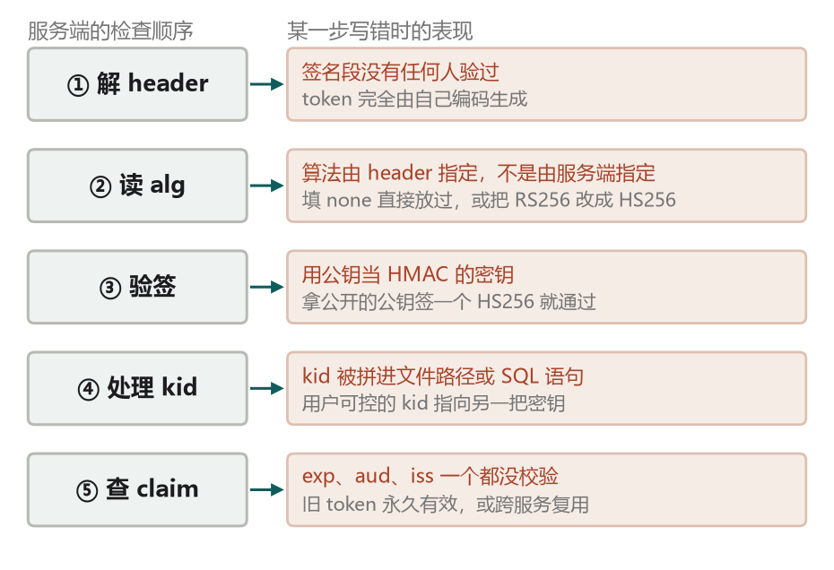
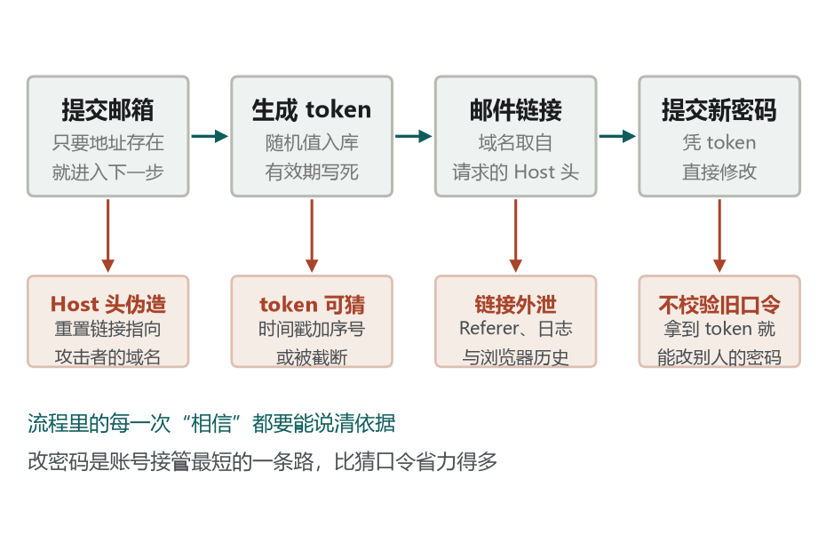

# 第七章　认证与会话的实战攻击

登录页是整站唯一一个允许陌生人提交数据的地方，它对所有人开放，又要对所有人做出判断。判断的内容只有一个，你是不是你说的那个人。

做完这一步之后，服务器需要记住你。HTTP 本身无状态，每个请求都是独立的，所以它发给你一个凭证，之后你把凭证带上，它就当你是同一个人。整站的安全模型都建立在这两件事上，一次身份判断，和之后无数次凭凭证放行。

这一章顺着这两件事往下走。凭证怎么被拿走，判断怎么做错，重置密码这种“辅助流程”为什么会变成最短的一条路，以及为什么多因素认证经常是被流程绕开而不是被破解。

## 7.1 会话凭证是怎么被拿走的

先看最普通的会话。登录成功后服务端生成一个随机会话 ID，写进 cookie，之后每次请求都带上。这个 ID 就是你的身份，谁拿到它谁就是你。

有三个地方容易出问题，都不需要破解密码。

第一个是 cookie 属性。`HttpOnly` 决定脚本能不能读到它，`Secure` 决定它会不会在明文 HTTP 上被发出去，`SameSite` 决定跨站请求会不会带上它。缺了 `HttpOnly`，一个 XSS 就能把会话整条读走；缺了 `Secure`，同一网段里的抓包就能拿到；缺了 `SameSite`，别的网站发起的表单提交会自动携带你的身份。检查方法很直接，在浏览器开发者工具里看响应的 `Set-Cookie` 头。

```text
Set-Cookie: SESSION=8f2a...; Path=/; HttpOnly; Secure; SameSite=Lax
```

第二个是会话固定（session fixation）。攻击者先访问站点拿到一个会话 ID，再想办法让受害者的浏览器也用这个 ID，比如通过 URL 里的 `;jsessionid=` 或者一个能写 cookie 的子域。受害者用这个 ID 登录后，服务端如果没换新的 ID，攻击者手里那个就变成了已登录状态。判断方法是登录前后各看一次 cookie，值没变就说明存在这个问题。现代框架大多在登录时重新生成 ID，PHP 的 `session_regenerate_id(true)`、Django 的 `cycle_key()` 都是干这个的。

第三个是凭证出现在 URL 里。有些应用把 token 放在查询串里做单点登录，或者做完跳转后忘了清掉。URL 会被写进 access log、被浏览器记住、在跨站跳转时通过 `Referer` 带给第三方。这类问题在日志里能直接看到，搜一下带 `token=` 或 `sid=` 的请求行就知道有没有。

会话的另一个属性是生命周期。永不过期的会话等于一张永久通行证，泄露一次就再也收不回来。合理做法是登录时发一个短的、可续期的凭证，并且记录签发时间和来源设备。测试时看两点，退出登录之后旧 cookie 还能不能用，改密码之后其他设备上的会话是否失效。两个答案都是能，说明服务端只根据 cookie 里的值查表，别的什么都不管。

## 7.2 JWT：验签的顺序比算法重要

JWT（JSON Web Token）现在是接口认证的主流做法。它把身份信息直接放在 token 里，用签名保证没被改过，服务端不需要查库就能验证。结构是三段 base64url，用点隔开。

```text
eyJhbGciOiJIUzI1NiIsInR5cCI6IkpXVCJ9.eyJzdWIiOiJ1c2VyMSJ9.9xQ...
```

第一段是头部，写着算法名；第二段是载荷，写着用户和过期时间；第三段是签名。三段都是明文可读的，任何人都能解出来，签名的唯一作用是防止篡改。

问题几乎全部出在验签时用什么算法这件事上。正确做法是服务端在代码里写死算法，然后只接受这一种。错误的做法是读头部里的 `alg` 字段，按它去选验签方式。后者等于让攻击者决定怎么验证自己。

<figure>

<figcaption>图 7-1　JWT 验签的五个判断点。前两个决定了后面所有验证是否有意义，最后两个决定了 token 能不能被重放或者跨服务使用。</figcaption>
</figure>

`alg` 为 `none` 是最古老的一种。规范里它表示不签名，一些库在实现时老老实实照着做了，于是任何人都能自己拼一个 token 通过。构造只需要几行代码。

```python
import base64, json

def b64(obj):
    raw = json.dumps(obj, separators=(",", ":")).encode()
    return base64.urlsafe_b64encode(raw).rstrip(b"=")

header = b64({"alg": "none", "typ": "JWT"})
payload = b64({"sub": "admin", "exp": 1999999999})
print((header + b"." + payload + b".").decode())
```

把它放进 cookie 或 `Authorization` 头试试。返回 200 并且是管理员视角，问题就确认了。现在的库大多会拒绝 `none`，但拒绝的方式是加一个黑名单，黑名单总有漏的写法，比如大小写写成 `None`。

比 `none` 更常见的是密钥混淆。一个用 RSA 签名的服务，公钥是公开的，任何人都能拿到。如果代码在验签时接受 `HS256`，而 HMAC 的密钥用了那把公钥的内容，攻击者就能用公开的公钥算出一个合法签名。原因是 HMAC 和 RSA 都把密钥当成字节串，代码没有区分这两类字节串的语义。判断依据是有没有把算法写死在 `decode` 调用里。

```python
jwt.decode(token, public_key, algorithms=["RS256"])
```

`algorithms` 这个参数是关键。少写它，库会从头部取算法，混淆就成立。

`kid` 是头部的另一个字段，表示用哪把密钥验签。它常被当成数据库主键或者文件名用，如果直接拼进 SQL 或者路径，就多出两个攻击面。拼进路径时可以指向一个内容已知的文件，比如 `/dev/null`，密钥变成空，签名就能自己算。拼进 SQL 时可以注入一个 `union` 把密钥换成自己知道的值。

头部还有 `jku` 和 `x5u` 两个字段，值是公钥集合的地址。部分库会自动去这个地址取公钥，这就等于让 token 自带一份验证材料。攻击者把自己的地址填进去，再用对应的私钥签名，整条链自己闭环。判断依据很简单，看服务端有没有对 `jku` 的域名做白名单，大多数实现连这个字段都没处理。

还有一类问题在密钥强度上。HMAC 用的密钥如果是人设的弱口令，离线爆破很快。

```bash
hashcat -m 16500 token.txt /usr/share/wordlists/rockyou.txt
```

`16500` 就是 JWT 的模式编号。跑出结果之后，剩下的就是自己签一个管理员 token。

最后是声明的校验。`exp` 过期时间、`aud` 受众、`iss` 签发方，这三个字段只有在校验时才有意义。漏了 `exp`，一个泄露的 token 永久有效；漏了 `aud`，给 A 服务签的 token 能拿去访问 B 服务。测试方法很笨但有效，把 `exp` 改成十年前，看还能不能用。

## 7.3 OAuth：两个参数决定了边界

OAuth 的授权码流程里，有两个参数承担了全部安全责任。

第一个是 `redirect_uri`。授权服务器在用户同意之后，把授权码发到这个地址。这个地址必须是事先登记过的，且匹配要严格到字符级别。常见的错误匹配有三种，前缀匹配（`https://app.lab/callback` 放行了 `https://app.lab/callback.evil.com`）、子域通配（`https://*.app.lab` 放行了攻击者控制的子域）、路径不校验（只比对域名）。三种都能让授权码落到攻击者手里。

```bash
curl -s -o /dev/null -w "%{http_code} %{redirect_url}\n" \
  "http://10.10.10.30/oauth/authorize?client_id=demo&response_type=code\
&scope=read&redirect_uri=https://app.lab/callback.evil.com"
```

返回 302 并且 `Location` 指向那个地址，问题就成立。这一步不涉及任何破解，只是把参数改一下看它接受什么。

第二个是 `state`。它在流程里唯一的用途是让回调请求和发起请求对上号，防止别人替你完成授权。缺了它，攻击者可以把自己的授权码塞给你的浏览器，让你在不知情的情况下登录成攻击者的账号，之后你在里面存的任何东西攻击者都能看到。这类攻击在共享文档、代码托管这类产品上效果很好，因为受害者会主动往自己那个账号里放东西。

`state` 还有一个作用，防止授权码在被换掉之前被别人抢先使用。它应该是随机的、一次性的、和当前会话绑定的。

如果客户端是公开的（比如纯前端应用，没有后端），授权码还有被拦截的风险，PKCE 用一次性的 `code_verifier` 解决这个问题。看一个应用有没有做 PKCE，就看授权请求里有没有 `code_challenge` 和 `code_challenge_method`。

授权码从授权服务器到客户端这一段，实际上经过了浏览器。如果中途页面加载了第三方资源，`Referer` 头会把带码的 URL 带出去。移动端更麻烦，自定义 scheme（比如 `myapp://callback`）可以被任何一个应用注册，谁先注册谁收到码。这两条说明同一件事，授权码应该被当成一次性、短命、且不能出现在日志里的东西。

## 7.4 口令重置：流程里的信任点

改密码这件事本身没有密码学难题。难的是流程里每一步都要相信一个东西，而这些相信经常没有依据。

<figure>

<figcaption>图 7-2　口令重置的四个环节和各自的信任点。任何一处判断错误都能导致别人的账号被改，而整条链路不涉及一次口令猜测。</figcaption>
</figure>

第一步是提交邮箱。这里最常见的缺陷不是提权而是信息泄漏，响应会告诉你这个邮箱是否注册过。拿一批常见邮箱跑一遍，就能得到一份有效账号列表。

第二步是生成 token。token 应该来自密码学安全的随机源，长度足够，一次性使用，有效期以分钟计。实际见过的问题包括用 `md5(time())`、用自增 ID 加时间戳、把 token 截断到六位。判断方法是连续申请两次，比较两个 token 的相似度，或者在同一个秒内发多次请求看是否重复。

第三步是发邮件。链接里的域名如果取自请求的 `Host` 头，攻击者就能让受害者收到一封域名看起来正确的邮件，点开却落到自己的服务器。

```bash
curl -s -X POST http://10.10.10.20/api/reset \
  -H "Host: attacker.lab" -d "email=victim@lab.test"
```

在自己搭的靶场里挂一个收信服务（MailHog 之类），看收到的邮件链接指向哪个域名。指向 `attacker.lab` 就说明 Host 头被信任了。这不是理论问题，它曾经是不少实际系统的缺陷。

第四步是提交新密码。这里要验证旧口令或者做一次二次身份，不能只凭一个 token。还有两个细节，改密之后其他会话是否失效，token 在用完之后是否立刻作废。两样都没做的话，攻击者改完密码，受害者还保持着登录，等受害者发现问题时，攻击者已经拿到了持久化的通道。

token 存明文也有影响。数据库被读走一次，所有未过期的重置链接都能用。

## 7.5 暴力破解的可行性判断

爆破能不能做，取决于三个量，口令空间、单次请求成本、失败的可观测性。

先看限速。连发二十次，看响应码有没有从 200 变成 429，看延迟有没有变长，看第几次开始出现验证码。

```bash
for i in $(seq 1 20); do
  curl -s -o /dev/null -w "%{http_code} " \
    -d "user=admin&pass=wrong$i" http://10.10.10.20/login
done; echo
```

如果一直是 200，说明没有限速。如果第五次开始 429，就去看限速是按 IP 还是按账号算的。按 IP 算的可以换地址，按账号算的要考虑锁定策略，锁定十分钟的那种可以用极慢的速率绕开。

单次请求成本不只是网络往返。带 bcrypt 的登录接口，每次验证要花几十毫秒到几百毫秒，这个成本在服务端，攻击者可以用并发把 CPU 打满，服务端反而先崩。这类参数本身就是防护的一部分。

账号是否存在，也能从响应里读出来。口令错误和账号不存在返回的文案不同是最粗的一种，更隐蔽的是时间差，不存在的账号会跳过口令哈希比对，响应快了几十毫秒。这种差异单个请求看不出来，跑五百个取中位数就清楚了。拿到一份有效账号列表，后面的撞库和社工才有目标。

口令空间决定值不值得花时间。一个要求十二位以上、混合字符的策略，配上一个不常见的口令库，爆破基本没有希望。反过来说，如果能拿到一份泄露的账号口令库，用撞库比爆破有效得多，因为人在不同网站用同一个口令的比例不低。

工具层面，`hydra` 和 `ffuf` 都能做这件事，区别是一个面向多种协议，一个面向 HTTP 的模糊测试。

```bash
hydra -l admin -P /usr/share/wordlists/rockyou.txt 10.10.10.20 \
  http-post-form "/login:user=^USER^&pass=^PASS^:F=incorrect"
```

命令里的 `F=incorrect` 是失败特征，写错了会得到一堆误报。这是最容易出错的地方，先用一个已知错误的口令跑一次，确认特征字符串确实出现在失败响应里。

## 7.6 多因素认证是被流程绕开的

MFA 的设计目标是让知道口令不足以登录。它没有解决的问题是，登录成功之后的那一整套流程里，还有多少地方要求重新确认身份。

最常见的一类问题是验证码没有次数限制。六位数字有一百万种可能，如果每次都返回明确的验证码错误，并且不限制频率，几分钟就能跑完。判断方法就是发十次错的，看第十次和第几次的响应有什么不同。

第二类问题出在客户端判断。登录接口返回一个 JSON，里面有 `mfa_required` 或者 `next_step` 这类字段，前端根据它决定跳不跳验证页。如果服务端只是跳过页面而没有拒绝请求，直接调用最终接口就能进去。

```text
{"ok": false, "mfa": true, "session": "partial-8f2a..."}
```

把 `mfa` 改成 `false` 重发，或者用那个 `partial` 会话直接访问业务接口，看是否放行。

第三类是验证码复用和绑定缺失。同一个验证码在有效期内可以反复用，或者验证码只校验值不校验属于哪个会话。前者意味着一次截获就能长期使用，后者意味着自己算出来的码可以给别人用。

第四类是备份码和恢复流程。备份码通常是一次性随机串，但如果生成得可预测，或者明文存在数据库里，等于多开了一扇门。恢复流程更糟，客服人工核验身份时凭的是什么，往往是一段可以被社工拿到的信息。

第五类是改密码、改邮箱、绑新设备这些敏感操作没有要求重新验证。攻击者不需要通过登录时的 MFA，只要拿到一个已登录的会话，就能在里面把账号改成自己的。这时候 MFA 保护的只是那道门，门后面的房间没有锁。

还有一类问题完全在流程之外，换卡。短信验证码依赖运营商，而号码的归属可以通过补卡或者欺骗客服改变。这不是技术手段能防的，所以把短信当成唯一的第二因素，在高价值账号上是不够的，硬件密钥或者应用内推送要稳得多。

## 7.7 会话生命周期的六项实测

会话的问题很少写在页面上，它们在服务端的状态里。用 curl 的 cookie jar 把整个生命周期跑一遍，六项检查一下午能做完。

先把登录和退出跑通。

```bash
J=/tmp/alice.jar
curl -s -c $J -o /dev/null -w 'login %{http_code}\n' \
  -d 'user=alice&pass=Passw0rd!' http://10.10.10.30/login
curl -s -b $J -o /dev/null -w 'me %{http_code}\n' http://10.10.10.30/api/me
cp $J $J.bak
curl -s -b $J -c $J -X POST -o /dev/null -w 'logout %{http_code}\n' \
  http://10.10.10.30/logout
curl -s -b $J.bak -o /dev/null -w 'replay %{http_code}\n' http://10.10.10.30/api/me
```

最后一行是全部检查里最关键的一行。`$J.bak` 是退出之前拷的，退出之后再用它请求，如果返回 200，说明退出只删了浏览器那份 cookie，服务端的会话还活着。拿到的 cookie 一旦被拷走，退出操作对攻击者没有任何影响。

剩下几项同样用旧副本验证。

| 检查 | 做法 | 期望 |
| 退出失效 | 退出后用备份 jar | 401 或跳登录页 |
| 改密失效 | 改密后用备份 jar | 401 |
| 并发限制 | 两个账号各登一次 | 两者都活，或多设备告警 |
| 空闲超时 | 等半小时再请求 | 401 |

第二项在共享账号的系统里经常不做，改完密码旧会话还能用，等于密码只是登录用的，不是控制用的。第四项判断的是服务端有没有记最后活动时间，不少实现只在签发时写 `exp`，只要请求不断就会一直续期，于是“空闲超时”变成了“永不超时”。

会话到底存在哪，改一个字符就能看出来。服务端存储的情况下，改坏的 ID 找不到对应记录，返回未登录；自包含的 token 被改动之后签名失效，也应该返回未登录。两者都会拒，区分靠看内容，把 cookie 解一下就能分。“会话值”是几十字节的随机串，“token”是能解出 JSON 的 base64，里面写着用户和过期时间。

会话固定也只需要两步。登录前访问一个页面拿 cookie，登录时带上这一份，登录后再看一次。

```bash
curl -s -c $J -o /dev/null http://10.10.10.30/login
curl -s -b $J -c $J -d 'user=alice&pass=Passw0rd!' -o /dev/null \
  http://10.10.10.30/login
grep -i session $J
```

值在登录前后没变，就说明登录没有重新签发 ID，攻击者预先塞给受害者的那个 ID 在登录之后就变成了已认证状态。

cookie 的属性可以直接从头里读。

```bash
curl -s -D - -o /dev/null -d 'user=alice&pass=Passw0rd!' http://10.10.10.30/login \
  | grep -i '^set-cookie'
```

三个属性里 `Secure` 在 HTTP 环境下本来就不会有，所以测试阶段看到的“缺失”不一定是缺陷，得看生产环境的头。`SameSite` 为 `None` 时必须同时带 `Secure`，否则浏览器会直接丢弃这个 cookie，症状是登录接口返回 200 但下一跳仍是未登录。

cookie 的长度也能提供线索。几十个字节对应着一个随机 ID，几百个字节对应着序列化的状态。后者要确认它有没有加密，把一个字符改掉之后看返回，报错里带解析异常就说明只是签了名而没有加密，内容对拿到它的人是可读的。

会话 ID 的熵也值得看一眼。拿十个刚签发的 ID 比一下长度和字符集，太短（比如 16 位十六进制）基本可以确认是弱随机。更直接的判据是看它会不会随时间递增，把两个连续的 ID 相减，差值很小就说明用了自增计数或者时间戳。

最后一项不靠命令，靠对照。同一份会话在两种环境下表现不同，比如开发环境退出就掉线、测试环境退出后仍能重放，差异本身就是个线索，它说明两个环境的会话存储不是同一套。报告里把这种差异写清楚，比笼统地说“会话管理不当”有用。

## 7.8 用本地授权服务器验回调地址

OAuth 的参数行为没法靠读文档推断，各家实现差异很大。想确认一个客户端的配置是否过宽，最省事的做法是自己在本地起一台授权服务器，把四种错误匹配逐个试一遍。

```bash
docker run -d --name kc -p 8081:8080 \
  -e KC_BOOTSTRAP_ADMIN_USERNAME=admin \
  -e KC_BOOTSTRAP_ADMIN_PASSWORD=admin \
  quay.io/keycloak/keycloak:26.0 start-dev
```

起来之后建一个 realm 叫 `lab`，再建一个客户端，回调地址写一个正常的和一个带末尾通配的。

```json
{
  "clientId": "demo",
  "publicClient": true,
  "redirectUris": [
    "https://app.lab/callback",
    "https://app.lab/*"
  ],
  "attributes": { "pkce.code.challenge.method": "S256" }
}
```

然后一组地址反复试。

```bash
for u in \
  'https://app.lab/callback' \
  'https://app.lab/callback/extra' \
  'https://app.lab/callback.evil.com' \
  'https://x.app.lab/callback' \
  'https://app.lab@evil.com/callback' \
  'https://evil.com/?r=https://app.lab/callback' ; do
  code=$(curl -s -o /dev/null -w '%{http_code}' --get \
    --data-urlencode 'client_id=demo' \
    --data-urlencode 'response_type=code' \
    --data-urlencode "redirect_uri=$u" \
    http://10.10.10.30:8081/realms/lab/protocol/openid-connect/auth)
  printf '%s %s\n' "$code" "$u"
done
```

判据很干净，400 就是拒了，200 或 302 就是接受。Keycloak 默认是严格匹配，`/*` 只表示子路径，不表示子域，所以第四个会被拒。换成某些自研实现，`*.app.lab` 这种写法真的会放行子域，而那个子域可能被别人注册下来。

授权码只能用一次，这一点在同一个环境里能验。拿同一个 code 换两次 token，第二次应该返回 `invalid_grant`。

```bash
for i in 1 2; do
  curl -s -o /dev/null -w "try$i %{http_code}\n" -X POST \
    -d grant_type=authorization_code -d "code=$CODE" \
    -d client_id=demo -d redirect_uri=https://app.lab/callback \
    http://10.10.10.30:8081/realms/lab/protocol/openid-connect/token
done
```

两次都返回 200，说明服务端没有把码标记为已用，一个被截获的码可以在有效期内反复使用。

还有一项配置容易被当成安全措施，CORS。它约束的是浏览器里的跨源读取，对服务端发起的任何请求都不起作用。一个返回 `Access-Control-Allow-Origin: *` 的接口看起来很大方，但只要不同时返回 `Allow-Credentials: true`，浏览器就不会把凭据带上去，危害有限。两项同时出现才值得警惕，那时候任意站点都能带着用户的 cookie 读这个接口，绕过同源策略的那一层就没了。看到这两个头同时出现，去验一下带上 cookie 的跨源请求到底能不能读出内容，比读配置快。

第五个地址值得单独看一眼。`app.lab@evil.com` 在 URL 语法里前面的部分是用户信息，真实主机是 `evil.com`。如果授权服务器先做字符串前缀比较、再交给浏览器跳转，两边对主机的理解就不一致。这类差异靠跟踪重定向看 `Location` 里的实际主机最直接。

`state` 和 PKCE 也能在这台服务器上看。把授权请求里的 `code_challenge` 去掉发一次，被拒说明客户端强制了 PKCE；没被拒而流程能走完，说明没强制。`state` 是客户端自己管的，服务器只负责原样回送，所以这项要在客户端测，看回调时有没有比对。本地环境的好处是可以把配置改坏再改好，看哪些改法真的影响结果，文档里含糊的那几项在这里跑一遍就知道了。

这一章讲的是你是谁。下一章换个层面，从应用层掉到内存层，看程序在处理你给的数据时，栈上的字节是怎么被改掉的。
