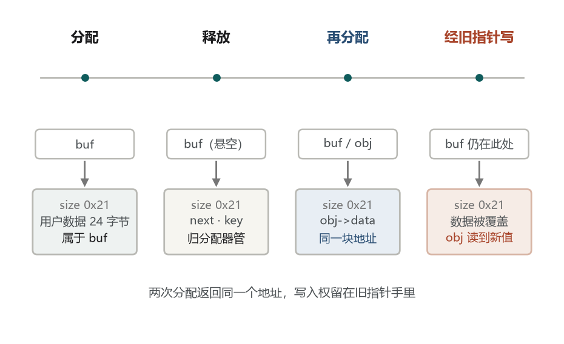
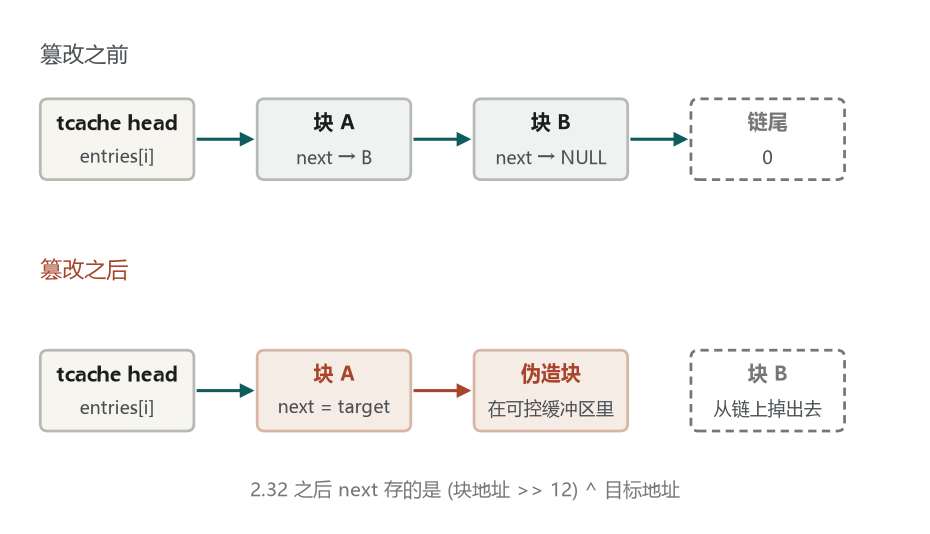

# 第九章　二进制实战：堆与分配器

栈上的偏移算一次就定了，同一条 payload 反复跑，结果一样。堆不一样。同一个漏洞，第一次跑通，第二次崩在 `malloc` 里，第三次拿到了 shell 却是别人的。这种随机性劝退过很多人，它的来源不是运气，是分配器的内部状态。

堆的内存布局由程序自己的分配和释放顺序决定。你多分配了一个临时缓冲区，tcache 的链表就变了；你在 shell 里多设了一个环境变量，`top chunk` 的位置就挪了。所以堆题的第一课不是怎么利用，是怎么把状态看清楚。

看状态需要两样东西。一个能把内存画出来的调试器，一个能复现的靶程序。前者的输出要能直接告诉你“这一块在哪个链表里、它的 next 指向谁”，后者的行为要稳定到每次跑都一样。两样凑齐之前不要碰 payload，碰了也只是在猜。

顺序是这样的。先确认 glibc 的版本，因为同一个漏洞在不同版本上的表现可能完全不同；再学会用 gdb 读堆的真实状态；然后才是 UAF 和 tcache 这两条最常见的路。所有程序都是自己写的靶子。

## 9.1 版本决定一切

栈溢出里，glibc 的版本只影响 `system` 和 `"/bin/sh"` 的偏移，换一个版本最多是地址算错。堆不是这样。分配器本身的实现每一版都在改，检测逻辑也在加，一个在 2.27 上稳定的利用，到 2.32 上可能连第一步都过不去。

四条时间线值得记住。

glibc 2.26 引入了 tcache（thread local cache），每个线程每个大小一条单链表，最多缓存 7 块。它的存在是为了性能，副作用是把释放变得非常"温和"，`free` 之后块上的指针不会被立刻清掉，于是悬垂指针能读到有意义的数据。

glibc 2.29 给 tcache 的每个块加了一个 `key` 字段，`free` 时写入 tcache 的地址，再 `free` 同一块时先比对 `key`，重复了就拒绝。这条检查直接堵住了最朴素的 double free。

glibc 2.32 引入了 safe-linking，链表里的 `next` 指针不再存原始地址，而是存 `(块地址 >> 12) ^ 目标地址`。想改链就得先知道堆的地址，信息泄漏从"可选"变成"必需"。

glibc 2.34 移除了 `__free_hook` 和 `__malloc_hook`。这两个符号曾是堆题最常用的落点，`free` 一块内存就能跳到任意地址。它们没了之后，落点转向 `_IO_list_all`、`exit_funcs` 或者栈上的返回地址。

所以拿到一个堆题，第一个动作是确认版本。

```bash
ldd ./note
# libc.so.6 => /lib/x86_64-linux-gnu/libc.so.6

/lib/x86_64-linux-gnu/libc.so.6
# GNU C Library (Ubuntu GLIBC 2.31-0ubuntu9.9) release version 2.31.
```

直接执行 libc 文件，它会打印版本和编译信息然后退出。这比 `strings | grep` 可靠，也不依赖符号。

本地调试时要把靶程序的 libc 对齐到远程那一份，否则所有偏移都是错的。`patchelf` 改解释器和搜索路径，或者在 docker 里用对应版本的发行版编译。

```bash
patchelf --set-interpreter ./ld-2.31.so --set-rpath . ./note
```

`ld-2.31.so` 和 `libc.so.6` 都要放在当前目录。改完之后 `ldd ./note` 应该指向同目录的 libc，不对就说明 rpath 没生效。

版本对不上时，还有一个反向确认的办法。分配一块固定大小的内存，看 `bins` 里它落在哪个桶、`next` 字段被写成了什么，再和候选版本的源码对照。tcache 上限、`key` 字段的位置、unsorted bin 的入链时机，这三样在每个版本上都可能不一样，而它们的差异在调试器里一眼就能看到。比看报错信息猜版本可靠得多。

还有一个容易混的地方。`libc.so.6` 的版本号和上面那些行为不是一一对应的，同一个版本号在不同发行版里可能打了不同的补丁。Ubuntu 的 2.31 和 Debian 的 2.31 在细节上就不一样。所以尽量用题目或靶机给的原始文件，不要用自己系统里的替换。

## 9.2 用 gdb 看堆

先写一个靶程序。它是一个便签程序，创建、编辑、查看、删除，四个功能。

```c
// note.c
#include <stdio.h>
#include <stdlib.h>
#include <string.h>
#include <unistd.h>

typedef struct {
    char *buf;
    unsigned int len;
} note_t;

static note_t *notes[16];

static unsigned int readn(void) {
    char tmp[16] = {0};
    read(0, tmp, sizeof(tmp) - 1);
    return (unsigned int)strtoul(tmp, NULL, 0);
}

int main(void) {
    setvbuf(stdout, NULL, _IONBF, 0);
    int idx;
    for (;;) {
        printf("1 new  2 edit  3 show  4 del  > ");
        switch (readn()) {
        case 1:
            printf("idx> "); idx = readn();
            if (idx < 0 || idx > 15) break;
            notes[idx] = malloc(sizeof(note_t));
            printf("len> "); notes[idx]->len = readn();
            notes[idx]->buf = malloc(notes[idx]->len);
            printf("data> "); read(0, notes[idx]->buf, notes[idx]->len);
            break;
        case 2:
            printf("idx> "); idx = readn();
            printf("data> "); read(0, notes[idx]->buf, notes[idx]->len);
            break;
        case 3:
            printf("idx> "); idx = readn();
            write(1, notes[idx]->buf, notes[idx]->len);
            break;
        case 4:
            printf("idx> "); idx = readn();
            free(notes[idx]->buf);
            free(notes[idx]);
            break;
        default:
            return 0;
        }
    }
}
```

编译时把保护关掉，方便观察。

```bash
gcc -g -O0 -fno-stack-protector -no-pie -o note note.c
```

这个程序有两处问题，都属于"忘了维护状态"。删除之后 `notes[idx]` 没有置空，于是 `show` 和 `edit` 仍然能操作一块已经交还给分配器的内存。这是最典型的 UAF（use after free）。

在 gdb 里跑起来，先分配两块，再看堆。

```bash
gdb -q ./note
pwndbg> r
1
0
0x20
AAAA
1
1
0x20
BBBB
```

这时候 `heap` 或 `vis_heap_chunks` 会画出所有块。看几个字段。

```text
pwndbg> vis_heap_chunks
0x555555559010  0x0000000000000000  0x0000000000000291   <- tcache 结构占的块
0x5555555592a0  0x0000000000000000  0x0000000000000021   <- 块 A
0x5555555592c0  0x0000000000000000  0x0000000000000021   <- 块 B
```

每块前面 8 字节是上一块的 `prev_size`，紧跟着 8 字节是 `size`。`size` 的低三位是标志位，`PREV_INUSE` 是最常用的一个，表示前一块还在用，所以 `prev_size` 无效。`0x21` 去掉标志位是 `0x20`，这也是 `malloc(0x18)` 得到的块大小，请求 24 字节，加上 8 字节的 size 字段，向上取整到 16 的倍数。

`bins` 命令看的是空闲链表。

```text
pwndbg> bins
tcachebins
0x20 [  2]: 0x5555555592d0 —▸ 0x5555555592b0 ◂— 0
```

格式是"大小, 数量, 链表"。这里 `0x20` 大小的桶里有两块，从 `0x…2d0` 开始，指向 `0x…2b0`，最后一格是 0。这个顺序说明后释放的块在链表前面，tcache 是后进先出（LIFO）。记住这一点，后面算分配顺序全靠它。

`x/8gx` 直接看内存，比看图形更准。

```text
pwndbg> x/4gx 0x5555555592b0
0x...2b0:  0x0000000000000000  0x0000555555559010
0x...2c0:  0x0000000000000000  0x0000000000000021
```

用户数据区的前 16 个字节，在块被释放之后就不再是数据了，它变成 `next` 和 `key`。`next` 占前 8 字节，`key` 占后 8 字节。上面这段的第一行是块 A 的用户区，`next` 为空，`key` 指向 tcache 结构；第二行是块 B 的块头，`prev_size` 为 0，`size` 还是 `0x21`。`key` 就是 2.29 之后加的检测标记。

还有几个字段平时看不见，用的时候才想起来。块头里的 `prev_size` 只在前一块空闲时才有意义，前一块在用时，这 8 字节归前一块的用户数据用，这也是为什么请求 `0x18` 能得到完整的 24 字节。`fd` 和 `bk` 只对已经进过 unsorted bin 的块有效，进 tcache 和 fastbin 的块，这两个位置分别被 `next` 和 `key` 占着。同一个偏移在不同链表里有不同含义，这是堆题最容易看错的地方。

pwndbg 里还有一个命令值得记住，`find_fake_fast`。它在指定的地址附近找一块“看起来像空闲块”的内存，判据是那个位置有一个合理的大小值，且它对应的 `fd` 能对上。tcache 的伪造块不需要这么麻烦，但打 fastbin 或者小 bin 时，这个命令能省掉很多手算。

## 9.3 UAF 能读到什么

<figure>

<figcaption>图 9-1　UAF 的四个阶段。释放之后指针还在，同一块内存被下一次分配复用，旧指针和新对象就指向了同一片区域。</figcaption>
</figure>

UAF 的危害分两半。读，叫信息泄漏；写，叫任意写。两半经常连着用，先泄漏出地址，再用地址去改写。

泄漏的可行性来自 `free` 的实现。程序调用 `free` 时，分配器要把这块内存挂回某条链表，而链表的指针就写在用户数据区里。挂回 tcache 的块，前 16 字节是 `next` 和 `key`；挂回 unsorted bin 的块，前 16 字节是 `fd` 和 `bk`，两个指针都指向 `main_arena` 里的某个位置，也就是 libc 内部。

`main_arena` 在 libc 的 `.data` 段里，它的地址和 libc 基址之间是一个固定偏移。所以只要读到一个 `fd`，libc 就泄漏了。

```python
add(0, 0x500, b"A" * 8)
delete(0)
p.recvuntil(b"idx> ")
p.sendline(b"3")
p.recvuntil(b"idx> ")
p.sendline(b"0")
leak = u64(p.recv(6).ljust(8, b"\x00"))
```

请求 `0x500` 字节，块大小是 `0x510`，超过 tcache 的上限 `0x410`，所以释放之后直接进 unsorted bin。读出来的六个字节就是 `fd`。

拿到之后要减去偏移。偏移不要背，用 libc 文件算。

```python
cand = leak - (libc.sym["__malloc_hook"] + 0x10 + 0x60)
if cand & 0xfff:
    cand = leak - (libc.sym["main_arena"] + 0x60)
```

第二行是校验。libc 映射在页边界上，基址的低三位十六进制一定是 0，算出来不是 0 就说明锚点错了，换一个再试。这个技巧在偏移记不准的时候特别有用，它把"猜"变成了"验"。

写的那一半要用 `edit`。程序删除之后没有清空指针，`edit` 仍然会往那块已释放的内存写数据，写进去的内容覆盖的是 `next` 和 `key`。这就是下一节要用的入口。

泄漏的长度也要算。同一个 `show` 调用里能读多少字节，取决于 `len` 字段，而 `len` 字段本身也可能被覆盖。如果一次只能读 6 个字节，那就只读 6 个，不要指望后面的补零能救回来。地址的高两位在用户态总是 `0x0000`，所以六个字节足够，这也是为什么泄漏代码总在 `recv(6)` 后面接一个 `ljust(8, b"\x00")`。

读到的值先怀疑一下再相信。libc 的地址形如 `0x7f...`，堆的地址形如 `0x55...` 或 `0x56...`，栈的地址也以 `0x7f` 开头但偏移更大。如果读出来的值既不像指针也不像 ASCII，那多半是读错了位置，不是运气不好。每次泄漏都打印一行日志，对着地址的高位判断它属于哪一段，这个习惯能提前发现大部分错误。

## 9.4 tcache poisoning

<figure>

<figcaption>图 9-2　tcache 单链表的正常状态与被篡改之后的状态。改写 `next` 之后，下一次分配返回的地址就由攻击者指定，中间那块被跳过。</figcaption>
</figure>

tcache 的结构很简单，一个数组，每个下标对应一个大小，数组里存链表的头。每个空闲块的前 8 字节是 `next`，指向下一个空闲块。

分配的时候，从表头摘一块下来，把它从链表里删掉，返回给调用者。整个过程没有任何位置校验，分配器不知道这个指针是从哪儿来的，也不检查它是否真的指向一个空闲块。

利用的步骤只有三步。

```python
add(0, 0x18, b"A" * 8)     # 块 A
add(1, 0x18, b"B" * 8)     # 块 B
delete(0)                  # 链表: A
delete(1)                  # 链表: B -> A
```

现在链表是 `B -> A`，因为 LIFO。A 已经在链表里了，但程序里还有一个有效的指针指向它，`edit(0, ...)` 能写。

```python
edit(0, p64(target))       # 改写 A 的 next
add(2, 0x18, b"C" * 8)     # 返回 B
add(3, 0x18, b"D" * 8)     # 返回 A
add(4, 0x18, b"E" * 8)     # 返回 target
```

第三次分配返回的就是 `target`。如果 `target` 指向一个函数指针，比如 `__free_hook`，那么接下来往这块内存写数据，就等于往那个函数指针写数据。

这条路走得通，但它有几个前提。

第一个前提是知道 `target` 的地址。要打 `__free_hook` 就得先泄漏 libc，所以要先把 9.3 那一半做完。

第二个前提是 `target` 要对齐。2.32 之后分配器会检查请求的地址是否按 16 字节对齐，不对就报 `malloc(): unaligned tcache chunk detected` 然后退出。所以伪造的地址末位最好是 0。

第三个前提是 `target + 8` 的位置要能放得下一个像样的大小值。分配器在摘块的时候会读 `target` 处的 `size` 字段做一次基本检查，值太离谱会被 `malloc_printerr` 拦下。

第四个前提在 2.32 之后才出现。`next` 存的是编码值，`(地址 >> 12) ^ 指针`，改链之前得先知道堆的地址，否则写进去的是错的值。泄漏堆地址的办法通常也是 UAF，读一个已经进过 tcache 的块的 `next`，反算回去。

摘链的代码本身很短，短到能背下来。取表头，把表头换成表头的 `next`，把计数减一，返回。没有一步在验证这个指针指向的东西是不是真的在那里。这就是为什么一个被改写的 `next` 能直接变成任意地址分配，也是为什么后面那些检测全部加在别处（对齐、计数、编码），而不是加在这里。

`__free_hook` 在 2.34 之后没了，落点要换。`_IO_list_all` 加伪造的 FILE 结构，或者 `exit_funcs`，或者直接改写栈上的返回地址。手法变了，思路没变，都是"让分配器把一个攻击者指定的地址当成空闲块返回"。

## 9.5 double free 为什么被拦

double free 是同一个块被释放两次。它的直接后果是链表里出现环，`A -> A`，之后每次分配都返回同一块，程序里两个不同的指针指向同一片内存。

2.29 之后这一步会被 `key` 检查挡住。

```text
free(): double free detected in tcache 2
```

检查的逻辑很短，`free` 发现这块要进 tcache，先看 `e->key` 是不是等于 tcache 自己的地址，如果是，再遍历整条链表看有没有重复。第一次释放时 `key` 被写成 tcache 地址，第二次释放时这个条件成立，于是报错退出。

绕过的方法也短，把 `key` 改掉。UAF 正好提供了这个写入口。

```python
delete(0)
edit(0, p64(0) + p64(0))   # 清掉 next 和 key
delete(0)                  # 第二次释放，检查通过
```

这就是为什么“UAF 加 double free”几乎总是一起出现。单独的 double free 在 2.29 之后不好用，配合一次写就能恢复。

检测还漏了一个地方。计数。tcache 每个桶里有一个 `counts` 字段记着当前有几块，如果这个数字被改大，分配器会以为链表比实际长，于是从一块已经分配出去的内存里继续取块。这条路的代价是得先找到一个能改到 `tcache_perthread_struct` 的写原语，而这通常意味着已经能任意写了。所以它很少被当作入口，更多是在已经能打的情况下换一种更短的写法。

fastbin 的检查是另一套。它只看当前表头那一块的大小，所以 `free(A); free(B); free(A)` 这种交错顺序不被拦。这条路径在 2.31 及以前一直在，2.32 之后被 safe-linking 加了一道门槛，但仍然可用。

2.27 之后还有一个名字很拗口的做法，叫 house of botcake。它不直接重复释放同一块，而是先把一块大的释放到 unsorted bin，再用它旁边的块重叠过去，让同一片内存同时属于两个链表。好处是不触发任何一条 double free 检测，代价是要先把 tcache 填满七个位置。这类手法的共同点是绕开检测而不是绕开机制，分配器从哪里取块、取完之后链表变成什么样，这两件事从来没变过。

还有一种思路不依赖重复释放，叫 overlapping chunk。改掉一个块的 `size` 字段，让它覆盖到后面还在使用的块，于是同一片内存被两次分配出去。这条路更稳，因为不触发任何 double free 检测，代价是长度字段的计算要准。

## 9.6 稳定性比技巧重要

堆题写完能跑一次，和能跑一百次，是两个不同的水平。

第一个不稳定来源是环境。gdb 会给进程加一堆环境变量，`/proc/self/environ` 的长度变了，栈上的布局变了，某些程序的堆起始位置也会跟着变。本地在 gdb 里跑通、直接跑崩掉，八成是这个原因。统一环境最省事的办法是两边都用空环境启动。

```python
p = process("./note", env={})
```

第二个来源是分配顺序。tcache 是 LIFO，多一次 `malloc` 或少一次 `free`，链表的顺序就变了，`target` 落到第几次分配上也就变了。调试时用日志把每一次分配和释放都打出来，对着 `bins` 的输出核对，比盯着源码想快得多。

第三个来源是 `top chunk`。所有从 `brk` 新要来的内存都在 `top` 上切，分配次数一多，`top` 的位置会变，而 `top` 的地址又影响堆基址的推断。有些题必须先把 `top` 推到一个确定的位置，做法是先分配一块大的再把释放，把 `top` 顶上去。

第四个来源是 tcache 的计数。每个大小最多缓存 7 块，第 8 块开始才进 fastbin 或者 unsorted bin。想触发后者，就得先把前 7 个位置填满。这个数字写错一次，后面所有推断全错，而错误的表现往往只是"泄漏出来是 0"。

排查的顺序建议固定下来。先确认程序没崩，崩了看 `dmesg` 里的地址。再看 `bins` 是不是你以为的样子，不对就往前找第一次分配。最后才看 payload，因为 payload 出错的表现和布局出错很像，先看布局能省一半时间。

一个常见的错觉是“远程和本地一样”。远程的 libc 版本、启动参数、甚至服务包装方式都可能不同，`socat` 起的进程和 `inetd` 起的进程环境变量就不一样。接远程之前，在本地用 `socat` 复刻一次，能提前发现大半差异。

稳定性的最后一个办法是量。同一个利用连续跑三次，三次都成功再算能用。一次成功就交作业，等于把偶然当成了必然。三次里有一次失败，回去看那次的 `bins` 输出，差异往往就在第一次分配之前。

堆之上还有一层，内核。那里的分配器是另一套（SLUB），漏洞的表现形式也不同，但"先看清状态再动手"这条顺序不变。
