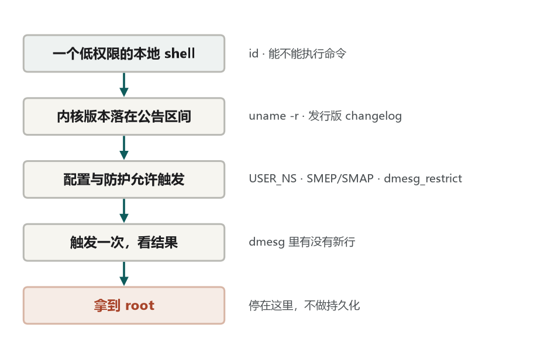
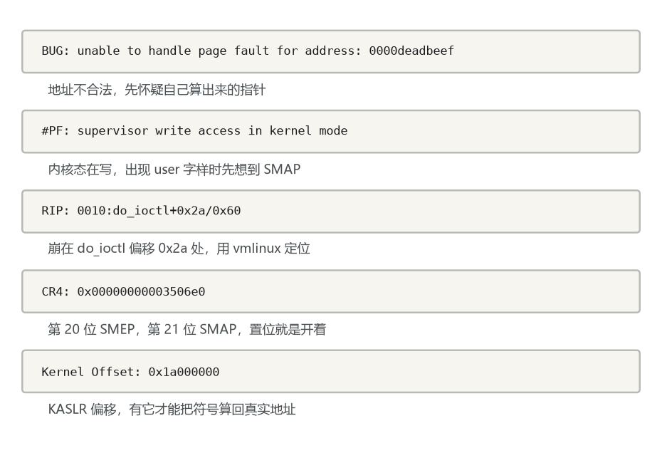

# 第十章　内核提权实战

拿到一个只读的低权限 shell，看一眼 `id`，发现自己是 `www-data`。接下来的路有很多条，内核提权是其中最直接也最粗暴的一条，因为一旦成功，它不依赖任何配置错误，只依赖内核自己写错了。

这条路的前提比想象中苛刻。内核版本要落在某个漏洞的区间里，相关的编译选项要开着，防护机制要恰好没挡住那一步。同一台机器上，别人三条命令就上去了，你折腾两天没有进展，差别往往就在这些前提上。

关于边界，先说清楚。这一章所有的内容都在自己的虚拟机上做，靶机是自己装的系统，快照随时能回滚。对不属于自己的机器做同样的事，性质完全变了，法律上没有任何模糊空间。内核漏洞的特点是它影响整台机器上所有进程，一次失败的尝试可能直接把系统打死，所以"在自己的环境里做"不是谨慎，是前提。

## 10.1 先确认三件事

动手之前先回答三个问题。内核是什么版本，相关功能开没开，我现在在什么位置。

版本要精确到发行版的构建号，不能只看主版本。

```bash
uname -r
cat /proc/version
```

`5.13.0-30-generic` 这样的字符串里，`5.13.0` 是上游版本，`-30-generic` 是发行版自己的修订。漏洞公告按上游版本说话，发行版会把补丁回移，所以两个 `5.13.0` 可能一个有事一个没事。判断方法是查发行版的 changelog，看目标版本对应的条目里有没有这个补丁。

配置在 `/boot/config-$(uname -r)` 里，那是一份完整的编译选项清单。

```bash
grep -E "CONFIG_USER_NS|CONFIG_MODULE_SIG|CONFIG_BPF_UNPRIV" \
  /boot/config-$(uname -r)
```

`CONFIG_USER_NS` 决定普通用户能不能创建 user namespace。这条打开的时候，很多利用的门槛会被拉低，因为在一个新的 user namespace 里，你会被当成有 `CAP_SYS_ADMIN`。`CONFIG_MODULE_SIG_FORCE` 决定内核模块是否强制验签，开了它，自己编译的模块就装不上。

运行时的开关在 `/proc/sys` 下面，和编译选项是两回事。

```bash
cat /proc/sys/kernel/kptr_restrict
cat /proc/sys/kernel/dmesg_restrict
cat /proc/sys/kernel/unprivileged_bpf_disabled
```

`kptr_restrict` 为 1 时，`/proc/kallsyms` 里的地址对普通用户显示成全零；为 2 时连 root 都要受限。`dmesg_restrict` 为 1 时，普通用户读不到内核日志。这两个开关直接决定你有没有办法拿到符号地址、能不能看到崩溃信息。做实验时把它们调成 0 方便观察，做完记得改回去。

位置指的是你在不在容器里。容器里的 root 和宿主机的 root 不是一回事。

```bash
cat /proc/1/cgroup | head -3
ls -la /.dockerenv 2>/dev/null
capsh --print | head -5
```

`/proc/1/cgroup` 里出现 `docker` 或 `kubepods` 这类字样，基本可以确定在容器里。`capsh --print` 会列出当前进程的能力集，容器默认会砍掉一大半。在容器里打内核漏洞，就算打成功了，拿到的也只是容器里的 root，跳出容器是另一件事。

这三件事看完，还要做一个判断，要不要走内核这条路。提权的思路有很多条，内核漏洞是成本最高、风险最大的一条，它应该在别的路都堵死之后才被考虑。先花五分钟看几眼配置，常常能省下两天时间。

```bash
sudo -l
find / -perm -4000 -type f 2>/dev/null
find / -writable -name "*.service" 2>/dev/null
```

`sudo -l` 列出当前用户能免密执行的命令，一个配错的 `sudo` 规则比内核漏洞好打得多。SUID 列表里每一个名字都值得搜一下，尤其是自己编的小工具。可写的服务配置文件意味着你能让 root 帮你执行命令，也不需要碰内核。这三条都比内核漏洞便宜，先把它们排除掉。

## 10.2 选一个漏洞

<figure>

<figcaption>图 10-1　内核提权的五个阶段。每一阶段都是一个可以停下来的判断点，任何一步不满足就换下一个思路，而不是把同一条路再试一遍。</figcaption>
</figure>

选漏洞的标准有三条。有公开的技术分析，影响版本区间明确，触发条件在你的环境里能满足。没有分析的漏洞不要碰，你会在某个莫名其妙的崩溃上耗掉一周。

这一章用 Dirty Pipe 做例子，编号 CVE-2022-0847。它由 Max Kellermann 在 2022 年 3 月公开，影响 Linux 5.8 及以后的版本，在 5.16.11、5.15.25、5.10.102 三个版本里修复。5.8 之前没有这个问题，因为相关代码是 5.8 引入的。

它的原理不复杂。管道（pipe）在内核里是一串 `pipe_buffer` 结构，每个结构描述一段数据，其中有一个 `flags` 字段。管道的写入有一个优化，如果新写入的数据和上一段数据在同一个页里、且那个页允许合并，内核就直接追加，不再新开一个 buffer。这个优化的判据是 `PIPE_BUF_FLAG_CAN_MERGE`。

问题在于，5.8 的一次重构之后，有两处代码在建立 `pipe_buffer` 时没有初始化 `flags`。它沿用上一个使用者的值。如果一个 buffer 之前被标记过可合并，被回收再分配给一段指向文件页缓存的数据，那个"可合并"的标记还在。

于是出现了一条不该存在的路径。管道里的一段数据本来只是引用某个文件的页缓存，是只读的；因为标记还在，一次 `write` 把数据合并进去了，写的是页缓存。

```c
int p[2];
pipe(p);
char buf[4096];
for (int i = 0; i < 16; i++) write(p[1], buf, sizeof(buf));
for (int i = 0; i < 16; i++) read(p[0], buf, sizeof(buf));

int fd = open("/tmp/target", O_RDONLY);
loff_t off = 1;                 /* 目标偏移减一 */
splice(fd, &off, p[1], NULL, 1, 0);
write(p[1], "PWN", 3);          /* 写进的是页缓存 */
```

先用一次写满再排空，把每个 buffer 的 `flags` 都设成可合并。然后 `splice` 从文件里搬一个字节进管道，这个字节所在的页被挂进了管道，但它仍然是只读的页缓存。最后 `write` 三个字节，因为可合并标记还在，内核直接把它追加在那个字节后面。

几个约束要知道。写入的起点不能是页边界，也就是偏移不能是 4096 的倍数，因为 `splice` 要先搬一个字节，那个字节必须在同一页里。写入不能跨页。文件长度不会变，只能覆盖已有内容。目标文件必须可读，哪怕它不可写、挂在只读文件系统上。

最后一个性质很有意思。写进去的数据进了页缓存，但那一页没有被标记为脏，所以它不会被写回磁盘。文件在内存里的内容变了，磁盘上的没变。

## 10.3 在自己的机器上复现

环境用一台快照干净的虚拟机，Ubuntu 21.10 的内核是 5.13，正好在受影响区间里。先把快照拍下来，这一步比后面所有步骤都重要。

装编译工具，把上面那段代码补成完整程序。

```bash
sudo apt install -y build-essential
gcc -O2 -o dirtypipe dirtypipe.c
```

靶文件用一个拷贝，不要拿系统文件试。

```bash
cp /etc/hostname /tmp/target
chmod 444 /tmp/target
```

运行之前先记下三样东西，文件的哈希、修改时间、以及 `strings` 出来的内容。

```bash
sha256sum /tmp/target; stat -c '%y %s' /tmp/target; cat /tmp/target
```

跑完之后再记一遍。内容变了，哈希变了，而 `stat` 里的修改时间没变，大小也没变。这个组合就是最好的证据，它同时说明了三件事。写入成功，写的是内存里的页，磁盘上的文件没被改。

想看磁盘上那一份有没有变，最省事的办法是重启。重启之后 `cat /tmp/target`，内容回到原样，因为页缓存被丢掉了。不想重启也可以把这块文件系统重新挂一次，效果一样。

这个现象本身值得停一下。同一条漏洞，用在只读文件上是"改内容"，用在可执行文件上是"改代码"。公开分析里提到的那条提权路径，是把 SUID 程序的几个字节改成一小段 shellcode，之后任何用户执行它都会得到一个 root 权限的进程。具体怎么改这里不写，那种东西一旦写全，就变成了一把直接能用的钥匙。

还有一个更干净的验证方式，不需要重启。另开一个终端，用另一个用户去读同一个文件。

```bash
sudo -u nobody cat /tmp/target
```

看到的也是新内容。两个毫无关系的进程看到同一份修改，说明改的既不是某个进程私有的内存，也不是磁盘，而是它们共享的那一层，页缓存。这条推论比任何日志都有说服力，因为它把"写成功了"和"写到哪儿了"分开了。

复现完把页缓存丢掉，文件就回来了。

```bash
echo 3 | sudo tee /proc/sys/vm/drop_caches
```

这个动作只对当前这台机器有意义，它清理的是实验状态，不是证据。

## 10.4 编译与加载的坑

很多人第一次尝试内核提权，是写一个模块加载进去。这条路有个逻辑问题，`insmod` 本身就需要 root 权限。

几处容易踩的地方还是记一下，因为调试内核代码时都会遇到。

编译用的内核头文件必须和运行的内核完全一致，版本号差一位就装不上。

```bash
sudo apt install linux-headers-$(uname -r)
make -C /lib/modules/$(uname -r)/build M=$PWD modules
```

`make` 的 `-C` 指向内核源码树，`M=` 指向你的模块目录，两者都对才能编译出匹配的 `.ko`。

签名是第二道坎。`CONFIG_MODULE_SIG_FORCE=y` 的时候，未签名的模块会被内核直接拒绝，日志里写的是 `module verification failed`。这个选项在主流发行版上默认是开的，所以自己编译的模块基本装不进去。`.ko` 里要带一个内核信任的签名，而签名要私钥，私钥在发行版手里。

第三道坎是符号。模块里调用内核函数，走的是 `EXPORT_SYMBOL` 导出的符号表，没导出的函数拿不到。老版本的 `kallsyms_lookup_name` 是导出的，后来取消了导出，很多老教程里直接调它的代码在新内核上编译不过。

容器里做这些更没意义。容器里没有 `CAP_SYS_MODULE`，模块加载不了。容器里的内核漏洞利用，要么是攻击宿主的内核（版本由宿主机决定，不由镜像决定），要么是利用 namespace 和 cgroup 的配置缺陷，两者完全不是一回事。

真正在实战里用得上的"不靠模块"的路，是 eBPF 和 user namespace。两者都是内核提供的合法接口，出问题的地方在于权限检查写错了，或者某个辅助函数（helper）能做的事超出了它该做的范围。这类漏洞的利用形态和传统的内核堆溢出完全不同，它不需要把机器打崩，只需要让一个普通用户完成一次本不该被允许的加载。

编译环境也要一致。在宿主机上编译再拷进虚拟机，很容易拿错头文件，表现是模块能编出来但一加载就报 `invalid module format`。最省事的做法是在靶机里装 `build-essential` 和对应的 `linux-headers`，编译和运行在同一个环境里。虚拟机快照一发，环境脏了就回滚，比修环境快。

## 10.5 失败时看内核日志

<figure>

<figcaption>图 10-2　一次内核崩溃在日志里留下的五行信息。地址、访问类型、崩溃位置、控制寄存器、KASLR 偏移，每一行对应一个具体的排查方向。</figcaption>
</figure>

内核崩溃不会给你段错误提示。进程直接消失，屏幕上什么都没有，唯一的信息在 `dmesg` 里。

`dmesg_restrict` 为 1 的时候读不到，做实验时先调成 0。

```bash
sudo sysctl -w kernel.dmesg_restrict=0
dmesg | tail -40
```

图上那五行是最常见的组合。

第一行给出出错地址。如果这个地址长得像 `0x00000000deadbeef` 或者一串重复字节，说明你传进去的指针本身是垃圾，问题在计算，不在触发。

第二行是访问类型。`supervisor write access` 表示内核态在写，`user` 表示它在访问用户空间。出现 `user` 的时候要想到 SMAP，内核默认不能直接读写用户内存，除非用专门的函数包一层。

第三行是崩溃位置，`RIP: 0010:do_ioctl+0x2a/0x60` 的意思是崩在 `do_ioctl` 这个符号往后 `0x2a` 字节处，而这个函数总长 `0x60`。有 `vmlinux` 的话，`gdb vmlinux` 之后 `disassemble do_ioctl` 就能看到那一行指令。没有符号文件的时候，这一步只能猜。

第四行是 `CR4`，它记录着几个关键开关。第 20 位是 SMEP，禁止内核执行用户空间的代码；第 21 位是 SMAP，禁止内核访问用户空间的数据。两个位都置起来，说明这两道防护是开的。`0x3506e0` 这样的值拆开看，`0x100000` 和 `0x200000` 都在里面。

第五行是 KASLR 的偏移。有这一行，你能算出内核真实的加载地址；没有这一行，说明 `dmesg_restrict` 拦住了，或者配置里关掉了输出。

想要把 `do_ioctl+0x2a` 变成一个行号，需要一份带调试信息的内核。发行版提供单独的包。

排查的顺序按这个来。先确认崩没崩、崩在哪个符号；再确认地址是不是合法；再看是不是被 SMEP 或 SMAP 挡住；最后才怀疑竞态。竞态类的漏洞最难，因为失败和成功的区别可能只是几微秒的时序，表现上却和"完全没触发"一样。

有一点要习惯。内核崩溃之后，那台机器就没法继续用了，所有没保存的东西都丢了。所以每一次尝试之前都要有快照，或者至少把关键文件备份出来。这个习惯在虚拟机里养成，比在真机上付出代价便宜得多。

```bash
sudo apt install linux-image-$(uname -r)-dbgsym
```

装完之后 `vmlinux` 在 `/usr/lib/debug/boot/` 下面，拿 gdb 打开它，`list *(do_ioctl+0x2a)` 就能看到对应的源码行。这一步的价值在于，它把"崩在某条指令"变成了"崩在某个判断上"，而后者才是你要改的地方。没有调试包时，退一步用 `/proc/kallsyms` 里的符号地址手算偏移，精度差一些，但够用来判断是不是同一个函数。

## 10.6 拿到 root 之后该停在哪

`id` 输出里出现 `uid=0(root)`，到此为止。

这句话不是道德说教，是技术边界。再往后做任何一件事，都会改变这台机器的状态，而改变状态在授权测试里是最需要谨慎的动作。

具体说三件不该做的事。不要装后门，不管是一个监听端口、一个 SUID 的 shell、还是一个改过的 `sudo`。不要改认证相关的文件，`/etc/shadow`、`/etc/sudoers`、SSH 的 `authorized_keys` 都算。不要试图维持访问，定时任务、服务、内核模块、启动脚本，这四样是持久化的四条路，一条都不要碰。

理由是取证。一台被改过的机器，事后很难说清哪些改动是你做的、哪些是别人做的。你留下了 root，等于在所有日志里都留下了自己的痕迹，而这些痕迹和你想要证明的那件事没有关系。

该做的事很少。截一张 `id` 的输出，记下时间和主机名，把上传上去的 exp 删掉，把改过权限的文件改回去。

```bash
rm -f /tmp/exp /tmp/target
```

如果动过系统文件，用快照回滚，不要手工恢复。手工恢复总会漏一处，而漏掉的那一处可能在几个月后才发作。

报告里写什么。写清路径，从哪个权限开始，经过哪个漏洞，到哪个权限结束。写清前提，内核版本、相关配置、需要的本地权限、有没有竞态。写清影响面，这个漏洞在这台机器上能被谁触发，触发之后能碰到什么。最后写修复，升级到哪个版本，或者关掉哪个开关。

内核提权在整条链路上通常是最后一步，也是最响的一步。它的价值在于证明"这台机器上的低权限账号等于 root"，而不在于你真的用它做了什么。把这句话说清楚，比拿到 root 本身更难，也更有用。

到这里，单机上的攻击面基本走完了一遍。再往上就是网络和身份，那是另一个尺度的战场。
