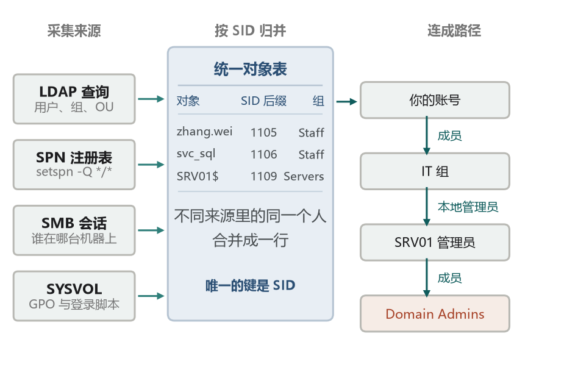
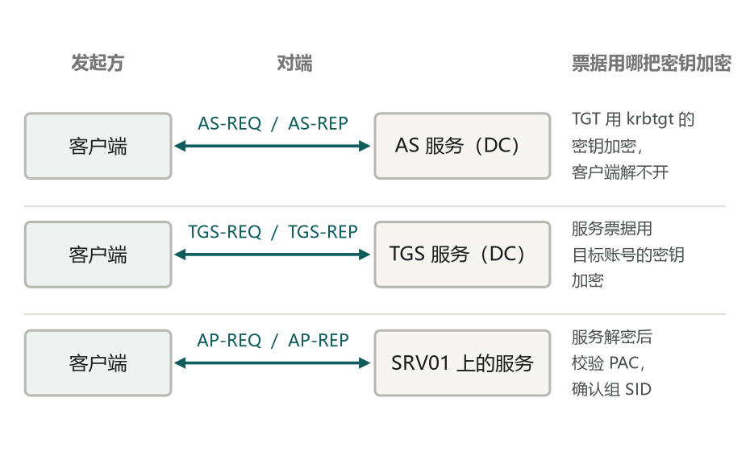

# 第十一章　Windows 与 Active Directory 入门

测试范围给的是一个域账号，`zhang.wei`，密码是入职邮件里发的初始口令。没有可打的 Web 漏洞，没有暴露在外网的端口，唯一能用的东西就是这一次登录办公网的机会。

三个小时之后，屏幕上是一张某工具画出来的关系图，三百多个节点，五条从 `zhang.wei` 出发的路径，最长的一条七跳，终点写着 `DOMAIN ADMINS`。这五条路没有一条需要内存破坏，没有一条需要写 exploit，它们全部是域里本来就存在的委托关系。

找路之前得先知道路是怎么铺的。这一章讲域这套系统的零件，以及零件之间默认就连着的线。下一章讲这些线里哪些是配置留下的缝。

## 11.1 域解决的是什么问题

一百台 Windows 机器，如果各自独立管理，会发生什么。

每台机器上有一个本地账号数据库，叫 SAM。给新员工开账号，要在十台机器上各建一次；员工离职，要在十台机器上各删一次。改一次密码策略，得挨个改注册表。更麻烦的是权限，文件服务器上给某个人开一个目录，得在服务器上再建一遍这个人的账号，两边靠人工保证对得上。

这就是工作组（workgroup）模型。它在十台机器以内勉强能用，超过就变成了纯人力成本。

域（domain）把这个数据库搬到一台专门的服务器上，所有机器都去那里问"这个人是谁、他能做什么"。这台服务器叫域控制器（domain controller，DC），上面跑的目录服务叫 Active Directory Domain Services（AD DS）。

AD DS 本身是一个 LDAP 目录。LDAP 是一套树形结构的数据库协议，每个节点叫对象（object），用可分辨名称（distinguished name，DN）标识，写成 `CN=Zhang Wei,OU=Staff,DC=lab,DC=local` 这种从下往上的形式。对象有属性，用户有 `sAMAccountName` 和 `mail`，计算机有 `dNSHostName`，组有 `member`。攻击者关心的几乎全部信息都在这棵树里，而默认情况下，任何通过认证的域用户都能读这棵树的大部分内容。

除了 LDAP，DC 还提供另外三样东西。Kerberos 认证服务，端口 88，这是域内认证的主干。SMB 文件共享，端口 445，其中 `SYSVOL` 和 `NETLOGON` 两个共享对全体域用户可读，组策略文件就放在里面。DNS，域和 DNS 是绑在一起的，客户端靠 SRV 记录找 DC。

树上的节点分两类，容器和叶子。

组织单位（organizational unit，OU）是最常用的容器。它有两个用途，一是把管理权限切块下放，让人事的同事只能重置人事部门的账号；二是挂组策略。OU 不是安全边界，这一点经常被误解。把两个部门放进同一个 OU 不会让它们能互相访问，把两个部门分开也不会让它们隔离，隔离靠的是权限和网络，不是目录结构。

组（group）才是权限的载体。AD 里有三种组作用域，全局组、域本地组、通用组。实际用起来最常见的是全局组，例如 `Domain Admins`、`Domain Users`，它们被放进各台机器本地的 `Administrators` 组，于是组里的人在那些机器上就是管理员。这个"组套组"的结构，是后面找路径时最重要的一类边。

组策略对象（Group Policy Object，GPO）是配置的分发机制。一条 GPO 链接到站点、域或者 OU 上，作用范围内的机器和用户在开机或登录时拉取并应用。GPO 能干的事情非常多，改注册表、装软件、改本地管理员组成员、下发登录脚本。它对攻击者的价值在于两点，一是所有域用户都能读到 GPO 的内容，包括里面可能写着的本地管理员口令；二是能改 GPO 的人等于能在一批机器上执行任意配置。

每个安全主体都有一个安全标识符（security identifier，SID），格式是 `S-1-5-21-<域标识>-<相对标识符>`。相对标识符（RID）是固定的几个数字，500 是内置 Administrator，502 是 `krbtgt`，512 是 `Domain Admins`，513 是 `Domain Users`，515 是 `Domain Computers`，519 是 `Enterprise Admins`。记这几个值有实际用处，因为很多判断要直接看 SID 而不是看名字，而名字是可以改的，SID 改不了。

## 11.2 搭一个最小域环境

真正的域环境动辄几千个对象，掺杂着十年的历史遗留配置。要在里面验证一个判断，成本极高。自己搭一个三台机器的域，反而更快。

需要的角色是这样分配的。一台 Windows Server，2019 或 2022 都行，官方提供 180 天的评估版，装完打上补丁。一台 Windows 10 或 11 当客户端，用来观察"普通域用户看到的域是什么样"。再加一台 Linux 当攻击机，放在同一个虚拟网络里。宿主上创建一块仅主机（host-only）或者内部网络（internal network）的虚拟网卡，三台机器都挂在这块网卡上，不给它们任何通往真实网络的路由。

这一步是硬要求。域环境里跑的漏洞利用、票据伪造、凭据抓取，任何一样漏到真实网络里都不是实验。

装 DC 的顺序是固定的。先设静态 IP，然后把网卡的 DNS 指向自己，`10.10.10.10`。装 AD DS 角色，提升为林根域，域名用 `lab.local`。提升过程中会要求设一个目录服务还原模式口令，记住它，后面恢复域要用。重启之后，用域管理员登录，DC 上会自动出现 `SYSVOL` 和 `NTDS` 两个目录，`C:\Windows\NTDS\ntds.dit` 就是那个装着所有账号哈希的数据库文件。

客户端加域之前，必须把它的 DNS 改成 DC 的地址。这一步错了会出现很典型的症状，提示"找不到网络路径"或者"无法联系域控制器"。原因不是网络不通，是客户端在 DNS 里查不到 DC 注册的 SRV 记录。手工验证一下。

```bash
nslookup -type=SRV _ldap._tcp.dc._msdcs.lab.local
```

返回里应该能看到 DC 的主机名和 389 端口。看不到就说明 DNS 配置有问题，先去修 DNS，不要继续往下试。

加域成功之后有一个坑等着。虚拟机挂起再恢复，时钟会漂移，而 Kerberos 默认只容忍五分钟的偏差。偏差超了会出现一个很迷惑的现象，口令明明是对的，登录却失败，事件日志里写 `KDC_ERR_SKEW`。把三台机器都指向同一个时间源，或者干脆在实验前手动对一次时。

环境搭好后往里放几个对象，后面每一章都要用。

```powershell
New-ADOrganizationalUnit -Name "Staff" -Path "DC=lab,DC=local"
New-ADOrganizationalUnit -Name "Servers" -Path "DC=lab,DC=local"
New-ADUser -Name "Zhang Wei" -SamAccountName "zhang.wei" `
  -Path "OU=Staff,DC=lab,DC=local" -AccountPassword (ConvertTo-SecureString "Passw0rd2026" -AsPlainText -Force) -Enabled $true
New-ADUser -Name "svc_sql" -SamAccountName "svc_sql" `
  -Path "OU=Staff,DC=lab,DC=local" -AccountPassword (ConvertTo-SecureString "Sql@2026" -AsPlainText -Force) -Enabled $true
Set-ADUser svc_sql -ServicePrincipalNames @{Add="MSSQLSvc/srv01.lab.local:1433"}
```

最后那条命令给服务账号挂了一个 SPN，它的作用在 11.5 节会看到。装完立刻打一个快照，命名成"干净域"。以后每次实验结束就回滚，比手工清理痕迹可靠得多，也不会把上一轮的测试对象带到下一轮。

## 11.3 枚举的产出应该是一张表

网上讲枚举的文章，多半是一长串命令。敲完命令，屏幕上滚动几百行，然后呢。

枚举的目的不是"收集信息"，是回答具体问题。我现在这个账号，能读到哪些用户对象，哪些账号有 SPN，哪些机器上存着我的会话，我对哪些对象有写权限。每个问题对应一条查询，每条查询的结果要落到同一张表里，才能跟下一个问题的结果做连接。

内置命令够用一阵子。

```bash
net user /domain
net group "Domain Admins" /domain
net group /domain
nltest /dclist:lab.local
setspn -T lab.local -Q */*
```

`net user /domain` 列出所有用户，`net group /domain` 列出所有组，`setspn -Q */*` 把所有注册了 SPN 的账号打出来。这三条命令的输出可以直接拼成第一版资产表，字段是对象名、类型、所属组、SPN。

要往下走就得用 LDAP 查询。命令行工具 `dsquery` 太笨，直接写过滤器更快。

```bash
ldapsearch -x -H ldap://10.10.10.10 -D "zhang.wei@lab.local" -w 'Passw0rd2026' \
  -b "DC=lab,DC=local" "(&(objectCategory=person)(objectClass=user)(adminCount=1))" \
  sAMAccountName memberOf
```

`adminCount=1` 这个属性值得单独说。它是 `AdminSDHolder` 机制的副产物。任何进入过特权组的账号，会被一个叫 SDProp 的后台任务每小时刷一次权限，同时打上 `adminCount=1`。关键在后半句，账号被移出特权组之后，这个标记不会自动清零，权限继承也不会自动恢复。所以查 `adminCount=1` 能找到两类人，现在的管理员和曾经的管理员。后者往往还留着当时配的强口令和遗留的委派关系，是很好的起点，同时也是误报的主要来源。

命令行的上限很快就到了。要看"谁能登录哪台机器""谁的会话在哪台服务器上"，得靠专门工具。PowerView 是一组 PowerShell 函数，`Get-NetUser`、`Get-NetGroupMember`、`Find-LocalAdminAccess`、`Get-NetSession`，把常见查询封成了对象。BloodHound 走得更远，它的采集器 SharpHound 把域里的对象和边collect 成 JSON，导入图数据库之后，可以直接问"从这个用户到 Domain Admins 的最短路径"。

图是这类工具真正的价值。列表告诉你域里有什么，图告诉你两条信息之间隔着几跳。

<figure>

<figcaption>图 11-1　域内枚举的信息汇聚。分散在 LDAP、SMB 会话、SPN 注册表和组策略文件里的四类事实，需要按 SID 归并到同一张对象表，才能在图上连成路径。</figcaption>
</figure>

按 SID 归并是这里唯一的技术要点。用户名可以重名，可以改，显示名可以伪造，SID 是域内唯一且不可变的。所有采集结果在入库前都换算成 SID，后面的连接才不会错。

## 11.4 Kerberos 的三条消息

域内认证的主干是 Kerberos，来自 MIT 的 Athena 项目，八十年代的设计，一直用到现在。它的核心思想是"票据"，谁也不直接相信对方的口令，大家都相信一个第三方，也就是 KDC。

KDC 在域里就是 DC，逻辑上分成两个服务。AS（Authentication Service）负责发第一张票，TGS（Ticket Granting Service）负责发后面的票。参与认证的密钥有三种，用户的密钥由口令派生，KDC 有一个叫 `krbtgt` 的账号，它的密钥用来加密所有 TGT，每个服务账号有自己的密钥。

第一条消息是 AS-REQ 和 AS-REP。客户端先把自己的当前时间用口令派生的密钥加密，放进 AS-REQ 里发出去，这叫预认证（pre-authentication）。KDC 用自己的副本解密，解开了就证明对方知道口令。然后 KDC 返回 AS-REP，里面有两块东西，一块是票据授予票据（Ticket Granting Ticket，TGT），用 `krbtgt` 的密钥加密，客户端解不开，只能原样保存；另一块是会话密钥，用客户端密钥加密，客户端能解开。

第二条消息是 TGS-REQ 和 TGS-REP。客户端要访问某个服务，就把 TGT 和那个服务的 SPN 一起发给 KDC。KDC 用 `krbtgt` 解开 TGT，检查里面的特权属性证书（Privilege Attribute Certificate，PAC），PAC 里装着这个用户的组 SID 列表。然后 KDC 签发服务票据，用目标服务账号的密钥加密，连同一个新的会话密钥一起返回。客户端同样解不开服务票据，只能转交。

第三条消息是 AP-REQ 和 AP-REP。客户端把服务票据交给服务，服务用自己的密钥解开，读到 PAC 和会话密钥，认证完成。AP-REP 是可选的，用于双向认证，让客户端确认对面确实是那个服务。

<figure>

<figcaption>图 11-2　Kerberos 的三次交换。每一段加密用哪把密钥决定了谁能读到票据内容，这也是后面票据伪造与离线破解的出发点。</figcaption>
</figure>

这三条消息里藏着一个很要紧的推论。票据的安全性完全依赖加密密钥的私密性，而密钥的持有者只有两方，KDC 和目标服务。任何能让 KDC 签发一张"发给某个服务"的票据的人，都能拿到一段用那个服务的密钥加密的密文。密文本身没用，但如果服务账号的口令很弱，它就可以被离线爆破。这就是下一节的内容。

## 11.5 两种 roasting

Kerberoasting 和 AS-REP roasting 是同一件事的两个变体。都是合法的认证请求，都拿回一段用别人密钥加密的数据，然后在自己的机器上慢慢破。

Kerberoasting 的前提只有一条，任何通过认证的域用户，默认可以给任意 SPN 请求服务票据，不需要对这个服务有任何访问权限。KDC 不会检查"你有没有资格用这个服务"，它只检查"你是不是域用户"。于是随便一个普通账号，就能把域里所有 SPN 对应的服务票据全部拉下来。

票据用服务账号的口令派生密钥加密。如果协商到的是 RC4（etype 23），密钥就是那个账号的 NT 哈希，爆破速度极快。如果是 AES，成本高一个量级，但服务账号往往设了"密码永不过期"，十年没换过，弱口令的比例比普通用户高得多。

在自己域里跑一遍。

```bash
python3 GetUserSPNs.py lab.local/zhang.wei:'Passw0rd2026' -dc-ip 10.10.10.10 -request
```

输出是 hashcat 能直接吃的格式，模式 13100。`svc_sql` 的口令是 `Sql@2026`，字典里几秒钟就出来了。整个过程在目标上留下的痕迹，只有一条 4769 事件，和一次正常的服务访问没有区别。

AS-REP roasting 的前提不同，目标账号必须关掉了"要求 Kerberos 预认证"这个选项，属性标志是 `UF_DONT_REQUIRE_PREAUTH`。关掉之后，任何人只要知道账号名，就能拿到一张 AS-REP，里面有一段用该账号密钥加密的数据，不需要知道口令。爆破模式是 18200。

```bash
python3 GetNPUsers.py lab.local/ -dc-ip 10.10.10.10 -usersfile users.txt -format hashcat
```

这两种技术之所以流行，是因为门槛和收益的比例太离谱。不写代码，不碰目标主机，不需要任何特权，产生的流量全是合法的 Kerberos 请求。代价也很明确，成败完全取决于口令强度，而且一旦域里禁用了 RC4，爆破成本会上升几个数量级。

防守方的应对是釜底抽薪。服务账号改用组托管服务账号（group Managed Service Account，gMSA），口令是 240 个字符的随机串，每 30 天自动轮换，拿到的票据永远破不开。域功能级别调高，禁用 RC4。这两条做完，Kerberoasting 就从"稳赚"变成了"白费力气"。

## 11.6 口令喷洒的边界

如果不想爆破，还有另一条路，猜。

常规的爆破是一个账号试很多口令，这种打法在现代域里活不过十分钟，因为账户锁定策略会盯着单个账号的失败次数。反过来做就绕开了这个限制，用一个口令去试很多账号，每个账号只失败一两次。这叫口令喷洒（password spraying）。

能不能做，做多大，完全由策略决定。先读策略再动手。

```bash
net accounts /domain
```

输出里有三个数字要记住，锁定阈值（Lockout threshold）、锁定时长（Lockout duration）、观察窗口（Lockout observation window）。如果阈值是 5，观察窗口 30 分钟，那么每个账号在半小时内最多试 4 次。这个数字直接决定了节拍，也决定了这件事在时间上值不值得做。

有个细节容易忽略，`badPwdCount` 是持久化的，会跨会话累积。你今天试了 3 次，明天在观察窗口内再来 2 次，一样会锁。做这种事必须自己记账。

口令的选择有讲究。真实世界泄露的口令里，占比最高的是"季节 + 公司名 + 年份 + 一个符号"，`Spring2026!` 这一类。公司的名字写在官网上，季节和年份是常识，于是这种口令的实际强度接近于零。在自己域里放几个这样的账号，用来验证检测规则是否有效，比凭空想象攻击者的行为有用。

检测这一块，单条日志基本没有意义。

| 事件 ID | 含义 | 有用的特征 |
| --- | --- | --- |
| 4625 | 登录失败 | 子状态 `0xC000006A` 表示口令错 |
| 4771 | Kerberos 预认证失败 | 失败码 `0x18` 表示口令错 |
| 4740 | 账号被锁定 | 爆破打穿锁定阈值的直接证据 |
| 4768 | TGT 请求成功 | 与前面的失败来自同一源，才是信号 |

有用的不是数量，是分布。同一个源地址在十分钟内对四十个账号各失败一次，这是喷洒；同一个源对同一个账号失败四十次，这是爆破，而且多半已经被锁了。阈值型规则在这种场景下几乎必然失效，因为域里天然的 4625 噪音量极大，过期口令、映射的旧凭据、扫描器，每天都在往里灌数据。按"源地址 × 不同账号数"做聚合，才有干净的信号。

真正决定成败的是最后那一下。失败只是过程，成功才是结果，一条 4624 类型 3 的登录，来自一台平时不出现的工作站，紧跟在几十条 4771 之后，这条才是要抓的东西。

## 11.7 一次 LDAP 查询的完整往返

`ldapsearch` 一行命令背后是一串可以拆开看的报文。拆开看的好处是，查询返回的东西不对时，能分清是哪个环节出了问题。

连接建立后第一件事是绑定。`-x` 指定简单绑定（simple bind），`-D` 给绑定 DN，`-w` 给口令。简单绑定把口令明文放进 `bindRequest` 的 `simple` 字段，在 389 上是明文，在 636 上才进 TLS。域控对这个行为有开关，`dSHeuristics` 里的 `LDAPServerIntegrity` 为 2 时拒绝无保护的简单绑定，此时同一条命令会返回 `strong(er) authentication required`。

绑定失败的错误码是固定的，记住几个能省很多时间。

| 返回码 | 附加信息 | 含义 |
| --- | --- | --- |
| 49 | `52e` | 口令错 |
| 49 | `532` | 口令过期 |
| 49 | `525` | 账号不存在 |
| 49 | `775` | 账号被锁定 |
| 49 | `533` | 账号被禁用 |
| 8 | 无 | 需要更强认证方式 |

绑定成功之后是搜索。搜索请求里有五个字段决定返回什么，基准 DN、范围、过滤器、要哪些属性、大小限制。范围有三个取值，`base` 只查当前节点，`one` 查直接子节点，`sub` 查整棵子树。日常枚举几乎全是 `sub`，但 `base` 有一个必不可少的用途，查 `RootDSE`。

```bash
ldapsearch -x -H ldap://10.10.10.10 -s base -b "" "(objectClass=*)" \
  defaultNamingContext dnsHostName supportedControl
```

`-b ""`（空基准）加 `-s base`，拿到的是目录服务器自身的属性。`defaultNamingContext` 告诉你根域 DN 是什么，`dnsHostName` 确认对面是哪台机器，`supportedControl` 里应该有 `1.2.840.113556.1.4.319`。没有这一条，说明对面不是 AD，不用再往下试。手工测试一条路径之前先跑这一句，比直接查询快得多。

过滤器语法里有几个细节会直接影响结果的数量。

```bash
ldapsearch -x -H ldap://10.10.10.10 -D "zhang.wei@lab.local" -w 'Passw0rd2026' \
  -b "DC=lab,DC=local" \
  "(&(objectCategory=person)(objectClass=user)\
  (!(userAccountControl:1.2.840.113556.1.4.803:=2)))" \
  sAMAccountName
```

`1.2.840.113556.1.4.803` 是位与匹配规则，`userAccountControl:...:=2` 的含义是这个字段的第 2 位为 1，即 `ACCOUNTDISABLE`，前面加 `!` 就排除了禁用账号。没有这个条件，返回的用户列表里会混进一堆停用了几年的账号，后面算路径时全是噪音。`userAccountControl` 里几个常用的位值记一下，`2` 禁用，`512` 普通账号，`514` 禁用账号，`66048` 口令永不过期，`2097152` 不需要预认证，最后这个对应 11.5 节的 AS-REP roasting。

真正会卡住人的是数量上限。域控默认单次搜索最多返回 1000 条，超了直接报错，不是截断。

```text
result: 4 Size limit exceeded
```

看到这个返回码，第一反应不该是加 `-z` 参数。`-z` 设的是客户端自己的限制，撞上去的仍然是服务端的 `MaxPageSize`。正确的做法是分页控制。

```bash
ldapsearch -x -H ldap://10.10.10.10 -D "zhang.wei@lab.local" -w 'Passw0rd2026' \
  -b "DC=lab,DC=local" -E pr=500/noprompt "(objectClass=user)" sAMAccountName \
  | grep -c "^dn:"
```

`-E pr=500/noprompt` 启用分页，每页 500 条。`/noprompt` 让客户端自动翻页，不加的话会停下来等按键。数一下 `dn:` 的行数，就知道到底有多少个用户对象。这一步在判断"为什么我看到的只有一千个账号"时是必做的。

同一套限制也适用于写操作返回的引用。删除或修改一个跨域对象时，服务端会返回 `continuation reference`，工具不处理就会报 `referral`，看着像失败，实际改已经生效了。

输出格式两个参数值得固定下来，`-LLL` 去掉 LDIF 的注释和版本行，`-o ldif-wrap=no` 禁止超长行自动折行。不加后者，一条属性值超过 78 个字符就会被拆成多行，用 `grep` 逐行提字段时会漏，漏得还很隐蔽。

## 11.8 把采集结果落成一张表

枚举的输出不落成文件，第二轮就没法复用，也没法和别人的结果对齐。落文件的标准很简单，CSV 或者 JSON，表头固定，一行一个对象。

PowerShell 这条路最直接。

```powershell
$props = "sAMAccountName","objectSid","enabled","adminCount",
         "pwdLastSet","lastLogonTimestamp","servicePrincipalName","memberOf"
Get-ADUser -Filter * -Properties $props -Server dc01.lab.local |
  Select-Object $props |
  Export-Csv -NoTypeInformation -Encoding UTF8 users.csv
```

`-Properties $props` 不能省。默认只返回一小部分属性，SPN、`adminCount` 这些全在扩展属性里，不加就取不到，取不到的空列看起来像"域里没有"。反过来，`-Properties *` 会把几十个构造属性一起拉下来，在几千个对象的域里慢十倍以上，而且其中大部分字段永远用不到。

`objectSid` 导出到 CSV 会变成 `System.Security.Principal.SecurityIdentifier` 对象的字符串形式，最好当场转掉。

```powershell
Select-Object @{n='SID';e={$_.objectSid.Value}}, sAMAccountName
```

两边数据对齐的唯一键是 SID，不是用户名。中文环境里重名的概率不低，`cn` 与 `sAMAccountName` 也可能不一致，按名字做连接一定会丢行。

采集完成之后，用 SQLite 把几个文件装进去，查询就能随意组合。

```bash
sqlite3 lab.db <<'SQL'
.mode csv
.import users.csv users
.import groups.csv groups
.headers on
SQL
```

导入前还得处理 BOM。Windows PowerShell 5.1 的 `-Encoding UTF8` 写出的是带 BOM 的文件，`sqlite3` 导入后第一列列名会多出三个不可见字节，随后所有引用这列的语句都报错。改用 `-Encoding utf8NoBOM`（PowerShell 7），或者导入前用 `sed -i '1s/^\xEF\xBB\xBF//' users.csv` 去掉。

装好之后，"哪些启用中的账号对某个组有写权限"这种问题变成一句 SQL。

```sql
SELECT u.sAMAccountName, g.name, a.right
FROM aces a
JOIN users u ON u.SID = a.principal_sid
JOIN groups g ON g.SID = a.target_sid
WHERE u.enabled = 'True' AND a.right LIKE '%GenericAll%';
```

`aces` 这张表不在 `users.csv` 里，它来自 ACL 采集。BloodHound 的采集器把这类关系直接写成边，输出是一堆 JSON 文件，`users.json`、`groups.json`、`computers.json`、`ous.json`，以及若干带 `_acl` 后缀的文件。每条边的结构都一样，`ObjectIdentifier` 是目标，`Aces` 数组里每一项带 `PrincipalSID`、`RightName`、`IsInherited`。`IsInherited` 这个字段不能不看，继承来的权限在删掉父容器的 ACE 之前无法单独清除，也不能当作"这个对象的配置错误"去报。

采集范围也要显式指定，否则采集器会按默认集合跑，有些边根本不会产生。

```bash
SharpHound.exe -c Group,LocalAdmin,Session,ACL,ObjectProps,Trusts \
  --LDAPPort 389 --domain lab.local --domaincontroller 10.10.10.10
```

`Session` 这一项依赖目标机器上的会话查询，跨网段或者被防火墙挡住时会是空的。空不等于没有，只等于这一次没采到，报告里这两种情况要分开写。

`lastLogonTimestamp` 这个字段需要单独提醒。它是 64 位的 FILETIME 值，换算成时间要减 `116444736000000000` 再除 `10000000` 得到 Unix 秒。更关键的是它不在登录时实时写入，默认每 14 天同步一次，每次提前 0 到 5 天的随机量。因此用它判断"账号多久没登录"，精度只到两周，看到"九天前"和"三天前"实际可能差不多。要精确值只能逐台域控读 `lastLogon`，而那个属性不复制。写报告时把这两个属性的区别标清楚，比给一个看似精确的日期有用。

表建好之后，下一步是把表读成问题。一张有三千行、二十列的表看不出任何东西，而"有多少个启用账号对 OU 有写权限""有多少台机器的本地管理员组里有域用户""有多少个账号的 `pwdLastSet` 早于两年前"，这三个数字能直接决定往哪个方向走。

域给了攻击者两样东西，一张完整的地图和一个统一的认证入口。这两样东西单独看都不致命，合在一起就不同了。地图让攻击者知道往哪走，统一入口让一次口令猜中能在所有机器上复用。下一章就沿着这两条线往下走，看域里那些为了"方便管理"而设计的委托机制，是怎么变成一条通往域管的阶梯的。
