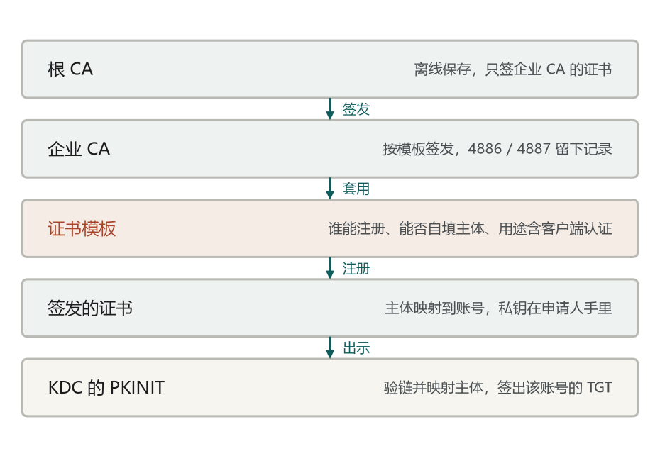
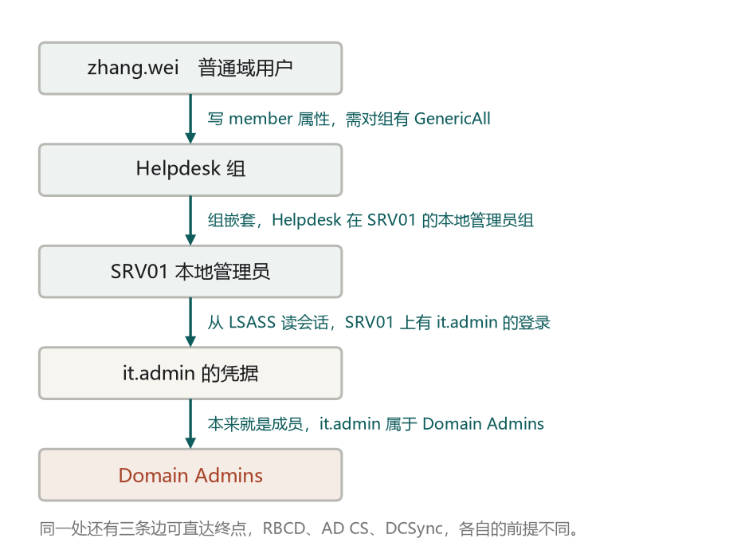

# 第十二章　AD 进阶：委派、ACL 与证书

上一章结束时手上有一张表，三百多个对象，五条通往 `Domain Admins` 的路径。这一章要回答的是，那些路径上的每一条边为什么存在，以及它们在什么条件下才算真的一条路。

这种区分很关键。BloodHound 画出来的边有两种，一种写着"理论上可以"，一种写着"现在就可以"。中间差的东西，有时候是一条注册表键，有时候是一个服务的运行身份，有时候是一台机器上有没有装某个组件。分不清这两者，就会在报告里写下一堆打不通的路径，然后被人一条一条否掉。

章末会回到那五条路上，看每一条的实际成本和被发现的概率。

## 12.1 ACL 与 ACE 的读法

Active Directory 里每个对象都挂着一个安全描述符。描述符里有两部分权限相关的列表，一个是 DACL（discretionary access control list），决定谁能做什么，另一个是 SACL，决定记录哪些访问。攻击者只关心 DACL。

DACL 是一串访问控制条目（access control entry，ACE）。一条 ACE 回答三个问题，谁、能做什么、作用范围多大。

"谁"是一个 SID，可以是用户、组，也可以是一个特殊的well-known SID，比如 `Everyone` 或者 `Authenticated Users`。

"能做什么"是一个 32 位访问掩码，加上可选的扩展权限 GUID。掩码里几个值要背下来，`GenericAll` 是 `0x10000000`，`GenericWrite` 是 `0x40000000`，`WriteDACL` 是 `0x00040000`，`WriteOwner` 是 `0x00080000`。前两个是"什么都能干"和"什么属性都能写"，后两个是"能改这张权限表本身"和"能改这个对象的主人"。

"作用范围"由继承标志和对象类型 GUID 决定。这是最容易读错的地方。同一条 ACE，如果带对象类型 GUID，它就只对某个属性或者某个扩展操作生效。`User-Force-Change-Password` 的 GUID 是 `00299570-246d-11d0-a768-00aa006e0529`，带这个 GUID 的 ACE 只允许重置口令，别的什么都做不了，但重置口令本身就够了。

图形界面的"完全控制"复选框会把这些细节全部藏起来。要看原始数据。

```powershell
dsacls "CN=Helpdesk,OU=Staff,DC=lab,DC=local"
Get-ObjectAcl -Identity "Helpdesk" -ResolveGUIDs | `
  Where-Object {$_.ActiveDirectoryRights -match "GenericAll|Write"}
```

`-ResolveGUIDs` 会把 GUID 翻译成人能读的属性名，不加这个参数看到的就是一堆十六进制。

哪些权限值得盯，取决于它落在什么类型的对象上。

| 落在什么对象上 | 有用的权限 | 能做什么 |
| --- | --- | --- |
| 用户 | `GenericAll`、`ForceChangePassword` | 改口令，不需要知道旧口令 |
| 组 | `GenericAll`、`WriteProperty member` | 把自己加进组 |
| 计算机 | `GenericAll`、写 `msDS-AllowedToActOnBehalfOfOtherIdentity` | 配 RBCD |
| 域对象 | `WriteDACL` | 给自己加复制权限，通向 DCSync |

读 DACL 还有两条规则会影响判断。拒绝 ACE 优先于允许 ACE，而且是在整个列表里全局优先，不是按先后顺序，一条针对组的拒绝会让通过组成员关系继承来的允许全部失效。继承来的 ACE 和直接挂上去的 ACE 在界面上长得一样，删的时候才会发现删不掉，因为它属于父容器。

还有一层容易被忽略。特权对象（`adminCount=1` 的那些）的 ACL 每小时会被 `AdminSDHolder` 覆盖一次。这意味着你在这类对象上加的权限活不过一小时，既不能当持久化用，做实验时也要注意别被这个机制误导，以为操作失败了。

## 12.2 委派的三种形态

委派（delegation）的初衷很朴素。用户访问一个 Web 应用，Web 应用要用这个用户的身份去读后端的数据库。应用手里没有用户的口令，怎么向后端证明"我是替张三来的"。

Kerberos 的答案是让 KDC 出一张写着"给张三用"的票据，再让这张票据可以被转交。三种委派形态的差别，就在于转交的范围和授权放在谁身上。

非约束委派（unconstrained delegation）最老也最危险。配置方式是给服务账号或计算机账号打上 `TRUSTED_FOR_DELEGATION` 标志，UAC 值 `0x80000`，界面上叫"信任此计算机来委派任何服务"。打上之后，用户访问这个服务时，服务票据里会额外带一份用户的 TGT。服务把它存进 LSASS，需要时可以拿出来访问域内任何服务。

后果是，谁拿下这台主机，谁就拿到了所有访问过它的用户的身份。域控天然带这个标志，所以以前有过"把域控的机器账号骗到我的主机上认证"这种打法。现代域里这条应该被彻底清零，除了 DC 之外不应该有任何账号带这个标志。

约束委派（constrained delegation）加了白名单。配置项是 `msDS-AllowedToDelegateTo`，里面列出这个服务可以代表用户去访问的目标 SPN。用户的服务票据里不再带 TGT，而是带一份"允许转交给谁"的说明，服务拿着它去 KDC 换目标服务的票，KDC 检查白名单。

这里面有两个子机制。S4U2Self 让服务在没有用户口令的情况下，为某个用户向自己申请一张服务票据，这叫协议转换（protocol transition），需要额外打 `TRUSTED_TO_AUTH_FOR_DELEGATION` 标志。S4U2Proxy 拿着这张票去换目标服务的票。

风险在于白名单的内容。如果白名单里写着 `ldap/dc01.lab.local`，那么这个服务就能以任意用户的身份对域控做 LDAP 操作，包括改权限。约束委派在配置上等价于"这个服务可以冒充任何人访问这几个目标"。

基于资源的约束委派（resource-based constrained delegation，RBCD）把授权方向反了过来。配置项是目标计算机对象上的 `msDS-AllowedToActOnBehalfOfOtherIdentity`，内容是一串 SID，表示"这些主体可以代表别人来访问我"。决定权在目标机器手里，不在发起方手里。

这个改动带来了一个很实际的后果。要给某台机器配 RBCD，只需要对那台机器的对象有写权限，不需要域管。而任何域用户默认可以在域里创建最多十台机器账号，这个额度由 `ms-DS-MachineAccountQuota` 控制，默认值是 10。

于是三样东西凑齐就能打。一个可控的、带 SPN 的主体（自己建的机器账号就够），对目标计算机对象的写权限，还有目标上允许 Kerberos 认证。三条都满足时，攻击者能以任意用户（包括域管）的身份访问那台机器。

判断一条 RBCD 的边是不是真的，要看三件事。写权限是否真的落在你手上（不是继承来的、被拒绝 ACE 挡掉的），目标的 `msDS-AllowedToActOnBehalfOfOtherIdentity` 是否可写（属性受保护时会失败），还有目标上是否有可用的服务（`cifs`、`http`、`host` 都行）。

## 12.3 强制认证与打印后台

有一类技术自己不给权限，只负责制造机会。

强制认证（coercion）是让一台机器主动向攻击者发起 NTLM 认证。做法都差不多，找到目标上的一个 RPC 接口，调用它，让它回连一个攻击者控制的地址。

打印后台（Print Spooler）是最有名的入口。`MS-RPRN` 协议里有个方法 `RpcRemoteFindFirstPrinterChangeNotificationEx`，作用是"打印机状态有变化时通知我这个地址"。传一个 UNC 路径进去，服务就会带着机器账号的凭据来连。

```bash
python3 printerbug.py lab.local/zhang.wei:'Passw0rd2026'@10.10.10.20 10.10.10.50
```

这条命令让 `10.10.10.20` 去连 `10.10.10.50` 的 445 端口。在 `10.10.10.50` 上抓包，能看到一个来自机器账号的 NTLM 协商。这就是全部效果，一次认证，没有代码执行。

这次认证能拿来做什么，取决于下游。如果 `10.10.10.50` 是一台配了非约束委派的主机，并且上面在跑一个能收票据的服务，那么机器账号的 TGT 就落到手里了。如果 `10.10.10.50` 在跑一个支持 NTLM 中继的服务，那么这次认证可以被转发到第三台机器上。

Spooler 还有过更直接的漏洞。2021 年的 PrintNightmare（CVE-2021-34527）允许远程往打印驱动目录写文件并加载，直接以 SYSTEM 执行。微软后续的补丁和默认策略改动之后，新系统上 Spooler 的远程调用被收紧，很多环境里这条已经不通了。

同类的入口还有几个。`MS-EFSRPC` 对应 PetitPotam，`MS-DFSNM` 对应 DFSCoerce，`MS-FSRVP` 对应 ShadowCoerce。它们的共同点是，只要目标上那个服务在跑、RPC 端口可达、补丁没堵上，就能触发一次回连。

判断这类技术的可行性，顺序是固定的。先确认目标的操作系统版本和补丁级别，再看对应服务是否在运行，然后确认从攻击机到目标的 RPC 端点可达（135 端口加上动态端口段），最后才谈得上利用。跳过前三步直接跑工具，得到的多半是一个超时。

还有一条反向条件经常被漏掉。回连是目标主动发起的，所以目标必须能路由到攻击者所在的地址。跨网段、经过防火墙、分属不同安全域的场景里，这条经常不成立。同网段的靶场一次就能成，换成真实环境就要先解决路由问题。

用的账号也有限制。触发这类 RPC 调用只需要一个普通域账号，不需要对目标有管理员权限，这正是它们难防的原因。日志里看到的只是一次正常的打印机状态订阅请求。

## 12.4 AD CS 与 ESC 系列

证书服务（Active Directory Certificate Services，AD CS）是域里最容易被忽视的一块。它本来是为了给内部网站发 HTTPS 证书，装完之后往往几年没人管。

它为什么重要，得从证书在认证里的位置说起。Kerberos 支持用证书做预认证，这个机制叫 PKINIT。客户端拿证书和私钥签一段数据，KDC 验证签名，检查证书链是不是由一个受信任的 CA 签发，然后看证书里的主体映射到哪个账号，发一张 TGT 给那个账号。

于是问题变成了，谁能拿到一张写着别人名字的证书。

企业 CA 的签发流程由两部分控制，证书模板（certificate template）和模板上的权限。模板定义"这张证书里放什么、用来干什么、谁能申请"，权限定义"哪些组可以注册"。配置错误就出在这两处。

<figure>

<figcaption>图 12-1　从模板到 TGT 的信任链。KDC 只验证证书是否由受信任的 CA 签发、主体映射到谁，模板允不允许申请人自填主体，全在签发那一刻决定。</figcaption>
</figure>

2021 年 SpecterOps 的 Will Schroeder 和 Lee Christensen 在《Certified Pre-Owned》里把这堆配置错误编了号，从 ESC1 排到 ESC8，后来又补到 ESC13。编号本身不重要，重要的是分类逻辑，所有问题都落在四个位置上。

第一个位置是模板允许申请人自己填主体。模板标志里有个 `CT_FLAG_ENROLLEE_SUPPLIES_SUBJECT`，勾上之后，申请时可以指定 subject 和 SAN。如果这个模板同时有客户端认证用途，且低权限组能注册，那么任何一个域用户都能给自己签发一张"主体是 Administrator"的证书。这是 ESC1，最直接的一种。

第二个位置是模板的用途定义得太宽。"任意目的"（Any Purpose）或者不设 EKU 的模板，可以被当作客户端认证证书使用，这是 ESC2。注册代理（enrollment agent）模板允许持有者为别人代申请证书，这是 ESC3。

第三个位置是权限。对模板对象有写权限的人可以把它改成 ESC1 的样子，这是 ESC4。对 CA 对象或者 PKI 容器有写权限的人可以改 CA 的配置，这是 ESC5。CA 上开了 `EDITF_ATTRIBUTESUBJECTALTNAME2` 标志之后，任何请求都能带 SAN，不需要模板配合，这是 ESC6。CA 上的 `ManageCA` 和 `ManageCertificates` 权限可以批准被拒绝的请求，这是 ESC7。

第四个位置是传输通道。证书注册有 HTTP 端点，`/certsrv` 是老的 Web 注册页，还有证书注册服务（Certificate Enrollment Service）。这些端点接受 NTLM 认证，如果不启用扩展保护（Extended Protection for Authentication），就可以把别处骗来的认证中继过来，替那台机器申请一张证书。这是 ESC8，也是这类问题里最不需要"配置错误"的一个，因为它只需要一个默认开启的端点加上一次成功的强制认证。

后面的 ESC9 到 ESC13 是更细的变体，涉及证书与账号的映射方式（弱映射、缺少安全扩展）、中继到 RPC 接口、签发策略与组的关联。看它们的思路是一样的，问三个问题。这张证书能不能写成别人的名字，这张证书能不能用来做客户端认证，我有没有资格申请。

一个装过 AD CS 的域，值得花半小时把所有模板过一遍。

```powershell
certutil -CATemplates
Get-ADObject -SearchBase "CN=Certificate Templates,CN=Public Key Services,CN=Services,CN=Configuration,DC=lab,DC=local" `
  -Filter * -Properties msPKI-Certificate-Name-Flag,pKIExtendedKeyUsage,msPKI-Enrollment-Flag
```

第一条列出 CA 发布的模板，第二条把模板的原始属性拉出来。要看的是 `msPKI-Certificate-Name-Flag` 有没有 `0x1`，`pKIExtendedKeyUsage` 里有没有客户端认证的 OID `1.3.6.1.5.5.7.3.2`，以及模板 ACL 里 `Authenticated Users` 有没有注册权限。

## 12.5 DCSync 的前提

DCSync 常被当成一种技术，其实它是一个权限的必然结果。

域控之间靠复制保持数据一致。复制的协议叫 `MS-DRSR`，核心调用是 `IDL_DRSGetNCChanges`，一次调用可以把指定范围内所有对象的属性拉过来，包括口令哈希。这个接口对任何一个 DC 都开放，因为 DC 之间本来就要互相拉数据。

问题在于，谁能调用它。答案写在域对象的 DACL 上，三条扩展权限。

| 扩展权限 | GUID |
| --- | --- |
| 复制目录更改 | `1131f6aa-9c07-11d1-f79f-00c04fc2dcd2` |
| 复制目录更改所有 | `1131f6ab-9c07-11d1-f79f-00c04fc2dcd2` |
| 复制目录更改筛选集 | `89e95b76-444d-4c62-991a-0facbeda640c` |

默认持有这三条的是 `Domain Admins`、`Enterprise Admins`、`Domain Controllers`，以及各台 DC 的机器账号。除此之外任何主体被授予了它们，都等于被授予了"读走全域名录里所有密钥"的能力。

所以看到一条通往域对象的 `WriteDACL`，实际含义是"可以先给某个账号加上这三条权限，然后把它当成一台 DC 来复制"。这条链不需要在那台机器上执行任何代码，只需要一次 LDAP 写和一次 RPC 调用。

拿到的产物是 `krbtgt` 账号的哈希。有了它就能伪造 TGT，也就是黄金票据（golden ticket）。伪造的票据里 PAC 由 `krbtgt` 的密钥签名，KDC 验证通过，于是票据里写什么组就是什么权限。有效期可以设得很长，因为 KDC 不检查票据的签发时间是否在账号创建之后。

让黄金票据失效只有一条路，把 `krbtgt` 的口令改两次。改一次不够，因为 AD 保留上一代密钥用于兼容，用旧密钥签的票据还能验过。这也是应急响应里最常见的疏漏之一。

判断这事的前提时，只需要一条查询。

```powershell
Get-ObjectAcl -Identity "DC=lab,DC=local" -ResolveGUIDs | `
  Where-Object {$_.ObjectType -in @("1131f6aa-9c07-11d1-f79f-00c04fc2dcd2","1131f6ab-9c07-11d1-f79f-00c04fc2dcd2")}
```

结果里除了预期的几个组和 DC 账号，多出来的每一个主体都值得单独看一遍。

## 12.6 把边连成路，再看代价

把所有边放在一张图上，就是章首提到的那五条路的样子。

<figure>

<figcaption>图 12-2　一条从普通域用户到 Domain Admins 的路径。每一跳都是一条可以单独验证的边，实际渗透中先验证边是否存在，再按代价排序决定走哪条。</figcaption>
</figure>

图上的每一跳，在真实环境里都要额外确认两三件事。RBCD 那一跳要有可控主体和写权限，强制认证那一跳要目标服务在跑且补丁没堵，AD CS 那一跳要有可注册的模板。图上画的是关系，落地要的是条件。

代价也要算。用 RBCD 会创建机器账号，留下 4741 事件；强制认证会产生一次来自机器账号的 4624 类型 3；走 AD CS 会在 CA 上留下 4886 和 4887 两条记录；DCSync 会留下 4662，而这类事件在正常运行中几乎不出现。

| 技术 | 主要日志 | 稀缺程度 |
| --- | --- | --- |
| RBCD | 4741、4662、4624 类型 3 | 机器账号创建少见 |
| 强制认证 | 4624 类型 3（机器账号） | 中等 |
| AD CS | 4886、4887、4768 | 证书申请平时很少 |
| DCSync | 4662 带复制 GUID | 极罕见 |

"稀缺程度"这一列比事件 ID 本身更有用。一条日志如果每天都在刷几十万条，写规则就是自欺欺人；一条日志一年只出现几次，那么任何一次出现都值得看一眼。DCSync 就属于后者，正常环境里只有 DC 之间会触发那两条 4662，来源如果不是 DC 的机器账号，基本可以直接判定。

这也解释了为什么防守方在这些技术上翻盘比在 Web 漏洞上容易。AD 的操作路径很窄，能干这些事的人本来就少，而每一条路都要在目录里留下痕迹。检测的关键不是认识工具，是知道正常的基线长什么样，然后盯住偏离基线的那一小撮。

下一章换个尺度，从域回到单台主机。域里的路径再短，最后也要落到某台机器上执行，而落地之后的第一件事，往往是想办法从普通用户变成管理员。
