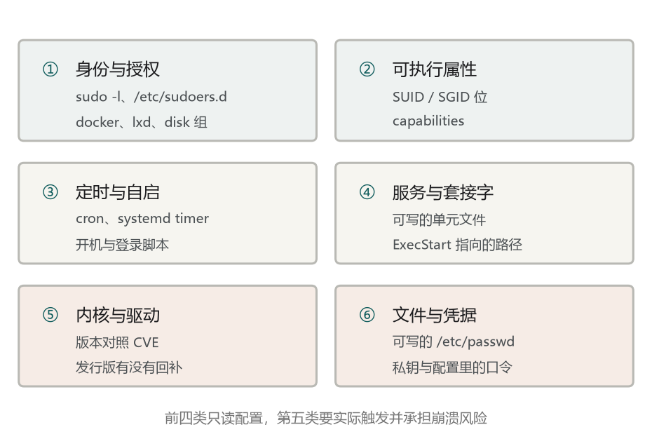
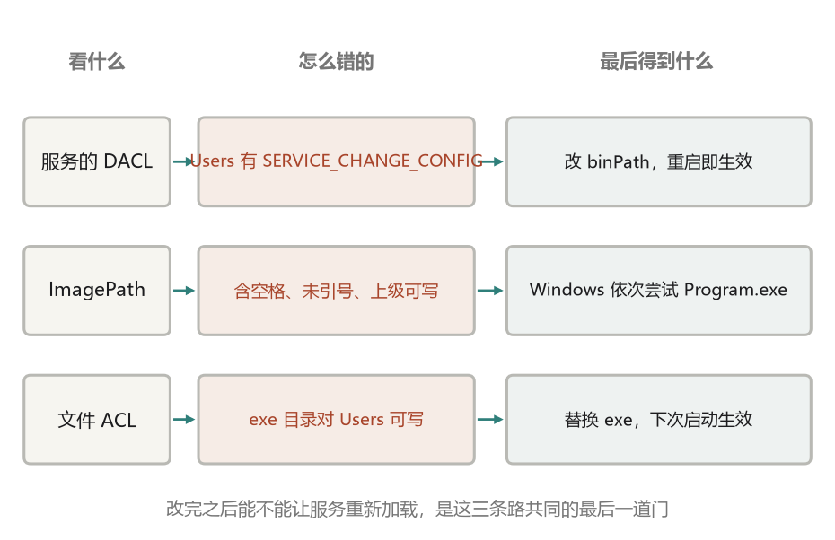

# 第十三章　主机提权：配置错误清单

拿到一个 shell 的时候，身份是 `www-data`。这是一个跑着 nginx 的 Linux 服务器，内核版本 5.15，装了一堆看着眼熟的软件。

网上的教程会告诉你跑一个枚举脚本，等两分钟，从几百行输出里挑一行标红的"建议提权"，照着链接走。很多人就是这么做的，然后在报告里写下"存在本地提权风险"，附一段没跑通的命令。

问题出在名单和判断的混淆上。枚举脚本给的是名单，名单上每一项都只是一个"看起来像"的配置。它不告诉你这个配置在当前这台机器上能不能用，因为那需要看运行身份、看权限、看有没有第二个条件同时成立。

这一章要建立的是一套判断流程，先看什么，看到什么算数，什么情况是误报。

## 13.1 提权的本质是换一个执行身份

先把概念摆正。

提权（privilege escalation）分成两种。垂直提权是从低权限身份拿到更高的权限，`www-data` 变成 `root`，普通用户变成 `SYSTEM`。水平提权是同级别的横向，从 A 用户的身份换成 B 用户的身份，权限没提高，但能碰到的数据变了。实战里两者交替使用，界限并不重要。

重要的是"身份"在系统里到底是个什么东西。

Linux 上，一个进程的身份由一组数字决定，真实用户 ID、有效用户 ID、保存的用户 ID。决定你能读哪个文件的是有效用户 ID（effective UID）。`root` 的 UID 是 0，所以"提权"在 Linux 上等于"让我的进程的 euid 变成 0"。

Windows 上，身份是一个访问令牌（access token），里面装着用户 SID、一组组 SID，还有一组特权（privilege）。看一个进程有什么权限，执行 `whoami /priv`。特权列表里出现 `SeDebugPrivilege` 或者 `SeImpersonatePrivilege`，就意味着这个进程有办法去操作别人的进程。

有了这个视角，提权的定义就清楚了。不是"找到一个漏洞"，而是"找到一个以更高身份执行我提供的输入的机会"。

这句话把检查清单的形状定死了。每一条都要回答三个问题，谁在执行，执行的是什么，我能不能改那个“什么”。三个答案都确定时，这条才是真的。缺一个，就是“看起来像”。

提权的收益也不在“拿到 root”这个动作本身。更高的身份能读到的凭据更多，能关掉的防护更多，能留下去的持久化更多。一台 Linux 服务器上的 root，往往意味着能读到一个能登数据库的账号口令；一台 Windows 服务器上的 SYSTEM，往往意味着能读出域内其他机器的本地管理员哈希。提权是手段，凭据才是目的。

这也解释了为什么配置错误比内存漏泴更常被用。漏泴需要版本匹配、需要绕过缓解措施、可能把进程打崩；配置错误不需要，它本来就是系统设计的一部分，只是被配错了。只要环境里有人为了“方便”改过一次权限，那个改动就会一直在那里，等被发现。

## 13.2 Linux 的六类检查点

Linux 上的配置错误可以归成六类，按"读配置就能确认"到"需要触发才能确认"排序。

<figure>

<figcaption>图 13-1　Linux 提权的六类检查点。前四类只需要读配置就能判断，第五类需要实际触发，第六类有崩溃风险，顺序本身就是成本排序。</figcaption>
</figure>

第一类是身份与授权。`sudo -l` 看当前用户能执行什么，`/etc/sudoers` 和 `/etc/sudoers.d/` 看完整规则。还要看组成员关系，`docker` 组、`lxd` 组、`disk` 组、`adm` 组的成员实际上都接近 root，因为这些组的成员能挂载文件系统、读日志、操作容器。

第二类是可执行文件的属性。SUID 位让程序以文件主（通常是 root）的身份运行，capabilities 把 root 的一部分能力单独授予某个程序。这两样都是"合法授权"，出现本身不说明有问题，问题在于授权给了哪个程序。

第三类是定时与自启动。cron 任务、systemd timer、`rc.local`、以及各种在开机或登录时执行的脚本。判断要点是脚本文件本身可不可写、脚本里调用的命令是不是用相对路径。

第四类是服务与套接字。systemd 单元文件可写，或者单元里 `ExecStart` 指向的路径可写，都能让 root 在下次启动服务时执行任意代码。

第五类是内核与驱动。内核版本对照已知 CVE，可加载模块有没有被禁用。

第六类是文件与凭据。可写的 `/etc/passwd`、root 的 SSH 私钥、配置文件里的明文口令、备份目录里的 `shadow` 副本。

顺序不是随便排的。前四类只是读文件，零风险，几分钟就能过一遍。第五类要实际跑 exploit，内核崩了整个环境就没了，在快照上做，并且放到最后。

头一遍过的时候不需要任何脚本，六条命令就够。

```bash
id && sudo -l
find / -perm -4000 -type f 2>/dev/null
getcap -r / 2>/dev/null
cat /etc/crontab; ls -la /etc/cron.d/
systemctl list-units --type=service --state=running
uname -a
```

看完这六条，心里应该已经有两三个候选点。枚举脚本跑出来的几百行，很多时候只是把这六条的结果重复了一遍再加上一堆噪音。先手工过一遍的好处是，你心里有一条基线，后面看脚本输出时能分得出哪些是新增的信息，哪些只是把常情又列了一遍。

## 13.3 Linux 上真正决定成败的几处

`sudo -l` 的输出值得逐行读。

```text
User www-data may run the following commands on web01:
    (root) NOPASSWD: /usr/bin/vim
    (root) /usr/bin/systemctl restart nginx
```

第一条规则的含义是，`www-data` 可以以 root 身份无口令运行 `vim`。第二眼看过去这只是一个编辑器。但 `vim` 里可以执行 `:!sh`，启动的 shell 继承的是 vim 的 euid，也就是 0。

判断一条 sudo 规则的依据只有一条，这个程序能不能被用来执行别的命令或者写别的文件。编辑器、分页器、解释器、打包工具、文件传输工具，几乎都能。`GTFOBins` 这个站点把这些程序整理成了一张对照表，查表比自己想快。

第二条规则看起来安全得多，因为它限定了子命令 `restart nginx`。但 `systemctl` 会去读单元文件，而单元文件里的 `ExecStart` 指向的是一个路径。这条规则的安全性完全依赖于那个单元文件不可写。这就是为什么每条 sudo 规则都要往下追一层。

SUID 的检查命令很老。

```bash
find / -perm -4000 -type f 2>/dev/null
```

输出通常会有一二十个文件，绝大多数是发行版自带的，`passwd`、`sudo`、`mount`、`ping`，这些的行为都被约束过。要挑出来的是那些非标准的，或者虽然标准但版本很老的。判断方法还是那三个问题，这个程序执行时会不会调用外部命令，它读写的文件我能不能影响，它的参数能不能注入。

有个细节经常被忽略。SUID 只在本地文件系统上生效，挂载时带了 `nosuid` 的分区上，SUID 位会被忽略。所以在容器里或者 `/tmp` 单独挂载的机器上，找到 SUID 也可能是白费。

capabilities 更容易被漏掉。

```bash
getcap -r / 2>/dev/null
```

输出里出现 `cap_setuid+ep`，基本可以直接用，因为设置 uid 的能力就是 root 的核心能力。出现 `cap_dac_read_search+ep`，可以读任意文件，包括 `/etc/shadow`。出现 `cap_net_raw+ep` 就没那么直接，需要看具体程序。

cron 的判断要多看一层。

```bash
ls -la /etc/cron.d/ /etc/cron.hourly/ /var/spool/cron/crontabs/ 2>/dev/null
cat /etc/crontab
```

看到 root 每分钟执行一个脚本，先看脚本权限 `ls -l`。脚本可写，直接改。脚本不可写，再看它调用的命令，如果写的是 `backup.sh` 而不是 `/usr/local/bin/backup.sh`，那 PATH 就参与进来了，而 cron 的默认 PATH 里通常包含 `/usr/local/bin`，那个目录能不能写就是关键。

还有一种形态是通配符。root 的 cron 在可写目录里执行 `tar czf /backup/etc.tar.gz *`，星号会被 shell 展开成当前目录里的文件名，于是可以放一个名字叫 `--checkpoint-action=exec=sh pwn.sh` 的文件，让 tar 把这个参数当成自己的选项。

内核漏洞放最后，因为它有代价。Dirty Pipe（CVE-2022-0847）影响 5.8 之后到 5.16.11 之间的内核，PwnKit（CVE-2021-4034）影响 polkit 的 `pkexec`，从 2009 年起的所有版本都在范围内。这类漏洞的利用成功率很高，但触发失败时机器会 panic，线上的话就是一次事故。

## 13.4 Windows 服务：三个位置，一个结局

Windows 上的服务是个常青的提权面，原因是它的配置分散在三个地方，任何一处松了都能被利用。

<figure>

<figcaption>图 13-2　服务权限的三处错误配置。三条路的终点相同，都是以服务的运行账户执行攻击者的代码，难点不在改配置，而在改完之后能不能让服务重新加载。</figcaption>
</figure>

第一处是服务对象的 DACL。每个服务都有自己的安全描述符，权限位里有一个 `SERVICE_CHANGE_CONFIG`，值是 `0x0002`。拥有这个位的账号可以改服务的可执行路径，也就是 `binPath`。

```bash
accesschk.exe -uwcqv "Users" * /accepteula
sc qc MyService
```

第一条命令列出 `Users` 组对哪些服务有写权限，第二条看某个服务的配置，`BINARY_PATH_NAME` 和 `SERVICE_START_NAME` 两行是重点。改路径之后启动服务，代码就以 `SERVICE_START_NAME` 那个账户的身份跑了。

第二处是路径本身。服务的可执行路径如果没有引号包住，而路径里又有空格，Windows 的加载顺序会变成逐个尝试，`C:\Program Files\My App\svc.exe` 会被依次试成 `C:\Program.exe`、`C:\Program Files\My.exe`、`C:\Program Files\My App\svc.exe`。只要前面某个候选路径所在目录对普通用户可写，就能放一个同名程序进去。

```bash
wmic service get name,displayname,pathname,startmode | findstr /i "auto" | findstr /i /v "C:\\Windows"
```

这条命令把自动启动、且不在系统目录里的服务列出来，然后肉眼找路径含空格又没引号的。

第三处是文件本身。服务 exe 所在的目录 ACL 如果允许 `Users` 修改，直接替换二进制文件即可，下次服务启动时执行的就是新文件。这一条比前两条简单，也最容易被忽略，因为大家习惯去看配置而不看文件的 ACL。

三条路的终点一样，都是"以服务账户的身份执行"。难点在后面一步，改完配置要能让服务重新加载。`sc stop` 和 `sc start` 需要 `SERVICE_STOP` 和 `SERVICE_START` 权限，`SERVICE_CHANGE_CONFIG` 不包含这两个。权限不够时得等机器重启，而重启一台生产服务器显然不在授权范围内。

这条限制在报告里必须写清楚。写"可提权"而不写"需要目标重启"，等于把一个没验证的结论当成事实。

## 13.5 令牌、计划任务与安装策略

Windows 上还有一类提权不依赖服务配置，依赖进程手里的令牌。

```bash
whoami /priv
```

看到 `SeImpersonatePrivilege` 处于 Enabled 状态，就意味着这个进程可以"模拟"另一个进程的令牌。IIS 的应用池身份、SQL Server 的服务账户，默认都带这个特权。

利用方式是让一个高权限进程主动连过来，然后模拟它。Potato 系列工具做的就是这件事，Rotten Potato 用 DCOM 的 OXID 解析器，Juicy Potato 用 COM 的激活服务，PrintSpoofer 用打印后台的命名管道，GodPotato 用 `rpcss`。它们的共同前提是有一个能被触发的、以 SYSTEM 身份运行的组件，以及一个可用的命名管道。判断依据要看系统版本，不同版本上可用的组件不一样。

同类的特权还有几个。`SeBackupPrivilege` 可以绕过文件 ACL 读任意文件，配合 `diskshadow` 能把 `ntds.dit` 和注册表 hive 拷出来。`SeRestorePrivilege` 可以绕过 ACL 写文件，写到 `System32` 下就是一个 DLL 劫持。`SeTakeOwnershipPrivilege` 拿文件所有权，`SeDebugPrivilege` 打开任意进程，`SeLoadDriverPrivilege` 加载内核驱动。

这些特权单独存在的价值不大，要看有没有配套的落点。`SeBackupPrivilege` 只有在目标机上真有值得读的文件时才算提权。

计划任务这一块判断更简单。任务定义存在 `C:\Windows\System32\Tasks\` 下的 XML 文件里，可写就能改它执行什么。任务指向的程序可写，也一样。任务以 `SYSTEM` 运行时，两种改法都能拿到 SYSTEM。

`AlwaysInstallElevated` 是个经典的坑。两个注册表键同时为 1 时，任何用户执行 msi 安装包都会以 SYSTEM 身份运行。

```bash
reg query HKLM\SOFTWARE\Policies\Microsoft\Windows\Installer /v AlwaysInstallElevated
reg query HKCU\SOFTWARE\Policies\Microsoft\Windows\Installer /v AlwaysInstallElevated
```

两条都要查。只查一条就下结论，是这类误报的主要来源之一。只有 HKCU 那条为 1 时，提权只对当前用户生效，换一个用户就没用了，价值完全不同。

无人值守安装文件是另一个老旧但一直存在的面。`unattend.xml`、`sysprep.inf`、`unattend.txt` 里经常存着 base64 编码的本地管理员口令，而 base64 不是加密。这类文件往往留在 `C:\Windows\Panther\` 或者某个部署脚本旁边，装完没有人清理。注册表的 `AutoLogon` 键里也可能直接写着 `DefaultPassword`。

配置文件里的凭据比提权本身更值钱。`web.config` 里的数据库连接串、PowerShell 的历史文件、`.git-credentials`、Jenkins 的 `credentials.xml`，这些东西交出来的是"可以拿去用的身份"，而不是"一台已经控制住的机器"。

## 13.6 枚举脚本的误读

枚举脚本省时间，但它输出的每一条都是"线索"，不是"结论"。

典型误报有五种。

脚本报了一个服务的 DACL 有问题，但那个服务已经被禁用，或者它的运行账户就是 `LocalService`，拿到这个身份没有实际意义。

脚本报了一个 SUID 二进制，但它是发行版自带的、经过了约束的，行为和你想象的不一样。

脚本报了一条 sudo 规则，目标程序确实能执行命令，但那个程序需要读一个普通用户读不到的配置文件，规则实际上是死的。

脚本报了内核版本落在 CVE 范围内，但那台机器跑的是 RHEL 或者 Ubuntu，发行版把补丁 backport 回去了，版本号没变。判断这一点要看 `uname -a` 里的构建号，或者直接查发行版的安全公告。

脚本报了一个可写的计划任务，但任务是禁用状态，或者触发条件永远不满足。

避免误读的办法是固定一套验证动作。对每一条线索，先确认"谁执行"，再看"在什么上下文执行"，最后确认"我能不能影响输入"。三个都过了，再上机试一次，试通了才写进报告。

| 线索 | 要补的那一问 |
| --- | --- |
| 服务 DACL 过松 | 服务的运行账户是什么，能否重启 |
| SUID 二进制 | 它执行时会不会调用外部命令 |
| sudo 规则 | 目标程序读的配置文件我读得到吗 |
| 内核版本在范围内 | 发行版有没有回补这个补丁 |
| 计划任务可写 | 任务是否启用，触发条件是什么 |

报告里要把"已验证"和"疑似"分开写。前者有复现步骤和截图，后者只有判断依据。混在一起写，等于把整个报告的可信度押在最弱的那一条上。

## 13.7 把六类检查点跑成一条脚本

手工跑六条命令适合第一次，第二次开始就该用脚本。不是为了快，是为了两次结果能对比。

写这种脚本有三条约束。只读，不改任何系统状态；输出固定格式，一行一个条目；带上时间戳，方便和上一次的备份 diff。

```bash
#!/bin/sh
# 只读采集，不修改系统状态
out=/tmp/host-scan-$(date +%Y%m%d-%H%M).txt
{
  printf 'kind\towner\tmode\tpath\n'
  find / -xdev -perm -4000 -type f -printf 'suid\t%u\t%m\t%p\n' 2>/dev/null
  find / -xdev -perm -2000 -type f -printf 'sgid\t%u\t%m\t%p\n' 2>/dev/null
  find / -xdev -type d -perm -0002 -printf 'wworld\t%u\t%m\t%p\n' 2>/dev/null
} > "$out"
cat /etc/crontab >> "$out" 2>/dev/null
ls -la /etc/cron.d/ >> "$out" 2>/dev/null
systemctl list-timers --all --no-pager >> "$out" 2>/dev/null
getcap -r / 2>/dev/null >> "$out"
```

几个参数不能省。`-xdev` 让它不跨文件系统，不然后一个挂载的 NFS 或 `/proc` 会把扫描拖到几十分钟。`-printf` 比 `ls -l` 稳定，因为它不会因为文件名里有空格而把列错位。`2>/dev/null` 挡掉的只是权限错误，真的找不到 `find` 时会直接报错退出，不会静默地漏扫。

输出里每一行都要回答一个问题，这个文件属于哪个包。

```bash
rpm -qf /usr/bin/passwd
dpkg -S /usr/bin/passwd
```

第一条返回 `passwd-x.y-z`，第二条返回 `passwd: /usr/bin/passwd`。能对上一个包，就说明它是发行版装的，风险等级低；对不上，说明有人手工放过。这一个判断能砍掉八成的名单，剩下的才值得逐个看。

两轮扫描之间做 diff，能直接回答另一个问题，这周谁在改机器。

```bash
diff <(cut -f1,4 /tmp/host-scan-20261120-0900.txt) \
     <(cut -f1,4 /tmp/host-scan-20261127-0900.txt)
```

新出现的 SUID 文件、新出现的全局可写目录、新出现的 cron 条目，这三类变化在应急场景里价值极高，因为它们直接指向“谁动过这台机器”。把这条 diff 做成每日定时任务，成本是几行脚本，收益是一份可回溯的变更底账。

capabilities 那一段有个容易忽略的前提。`getcap` 只能看到文件上的扩展属性，而扩展属性在某些挂载选项下会被隐藏，比如用 `nosuid` 或 `noexec` 挂的分区，能力位同样不生效。看到 `cap_setuid+ep` 之后，还要确认所在分区没带这些选项。

```bash
findmnt -no OPTIONS -T /usr/bin/ping
```

输出里出现 `nosuid,noexec` 时，前面所有的能力发现都可以当作不存在。

`sudo -l` 的输出同样有几处要读准。`(ALL : ALL)` 意味着目标用户和组都不限，`(root)` 只限定了用户；行尾的 `SETENV` 表示可以自己设环境变量，`env_reset` 生效时这个标记决定了你能不能往子进程里塞东西。`!` 开头的是禁止项，它比同名的允许项优先，且不受顺序影响。用 `sudo -l -U someone` 可以查别人的规则，前提是当前用户有权限这么做。

这一层跑完，还有一类不靠文件名、靠调用关系的点。root 的 cron 调用一个普通用户的脚本，脚本本身不可写，但它自己不写绝对路径，而 `PATH` 里排在前面的目录可写，这就构成了另一种可以利用的配置。查证办法是在脚本里加一行 `which` 看它到底解析到哪个文件，而不是靠读代码猜。

## 13.8 Windows 侧的一次完整验证

Windows 上最常见的误判是把“能改配置”等同于“能以 SYSTEM 执行”。中间差两个条件，一个是运行账户，一个是能不能让服务重新加载。

先看文件的 ACL。`icacls` 的输出能把权限讲清楚。

```bash
icacls "C:\Program Files\MyApp"
```

```text
C:\Program Files\MyApp BUILTIN\Users:(OI)(CI)(RX)
                     NT AUTHORITY\SYSTEM:(OI)(CI)(F)
                     BUILTIN\Administrators:(OI)(CI)(F)
```

`(OI)` 表示对象继承，`(CI)` 表示容器继承，两个一起出现说明这个权限会往下传。`(RX)` 只读加执行，`(M)` 修改，`(W)` 只写，`(F)` 完全控制。`Users` 那一行如果是 `(M)` 或 `(F)`，目录里的 exe 就能被替换，这是三条路里最简单的一条。

服务的 DACL 用另一个工具看。

```bash
accesschk.exe -uwcqv "Users" * /accepteula
sc qc MyService
```

`accesschk` 输出里的 `RW` 意味着这个组对服务对象有读写权限，包括 `SERVICE_CHANGE_CONFIG`。`sc qc` 里三行是重点，`BINARY_PATH_NAME` 是可执行路径，`SERVICE_START_NAME` 是运行账户，`DEPENDENCIES` 决定了停服务时会不会连带停掉别的业务。

另一个比 `whoami` 更准的判断是 `whoami /groups` 末尾的完整性级别。经过 UAC 过滤的管理员显示为 `Medium Mandatory Level`，名字仍然是管理员，权限却不是；出现 `High Mandatory Level` 或 `System Mandatory Level` 时才是真的到了。只看用户名会得出错误结论。

验证不必真去拿 SYSTEM。最小验证只需要证明“我改的路径会被执行”，做法是改 `binPath` 指向一个只写一个标记文件的命令，重启，看标记文件有没有出现，然后还原配置。

```bash
sc config MyService binPath= "cmd.exe /c echo ok > C:\Windows\Temp\svc-ran.txt"
sc stop MyService
sc start MyService
type C:\Windows\Temp\svc-ran.txt
```

`binPath=` 后面的等号后面必须有空格，这是 `sc` 的古早语法，漏了会得到 `The option name is invalid`。真正的卡点通常在第二步。

```text
[SC] OpenService FAILED 5:

Access is denied.
```

错误码 5 表示拿不到服务句柄，缺的是 `SERVICE_STOP` 或 `SERVICE_START`。`SERVICE_CHANGE_CONFIG` 不含这两个，所以能改不能停。此时只能等机器重启，而重启生产服务器通常不在授权范围内。报告里必须写清这一点，否则“可提权”这个结论是不成立的。

路径未加引号的那一类更容易验证，因为它不需要动任何配置。列一遍自动启动、路径含空格、不在系统目录的服务。

```bash
wmic service get name,pathname,startmode | findstr /i "auto" | findstr /i /v "C:\\Windows"
```

拿到候选之后，逐个用 `icacls` 看路径里每个目录的权限。`C:\Program Files\My App\` 这一串里只要有一层对 `Users` 可写，就能在这个层级上放一个同名 exe。写报告时把哪一层可写写清楚，这个细节决定了修复方案是改 ACL 还是加引号。

继承关系会把这件事弄乱。图形界面里看到的权限列表混着继承来的和直接挂上去的，删的时候才发现删不掉。用 `Get-Acl` 加一层过滤能看清来源。

```powershell
(Get-Acl "C:\Program Files\MyApp").Access |
  Where-Object { $_.IdentityReference -match 'Users|Everyone' } |
  Select-Object IdentityReference, FileSystemRights, IsInherited
```

`IsInherited` 为 True 的条目，要修就得去父目录改，或者先把继承断开再重设。`SetAccessRuleProtection($true, $false)` 会同时清掉继承来的 ACE，在没有备份的情况下是个危险动作，实验里先导出再改。

计划任务那一条的判读也很直接。任务定义落在 `C:\Windows\System32\Tasks\` 下，文件不带扩展名，内容是一个 XML。

```bash
schtasks /query /tn "MyTask" /xml ONE
```

要看的是 `<Command>`、`<Arguments>`、`<UserId>` 三个节点，以及 `<Triggers>`。`<UserId>` 为 `S-1-5-18` 就是以 SYSTEM 跑，为某个域账号则是那个账号。触发条件里如果是 `<BootTrigger>` 或 `<LogonTrigger>`，意味着改完之后等一次重启或登录就能验证；如果是每天某个固定时刻，就得等到那个点。这条差别直接决定了验证要不要花一晚。

主机提权的位置在整个流程里是中间站。它的价值不在于"拿到 root"这个动作本身，而在于更高的身份能读到的凭据更多。一台 Linux 服务器上的 root，能读到的往往是一个能登录数据库的账号口令；一台 Windows 服务器上的 SYSTEM，能读出的是域内其他机器的本地管理员哈希。这些凭据才是下一步的东西。
