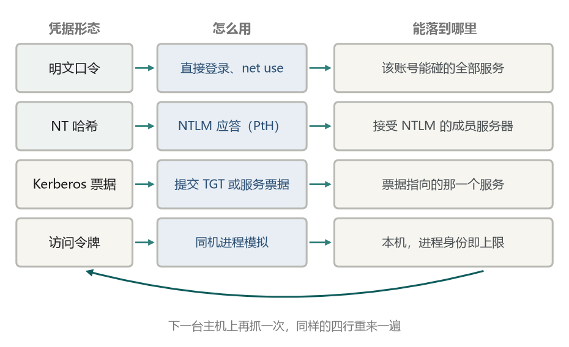
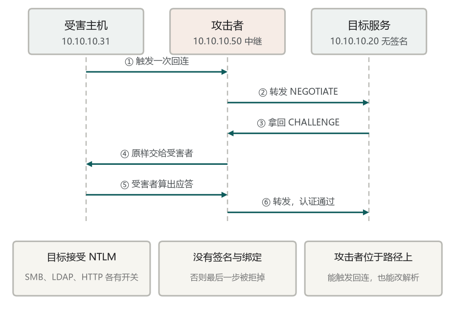

# 第十四章　横向移动与凭据

`WS-0231` 是财务部的一台办公机。从它上面拿到本地管理员权限之后，`whoami` 返回 `nt authority\system`，很多人到这一步就开始翻工具列表，找一个能远程执行的东西，往下一台机器上打。

先停一下。这台机器比手上那个 shell 值钱的地方，不在于它能执行命令，而在于它替你记住了别人。登录过它的域账号、它自己那份本地管理员口令、内存里还没过期的票据、它所在网段能直连的那些服务，这些才是横向移动的燃料。工具只负责把某一种燃料塞进某一条通道。

凭据有四种形态，入口有四个。每个组合留下的痕迹都不一样，能不能用也取决于目标一侧的配置。这一章的顺序是先把形态认清，再看每条通道的接受条件，再把痕迹对回日志。判断依据在前，动作在后，顺序反过来就会变成“工具跑通了，但说不清为什么通，也说不清留下了什么”。

## 14.1 凭据的四种形态

明文口令最好用，也最少见。来源分散在几个地方，LSASS 内存、配置文件里的连接串、部署脚本、浏览器保存的口令、组策略首选项里的 `cpassword`，这一种的加密密钥还是公开的，拿到密文就等于拿到口令。明文能做的事最多，任何协议都能用，能拿去别处试，也能人工看一眼判断它是不是某个命名规律的一部分。

NT 哈希次之，形式是一串 32 位十六进制。它的算法是 MD4 作用于 UTF-16LE 编码的口令。看到这行定义就该明白一件事，它不是口令的指纹，它是口令经过一次变换后的结果，而 NTLM 协议验的正好是这个结果。所以它不能反推出口令，却能直接当口令用。

Kerberos 票据是第三种。TGT 和它的会话密钥一起躺在 LSA 里，由 `lsass` 保管，读出来需要 SYSTEM。票据的价值在于它自带有效期和授权信息，PAC 里写着这个用户的组 SID 列表。提交它的时候不需要再向任何人证明口令，也不产生一次口令校验。

访问令牌是第四种，最容易被误解。它是进程的一个属性，装着用户 SID、组 SID 和特权列表。它能被复制到同一台机器上的另一个进程里，不能通过网络发给别的机器。很多人在一台机器上拿到了域管的令牌，以为可以横着走，实际上那个令牌只在那一台机器上有效。

<figure>

<figcaption>图 14-1　四种凭据形态与它们各自能到达的位置。右下角那条回环是整个流程的形状，每台新机器都会再产出一批新的凭据，形态决定能做什么，而不是反过来。</figcaption>
</figure>

图上四行看起来是并列的选项，实际上它们经常同时存在于一台机器上。一台刚被登录过的办公机，内存里有明文、SAM 里有本地哈希、LSA 里有域账号的 TGT、当前进程里有登录用户的令牌。判断从哪里下手，看的是哪一样能到达下一个目标，而不是哪一样看起来更高级。

## 14.2 三条能过认证的路

NTLM 的三步在九十年代定下来之后没怎么变。客户端发 NEGOTIATE，服务端回一个 8 字节的 CHALLENGE，客户端用口令派生出的 NT 哈希对这个 challenge 做 HMAC-MD5，把结果连同一段客户端随机数发回去。服务端拿自己存的哈希算一遍，对上了就通过。整个过程口令本身没有出现过，出现的是哈希。

Pass-the-Hash 就是把这一步搬到远程。手里有哈希，就自己算应答，不需要知道口令。

```bash
python3 psexec.py -hashes aad3b435b51404eeaad3b435b51404ee:31d6cfe0d16ae931b73c59d7e0c089c0 \
    lab.local/administrator@10.10.10.31
```

冒号前半段是 LM 哈希，现代系统里那一半早就废弃了，写一个固定值占位即可，上面这一对是空口令账号的经典取值，真打的时候换成目标账号的 NT 哈希。这条命令会在目标上创建一个服务、落地一个二进制、以 SYSTEM 执行，留下的东西比它做到的事更值得记，14.4 会展开。

Pass-the-Hash 的失效条件不多，但每一个都很硬。域里禁用 NTLM，这条路直接死；目标是域控时，默认策略通常不允许 NTLM 网络登录；账号被放进 Protected Users 组，NTLM 与 RC4 都被拒。想用哈希走 RDP，目标得先开了 Restricted Admin 模式，否则客户端这一侧必须先有明文。WinRM 的 Negotiate 在常见工具实现里只吃口令或证书，哈希在它上面用不上，这一点经常被误判成“凭据无效”。

第二条路叫 Overpass-the-Hash，名字里的 over 指的是跨过 NTLM。做法是拿哈希去做 Kerberos 预认证。AS-REQ 里的预认证数据是用账号的长期密钥加密的时间戳，如果协商到 RC4（etype 23），那把长期密钥就是 NT 哈希本身；手里有 AES256 密钥时，走 etype 18。KDC 验过之后发一张正常的 TGT，后面所有操作都是标准 Kerberos，与口令登录没有任何区别。

| 项目 | Pass-the-Hash | Overpass-the-Hash |
| --- | --- | --- |
| 认证协议 | NTLM | Kerberos |
| 需要的材料 | NT 哈希 | NT 哈希（仅 RC4）或 AES 密钥 |
| 目标侧记录 | 4624 类型 3，域账号另有 4776 | 4768，之后是 4769 |
| 失效条件 | 禁用 NTLM | 禁用 RC4，或强制 AES |

这个区别在实际环境里很要命。很多域为了防中继把 NTLM 关掉，Pass-the-Hash 全军覆没，但 Overpass-the-Hash 照样能用，因为它走的是 Kerberos，只是第一段用了哈希当密钥。反过来，域里禁了 RC4 只留 AES，那么只有 NT 哈希的人就卡住了，得有 AES 密钥或者一张现成的票据。

第三条路是票据。拿到 TGT 和会话密钥之后，把这一对东西塞进当前会话的 LSA 缓存，后面任何一个走 Kerberos 的程序都会自动用上它，包括浏览器和文件共享。服务票据也能单独注入，粒度更细，只影响一个服务，代价是每换一个目标都要重新做一次。

还有一条不属于上面三条的路，成功率却最高。很多环境用同一个镜像装机器，本地 Administrator 的口令全网一致，抓到一台就等于拿到所有机器的本地管理员。这不算凭据窃取，算凭据猜测，但只要口令真的一样，它比任何技术都好用。LAPS 就是为这件事存在的，它让每台机器的本地管理员口令独立且定期轮换，一旦部署完整，这条路也断了。

## 14.3 NTLM 中继的前提

中继（relay）和 Pass-the-Hash 的终点一样，都是让别人替自己完成一次认证。区别在于中继不需要知道任何凭据，它只需要站在两个人中间，把箱子从一个手里搬到另一个手里。

<figure>

<figcaption>图 14-2　一次 NTLM 中继的六步。攻击者全程没有解开任何一段报文，他只是搬运，所以中继的成败完全由目标与协议侧的配置决定，不取决于攻击者的算力。</figcaption>
</figure>

一次中继由三段构成。先让受害者发起认证，办法是利用强制认证，或者等一台机器自己来连，比如它去访问一个 UNC 路径，或者解析了一个被劫持的名称。再把这段认证原样转给目标。目标返回的 challenge 转回给受害者，受害者算出的应答再转给目标。认证通过之后，目标认为自己在和受害者说话，实际上写进去的指令来自攻击者。

四个条件要同时成立。

目标得接受 NTLM 认证。SMB、LDAP、HTTP、MSSQL 各自都有这个开关，很多现代部署里其中某几个已经关掉。

上层协议不能有完整性保护。SMB 开了签名，LDAP 强制了签名，或者 HTTP 启用了扩展保护（Extended Protection for Authentication，EPA）与通道绑定，搬运到最后一刻会被拒。这一条是中继最常见的死因。

攻击者得在路径上，并且能触发一次回连。回连这件事在域里并不稀有，第十二章列过几个入口，共同点是只需要一个普通域账号。

认证不能要求双向。NTLM 支持互相验证，但多数服务默认不做，所以搬运过程不会被受害者识破。

判断签名这一条最直接的办法是看策略。

```bash
nmap -p445 --script smb2-security-mode 10.10.10.20
```

输出里出现 `message signing enabled but not required`，这台机器就是可以被中继的；出现 `required`，这条路死了。域控默认是 required，所以“中继到域控的 445”在绝大多数环境里不通，能中继的是那些没开签名的成员服务器。这个差别解释了为什么很多教程里的中继实战，目标全是一台普通文件服务器。

LDAP 的情况不一样。历史上 LDAP 签名不是默认强制，于是把一次 SMB 认证中继到 LDAP，再借 LDAP 去改目录里的属性，成了造机器、配资源型约束委派的常规做法。微软这几年在逐步把 LDAP 签名与通道绑定改成默认要求，具体落到哪个补丁级别取决于目标的实际配置，不能凭经验假设。

NTLM 的报文和上层协议无关，所以把 SMB 的认证搬去 LDAP 是可行的，这一点和 Kerberos 不同。真正卡住跨协议中继的是签名与绑定，不是协议格式。反过来也一样，从 HTTP 搬去 SMB 会在 SMB 侧被签名挡住，除非那台机器本来就没开。

这套默认值最近几年在收紧。从 Windows 11 24H2 和 Server 2025 起，SMB 客户端签名变成默认强制，入站策略也一起变了。方向很清楚，中继的空间在变窄。但它依赖的是“某一台成员服务器没开签名”这种局部配置，只要环境里还有一台，这条路就还在。

## 14.4 远程执行的四个入口

能过认证之后，要选一个入口把命令送进去。四个入口的区别不只是端口，还有需要的权限、代码以什么身份跑、以及落地的东西被谁看见。

| 入口 | 依赖 | 需要的权限 | 留下的东西 |
| --- | --- | --- | --- |
| SMB 服务创建 | 445，`ADMIN$` 可写 | 目标管理员 | 7045，新服务，落地的 exe |
| SMB 计划任务 | 445 | 目标管理员 | 4698，Tasks 目录下的 XML |
| WMI | 135 与动态端口 | 目标管理员 | `WmiPrvSE.exe` 派生的子进程 |
| WinRM | 5985 或 5986 | 管理员或远程管理组 | WinRM 91 事件，`wsmprovhost.exe` |

权限这一列看着一样，实际不一样。SMB 服务创建要能写 `ADMIN$`，也就是要 C 盘的写权限；WMI 走 DCOM，受 UAC 远程限制影响，同一组里的普通成员未必够用；WinRM 可以把权限单独委派给一个自定义组，让一个不是管理员的账号也能执行命令，这是它比其余三个更适合长期使用的理由。

执行上下文也要看。`psexec` 创建的服务以 SYSTEM 运行，`schtasks` 指定 SYSTEM 时也以 SYSTEM 运行，WMI 的 `Win32_Process::Create` 同样落在 SYSTEM 上，WinRM 则在调用者身份的 `wsmprovhost.exe` 里跑。想让动作看起来像某个服务的正常行为，就得挑上下文对得上的那一个。

动静的差别很大。服务创建在企业环境里本来就少见，一个随机名字的服务配一条 `cmd.exe /c` 的命令行，几乎是明牌，`PSEXESVC` 这个名字十几年没变过，仍然有人在用。计划任务温和一些，但任务 XML 会落在磁盘上，事后取证直接读得到内容。WMI 的临时调用不落地，只有 `WmiPrvSE.exe` 的子进程这一条线索，不过永久事件订阅会留下 5861，而且这种订阅在正常环境里极少出现。WinRM 最轻，日志和 PowerShell 的脚本块日志联起来看，内容反而是最全的。

选哪个，取决于这一步要待多久。一次性的动作挑最方便的，长期的驻留挑最像正常管理的。同一个环境里连打十台机器全用 `psexec`，防守方只需要一条规则就能把这个扇出串起来。

## 14.5 跳板与代理

能认证、能执行，还是可能打不到。目标在一个不能直连的网段里，或者攻击者的出口被限制得很死。这时候需要的是一台跳板（pivot）。

判断一台机器能不能当跳板，看三件事。它有几块网卡，它的路由表指向哪里，它能不能出网。前两个决定它能碰到谁，第三个决定它能不能把结果送回来。

```bash
ipconfig /all
route print
netstat -ano | findstr LISTENING
```

`ipconfig /all` 里的默认网关比 IP 地址有用，多网卡的机器往往就是网段之间的桥。`route print` 能看到它自己认为哪些网段是直达的。`netstat` 那一行决定后面用什么工具，一台只开了 445 的机器和一台能出 443 的机器，能走的路完全不同。

代理的形态有三种。端口转发是一次性的，一条隧道对一个目标。SOCKS 代理能让工具把整段流量转过去，一次配置多个目标。反向隧道是让目标主动连出来，用在目标不接受入站连接的场景。ssh 的三个参数正好对应这三种，`-L` 本地转发，`-R` 反向，`-D` 动态。跨平台场景里 chisel 和 socat 更常见，因为它们不要求对方有 ssh 服务。

隧道本身是痕迹。它必然在跳板上留下一个监听端口和一条长时间存在的连接，`netstat` 一眼就能看见；它也必然在网络上留下一条本不该出现的长连接，防火墙上如果做了会话时长统计，这条会被挑出来。有时候更省事的做法是不建隧道，用跳板上已经有的执行能力跑脚本，只把结果带回来。慢一点，但安静得多。

## 14.6 痕迹与日志

横向移动在日志里的形状是一个扇出（fan-out）。同一个账号在一个短时间窗里出现在多台主机的登录日志上，这在正常环境里很少见，因为人不会一分钟内在五台服务器上登录。

| 事件 | 记录什么 | 正常量级 |
| --- | --- | --- |
| 4624 类型 3 | 网络登录，带来源地址 | 大量 |
| 4624 类型 9 | 显式凭据（`runas /netonly`） | 很少 |
| 4648 | 用另一组凭据启动进程 | 少，值得逐条看 |
| 4768 与 4769 | TGT 与服务票据 | 海量 |
| 7045 | 服务安装 | 很少 |
| 5140 与 5145 | 共享与文件访问 | 中等 |

最有用的一列不是事件 ID，是量级。4776 在域里每天几十万条，拿它做告警等于关掉告警；7045 一年可能只有几次，任何一次都值得看内容。判据是分布，不是名字。

有两个细节会让时间线错位。类型 3 的源地址在直接登录时是攻击者的地址，但如果这次认证是从别人那里中继过来的，地址就变成了受害者的，看日志的人会以为是那台机器在动。另一处是账号，用一台机器的本地管理员哈希去打另一台机器，成功时记的也是那个本地账号，在域视角下它不显眼，只有在逐台对比时才看得出来。

凭据的寿命这一点容易被忽略。用过的票据会留在内存里，用过的哈希会留在缓存里，被抓过一次的账号在口令改掉之前一直有效。防守方最快的一步不是找攻击者，是改口令、撤票据、把被复用的本地管理员口令换掉。这件事对攻击方的意义在于，时间窗是有限的，动作必须排进这个窗里，做完就该走。

横向移动的每一步都在消耗两样东西，凭据和时间。打得越多，能用的凭据越少，被关联的机会越多。把这条链路拉长到几周之后，问题会换一副样子，不再是“能不能再打一台”，而是“怎么在几十天里低噪音地跟这些主机保持联系”。
