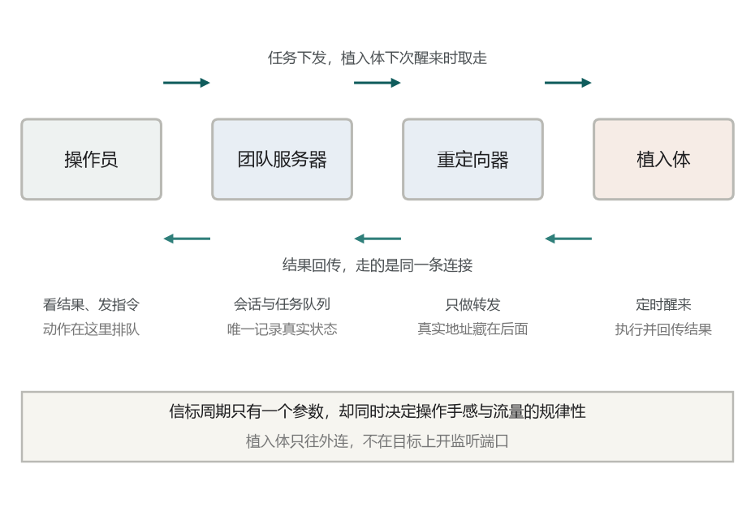
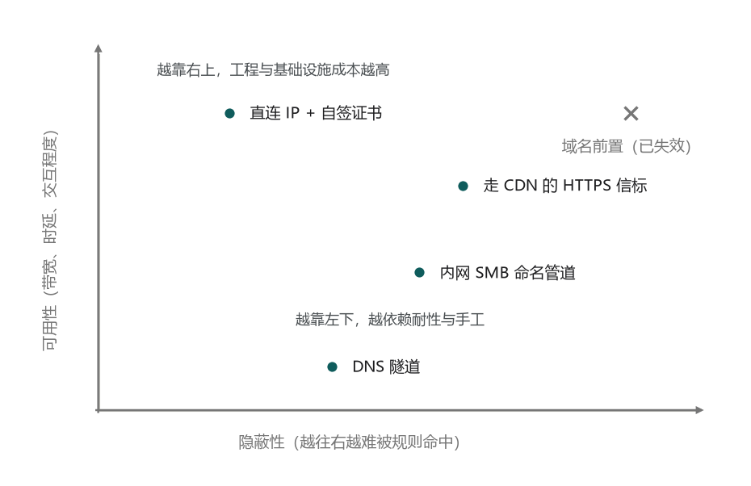

# 第十五章　C2、隧道与对抗的边界

手上有了四五台机器之后，工作方式会变。前面的动作都是一次性的，打进去、取东西、离开。要长期做的事需要一条能反复使用的回访通道，每隔一段时间问一次有没有新任务，把结果带回来。这条通道叫命令与控制（command and control，C2）。

这一章讲它的结构、它的代价，以及防守方在哪几个位置能看见它。至于怎么让某个载荷躲过某个引擎，这里不会给步骤，理由在 15.5。那不是一门能学会的手艺，是一门会过期的生意。

先把范围说清楚。C2 是所有后续动作的支点，也是攻防研究里被翻得最透的一块。理解结构对两边都有用。防守方要能判断“一台每 60 秒连一次同一个域名的主机”意味着什么，攻击方要知道每换一种通道自己付出了什么。这两件事本来就是同一件事的两面。

## 15.1 C2 的最小模型

一个能用的 C2 由五个部分组成。植入体（implant）在目标上运行，负责定时醒来、取任务、执行、把结果排队。团队服务器（team server）记住所有会话、任务和结果，是唯一记录真实状态的地方。重定向器（redirector）挡在前面，让植入体看到的地址和真实服务器没有关系。操作员通过界面下发指令。第五个部分是通道本身，它决定前四个怎么连起来。

<figure>

<figcaption>图 15-1　C2 的四个部件与一条双向通道。所有连接都由植入体一端发起，任务和结果走同一条连接，因此目标上不需要任何监听端口。</figcaption>
</figure>

图上的箭头是双向的，连接却是单向发起的。植入体从不监听端口，它只往外连。这个选择带来两个后果，目标上不会出现一个意外的监听端口，也不怕入站被防火墙挡住。代价是任务不能即时推送，只能等植入体下次醒来时自己取走。所有“实时控制”的感觉，都是靠缩短等待换来的。

于是有一个参数绕不过去，信标周期（beacon interval）和抖动（jitter）。植入体每 N 秒醒一次，实际间隔在 N 上下浮动一段随机值。N 决定两件事。操作手感，N 是 5 秒的时候，敲一条命令两秒后能看到结果，和本地 shell 差不多。流量规律性，同样是 5 秒，任何一个做周期性分析的工具在两分钟内就能把它挑出来。N 是一小时的时候，两件事同时反过来。

商业框架把这个参数做成界面上的一项配置，看起来只是个开关，实际上它同时是功能参数和检测特征。调它就是在隐蔽性和可用性之间移动，没有第三个方向。

还有几个参数同样带着这种双重身份。进程注入的间隔决定进程树长什么样，回传的分块大小决定上下行字节数的比例，备用通道的启用条件决定失联时会不会突然出现一条新连接。写这些参数的人如果只考虑功能，产出的就是一份特征清单。

## 15.2 传输方式的取舍

HTTP(S) 最常见，原因是它最容易混进正常流量。企业里大量主机在访问外部 HTTPS，一条到某个域名的、带证书的连接不会引起注意。它还能穿过绝大多数出网代理，因为代理本来就是为它设计的。代价是外面要有一个域名和一张证书，域名一旦进了情报库，整条通道就作废，换域名意味着重新准备一整套东西。

DNS 的优势是出口几乎总是开着的。很多环境封了 443 却不封 53，因为 DNS 不通整个网络就瘫了。做法是把数据编码进查询名，用 TXT 或 A 记录把结果带回来。代价很清楚。一个查询能带的字节数有限，递归解析器还会缓存和限速，实际吞吐常在几十 KB/s 以内，交互式操作基本不可能。它的形状也太特殊，长随机标签、高熵的域名、大量 NXDOMAIN，全是现成的规则。

SMB 命名管道不出网，只在目标之间走 445，用在已经拿到一个内网落脚点、需要穿过网段隔离的场景。带宽好，时延低，代价是每一跳都要有一台已经被控制的主机。链路上任何一环掉线，后面全部失联，而且这条链的形状在日志里非常清楚，一台机器的 5140 事件指向下一台，串起来就是一张图。

| 通道 | 依赖 | 带宽与时延 | 主要痕迹 |
| --- | --- | --- | --- |
| HTTPS | 域名、证书、出网 443 | 高，可交互 | 周期、证书、TLS 指纹 |
| DNS | 出网 53 可达 | 低，几乎不可交互 | 查询熵、NXDOMAIN 比例 |
| SMB 管道 | 内网 445、已控跳板 | 高，低时延 | 5140 串联、命名管道访问 |

第四种是域前置（domain fronting），现在只能当历史讲。原理是让 TLS 的 SNI 指向 CDN 上的一个合法域名，而 HTTP 的 Host 头指向真正的后端。审查者看到的是 SNI，CDN 按 Host 转发。2018 年前后，主流 CDN 陆续要求 SNI 与 Host 一致，这条路基本关闭。它在教材里的价值在于说明一件事，隐蔽性常常来自借用别人已经建立的信任，而这份信任是有主人看着的，主人随时可以关掉。

## 15.3 隐蔽性与可用性的取舍

隐蔽性和可用性在大多数时候是反向的。想让它快、能交互，就要频繁地连、大量地传，这两件事都是异常。想让它安静，就要拉长周期、压缩数据，操作就变成发一条命令、等一小时。

<figure>

<figcaption>图 15-2　几条常见通道在隐蔽性与可用性上的相对位置。这是示意图，坐标只表示量的方向不表示具体数值，域前置一栏标出的是一项已经失效的选项。</figcaption>
</figure>

这张图能回答一个很实际的问题，真实行动里的 C2 为什么常常是两套。一套是低频的长连接，用来维持存在，几小时一次，只传心跳。另一套是按需建立的临时通道，用在做具体动作的那几个小时里。前者便宜、稳、不容易被周期分析抓到，缺点是几乎没法操作。后者贵、短命，但用起来像本地 shell。两套并存不是浪费，是分工。

备用通道要付两次代价。第一次是基础设施，多一套域名、多一台服务器、多一份证书、多一个要记住的运维流程。第二次是暴露面，两条通道都要维护，而它们往往共享同一个植入体，只要一条被分析清楚，另一条的存在方式也跟着暴露。所以“多准备一条路”在纸面上是冗余，在实践中经常是把发现概率乘了二。

还有一个反直觉的地方。加密在这里几乎不提供隐蔽性。流量内容是加密的，但连接的形状不是，什么时候连、连多久、上下行各多少字节、TLS 握手里的指纹，这些都不在密文里面。把载荷套上一层 TLS 能让内容不可读，却让连接更像“一个程序在定时联网”，而后者正是被检测的东西。

## 15.4 检测面

EDR 大致在三个位置观察，进程与行为、内存、网络。三个位置的成本、误报率和能回答的问题都不一样。

行为层看进程树、命令行、模块加载、文件与注册表写入。它的好处是语义清楚，一个 `rundll32` 去加载临时目录里的一个 dll，这件事本身就说不通。弱点是依赖规则质量，而一条链可以被打散，拆成五个各自都正常的动作，合起来才异常。这也是为什么单纯的命令行匹配在有耐心的对手面前会失效。

内存层看可执行页的来源。正常进程的代码来自磁盘上的模块，页表里有对应的文件在背书。植入体的代码要么落在一块没有文件背书的匿名内存里，要么被塞进一个合法模块的空隙里，两种都在内存扫描里留下特征。行为层可以靠“只用合法的东西”绕过，内存层不行，代码必须在某个位置变得可执行，那个位置就是观察点。

网络层看连接本身，目的地址、频率、字节数比例、TLS 指纹、DNS 查询的熵。这一层最难藏，因为连接必须发生。TLS 指纹（JA3 与 JA3S，2017 年由 Salesforce 提出）之所以有效，是因为它来自客户端实现的细节，换一个库就换一个指纹，而换成和目标环境一致的那个又会影响其他行为。

行为层的观察点不止用户态的回调。进程创建、线程创建、映像加载、句柄操作都要经过内核，厂商在这里注册回调，用户态那层可以绕，这一层不行，除非对手已经拿到内核权限。内核之上的 ETW 还能给出调用栈，调用栈比事件本身难伪造得多，一段正常模块里的代码不会带着来路不明的返回地址。

| 层次 | 观察什么 | 典型误报来源 |
| --- | --- | --- |
| 行为 | 进程树、命令行、模块加载 | 运维脚本、软件更新 |
| 内存 | 无文件背书的可执行页 | JIT 编译、加壳的合法软件 |
| 网络 | 周期、TLS 指纹、DNS 熵 | 遥测、业务心跳 |

三层里最耐用的是网络层的周期性和内存层的可执行页。这两条不依赖“这个工具长什么样”，依赖“这件事在物理上必须发生”。一个植入体可以不调用任何可疑 API，可以不带任何已知字符串，但它必须联网，必须在某个时刻让代码可执行。判据落在这两件事上，规避的成本才会真正上升。

## 15.5 为什么免杀是一次性收益

很多人把对抗理解成一场军备竞赛，我改一版，你更新一次特征，如此往复。实际发生的比这快得多，一次改动的收益通常以天计。

原因在成本结构。防守方拿到样本之后，特征提取是自动化的，从样本进入情报库到端上生效，时间以小时计。改一版要么改源码重编译，要么换加载器，要么换打包方式，每一种都要本地测试、要在目标环境验证、要承担改坏的风险。一次改动换几天，这个交换比不会因为手艺变好而改善。

更根本的一点是判据的层次不同。基于文件特征的判据看的是“这个文件以前见过没有”，改一个字节就换了一个文件。基于行为的判据看的是“这段代码做了什么”，重新编译不改变它做了什么。所以一个只靠改文件活着的载荷，寿命由特征更新周期决定；一个行为上就该被判定的动作，改多少次都一样。

规避动作本身也产生异常。为了让代码跑在没有文件背书的内存里，要用一种不常见的分配方式；为了绕开用户态的回调，要走一条不同寻常的调用路径；为了不让命令行进日志，要把参数藏到别处。每一项在减少一个特征的同时增加另一个特征，而且增加的往往更少见，因为正常软件不需要这么做。完全不可检测是一个不成立的目标，能做到的只是把代价推给对方，并且清楚自己推了多少。

这也是这一章不写具体步骤的原因。步骤写出来，它的有效期就是下一次特征更新，而理解代价结构这件事不会过期。

衡量这件事有个粗糙但好用的办法，记录一次改动从上线到第一次被拦下的时间差。这个数字在任意环境里都可测，比任何工具的宣传都可信。它通常还会随时间下降，因为情报库的关联能力在变强，而改动的手法越来越常见。

## 15.6 作战节奏与 OPSEC

节奏比技术更容易被忽略。

作战安全（operational security，OPSEC）在这一行的意思很具体，就是不让两件本该分开的事产生关联。同一个域名不要既做钓鱼又做 C2，同一台服务器不要既托管载荷又当重定向器，同一批基础设施不要在两次行动里复用。关联一旦建立，防守方识破一处，其余全部连带暴露。基础设施分层的成本是钱和时间，收益是任何单点失败都不会牵连全局。

记时间是第二件小事。自己的每个动作都要带时间戳，理由有两个。事后要和目标的日志对齐，解释某条告警是怎么来的；出问题时要能立刻回答这个时间窗里我在哪几台机器上动过。这一步没有任何技术含量，但复盘失败大多是因为它没做。

再就是动作预算。一次行动里能做的动作是有限的，不是技术不够，是每多一个动作就多一条日志、多一次被关联的机会。把动作排优先级，先做只有一次机会的，可重复的放到后面。一次登录能拿全的信息，不要分成三次登录去拿。

还有一条是退出条件。植入体要有失效时间（kill date），基础设施要有撤销流程，动作完成后要能把落在地面的东西清掉。一次没有退出条件的行动，结束之后仍然在产生流量，而它产生的每一条流量最后都会出现在某份报告里。写计划时把这一条写进去，比事后解释便宜得多。

边界这一条最容易被当成套话，但它有具体内容。授权范围（scope）不只是 IP 列表，还包括时间窗、可以触碰的数据、可以使用的技术。越界在技术上可能只是一条命令，在合约上是一次违约。写清楚自己在做什么、为什么在范围内，比任何技术细节都重要，因为技术细节会在报告里被复核，范围不会。

C2 这条线把前面几章串了起来。凭据让它能落地，横向让它能扩散，检测与响应决定它能活多久。攻防两侧在这条线上用的是同一套知识，区别只在站在哪一侧，以及愿意为隐蔽付出多少可用性。

一条 5 秒周期的通道和一条 5 小时周期的通道，做的是同一件事，被发现的概率差几个数量级，操作员的耐心也差几个数量级。选哪一个，取决于这次行动要完成什么，不取决于手上有什么工具。
