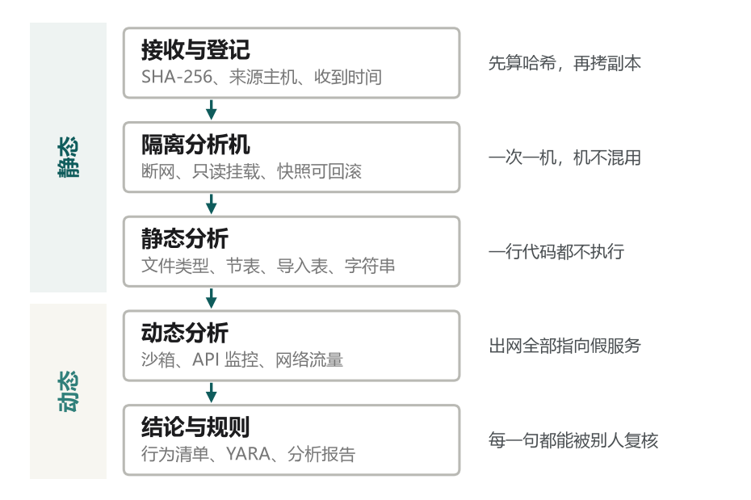
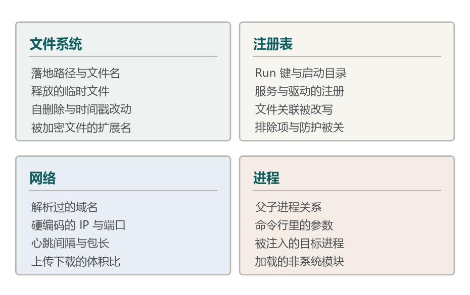

# 第十六章　恶意样本分析实战

周五下午，邮件网关拦下一个附件。解压之后是一个 4 MB 的可执行文件，名字叫 `付款通知_20261106.exe`。网关只负责拦，不负责判断，值班的人把它拷到共享盘上，问了一句这东西到底有没有害。

这个问题不能直接回答，但可以拆成一组能回答的小问题。它是什么格式的文件，大概由什么写出来，运行时想连哪里，在什么条件下才动手，在系统里留下哪些痕迹。这些问题的答案都不需要读懂汇编，也不需要把样本交给任何第三方。

顺序有讲究。先把自己和网络保护起来，再从“不执行”的角度读文件，然后在随时能扔掉的虚拟机里让它跑一遍，最后把看到的东西写成别人能复核的句子、固化成规则。跳步的代价不对称，前两步跳过最多是浪费时间，第三步跳过可能是一次真实的事故。

## 16.1 先把自己和网络保护起来

样本分析出事故，多半不是样本太强，是环境太随便。

第一条是隔离。分析机单独一台虚拟机，宿主机的共享文件夹、剪贴板同步、拖放通道全部关掉。这三条通道是最常见的泄漏口，样本不需要任何漏洞，只要写一个往 `\\VBOXSVR\` 或者 `\\vmware-host\` 下丢文件的循环，就能从虚拟机里爬出来。网络用 host-only 模式，不与办公网共用网段，网关指向一台分析专用的虚拟机。

第二条是快照。开机之后、动手之前打一个干净快照，跑完直接回滚。这个动作的价值在于让“重来”变得便宜，只有重来足够便宜，人才愿意承认上一次没看全，愿意换个角度再看一遍。

第三条是不上传。把样本丢到公开的多引擎扫描站或者公共沙箱，等于把样本连同你自己的调查意图一起公开。对方的控制服务器会看到这个哈希被查询过，运营者据此判断自己被发现了，换域名、换载荷、停手，你手上这条线索就断了。合规上也有麻烦，样本里可能带着别人的真实数据。要查哈希，用自己的情报库或者本地引擎。

剩下几条是细节，但都会影响结论的可靠性。样本以只读方式挂在分析机上，Linux 下用 `mount -o ro` 或者干脆放在无执行权限的目录里；样本传输时用密码压缩，业界惯用的密码是 `infected`，避免邮件网关和杀毒软件在半路把它删掉；分析机的系统时间与墙上的时间对齐，否则后面写时间线时所有时间戳都要手工换算。

<figure>

<figcaption>图 16-1　从接收到结论的五步，左侧是两段性质不同的工作。静态分析全程不执行样本，动态分析全程假设样本已经失控，两者的安全要求完全相反。</figcaption>
</figure>

登记这一步容易被当成形式主义，实际是后面一切工作的锚点。记录文件名、来源主机、收到时间、SHA-256，并且在动样本之前先算哈希。样本一旦被改名、被截断、被解压工具顺手改写，哈希就对不上了，后面所有结论都没法回溯到同一个文件。给自己的样本库建一个目录，一个样本一个子目录，里面放原文件、哈希清单、笔记，比什么都强。

## 16.2 不运行也能读出的东西

Windows 上的可执行文件绝大多数是 PE 格式（Portable Executable），结构从 1990 年代沿用至今，文档齐全，读它不需要逆向功底。

文件开头两个字节是 `4D 5A`，即 ASCII 的 `MZ`，是 DOS 时代留下的签名。真正的 PE 头位置藏在偏移 `0x3C` 处的四个字节里，这个值叫 `e_lfanew`，指向 `PE\0\0` 签名。签名之后是 COFF 文件头，记录目标架构、节的数量、编译时间戳；再往后是可选头，记录入口点、镜像基址、子系统版本；最后是节表，一节一节地描述代码和数据放在哪儿、有多大、有什么权限。

```bash
file payment.exe
objdump -x payment.exe | head -40
```

`file` 给出的是最粗的判断，`objdump` 能看到节表和导入表。想批量处理、想自己算统计量，用 `pefile` 更顺。

```python
import pefile

pe = pefile.PE("payment.exe")
for s in pe.sections:
    name = s.Name.decode(errors="replace").rstrip("\x00")
    print(f"{name:10s} raw={s.SizeOfRawData:>8d} "
          f"virt={s.Misc_VirtualSize:>8d} "
          f"chars={s.Characteristics:#010x} "
          f"entropy={s.get_entropy():.2f}")
```

输出值得盯的几处。

节的数量和名字。正常的编译器产物一般是 `.text`、`.rdata`、`.data`、`.rsrc` 四五节。只出现 `UPX0`、`UPX1`，或者 `.aspack`、`.themida`、`.vmp0` 这种名字，说明外面裹了一层壳。也有一类样本把节名起成 `.text` 之外的随机串，故意让人看不出结构。

原始大小和虚拟大小的比例。`raw=0` 而 `virt` 很大，意味着这块内存在磁盘上不占地方，运行时由解压代码填进去。这是加壳最直接的证据。

节的权限。可写又可执行（`Characteristics` 里同时含 `0x20000000` 和 `0x80000000`）的节，在正常程序里很少见，因为编译器默认不会这么安排。出现这种节，通常意味着程序要在运行时修改自己的代码，或者把解密后的内容写进去再跳过去执行。

熵。压缩或加密过的数据熵接近 8.0，正常代码和数据一般在 6 以下。整节熵 7.9 以上，基本可以认定被压缩或加密。

导入表是另一个高信息量的地方。一个正常程序会导入几十上百个函数，名字直白，来自 `kernel32.dll`、`user32.dll`、`advapi32.dll`。样本的导入表往往很少，只导入 `LoadLibraryA` 和 `GetProcAddress` 两个，其余函数在运行时按名字现查。这叫动态解析（dynamic resolution），目的是让静态分析看不到它到底调用了什么。导入表里如果出现 `VirtualAllocEx`、`WriteProcessMemory`、`CreateRemoteThread` 这三个的组合，基本可以判定它有往别的进程里写代码的意图，这三个函数是进程注入的标准三件套。

编译时间戳要谨慎对待。这个字段由编译器写入，改起来没有任何难度。看到 1970 年、未来的时间、或者与文件里其它线索明显矛盾的日期，本身就是一条信息，说明作者在有意干扰。

数字签名可以自己验。

```bash
signtool verify /pa /v payment.exe
```

签名有效只说明这个文件由证书持有人签出，不说明它安全。证书可能来自一家刚注册三个月的空壳公司，也可能是从别处偷来的。看到签名，要接着问签名者是谁、证书什么时候签发、这个签名者在别处有没有出现过。

节表之后还有一个常被忽略的区域。文件末尾到最后一个节结束之间，往往还有一段不属于任何节的数据，叫附加数据（overlay）。正规的安装包会把压缩内容放在这里，样本也会。用 `pe.get_overlay()` 取出这一段，看大小和熵，如果它占了整个文件的八成，真正的载荷就藏在那里，前面那些节只是解压器。资源节 `.rsrc` 是另一个常见藏匿点，图标、版本信息、对话框模板里塞一段加密数据，用资源编辑器打开只能看到一堆乱码。

## 16.3 字符串、壳与混淆

字符串是性价比最高的一步，几秒钟就能拿到一批线索。

```bash
strings -n 8 payment.exe | head -50
strings -el -n 6 payment.exe | head -50
```

第二条命令读的是 UTF-16LE 编码，Windows 程序里的宽字符字符串用 `strings` 的默认模式抓不到，漏掉这一半会得出完全错误的结论。

值得记录的字符串有几类。URL 和域名，直接指向控制服务器或者下载点。User-Agent，很多家族有固定的、抄来的 UA 字符串，是可以复用的指纹。注册表路径，`Software\Microsoft\Windows\CurrentVersion\Run` 这种一眼就是持久化。互斥体名（mutex），用来保证同一台机器上只跑一个实例，名字往往带家族特征，是最稳的 IOC 之一。PDB 路径，编译时留下的调试信息，常常带着开发机的用户名和项目目录名，`C:\Users\build01\Desktop\rat_v3\` 这样的路径比任何分析都更能说明作者在做什么。

字符串看不出来的时候，说明它被加密了，运行时才解出来。这时候有两个选择，一是上 FLOSS 这类专门还原混淆字符串的工具，二是在动态分析里直接从内存里捞。

壳的识别前面已经讲了静态特征，处理方式分两种。UPX 这类公开的壳，`upx -d payment.exe` 一条命令就脱掉，脱完再重新走一遍静态分析。非公开的壳没有通用解法，只能在沙箱里让它跑起来，等它自己解压完、跳到原始入口点（OEP），再把内存镜像 dump 出来。dump 出来的是运行时的样子，导入表通常是坏的，需要用工具重建。

脱壳的目的只是看清内容，不追求完美还原。一份能读的 dump，配上几段关键函数的反汇编，已经够写结论了。把时间花在修复一份完整的可执行文件上，通常不值。

## 16.4 让它跑一遍

动态分析要解决的核心矛盾是，你得让它以为自己在真实环境里，同时它干什么都不能造成真实后果。

网络这一层最容易做干净。分析机放在一个只有虚拟机的网段里，DNS 指向一台本地服务，所有域名都解析到它；HTTP、HTTPS、SMTP 这些常见协议由本地服务应答，返回准备好的假页面和假响应体。INetSim 和 FakeNet-NG 都是干这个的，装好之后基本不用配置。样本如果连出去了，你在 `tcpdump` 里能完整看到它请求了什么、期待什么样的回复，而不需要真的让它连到互联网。

监控分三条线同时开。

进程与文件这一层，Windows 上用 Process Monitor 看文件、注册表、进程操作的实时流，配合 Sysmon 拿到带哈希和父进程 ID 的结构化日志；Linux 上用 `auditd` 的 `execve` 规则加 `inotify`。要关注的不是“生成了什么文件”，而是“哪个进程在什么父进程下创建了它”。

API 这一层，`API Monitor` 或者 ETW 能把调用序列打出来。看到 `VirtualAllocEx` 分配、`WriteProcessMemory` 写入、`CreateRemoteThread` 启动这一串，就知道它注入了哪个进程。

网络这一层，除了包，还要记时序。多长时间发一次心跳，每次包多大，请求和响应的比例，这些是后面做检测规则时最有用的特征。

<figure>

<figcaption>图 16-2　样本行为的四类观察点。同一个动作往往在多个位置留下痕迹，交叉比对才能确认它真的发生了。</figcaption>
</figure>

样本也会反过来检查环境。查虚拟机的痕迹，`VBoxService.exe` 进程、注册表里的 `VBOX__` 键、网卡 MAC 的 `08:00:27` 前缀；查调试器，`IsDebuggerPresent`、`CheckRemoteDebuggerPresent`；查分析工具的进程名和窗口标题；查 CPU 核心数和物理内存，一台两核 2 GB 的机器不像办公电脑。条件不满足就睡过去，什么也不做，观察者得到的是一片安静。对付这类检测有两条路，一是把环境做真，补上核心数、装上常见软件、清掉虚拟机特征；二是在反汇编里找到这些调用，把条件跳转改掉。前者花时间，后者花功力，实际工作中往往两条一起走。

观察窗口要留够。样本的逻辑常常带延迟，等十分钟、等系统重启、等用户点开某个文档才动手，这段等待叫休眠（sleep）或者失速（stall），是专门用来熬过沙箱的。固定观察二十分钟、中途重启一次、再等十分钟，能覆盖大部分情况。在看清它做什么之前就下结论“没有外联”，是很常见的错误。

单次运行的结果也不代表全部。同一个样本在不同区域、不同系统版本、不同网络环境下的行为可能完全不同，控制服务器只对特定目标下发第二阶段载荷是常规做法。

## 16.5 结论怎么写才算数

分析报告里最容易出问题的是语言，不是技术。

“该样本意图窃取财务数据”这种句子没法验证，也没法反驳，写了等于没写。能站住的写法把结论拆成三层。

事实层，只写可以直接复核的观察。某个时刻，某个进程以某条命令行启动，父进程是谁，之后打开了哪个文件。每一句都能对应到一条日志或者一张截图。

推断层，写判断和它的依据。“通过计划任务实现持久化”后面要跟上具体的任务名、触发条件、命令行；如果还有别的解释（比如某个合法软件的更新程序也这么干），要把排除的过程写出来。

未知层，明说哪些没看到。观察窗口里没有外联，可能是控制服务器已经下线，可能是样本在等某个条件，也可能是它根本不联网。三种情况的处置完全不同，混在一句话里就没法用。

还有一个常见的坑是“没观察到”被写成“不存在”。所有结论都要带观察条件，跑了多久、什么系统、网络通不通。

举个具体的例子。观察到的现象是样本启动三分钟后向 `a.example-cdn.net` 发了一次 POST，请求体 1.2 KB，响应 204 字节。可以写成“每隔一段时间上报一次状态”，也可以写成“观察窗口内只发生了一次上报，间隔无法确定”。后一种写法啰嗦，但它没有把一次观察推广成规律。报告里被后续事件推翻的结论，多半都是这种提前推广造成的。

产出物里最有用的是 IOC，但 IOC 有寿命。文件名和哈希最脆，改一个字节就失效；IP 次之，云主机换得很快；域名能撑几个月；互斥体名、加密算法的常量、专用的注册表路径这类结构性特征最持久，能跨版本命中。给 IOC 分级比给一堆不分类的列表有用得多。

## 16.6 用 YARA 把发现固化成规则

报告是一次性的，规则是可以一直用的。把分析结论写成 YARA 规则，等于让这次分析在未来自动重复。

YARA 的结构很朴素，一个规则由三部分组成：元信息、字符串、条件。

```yara
rule Practice_Loader_AppData
{
    meta:
        author = "lab"
        date = "2026-11-20"
        description = "小型加载器，释放到用户目录后内存执行"
        sample = "e3b0c44298fc1c149afbf4c8996fb924"
        version = 1

    strings:
        $api1 = "VirtualAllocEx" ascii
        $api2 = "WriteProcessMemory" ascii
        $api3 = "CreateRemoteThread" ascii
        $path = "\\AppData\\Roaming\\svch0st\\" ascii nocase
        $ua   = "Mozilla/5.0 (Windows NT 6.1; WOW64)" ascii
        $mutex = "Global\\ms_upd_2026" ascii wide

    condition:
        uint16(0) == 0x5a4d and
        filesize < 3MB and
        pe.number_of_sections <= 6 and
        2 of ($api*) and
        ($path or $mutex) and
        not pe.is_signed
}
```

几处写法值得说明。`uint16(0) == 0x5a4d` 是最便宜的 PE 判断，比读整个头部快得多，能先把非 PE 文件筛掉。`2 of ($api*)` 用的是带通配符的字符串集，含义是这一组里至少命中两条，比写 `all of them` 宽松，比 `any of them` 严格，正好对应“注入三件套里出现两个”这种实际情况。`ascii wide` 让同一个字符串同时匹配单字节和双字节两种编码，针对 Windows 样本几乎总要加上。`not pe.is_signed` 把已签名文件排除掉，能砍掉大量误报。

规则写完必须测，而且要往两个方向测。

```bash
yara -s -w loader.yar samples/
yara -r -w loader.yar /path/to/clean_corpus/
```

第一条用已知的恶意样本验证，`-s` 会把命中的字符串打出来，方便确认命中的是预期的那几条而不是凑巧。第二条用一批干净文件跑，最理想的是整个 `C:\Windows\System32` 目录，几百个规则一起跑一遍，看看会不会命中系统文件。一条规则在干净集合上命中任何东西，都要回去改条件。

规则命名带前缀（`Practice_`、`APT_`、家族名），每条规则带 `version` 和 `date`，改动时递增。没有版本号的规则库，半年之后就没人敢动了。

最后是报告骨架，五段够用。

样本标识，哈希、原文件名、来源、收到时间。结论，三到五条，每条一句话，后面跟证据编号。行为与证据，用表格列时间、动作、证据来源，一行一个动作。IOC 与规则，按寿命分级，附规则文件路径。未解决的问题，写清楚下一步要什么才能继续。

这份东西的读者通常不是分析者本人，是第二天要决定封哪个域名、要不要重装机器的人。写的时候心里装着这个读者，就不会把篇幅花在炫技上。

<div class="chapter-end"></div>
