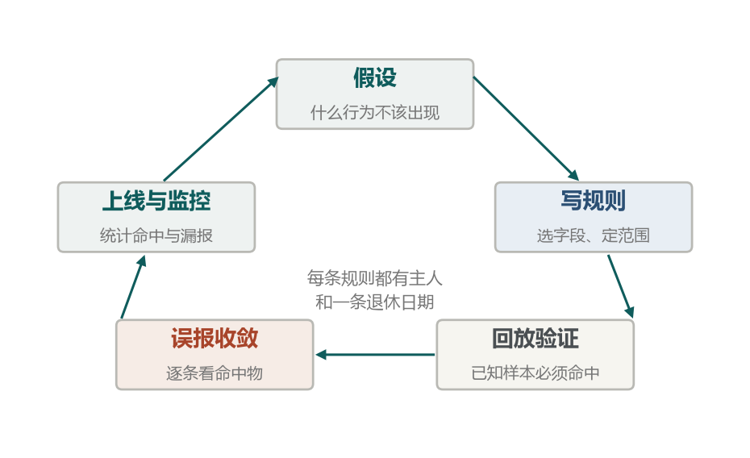
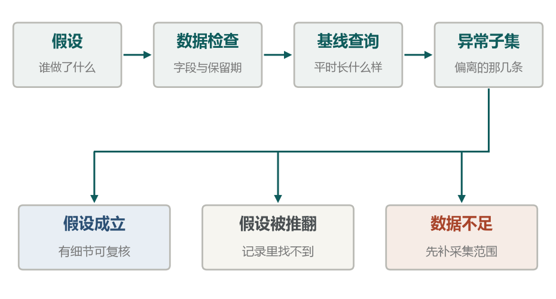

# 第十七章　检测工程与日志狩猎

凌晨三点十七分，值班群里进了一条告警：某台服务器上 `powershell.exe` 带 `-enc` 参数启动。值班的人点开看了一眼，这台机器每小时都报一次，昨天报的也是同一行，前天也是。他点了“已确认”，继续睡。

同一个晚上，另一台机器上 `certutil.exe` 把一个 40 KB 的文件写进了 `C:\ProgramData\`，之后每隔五分钟连一次外部地址。没有告警，因为没有人为这个动作写过规则，也没人注意到它。

这两件事放在一起，说明检测的瓶颈不在数据量。日志一直在产生，缺的是把“什么不该发生”变成一条能被机器执行的判断，以及判断写完以后有人负责验证它到底准不准。

检测工程（detection engineering）就是干这个的。它更像软件工程而不是安全运维，有版本、有测试、有回归、有废弃流程。狩猎（threat hunting）是它的上游，负责找出还没有规则覆盖的行为。

## 17.1 四条日志源，各自能回答什么

写规则之前先要知道手上有什么。四条常见的日志源，覆盖的能力差别很大。

Windows 安全日志（Security）记的是身份与授权相关的事件。`4624` 登录成功，里面带登录类型，2 是本地交互，3 是网络，10 是远程桌面；`4625` 登录失败；`4672` 给账号指派了高权限；`4720` 新建用户；`4698` 创建计划任务；`4769` 请求 Kerberos 服务票据，加密类型字段出现 `0x17` 时值得看一眼，那是 RC4，Kerberoasting 的典型痕迹；`1102` 日志被清空，这条几乎不需要判断，出现就该查。服务安装的事件不在这个日志里，在 System 日志的 `7045`。

进程创建是 `4688`，但它默认不记命令行，需要在组策略里打开“审核进程创建”，再单独打开“在进程创建事件中包含命令行”。这一步没做，`4688` 只告诉你启动了一个程序，不告诉你它带了什么参数，而参数往往才是全部信息量。

Sysmon 补的正是这块。它是个独立驱动，事件编号自成一套。`1` 进程创建，带命令行、父进程、文件哈希；`3` 网络连接；`7` 映像加载，能看到进程加载了哪些 DLL；`8` 远程线程创建；`10` 进程访问，`TargetImage` 是 `lsass.exe` 的那种访问基本就是凭据转储；`11` 文件创建；`13` 注册表值写入；`22` DNS 查询。Sysmon 默认配置记的东西太多，一天的日志能到几个 GB，实际部署要用一份社区维护的配置文件裁剪，只留关心的类型。

Linux 上对应的是 auditd。它按规则记录系统调用，规则长这样。

```bash
auditctl -a always,exit -F arch=b64 -S execve -F auid>=1000 -F auid!=4294967295 -k exec_cmd
ausearch -k exec_cmd -ts today | aureport -f -i
```

第一条挂一条规则，记录所有以普通用户身份发起的 `execve`，打上 `exec_cmd` 标签。`auid!=4294967295` 排除掉没有登录会话的进程，不加这个条件，日志里会塞满系统守护进程。第二条按标签和日期检索，再汇总成可读的文件访问报告。规则要落盘到 `/etc/audit/rules.d/` 才能重启后保留，命令行里加的规则重启就没了。

网络流是第四条。NetFlow 和 IPFIX 只记五元组、起止时间、字节数和包数，不记内容，好处是量大也不贵。它能回答“哪两台机器在通信、传了多少”，回答不了“传的是什么”。Zeek 这类工具更进一步，从流量里还原出 `conn.log`、`dns.log`、`http.log`，字段结构规整，适合做关联分析。

| 数据源 | 能回答 | 回答不了 |
| --- | --- | --- |
| Windows 安全日志 | 谁登录、谁被授权、账号变更 | 进程做了什么 |
| Sysmon | 进程、网络、注册表、模块加载 | 参数的含义、文件内容 |
| Linux audit | 命令执行、文件与权限变更 | 图形界面里的动作 |
| 网络流 | 谁和谁通信、传了多少 | 传的是什么 |

这张表反过来用更有价值。写规则前先问一句，要判断的行为在哪个源里能留下痕迹。想检测“有人读取了 lsass 内存”，安全日志里没有，只有 Sysmon 的事件 10 或者 EDR 的遥测。源里没有的东西，规则写得再漂亮也命不中。

还有两个容易被忽略的前提。一是时间同步，所有主机、网络设备、日志服务器必须指向同一组 NTP 源，偏差控制在秒级。两台机器的时间差两分钟，关联查询就会把 A 机上的登录和 B 机上的进程对不上号，事后重建时间线会变成一场灾难。二是保留期，大多数平台默认只存三十天，出事之后才发现需要三个月前的日志，这种事后没有补救办法。算一下存储成本，在预算允许的前提下把它加到最长，比多买一套告警工具有用。

## 17.2 Sigma：把检测意图写成能移植的文本

各家 SIEM 的查询语言都不一样，Splunk 用 SPL，Elastic 用 EQL 或 KQL，Sentinel 用 KQL 的另一个方言。为每个平台重写一遍规则，是纯粹的浪费。

Sigma 用一种中立的 YAML 描述检测逻辑，再由转换工具生成各平台查询。一条真实可用的规则长这样。

```yaml
title: 计划任务指向用户可写目录
id: 5f0c1a3e-2b7d-4a86-9c1e-3d2f4b5a6c70
status: experimental
description: schtasks 创建的任务，可执行文件落在用户目录下
references:
    - https://attack.mitre.org/techniques/T1053/005/
author: lab
date: 2026/11/20
logsource:
    category: process_creation
    product: windows
detection:
    selection_img:
        - Image|endswith: '\schtasks.exe'
        - OriginalFileName: 'schtasks.exe'
    selection_args:
        CommandLine|contains|all:
            - '/create'
            - '\AppData\'
    filter_system:
        User|contains: 'SYSTEM'
    condition: selection_img and selection_args and not filter_system
falsepositives:
    - 安装程序自建更新任务
level: medium
tags:
    - attack.persistence
    - attack.t1053.005
```

几个字段值得单独说。

`logsource` 决定这条规则能不能被正确翻译。`category: process_creation` 表示需要进程创建事件，转换工具会按目标平台把它映射到 `4688`、Sysmon 事件 1 或者 EDR 的进程表。写错成 `product: windows` 而没给 `category`，生成出来的查询就会指向一堆不相干的事件。

字段修饰符是控制精度的主要手段。`Image|endswith` 匹配路径结尾，比 `|contains` 不容易被 `C:\tools\schtasks.exe.bak` 这种路径误伤。`CommandLine|contains|all` 要求列表里每一项都出现，且不限定顺序，比写成一整条正则更耐得住参数顺序变化。

`filter` 段单独命名的习惯值得养成。每加一条过滤，就写上它排除的是什么样本、依据是什么。三个月后回头看，没有理由的过滤是删不掉的，因为它可能正在压着某个真实告警。

`falsepositives` 不是写给人看的客套话，是给自己留的提醒。写不出来的规则，通常说明还没想清楚。

转换命令由 pySigma 提供。

```bash
sigma convert -t splunk -p splunk_windows rule.yml
sigma convert -t sentinel rule.yml
```

规则库用 Git 管，一条规则一个文件，文件名带编号。改动用 Pull Request，评审看三件事，条件是否够窄、过滤是否有理由、`level` 是否和实际影响匹配。

## 17.3 一条规则的一生

规则不是写完就完事的资产，它有生命周期，而且大多数规则最终会死掉。

<figure>

<figcaption>图 17-1　检测规则的开发闭环。顺时针五步，任何一步缺失，规则都会在上线后以大量误报或长期沉默的形式暴露出来。</figcaption>
</figure>

起点是一个假设，不是一条日志。假设的形式是“某类行为在这套环境里不该出现”，比如“财务部门的机器不会主动向外发起 SMB 连接”。假设来自对业务的理解，也来自对手手法的研究，两者都缺的时候，写出来的规则只能覆盖已知样本的表面特征。

接着要做数据可用性检查。这条规则需要的字段，现在采到了吗，保留多久，覆盖率多少。全公司五千台机器，Sysmon 只装了八百台，那么规则的有效覆盖率就是百分之十六，命中率再怎么优化也补不上这个缺口。这一步经常把假设直接否掉，否掉也是产出。

写完要回放。手上有历史日志的，把过去三十天到九十天的数据跑一遍，看命中了什么。命中的每一条都要人工看，判成真阳性的留下，判成误报的想办法收窄。没有历史数据的，用 Atomic Red Team 这类工具在测试机上把对应技术执行一遍，产生真实遥测，再验证规则是否能命中。这一步叫真阳性验证，缺了它，规则可能一直是哑的。

误报收敛是最耗时间的环节，也是最能体现功力的。常见手法有几种：把条件从字符串包含改成路径结尾或完整匹配；加上父进程条件，限定调用者；加上执行用户条件，排除服务账号；拆成两条规则，一条宽泛但低危，一条窄但高危。每加一个条件，都在牺牲召回换精确，这个取舍要写进注释。

上线之后要监控两件事，命中量和确认率。一条规则每天命中三百次，分析师会直接把它静音，等于没上线。一条规则一个月零命中，可能是环境里真的没有，也可能是数据断了，要主动确认是哪一种。

退役的标准要事先写下来，常见三条：连续一段时间零命中且对应行为已经不可能出现；数据源变更导致规则失效；被更宽的规则完全覆盖。没有退役机制，规则库会在两年内膨胀到没人敢动。

规则库还需要分层，否则它会退化成一堆平铺的文件。常用的分层是三层。底层是原始遥测的完整性监控，比如“某台机器一整天没有任何 Sysmon 事件”，这类规则不检测攻击，只保证上层规则有数据可用。中间层是行为规则，数量最多，覆盖具体技术。顶层是关联规则，把几条行为按顺序和主机串起来，比如“同一主机十分钟内出现钓鱼附件释放、Office 子进程启动、外连新域名”三件事。三层混在一起写，工程师每天会被中间层的大量告警淹没，反而看不见顶层那几条真正重要的。

## 17.4 狩猎：从一个说不通的点开始

狩猎和告警的区别在于谁先动。告警是规则先动，人是被动响应；狩猎是人先提出一个猜测，然后去数据里找证据。

<figure>

<figcaption>图 17-2　一次狩猎的路径。三种结论都算收获，最没用的是“查了一下没发现”却说不清查过什么。</figcaption>
</figure>

起点通常是一个说不通的现象。某台机器每天凌晨两点向一台内网服务器发起 30 次 RDP 连接，失败 29 次；某个账号在三个不同的城市登录；某台开发机的出网流量在周末翻了三倍。这些现象单独看都能解释，合起来就值得追。

假设要写成可以被查询否定的句子。“有人在用合法运维工具做横向移动”太空，“过去三十天里，存在同一账号在一小时内从两台不同主机发起 WinRM 连接的情况”就能直接翻译成查询。

```text
index=wineventlog EventCode=4688
  (Image="*\\wsmprovhost.exe" OR CommandLine="*Invoke-Command*")
| stats dc(Computer) as hosts values(Computer) as host_list by Account_Name
| where hosts > 1
```

跑完拿到的是一个候选集，不是结论。接着要补上下文：这些主机是不是同一批运维负责的，时间段是不是在变更窗口内，账号是不是服务账号。上下文补齐之后，要么得出结论“是正常的自动化脚本”，要么得出“有一个账号在多台机器上横向”，要么得出“数据里看不到区分正常与异常所需的字段”。

三种结论都有价值。第一种让你知道这条假设不成立，可以排除掉一整类误报；第二种直接进事件响应；第三种会变成一条采集需求，比一条规则更有用。

狩猎的产出不该是“一份报告”，而是三样东西中的至少一样：一条新规则、一条采集缺口、一条已经被证实不存在的路径。三样都没有，说明这次狩猎没走完。

再举一个例子，假设是“有主机在用 DNS 通道外传数据”。DNS 查询日志里每个域名都是合法的，看不出问题，要看的量是长度、频率和熵。一个域名标签长达五十多个字符、由随机字符组成、查询间隔均匀到秒级，这三条同时成立时，它是隧道的可能性远高于它是正常业务。这类狩猎的结果往往不是一条可以直接上线的规则，而是一份基线，先算出本环境里域名长度的分布，把尾部那百分之一圈出来，再决定阈值定在哪里。

## 17.5 ATT&CK 映射用对了才有用

ATT&CK 是一张行为清单，按战术（tactic）分组，每组下面是技术（technique）和子技术（sub-technique）。战术描述目的，比如持久化、提权、横向移动；技术描述手段，比如计划任务、注册表运行键、进程注入。

常见的误用有三种。

第一种是映射到战术。写“这条规则覆盖持久化”，等于什么都没说，因为持久化底下有几十种技术，覆盖了哪一种必须点名。规则标签应该落到技术编号，`attack.t1053.005` 指的是计划任务，`attack.t1547.001` 指的是注册表运行键，粒度差了一个数量级。

第二种是把映射当成覆盖率指标。给管理层看一张“覆盖了 68% 的技术”的图很好看，实际意义有限。一条规则可以映射到某个技术，但它可能只覆盖了这个技术的一种实现，而对手用的是另一种。反过来，一条很扎实的规则可能只映射到一个技术，价值却远高于十条浅规则。

第三种是不管版本。技术会合并、会拆分、会废弃。曾经的 `T1064` 脚本执行已经并入 `T1059` 命令行解释器，还挂在旧编号上的规则，标签和文档都在慢慢失去意义。规则库里的 `tags` 应该定期和当前版本的 ATT&CK 对照一遍，这项工作很枯燥，但不做的话两年后没人知道标签在说什么。

映射真正的用处是找空白。把现有规则按技术和数据源排成一张表，空着的格子就是没有检测能力的地方，而对手实际会走哪些格子，取决于你的行业和资产。空白不一定都要填，但要明确知道自己是选择不填，还是忘了填。

## 17.6 评测：让规则接受检验

规则写完、上线、跑了一段时间，接下来要回答一个不太好回答的问题，它到底有用吗。

最低限度的评测是回放。把过去半年的日志存下来，规则改一次就跑一次全量，看命中集合的变化。能回放多久，取决于日志保留期，保留 30 天的环境只能验证最近一个月的行为，这一点要在文档里写清楚，免得把“回放没命中”误当成“历史上没发生”。

再往上一层是模拟执行。Atomic Red Team 把 ATT&CK 的技术拆成一条条可执行的小测试，跑一条，看遥测里有没有对应的记录，规则有没有报警。这种方法的好处是可控、可重复，缺点是它产生的是“教科书式”的遥测，真实对手会加壳、会混淆、会挑不常见的实现方式，模拟测试过了不代表实战能过。

最接近真实的评测是红队。攻击队按真实手法打一遍，防守方不知道时间和路径，事后统计哪些动作被抓到、延迟多久、告警有没有被正确处理。这种评测的代价高，一年做不了几次，但它能暴露前面两种方法都发现不了的问题，比如告警进了队列但没人看，或者规则命中了却被分析师的过滤条件吃掉。

指标上要诚实。精确率（precision）可以测，把命中样本人工判一遍就能算出来。召回率（recall）在真实环境里基本测不了，因为你不知道漏掉了什么。能测的替代指标是覆盖率，即已知手法里有多少条路径有规则覆盖，以及平均检出时间，从行为发生到告警被确认的时间差。

一套检测体系做到最后，真正的资产不是规则文件，是对“这台机器上什么算正常”的共识。规则只是这个共识的可执行形式，共识变了，规则就得跟着改。

<div class="chapter-end"></div>
