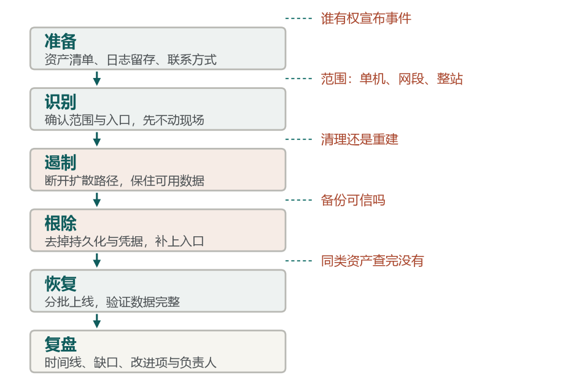
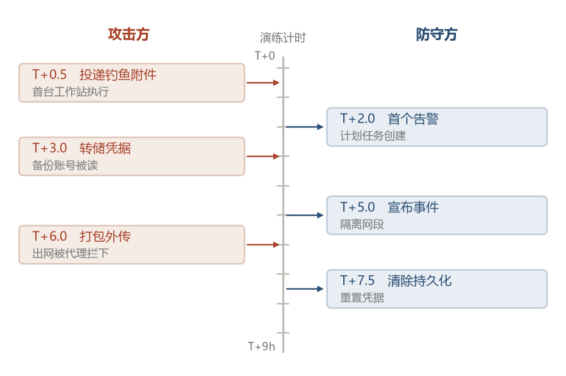

# 第十八章　应急响应与红蓝演练

周一早上八点四十，财务共享盘打不开了。IT 上去看，服务器上多了一批扩展名为 `.locked` 的文件，桌面上躺着一个 `README_RESTORE.txt`，里面写着要联系某个邮箱，附了一串 Tor 地址。备份服务器在同一个网段，凌晨三点有过一次成功的登录，用的是域管理员账号。

接下来几个小时的每个决定都会影响结果。先关服务器还是先拔网线，先看备份还是先找入口，先重置密码还是先保留内存。做错顺序不会让事情立刻变得更糟，但会让后面几天的恢复工作成倍变长。

这一章讲两件事。一件是出事之后按什么顺序动手，另一件是没出事的时候怎么演练这套顺序。两件事的底层逻辑是一样的：把有限的时间和注意力，放在最不可逆的环节前面。

## 18.1 六个阶段与它们的时间尺度

教科书上的响应流程分六个阶段，准备、识别、遏制、根除、恢复、复盘。实际过程很少这么顺，经常在遏制的中途发现范围比想象的大，退回识别重来，或者一边恢复一边又被加密一批。

<figure>

<figcaption>图 18-1　六个阶段以及阶段之间的决策点。虚线标出的五个问题，是每个阶段结束时必须有人明确回答的，答不出来就不能往下走。</figcaption>
</figure>

准备阶段的工作全在平时。资产清单要能回答“这台 IP 上跑的是什么业务、归谁管”，没有这个，出事之后连该给谁打电话都不知道。日志留存要覆盖足够长的时间，最短三十天，重要系统九十天以上。离线备份要定期做恢复演练，备份文件存在但恢复不出来，是勒索事件里最常见的二次伤害。授权文件要提前签好，写明谁有权决定断网、停机、报警。

识别阶段要做的是确认和划定范围。确认这件事真的发生了，不是运维在做迁移；确认范围是一台机器、一个网段还是整个域；确认入口大概在哪。这个阶段最容易被跳过，人手紧张的时候，人们倾向于看到一个可疑进程就开始删，删完发现同一批文件在另外三十台机器上都有。

遏制分短期和长期。短期遏制的目标是立刻止血，手段往往很粗暴，断开网段、禁用账号、关掉某个服务。长期遏制是在止血之后建立一个能维持几天的状态，让业务在受限条件下继续跑，同时给根除争取时间。这两个动作经常被混为一谈，结果是要么止不住，要么止血的手段太猛，把业务一起停了。

根除是清除持久化机制、修补入口、重置可能泄露的凭据。这一步的难点在于“清除干净”，攻击者留下的东西往往不止一个，计划任务、服务、注册表项、被改过的合法二进制、被加了成员的账号组，漏掉任何一个，恢复之后几天内会重新被控。

恢复要分批。先恢复认证系统，再恢复核心业务，最后恢复办公。每一批上线之前要验证数据完整性，验证方式不只是“能打开”，而是抽样比对哈希或者业务校验。恢复过程中要继续监控，攻击者经常等恢复完成再回来。

复盘放在最后，但不是最不重要。它的产出是改进项，改进项能不能落地，决定了下一次事件的时长。

## 18.2 勒索事件：先断什么，先保什么

勒索是应急里最常见也最容易做错顺序的一类。下面这个顺序不是唯一正确的，但每一步的理由都是硬的。

第一件事是确认备份还在不在。在动任何一台机器之前，先去备份系统上确认，最近的备份有没有被加密、被删除、被改了保留策略。攻击者在加密之前通常会先花几个小时到几天，把备份毁掉，常用命令有三个，`vssadmin delete shadows /all /quiet` 删卷影副本、`wbadmin delete catalog` 删备份目录、`bcdedit /set {default} recoveryenabled No` 关掉恢复环境。这些命令在事件日志和进程记录里都有痕迹，可以在确认备份时顺手查一遍。备份安全，整件事的性质就从“灾难”降级成“麻烦”。

第二件事是断网络，不是关机。关机看起来干脆，代价是内存里的东西全没了。正在运行的加密进程、内存里的密钥、攻击者的连接、还没落盘的命令行历史，全都在内存里。正确的做法是拔掉网线或者关掉交换机端口，保留电源。虚拟机直接断开虚拟网卡，效果一样。无线网络要单独确认，很多笔记本同时连着有线和无线，拔了网线还在传。

第三件事是保住现场。在断网之后、任何清理动作之前，把内存抓下来，把关键机器的磁盘做镜像。抓内存这件事越早越好，因为它最易失。具体动作下一节讲。

第四件事才是判断范围。查同一时间窗内哪些机器上有相同的文件、相同的计划任务、相同的登录来源。勒索软件的横向通常走 SMB 或者远程桌面，查 445 端口的连接和 3389 的登录记录，能把传播路径大致画出来。

第五件事是处理凭据。如果域管理员账号被用过，只改密码不够。Kerberos 的票据有寿命，攻击者拿到的票据在密码改掉之后仍然有效，这就是黄金票据（golden ticket）。标准做法是把 `krbtgt` 账号的密码重置两次，两次之间要等超过最大票据寿命，域环境默认是十小时。这一步做完之前，任何“已经清干净”的结论都不成立。

有几件事不要做。不要一上来就删加密文件，那些文件是分析入口和手法的原料。不要立刻格式化重装，重装会毁掉所有能用来判断入口的证据。不要在没确认备份的情况下重启域控。不要在没有专业谈判支持的情况下私下联系对方，付款之后拿到解密工具的承诺，兑现比例并不高。

恢复的顺序和业务重要性不完全一致。先恢复认证（域控、DNS、DHCP），再恢复备份系统本身，然后是核心业务数据库，最后是办公文件。每恢复一层，观察二十四小时再往下走。全部恢复完再统一观察，出问题时无法定位是哪一层带进来的。

## 18.3 内存与磁盘取证的基本动作

取证的第一原则是易失性顺序，越容易消失的东西越先抓。RFC 3227 给出的顺序大致是，寄存器和缓存最先，然后是内存与网络连接状态，再往后是临时文件系统与交换分区、磁盘、远程日志、备份与归档。实践中能抓的通常是中间几项，其中内存最容易被跳过，也最容易被毁掉。

抓内存的工具按平台分。Windows 上用 WinPmem 或者 Magnet RAM Capture，命令行下 `winpmem_mini_x64.exe mem.raw` 一条就够。Linux 上用 LiME 内核模块，把 `/dev/mem` 或者 `/proc/kcore` 映射成一个文件。虚拟化环境下更简单，直接对虚拟机做快照，快照文件里就包含内存状态。

抓之前和抓之后各算一次哈希，两个值都写进记录。内存镜像的哈希在分析过程中不会变，但如果镜像被复制、被截断，哈希就对不上，证据链就断了。

磁盘镜像要先解决写保护。物理机上用写阻断器（write blocker），软件方案是在 Linux 下以只读方式挂载，或者在 Windows 上用带只读开关的采集工具。命令行的经典做法是 `dcfldd`，边复制边算哈希。

```bash
dcfldd if=/dev/sda of=/evidence/disk01.dd bs=4M hash=sha256 hashlog=/evidence/disk01.sha256
```

企业环境里更常用 E01 格式，带压缩和分卷，FTK Imager 或者 `ewfacquire` 都能生成。格式本身不影响分析，影响的是后面的工具链能不能直接读。

证据记录要回答四个问题，谁采集的、什么时候、用什么工具和版本、结果哈希是多少。这份记录要和使用者分离保管，取证的人不负责保管证据，是行业里通行的做法。

分析阶段，内存镜像用 Volatility 3 处理。

```bash
vol -f mem.raw windows.pslist
vol -f mem.raw windows.netscan
vol -f mem.raw windows.malfind
```

`windows.pslist` 列进程树，看有没有父进程异常的条目；`windows.netscan` 列当前和残留的网络连接，勒索软件的控制连接常常还挂在那里；`windows.malfind` 扫可执行且非常规映射的内存区域，注入了代码的进程会露出来。三条命令跑完，通常就能定位到可疑进程和它的落地路径。

磁盘侧看三样东西，文件系统元数据、注册表、事件日志。NTFS 的 `$MFT` 记录每个文件的创建、修改、访问时间和大小，`$UsnJrnl` 记录文件系统层的变更流水，这两样合起来能还原“某个时间点出现过哪些文件”。注册表的 `SYSTEM` 和 `SOFTWARE` 里能找到服务、驱动、启动项；`NTUSER.DAT` 里的 `Run` 键和最近打开的文件，能说明用户在做什么。事件日志前面提过，安全日志看登录，System 日志看服务安装，PowerShell 的 4104 脚本块日志在开启的情况下能看到实际执行的代码。

## 18.4 时间线重建

时间线是把散落在各处的记录按时间排成一条线。它的价值不在于“完整”，而在于把因果关系串起来，看清楚第一步和第二步之间隔了多久。

多源合并的头号问题是时间基准。文件系统时间、事件日志时间、网络设备时间、应用日志时间，各自来自不同的时钟。做时间线之前先统一到 UTC，并记录每个源与标准时间的偏差。设备时间差三分钟，就足以让“谁先谁后”的判断反过来。

工具上，plaso 是常用的选择，先把各种来源解析成一个统一的存储，再导出成表格。

```bash
log2timeline.py --storage-file case.plaso /evidence/
psort.py -o l2tcsv -w timeline.csv case.plaso "date > '2026-11-20 00:00:00'"
```

`log2timeline.py` 认几百种格式，包括事件日志、注册表、浏览器历史、`$MFT`。`psort.py` 负责过滤和导出，第二个参数是过滤表达式，只导出关心的时间段，否则几十万行没人看得完。

时间戳本身可能被改。NTFS 里每个文件有两组时间，`$STANDARD_INFORMATION` 属性和 `$FILE_NAME` 属性各存一份。恶意程序改时间戳时通常只改前者，用 `SetFileTime` 这类接口能改的就是它，后者由文件系统在重命名、移动时写入，改起来麻烦得多。两份时间对不上，尤其是 `$FILE_NAME` 的创建时间晚于 `$STANDARD_INFORMATION` 的修改时间，就是时间戳篡改（timestomping）的直接证据。

时间线做多细，取决于要给谁看。给管理层看的版本只保留五到十个关键节点，每次转折一句话。给技术团队看的版本要带证据引用，每个节点后面跟来源文件、行号或者事件 ID。两个版本都要准备，混在一起写的结果是两边都不满意。

一个实用的判断是，时间线只要能做到回答这三个问题就够了：第一台机器是怎么被进来的，横向用了什么，数据在什么时候、以什么方式出去的。回答不了，说明还缺数据源，缺什么就写在复盘报告里。

## 18.5 复盘报告与改进项

复盘报告不是事件记录的堆砌，它要回答两个问题，为什么会发生，下次怎么让它不发生或者发生得更晚。

报告结构可以固定成五段。事实部分只写有证据支撑的内容，按时间排列，每条后面带来源。影响部分写清业务停了多少小时、丢了多少数据、有没有外泄、有没有监管报送义务。根因部分要分技术和流程两层，技术根因是那个被利用的漏洞或者被猜到的密码，流程根因是为什么这个漏洞三个月没打补丁、为什么这个密码能被猜到。处置评估部分诚实写哪些决策做对了、哪些做晚了。改进项部分是可执行的任务清单。

改进项的质量决定整份报告的价值。判断标准只有一条，能不能被验证。“加强员工安全意识”没法验证，“在三十天内把 445 端口从办公网段阻断，用内网扫描确认无开放主机”可以验证，而且到期就能检查。

每条改进项要带三样东西，负责人、截止日期、验收方式。缺任何一样，它就只是一句愿望。经验上，一次中等规模事件的改进项控制在十到十五条，太多了一条也做不完，太少说明没找到问题。

复盘会的形式也影响结果。会上不谈个人责任，只谈决策和条件，这条原则在航空业用了几十年，在安全团队里同样成立。一个人在凌晨三点、信息不全、连续工作十四小时的条件下做出错误判断，是系统的问题，不是他的问题。把会开成追责会，下一次没人愿意在第一时间报告异常。

## 18.6 红蓝演练的组织与边界

演练的价值在于让上面所有流程在没有真实损失的情况下跑一遍。跑一遍就会暴露很多平时看不出来的东西，比如断网的决定要等两个小时才能批下来，比如备份系统的密码只有一个人知道，而他在休假。

<figure>

<figcaption>图 18-2　一次八小时演练的时间线。攻击方的每个动作都在时间轴上留下对应位置，防守方的检出与响应延迟可以直接量出来，这个差值比“谁赢”更有意义。</figcaption>
</figure>

组织上至少要三方。红队负责攻击，只用事先约定的手法和范围。蓝队是被测方，事前只知道大致时间窗，不知道具体路径。白队负责控制和裁判，掌握全部信息，判定得分、处理越界，并在出现意外时叫停。规模大一点的演练还会加观察员，只记录不参与。

规则边界要写成文档，双方签字。至少包含五项内容。范围，哪些网段、哪些资产可以碰，哪些绝对不行，生产数据库和真实客户数据通常列在后者。时间窗，从几点到几点，超出时间窗的攻击一律算违规。禁止动作，拒绝服务、破坏性操作、社工真实员工、把数据传出组织边界，这四类基本都禁。通信方式，红队每天报备进度，出现“疑似真实事件”时通过什么渠道去冲突（deconfliction），避免蓝队把演练当成真实入侵去报警。紧急停止，一个双方都知道的词，说了就全部停手。

授权的书面文件不能省。它写明谁授权、授权范围、有效时间，在红队被第三方安全设备拦下、被 ISP 投诉、被执法部门问询时，这份文件是唯一能解释清楚的东西。

评分方式直接影响演练结果的可信度。按“攻破了几台”评分，会诱导红队走最激进的路；按“检出时间”和“响应时间”评分，才和防守能力的提升相关。常用的指标有三个，首次检出时间（从第一个动作到第一条告警）、确认时间（从告警到宣布事件）、遏制时间（从宣布到扩散停止）。三个数字和真实事件里的数字对比，差距就是需要补的地方。

有一类失真必须提前排除。红队用了蓝队根本采集不到的数据源，或者用了蓝队没有部署的工具，得出的“未被检出”结论没有意义。演练之前双方要对一遍可见性清单，明确哪些日志正在采、哪些没采，否则复盘时会陷入“你要是装了 EDR 就能看见”这种无解的争论。

## 18.7 前两小时的命令清单

事发之后最缺的不是工具，是一份按顺序排好的命令。下面这些全部只读，可以放心地跑，跑完拿到的结果直接决定后面做什么。

先确认备份。这是唯一能改变事件性质的一步。

```bash
vssadmin list shadows /for=C:
wbadmin get versions -backupTarget:E:
```

第一条列卷影副本，第二条列备份历史。返回 `No items found that satisfy the query` 时不要立刻下结论，先看是不是命令打错了卷或备份目标。确认之后再看备份文件本身的时间戳与大小，一份看上去存在但三天没更新的备份，和没有备份差不多。

接着定范围。同名的加密标记文件是最好的筛选条件。

```powershell
Get-ChildItem -Path \\fs01\share -Recurse -Filter *.locked -ErrorAction SilentlyContinue |
  Measure-Object -Property Length -Sum |
  Select-Object Count, @{n='GB';e={[math]::Round($_.Sum/1GB,1)}}
```

`-ErrorAction SilentlyContinue` 不能省，遇到拒绝访问的子目录时它会跳过而不是中断。统计出来的是“已经加密了多少”，这个数字决定要不要直接启动灾难恢复，而不是继续排查。

然后找回入口。登录日志里有两类值得看，网络登录与远程桌面。

```powershell
Get-WinEvent -FilterHashtable @{LogName='Security'; Id=4624; StartTime=(Get-Date).AddHours(-48)} |
  ForEach-Object {
    $x = [xml]$_.ToXml()
    $d = @{}; $x.Event.EventData.Data | ForEach-Object { $d[$_.Name] = $_.'#text' }
    if ($d['LogonType'] -in '3','10') {
      [pscustomobject]@{ Time=$_.TimeCreated; User=$d['TargetUserName'];
                         Type=$d['LogonType']; Src=$d['IpAddress'] }
    }
  } | Group-Object User, Src | Sort-Object Count -Descending | Select-Object -First 20
```

`LogonType` 只看 3 和 10，因为勒索的横向几乎全走 SMB 与远程桌面。按账号与源地址分组，突发的那一组就是传播路径。

这些查询在大日志上会跑得比想象中慢。`-FilterHashtable` 会被翻译成 XPath，由日志服务在读取时就过滤，比把所有事件拉进管道再用 `Where-Object` 筛快上百倍，但它的条件表达力有限，复杂的字段判断只能放在 `ForEach-Object` 里做。安全日志动辄几 GB 时，先用 `-FilterHashtable` 把范围缩到几小时，再在内存里过滤字段，顺序反了会让一条查询跑上半小时。

再把不在系统目录里的服务和计划任务列出来。

```powershell
Get-CimInstance Win32_Service |
  Where-Object { $_.PathName -and $_.PathName -notlike 'C:\Windows\*' } |
  Select-Object Name, StartMode, StartName, PathName
Get-ScheduledTask |
  Where-Object { $_.Actions.Execute -and $_.Actions.Execute -notlike 'C:\Windows\*' } |
  Select-Object TaskPath, TaskName, @{n='Exec';e={$_.Actions.Execute}}
```

这两条能直接找出攻击者留下的持久化，但也会列出一堆正规软件（备份代理、监控探针大多装在 `Program Files` 下）。判断办法是看签名和创建时间，不只看路径。

两件事得在清理之前做，导日志和抓内存。

```bash
wevtutil epl Security D:\ir\sec.evtx /ow
wevtutil epl System D:\ir\sys.evtx /ow
winpmem_mini_x64.exe D:\ir\mem.raw
```

`wevtutil epl` 是导出并清空，`/ow` 允许覆盖同名文件。先导出再清空有一个副作用，本机的安全日志会变成空白，如果这台机器还要继续取证，改成先复制再操作。

跑这些命令之前先记一个数，当前时间与 UTC 的偏移。后面所有时间线都要靠它对齐，忘了这一步，两份日志拼起来会差八小时，看上去像两个不相干的事件。

断网之后还要确认网真的断了。拔了网线不等于没有连接，虚拟机可能还有第二块虚拟网卡，笔记本可能同时连着无线。

```powershell
Get-NetTCPConnection -State Established |
  Where-Object { $_.RemoteAddress -notmatch '^(127\.|10\.|192\.168\.|::1)' } |
  Select-Object RemoteAddress, RemotePort, OwningProcess
```

结果为空才算真的隔离。有残留就把对应进程的 PID 记下来，这条记录后面和内存镜像里的连接表对得上，能直接确认是不是控制通道。如果残留的是一条每几分钟重连一次的连接，先不要杀进程，先看它连的地址、端口和进程命令行，这三样东西决定了下一步该封域名还是封 IP。

## 18.8 证据链与凭据处置

取证做完之后，真正容易出错的环节才开始。证据的可用性取决于两件事，完整性有没有被证明，交接有没有记录。

完整性靠哈希。每个采集产物当场算一次，写进清单。

```powershell
Get-ChildItem D:\ir -File |
  ForEach-Object { Get-FileHash $_.FullName -Algorithm SHA256 } |
  Select-Object Hash, Path | Export-Csv -NoTypeInformation D:\ir\manifest.csv
```

清单要跟着证据走，不是跟着人走。镜像拷给分析同事时，清单一起交，接收方重新算一次，两个值对上了才签字。这个动作看起来繁，但它能把“数据在传输中被改过”这种质疑一次性排除掉。

交接记录不用复杂，六个字段就够，交出人、接收人、时间、文件哈希、存储位置、用途。缺一项，这份证据在正式场合就很难被采信。清单本身还要另存一份到不同介质上，介质同时损坏是真实发生过的事；报告里引用编号而不是文件名，因为拷贝几次之后文件名经常被改，编号不会。

凭据处置的顺序比处置本身重要。正确的顺序是先断传播、再重置、最后验证，反过来做等于给攻击者留了重新进来的窗口。

`krbtgt` 双次重置是这里唯一不能简化的步骤。

```powershell
Set-ADAccountPassword -Identity krbtgt -Reset `
  -NewPassword (ConvertTo-SecureString 'First-Reset-2026!' -AsPlainText -Force)
```

第一次重置之后要等超过最大票据寿命，域默认十小时，稳妥的做法是等一天，然后再重置一次。两次之间不能有新的域管登录，否则新票据又可能被拿走。第二次重置完成之后，所有用旧密钥签的票据才真正失效。

等待期间可以用一条查询确认还有没有旧票在用。

```powershell
Get-WinEvent -FilterHashtable @{LogName='Security'; Id=4769; StartTime=(Get-Date).AddHours(-2)} |
  Measure-Object | Select-Object Count
```

数量回到平日的基线，说明旧票已经清完；一直高于基线，说明还有主机拿着旧票在请求，得去查是哪几台。

普通账号的重置有优先级。先改被确认用过的域管账号，再改同组的其他管理员，之后是服务账号，普通用户放最后。服务账号排在后面不是因为不重要，是因为改它会停业务，需要排窗口。

机器账号不用手动改。它们每三十天自己轮换一次口令，但如果攻击者拿到过机器账号的哈希并配了 RBCD，光靠轮换不够。得把那个属性清掉。

```powershell
Set-ADComputer SRV01 -PrincipalsAllowedToDelegateToAccount $null
```

这一句比换口令快得多，也常常被忘。事件处置完之后过两周又被控回去的案例，相当一部分是因为这条属性还在。

凭据处置和业务恢复是会打架的。改口令要重启服务，重启服务要停业务，停业务要审批，审批要开会。把这个链条事先写进应急预案，事件当天就只剩执行。临时现商量一次，半天就过去了，而攻击者恰恰靠的就是这半天。

演练结束后，红队交攻击路径，蓝队交检测与响应记录，白队合并成一份报告，输出的是改进项清单，和前面一样，每项带负责人、期限、验收方式。

一套练熟的流程，在真实事件里能省下的不是几个小时，是几十个小时。这也是为什么准备阶段的工作看起来最不紧急，实际回报最高。

<div class="chapter-end"></div>
