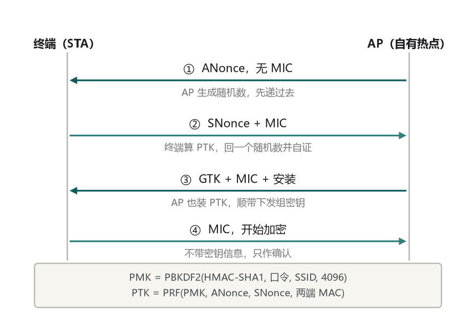
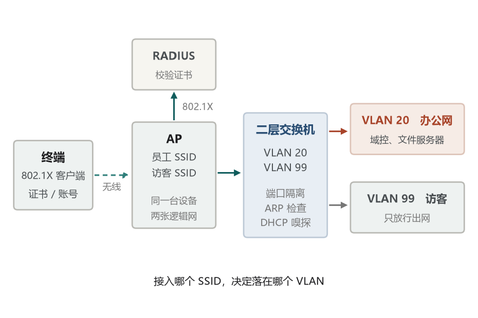

# 第十九章　无线与二层实战

一台笔记本被带进会议室，开机，什么都不用输，它自己连上了公司的 Wi-Fi。十分钟后，这台机器上的浏览器打开了一个内网系统，页面上挂着生产环境的工单列表。整个过程没有钓鱼，没有漏洞利用，也没有人输入密码。

很多渗透报告里“从边界进入内网”那一节，真正的入口不是 Web 应用，是二层。无线让接入变得太容易，而二层协议在设计时默认“能插上网线的人都是可信任的”，这个假设一直没变过。

这一章讲空口和二层。所有抓包、伪造、跳跃实验都在自己买来的 AP、自己的交换机和自己的虚拟机上做。拿别人的 SSID 做实验，在绝大多数司法辖区里都不属于“研究”，属于违法，区别只在于有没有人报案。

## 19.1 网卡要先能听懂空口

普通无线网卡工作在管理模式，驱动只把“发给本机的帧”交给系统，其余的帧在硬件或驱动层就丢掉了。监听模式把这层过滤关掉，整段空口上的 802.11 帧原样送进用户态，包括所有管理帧。

打开监听模式的命令在 Linux 上是 `iw`。

```bash
iw dev
sudo ip link set wlan0 down
sudo iw dev wlan0 set type monitor
sudo ip link set wlan0 up
sudo iw dev wlan0 set channel 36
```

最后一句把网卡钉在某个信道上。802.11 的网卡同一时刻只能听一个信道，2.4 GHz 只有 1、6、11 三个信道互不重叠，5 GHz 的信道多一些，但要看所在地区的法规允许哪些，其中一部分还是雷达共用频段，网卡在这类信道上要先做可用性检测，切换有明显延迟。不钉频就是让网卡自己在信道之间跳，抓到的东西是碎的，握手会缺帧。

实验完记得改回来，`sudo iw dev wlan0 set type managed`，否则网络管理器会认为这块网卡坏了。

硬件是第一个门槛。芯片要同时支持监听和注入，常见能用的有 Atheros AR9271、Ralink RT3070、MediaTek MT7612U 这几种，几十块到两百块的外置网卡多是它们。笔记本内置的 Intel 网卡在 Linux 下大多只能监听不能注入，Windows 上的驱动栈更封闭，通常要装厂商提供的特殊驱动才能进入监听模式。

判断一块网卡行不行，不用猜，看它自己报的能力。

```bash
iw phy | grep -A 8 "Supported interface modes"
aireplay-ng --test wlan0mon
```

前一条在输出的模式列表里找 `* monitor`。后一条做注入测试，能收到回包才说明这块卡能发。只监听不注入，抓握手时就没法主动让客户端重连，效率会差很多。

装好之后，扫一遍周围有什么。

```bash
sudo airodump-ng --band abg -w scan wlan0mon
```

`--band abg` 表示 2.4 GHz 和 5 GHz 都扫。输出里每行一个 BSSID，列包括信号强度、已收到的 beacon 计数、数据帧计数、信道、加密方式、认证方式、ESSID。加密那一列写着 `WPA2` 且 CIPHER 是 `CCMP` 的，是当下最常见的配置；写着 `WPA` 加 `TKIP` 的，通常意味着这台设备很老，网络里大概还有更老的东西。

## 19.2 Beacon、Probe 与藏不住的 SSID

AP 每秒广播大约十次 beacon，间隔由 beacon interval 决定，默认 100 个时间单位，一个时间单位是 1024 微秒，算下来 102.4 毫秒。beacon 里是一串信息元素（information element，IE），SSID、支持的速率、RSN 能力、HT 与 VHT 参数、厂商自定义字段都在里面。

隐藏 SSID 的做法，是把 SSID 这个 IE 的长度字段置零，或者填成一串 0x00。这样扫描列表里看到的是一个空名字。

它挡不住任何认真的观察者，原因有三个。

客户端连接时会发 probe request 和 association request，这两个帧里的 SSID 是明文字段。已连接的手机会周期性发 probe request 找自己的家，SSID 一样是明文。就算客户端完全不动，抓一次它重新关联的过程也拿到了。真正的效果只是让列表里显示得难看一点。

`airodump-ng` 里判断方法很直接，ESSID 那一列显示 `<length: 0>`，就是隐藏。真正的信息在下面那张客户端表里，`Probe` 那一列会把这个网络里的客户端正在寻找的 SSID 全部列出来。一个隐藏网络如果有十台设备连着，它的名字会被这十台设备轮流喊出来。

扫描结果里还有几个比 SSID 更有用的字段。

WPS 是否开启决定了这台 AP 有没有一条绕过口令的近路，`wash -i wlan0mon` 能直接列出来，开了 WPS 的会显示版本和是否锁定。加密套件决定了握手能不能被抓来离线猜，只支持 TKIP 的老设备往往还配着短口令。客户端数量与厂商决定了这个网络值不值得看，一台连着几十个 IoT 设备的办公 AP，管理面通常比它的无线面更松。

## 19.3 四次握手在算什么

WPA2 个人版的口令不是密钥。口令（passphrase）先经过 PBKDF2-HMAC-SHA1，迭代 4096 次，盐是 SSID 本身，输出 256 位，这个结果叫 PMK（pairwise master key）。同一个口令配不同的 SSID，算出来的 PMK 完全不同，所以换 SSID 等于换密钥。

PMK 在整段会话里不变，直接拿它加密数据会出问题。同一个密钥用得越久，泄露一次影响的范围就越大，而且同一对设备之间反复使用同一密钥，帧计数与随机数的复用风险会累积。四次握手的任务是两件事，双方各自证明自己持有 PMK，再由双方贡献的随机数协商出一个只用于这次会话的密钥。

<figure>

<figcaption>图 19-1　WPA2 个人版的四次握手。两个 nonce 分别由双方生成，PTK 由此派生；第一帧没有 MIC，因为此时还没有 PTK 可以拿来算。</figcaption>
</figure>

第一帧由 AP 发给客户端，带一个 AP 生成的随机数 ANonce，没有 MIC。原因很实际，这时候客户端还没有 SNonce，PTK 算不出来，没有密钥就没法算校验值。

第二帧由客户端发回，带自己生成的 SNonce 和一个 MIC。客户端此刻手里有 PMK、两个 nonce、双方的 MAC 地址，四个输入齐了，算出 PTK，再用 PTK 里的 KCK 部分对整帧算 MIC。AP 收到之后用同样的输入算出 PTK，比对 MIC，对得上就说明客户端确实知道口令。

第三帧由 AP 发回，带同样的两个 nonce、加密后的组密钥 GTK、一个 install 标志和 MIC。这一帧的密钥材料用 PTK 里的 KEK 部分加密，装好之后双方的数据帧就可以用 TK 加密了。

第四帧只是确认，客户端回一个 MIC，不带密钥信息。这一帧丢了不影响使用，AP 收到就认为握手完成，收不到也会按第三帧的状态继续往下走。

PTK 通常被切成三段，KCK 算 MIC，KEK 加密密钥材料，TK 加密真正的数据。这个切分解释了为什么握手包能用来离线猜口令。报文里包含验证一次猜测所需的全部材料，攻击者猜一个口令，算 PMK，算 PTK，用 KCK 校验第二帧的 MIC，通过就是对，不通过就换下一个。整个验证不需要和 AP 有任何交互。

4096 次迭代就是为这件事设计的。它让每次猜测比 WEP 时代贵了三个数量级以上，把攻击的成本从“算力”挪到了“字典”。口令如果不在字典里，再多显卡也猜不出来。

## 19.4 抓一次自己的握手

以下操作的对象是自己买的 AP 和自己的设备。抓别人的握手包在很多地方已经构成犯罪，不论有没有解密成功。

先在监听接口上盯住目标 AP 的信道，把抓到的东西写进文件。

```bash
sudo airodump-ng -c 6 --bssid AA:BB:CC:DD:EE:FF -w hs wlan0mon
```

`-c` 钉信道，`--bssid` 只收这个 AP 的帧，`-w` 是输出前缀，实际文件是 `hs-01.cap`。右上角出现 `WPA handshake: AA:BB:CC:DD:EE:FF` 就说明抓到了完整的一次。

如果一直等不到，可以让自己的手机断开重连，或者发几个 deauth 帧把已连接的客户端踢下线，它重连时会重新走一遍握手。

```bash
sudo aireplay-ng --deauth 5 -a AA:BB:CC:DD:EE:FF -c 11:22:33:44:55:66 wlan0mon
```

一次发五帧，够客户端重连了。数量别调大，deauth 洪水会让整个频段的设备都掉线，这在自己家里也很烦。

拿到 cap 之后有两条路。老路是 aircrack-ng，读字典，逐条验证。

```bash
aircrack-ng -w /usr/share/wordlists/rockyou.txt -b AA:BB:CC:DD:EE:FF hs-01.cap
```

新一点的路是转成 hashcat 的 22000 格式，交给显卡。

```bash
hcxpcapngtool -o hs.hc22000 hs-01.cap
hashcat -m 22000 hs.hc22000 rockyou.txt
```

2018 年 Jens Steube 发现了一种更省事的方式。AP 发第一帧时可以在 RSN 信息元素里带一个 PMKID，这个值由 PMK 与 AP 的 MAC 等材料算出，离线验证时拿它替代整个握手。这种方式不需要等客户端上线。抓这种包用 `hcxdumptool`，`hcxpcapngtool` 同样能把它转成 22000 格式。

抓到包之后能做什么、不能做什么，边界很清楚。

离线猜测的上限由口令熵决定，与工具无关。十二位随机字符组成的口令，用字典法永远不会命中；反过来，“公司缩写加年份”这种口令，字典里早就有，一张显卡几秒钟就出来了。听到“WPA2 已经不安全”这种说法时，先问一句对方的 AP 用的是什么口令。

抓不到握手就没有离线空间。客户端不重连、AP 开了管理帧保护（802.11w）、只跑 5 GHz 而设备只监听 2.4 GHz，任何一个都会让抓包失败。失败之后常见的错误做法是加大 deauth 强度，结果把周围所有设备踢下线，事情从技术问题变成投诉。

在线猜在这里也不成立。WPA2 的每次错误尝试都要走一次完整握手，AP 侧通常还有失败计数，速率低到没有意义。

## 19.5 企业版：证书决定你连得上谁

802.1X 有三个角色。申请者（supplicant）是客户端，认证者（authenticator）是 AP 或交换机，认证服务器（authentication server）一般是一台 RADIUS。AP 在认证通过之前只放行 EAP 报文，通过之后才把端口放进某个 VLAN。

真正决定安全性的不是 EAP 这个名字，是双方各自拿什么证明身份。

| EAP 方法 | 客户端凭据 | 服务端凭据 | 主要弱点 |
| --- | --- | --- | --- |
| EAP-TLS | 客户端证书 | 服务端证书 | 部署证书的成本高 |
| PEAP-MSCHAPv2 | 账号口令 | 服务端证书 | 客户端不校验证书时会被假 AP 收走响应 |
| EAP-TTLS | 账号口令 | 服务端证书 | 客户端不校验证书时可被套取口令 |

EAP-TLS 双向都要证书，中间人拿不出被信任的客户端证书，也拿不出服务端证书，所以它是最稳的一种。后两种只要求服务端有证书，客户端用账号口令，安全性完全押在“客户端会不会校验服务端证书”这一件事上。

很多客户端在配置企业 Wi-Fi 时，安装向导会提示“是否验证服务器证书”，用户点了“否”，或者管理员为了省事在配置模板里没填 CA。这个选项一关，客户端就会接受任何出示证书的 AP。攻击者拿一台自己的 AP，SSID 设成公司那个，证书随便签一张，客户端连上来，内层 MSCHAPv2 交换的挑战响应就落到攻击者手里。这个响应可以离线猜，也可以在条件合适时被中继到真实的认证服务器。

检查自己机器上到底校不校验，不用看界面，看配置文件。

```bash
nmcli connection show corp-wifi | grep 802-1x
```

输出里如果有 `802-1x.ca-cert` 且指向一个真实存在的 CA 文件，说明在验；这一项是空的或者写着 `--`，等于没有校验。`802-1x.domain-suffix-match` 也不能少，它防止攻击者用一张别的域名签发的合法证书蒙混过去。

<figure>

<figcaption>图 19-2　同一台 AP 上的两个 SSID 落到两个 VLAN。员工 SSID 认证通过后进入办公网段，访客 SSID 只放行出网；接入点只是入口，真正的边界在交换机上的 VLAN 与 ACL。</figcaption>
</figure>

“连上 Wi-Fi 就等于进入内网”这句话之所以经常成立，原因在图 19-2 里。RADIUS 认证通过后返回一组属性，其中 Tunnel-Private-Group-Id 决定这个会话被塞进哪个 VLAN。很多部署把它固定成办公网段，于是任何能通过 802.1X 的设备，包括一台被带进来的私人笔记本、一台被攻陷的打印机，都直接落在能访问域控和文件服务器的广播域里。

RADIUS 侧的认证日志能回答这个问题，看 Calling-Station-Id、返回的 VLAN 属性，以及同一个账号在短时间内的多次失败。一个账号在五个不同 AP 上连续认证失败，通常不是密码记错了。

还有一层常被忽略。交换机端口上如果开着 MAC 认证旁路（MAC authentication bypass，MAB），客户端拿 MAC 地址当凭据，而 MAC 地址是明文发送、可以伪造的。MAB 只应该留给打印机、摄像头这类不会跑客户端的设备，且应该把它们放进单独的 VLAN。

## 19.6 二层：ARP、DHCP 与 VLAN

有线侧的老三样在今天的办公网里依然有效，因为它们的根因是协议本身没有认证。

ARP 是无状态广播协议，任何主机收到“我是 192.168.1.1，我的 MAC 是 xx”都会更新缓存，不做任何验证。中间人只需要持续发这种应答。

```bash
sudo arpspoof -i eth0 -t 192.168.1.10 192.168.1.1
sudo arpspoof -i eth0 -t 192.168.1.1 192.168.1.10
```

两条一起跑，受害者和网关之间的双向流量都经过攻击机。命令要开两个终端，或者加 `&` 放后台。停的时候直接 Ctrl-C，受害者的 ARP 缓存会在几分钟内自己恢复。

DHCP starving 打的是地址池。攻击机伪造大量不同源 MAC 的 DISCOVER，把池子里的地址要光，之后新接入的设备拿不到地址，只能接受攻击者搭的假 DHCP 服务器分配的配置，网关和安全 DNS 都指向攻击机。

```bash
sudo dhcpstarv -i eth0 -e 192.168.1.200
```

`-e` 是池子的末尾地址，工具会在整个范围内请求。这个动作对生产网络影响很大，地址池耗尽会让所有新设备上不了网。自己的实验环境里跑一遍，看看交换机有没有反应，比读一百页文档有用。

VLAN 跳跃有两条路，成因都在交换机的默认配置上。

一条是交换机伪装。Cisco 的接入口可以配成 `dynamic auto` 或 `dynamic desirable`，这时端口会和对面协商要不要做 trunk。攻击机发一个 DTP 帧，端口就可能变成 trunk，于是所有 VLAN 的流量都能收到。判断方法是看交换机配置里有没有 `switchport mode access` 加上 `switchport nonegotiate`，两个都写了才关掉这条门。

另一条是双标签。802.1Q 的标签可以叠两层，交换机在接入口上剥掉一层，如果内层标签还在，帧会按内层 VLAN 转发出去。攻击机必须处在这个端口的 native VLAN 上，因为交换机对外层标签的期望正是 native VLAN。这条路的限制也很硬，回程流量不会回到攻击机，所以只能做单向注入，用来打不需要回包的协议，比如某些广播型的管理协议。

防守侧的手段都是现成的，问题在于有没有配置。

| 默认状态 | 后果 | 改法 |
| --- | --- | --- |
| 接入口不做 MAC 限制 | 一个口插一台小交换机，几十个 MAC 都能上 | 端口安全，限制 MAC 数量 |
| DTP 协商开启 | 端口被协商成 trunk | `switchport nonegotiate` |
| native VLAN 是 VLAN 1 | 双标签攻击有落点 | 换成一个不用的 VLAN |
| 没有 DHCP snooping | 假 DHCP 服务器可以直接生效 | 在接入口开启，只信任上联口 |

ARP 欺骗的防线是动态 ARP 检查（dynamic ARP inspection，DAI）。它依赖 DHCP snooping 维护的那张表，表里记着每个 MAC 在哪个端口、拿到哪个 IP，DAI 收到 ARP 就按表校验，对不上的丢掉。这张表没建起来，DAI 也没法工作，两个功能必须一起上。

无线侧的对应手段是客户端隔离。开了之后，同一个 SSID 下的设备不能互相通信，只能和网关说话。它挡住了同一个访客网络里的横向移动，代价是同一个网络里的打印机、投屏这类设备也要单独处理。

## 19.7 该改的默认值

把上面几节的内容收成一张表，按“改了收益最大”排序。每条都带验证方式，因为没法验证的加固等于没做。

| 配置 | 风险 | 改成 | 怎么确认 |
| --- | --- | --- | --- |
| WPA2-PSK 加短口令 | 抓到握手即可离线猜 | WPA3-SAE，或长随机口令 | 看 AP 的 RSN 信息元素 |
| WPS 开启 | 存在绕过口令的近路 | 关闭 | `wash` 里看不到 WPS |
| 无管理帧保护 | deauth 洪水可随时踢人 | 802.11w 设为 required | 抓包里 deauth 不再生效 |
| 单一扁平网段 | 一台设备被控等于全网可达 | 按角色分 VLAN 加 ACL | 从访客段扫办公段应全被拒 |

除了表里这四条，还有两件成本很低的事。一件是把所有 AP 的管理面放进独立的管理 VLAN，只允许运维网段访问，很多无线入侵的起点其实是弱口令的管理页面。另一件是打开无线侧的告警，deauth 洪水、大量关联失败、同一 BSSID 出现两个不同 MAC，这三类事件在正常网络里几乎不会发生，出现就该看一眼。

无线侧的检测和有线侧不太一样，它需要另一套射频环境。无线入侵检测系统（wireless intrusion detection system，WIDS）用专门的传感器在全频段扫描，把看到的 BSSID、信道、加密方式汇总到一台服务器，与自己的资产清单比对。清单里没有的 BSSID 出现在办公区，就是私接 AP 或者假 AP；同一个 SSID 下出现两个不同的 BSSID 且加密方式不一致，基本可以确定有人在仿冒。这套东西的成本主要在部署传感器，不在软件。

无线和二层的麻烦有个共同点。协议在设计时假设物理接入是可信的，802.11 在 1997 年定稿时假设“能收到信号的人是自己人”，以太网在更早的时候假设“能插上网线的人在自己办公室里”。这两个假设在会议室、在大厅、在停车场里都不成立。

改不了协议，就只能改配置。而配置的默认值，是厂商为“能跑起来”选的，不是为“安全”选的。
