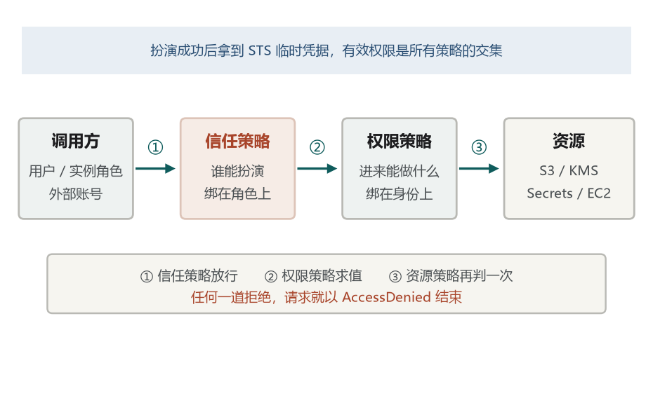
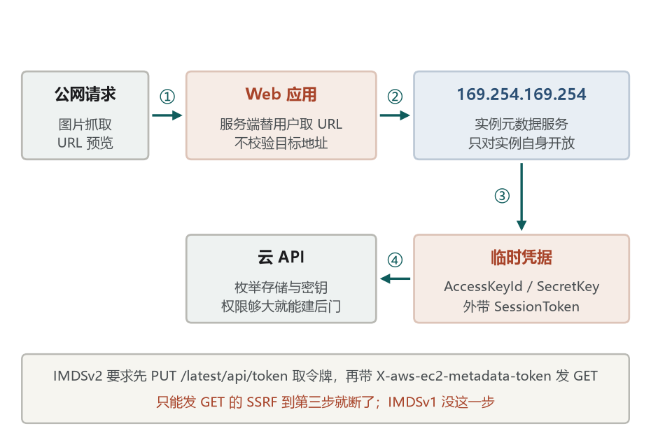

# 第二十章　云上实战

一份前端仓库里的 `.env` 被推到了公开仓库。里面有四个变量，数据库地址、两个 API 端点，还有一个 `AWS_SECRET_ACCESS_KEY`。三天后账号里多出十七台高配实例，全部用来挖矿，账单在一个周末里涨到五位数。

这件事里没有漏洞。没有越权，没有注入，没有任何一个 CVE。有的只是一串四十个字符的密钥，而它在云上等价于一个账号。

云的安全模型和机房差别最大的地方在这里。机房里有一条物理边界，防火墙架在边界上，进去之后是“内网”。云上没有内网这个缓冲带，每一个 API 调用都要带凭据，凭据从哪来、能做什么、有效期多长，决定了边界画在什么地方。

这一章的全部实验都在自己的云账号里做，开场先开账单告警，收工前删掉所有资源。用别人的密钥跑一条 `aws s3 ls`，在多数地区的法律里已经不是“测试”。

## 20.1 边界从机房门挪到了策略文件

云厂商和客户之间有一份责任划分，叫共享责任模型（shared responsibility model）。物理机房、硬件、虚拟化层、托管服务自身的代码，归厂商。客户的数据、访问配置、身份与权限、自己部署的系统和补丁，归客户。

划分本身没有争议，麻烦在于“归客户”的那一半，在控制台上全是一堆可以点错的开关。

<figure>

<figcaption>图 20-1　一个请求要穿过三道判断。信任策略决定谁能扮演这个角色，权限策略决定扮演之后能做什么，资源策略还能再收紧一次，任何一道拒绝都会以 AccessDenied 结束。</figcaption>
</figure>

身份是这套模型的核心。云上的每一个动作都是一个 API 调用，每个调用都带着一个身份，身份的权限来自绑在它身上的策略。策略写在 JSON 里，一行 `"Resource": "*"` 就能把整个账号打开。

这也解释了云上事件的一个共同特征，攻击者很少“拿下”某一台机器之后停下。他们先用这台机器上的凭据问一句“我是谁、我能做什么”，然后按权限列表逐项尝试，能建用户就建用户，能读密钥就读密钥，能改日志就先改日志。

这也是为什么云上的凭据管理比主机加固更值得投人力。一台主机被攻陷，损失的上限是这台机器上的数据；一个身份被拿走，损失的上限是这个身份能碰到的全部资源，而资源之间的关系往往没人完整梳理过。真正做过一次云上梳理的团队都会发现，账号里存在若干条自己都忘了的信任关系，某个 CI 角色能扮演生产角色，某个运维角色能扮演所有子账号的角色，链条一旦接起来，一个低权限的入口可以走到账号的最深处。

进自己的账号之前，先把四件事做掉。给根账号开多因素认证并把它锁起来，日常操作另建一个 IAM 用户。开账单告警，把自己的额度上限设成一顿饭的钱，超过就发邮件。给所有资源打上项目标签，收工时按标签批量删。第三条尤其重要，云上最贵的错误往往不是被打，是忘了关。

```bash
aws configure --profile lab
aws sts get-caller-identity --profile lab
```

第二条命令返回账号 ID、用户 ARN 和用户唯一 ID。后面所有判断都从这三个值出发，凡是返回的 ARN 不是你预期的那个，先停下来查清楚再往下走。

## 20.2 元数据服务：只对实例开放的 HTTP 服务

每台云主机内部都有一个特殊的地址，`169.254.169.254`。它属于链路本地网段，不出网卡，从实例内部访问时由虚拟化层直接应答。这个服务叫实例元数据服务（instance metadata service，IMDS），返回的是这台实例自己的信息，主机名、区域、可用区、用户数据脚本，以及如果实例绑定了角色，一份临时的访问凭据。

凭据那一条的路径是固定的。

```bash
TOKEN=$(curl -sX PUT "http://169.254.169.254/latest/api/token" \
  -H "X-aws-ec2-metadata-token-ttl-seconds: 21600")

curl -s -H "X-aws-ec2-metadata-token: $TOKEN" \
  http://169.254.169.254/latest/meta-data/iam/security-credentials/

curl -s -H "X-aws-ec2-metadata-token: $TOKEN" \
  http://169.254.169.254/latest/meta-data/iam/security-credentials/app-role
```

第一条拿令牌，TTL 是令牌的有效期，最大 21600 秒。第二条问“这台实例绑了哪个角色”，返回角色名。第三条拿这个角色的凭据，返回一个 JSON，里面有 AccessKeyId、SecretAccessKey、Token 和过期时间。

这套流程是 IMDSv2。老版本叫 IMDSv1，不需要令牌，直接 `curl http://169.254.169.254/latest/meta-data/iam/security-credentials/` 就出结果。

两者的差别看着只是一个额外的 HTTP 请求，实际差别很大。IMDSv2 的第一步是 PUT，并且要求一个自定义请求头。浏览器里的跨站请求发不出 PUT 加自定义头，大多数服务端请求伪造（server-side request forgery，SSRF）的利用方式也只能发 GET。这一层设计让“让服务器替我去取一个 URL”这种漏洞，在默认配置下拿不到凭据。

其他云有同样的东西，只是地址和头部不同。谷歌云的地址是 `metadata.google.internal`，要求 `Metadata-Flavor: Google` 头；Azure 的地址与 AWS 相同，要求 `Metadata: true` 头；阿里云的地址是 `100.100.100.200`，也提供带令牌的加固模式。前两家从设计上就要求自定义头，所以裸的 SSRF 拿不到东西，AWS 因为兼容老实例，默认允许 v1，才有了后面那些案例。

确认自己的实例到底允许哪种方式，一条命令就够。

```bash
aws ec2 describe-instances \
  --query "Reservations[].Instances[].{id:InstanceId,opt:MetadataOptions}" \
  --output table
```

返回里的 `HttpTokens` 是 `optional` 说明 v1 还能用，是 `required` 说明只认 v2。`HttpPutResponseHopLimit` 是令牌能跨几跳，设成 1 表示只有实例本身能取，设成 2 是为了让容器里的进程也能取。这个值每加一跳，能碰到元数据服务的进程就多一层。

同一个服务里还有一条路径值得看，`/latest/user-data`，返回的是实例启动时执行的用户数据脚本。很多部署脚本把数据库口令、初始化密钥直接写在这个脚本里，而它默认可以被实例上的任何进程读取，任何有读权限的控制台用户也能看到。这是元数据服务上第二个高频泄露点，比凭据本身更容易被忽略。

改成强制 v2 只需要一个动作，对已经在跑的实例也能改，改完重启生效。

```bash
aws ec2 modify-instance-metadata-options --instance-id i-0123456789abcdef0 \
  --http-tokens required --http-put-response-hop-limit 1
```

## 20.3 从 SSRF 到临时凭据

有了前两节的铺垫，这条链就很好读了。

<figure>

<figcaption>图 20-2　四步拿到临时凭据。真正卡住这条路的是第三步之前的令牌交换，只能发 GET 的 SSRF 在这一步断开；IMDSv1 没有这一步。</figcaption>
</figure>

一个正常的业务功能，比如“粘贴图片链接自动下载”或者“输入网址生成预览”，服务端会拿用户给的 URL 去发请求。功能本身没问题，问题在于它有没有校验目标地址。没校验的话，用户给一个 `http://169.254.169.254/latest/meta-data/iam/security-credentials/`，服务器就老老实实去取，把结果返回给用户。

2019 年公开披露的一起事件把这个链条完整走了一遍。一家美国银行的一台服务器上，一个配置错误的开源 WAF 允许构造出 SSRF，攻击者借此访问了实例元数据服务，拿到实例角色的临时凭据，再用这份凭据列出并下载了对象存储里的客户申请资料，涉及约一亿人。整个过程的每一步单看都不算漏洞，合起来是一条完整路径。

判断一个应用有没有这个风险，问三个问题。

服务端会不会替用户发请求，包括抓取图片、解析网页、导入 RSS、生成 PDF、调用 webhook 这些功能。发请求时有没有对目标做限制，限制是黑名单还是白名单，黑名单能不能用重定向、DNS 重绑定、十进制 IP 写法绕过。这台实例的出站流量有没有被网络层限制，如果它能访问 `169.254.0.0/16`，也能访问任意公网地址，那么 SSRF 的后果就不只是读元数据。

拿到凭据之后的第一件事是确认身份，而不是急着用。

```bash
export AWS_ACCESS_KEY_ID=ASIA...
export AWS_SECRET_ACCESS_KEY=...
export AWS_SESSION_TOKEN=...

aws sts get-caller-identity
aws iam list-attached-role-policies --role-name app-role
```

返回的 ARN 里能看到角色的名字，第二条能看到这个角色被授予了哪些托管策略。临时凭据比长期密钥多一个 `SessionToken` 字段，使用的时候三个值必须一起带上，缺了令牌会得到一个语义奇怪的报错，写法对但权限不对。命令行工具从环境变量读，SDK 从同一个地方读，写进 `~/.aws/credentials` 时也要多写一行 `aws_session_token`。很多人在这一步卡住，以为是权限问题，其实只是漏了一个字段。

临时凭据的有效期通常在一小时以内，到期自动失效，这一点和长期密钥不同，也是它相对安全的地方。真正危险的是权限范围，如果这个角色为了省事被授予了 `AdministratorAccess`，那么一条 SSRF 就等于整个账号。

收敛的办法有四层，从便宜到贵排列。元数据服务强制 v2，成本是一次配置变更。把 hop limit 设成 1，成本同样是零。应用侧对出站 URL 做白名单，并且在解析之后校验目标 IP 不属于私有网段与链路本地网段，成本是几行代码。网络侧限制实例出站，只允许它访问需要的域名，成本最高，效果也最好。

## 20.4 IAM 提权：PassRole 与 AssumeRole 的组合

云上的提权很少是“改一个文件就让权限变大”，它更像搭积木，两块单独看都合理的权限，拼起来就能换一个身份。

先看策略怎么求值。一条请求进来，先看有没有任何一条策略写了显式拒绝，有就直接结束。然后看组织级的服务控制策略（service control policy，SCP），它划定了这个账号能做什么的上限。再看权限边界（permissions boundary），它划定了这个身份能做什么的上限。最后把身份策略和资源策略合起来，同账号内的这两个是并集。四层里任何一层没放行，请求就被拒。

需要记住的是“上限”这个概念。给一个身份加一条 `Allow *`，如果它的权限边界里没有这一条，实际权限还是边界里那些。反过来，删掉一条拒绝不会让权限变大，因为上限还在。

第一块积木是 `iam:PassRole`。这个权限的意思是“允许把这个角色传给某个服务”。它本身什么都不做，但配上 `ec2:RunInstances` 或者 `lambda:CreateFunction`，就能启动一台绑着高权限角色的新实例或者新函数，然后从新资源里把凭据读出来。

第二块是 `sts:AssumeRole`。这个权限决定能不能扮演某个角色，而能不能扮演还要看那个角色的信任策略里写没写你的 ARN。两块都齐，就完成了一次身份切换。

判断自己账号里有没有这种组合，不要靠眼看，用官方的策略模拟器。

```bash
aws iam simulate-principal-policy \
  --policy-source-arn arn:aws:iam::111122223333:user/dev \
  --action-names iam:PassRole ec2:RunInstances \
  --resource-arns arn:aws:iam::111122223333:role/app-admin
```

返回里每条动作有一个 `EvalDecision`，取值是 `allowed`、`implicitDeny` 或 `explicitDeny`，还会列出是哪条策略给出的判断。模拟器只读，不会真的启动实例，是验证判断最省事的办法。想测一条还没上线的策略，用 `simulate-custom-policy` 把 JSON 直接喂进去。

```bash
aws iam simulate-custom-policy \
  --policy-input-list file://proposed.json \
  --action-names s3:GetObject --resource-arns arn:aws:s3:::example-bucket/*
```

除了模拟器，还有两个工具值得常开。IAM Access Analyzer 会持续扫描账号，找出可以从账号外访问的资源，以及给了但一直没用的权限。`aws accessanalyzer list-analyzers` 先列出账号里的分析器，拿到 ARN 之后用 `list-findings` 拉结果。凭证报告 `aws iam get-account-authorization-details` 导出整个账号的用户、角色、策略、绑定关系，几十个账号规模下用它做一次人工比对，能找出不少历史遗留。

Azure 和谷歌云有等价物。Azure 的 `az role assignment list --all` 加 `az role definition list`，谷歌云的 `gcloud projects get-iam-policy` 加 Policy Troubleshooter。名字不同，逻辑一样，都是“谁、在什么范围、被授予了什么”。

现实里做提权不是一条一条试，而是先把权限列表拉出来看形状。返回的 JSON 里如果出现 `iam:PassRole` 加上任意一个能创建计算资源的动词，中间就有一条路；出现 `iam:CreatePolicyVersion` 加上 `iam:SetDefaultPolicyVersion`，可以把一条已有策略改成任意内容，等于直接改权限；出现 `sts:AssumeRole` 加上一串角色 ARN，就要逐个看那些角色的信任策略。这三种形状覆盖了大部分公开的云上提权路径。

防这一类组合，靠的是把上限画死。给所有人类用户加权限边界，边界里不含 `iam:*`。组织级 SCP 禁掉整个组织里的 `iam:CreateUser`。`iam:PassRole` 加条件，限定只能传给某几个服务，`iam:PassedToService` 这个条件键就是干这个的。三条里任何一条做到，前面那两块积木就拼不起来。

## 20.5 对象存储的三种错误

对象存储的配置错误是云上最常见的一类，因为它的默认值在不同年代改过好几次，而老账户保留着老默认。

第一种是公共读。存储桶的访问控制列表（access control list，ACL）里有 `AllUsers` 的读权限，或者桶策略里的 Principal 写成了 `"*"`。这两件事有一件成立，任何知道桶名的人都能读。

第二种是列出权限。`s3:ListBucket` 允许列举桶里的对象名。很多人觉得“只是列个名字”，实际上对象名本身就是情报，里面有客户编号、日期、备份批次、甚至内部系统的主机名。列出来之后配合第一种错误，整个桶就下来了。

第三种是预签名 URL。它的本意是给一个临时链接，让没有凭据的人也能下载某个对象。用长期凭据签出来的链接最长可以设七天，链接一旦出现在前端源码、日志、聊天记录或者页面的 Referer 里，就等于把那个对象公开了七天。

检查自己的桶，四条命令按顺序跑。

```bash
aws s3api get-public-access-block --bucket example-bucket
aws s3api get-bucket-policy-status --bucket example-bucket
aws s3api get-bucket-acl --bucket example-bucket
aws s3 ls s3://example-bucket --no-sign-request
```

第三条返回的 ACL 里如果出现 `URI="http://acs.amazonaws.com/groups/global/AllUsers"`，这个桶对外开了。第四条是站在陌生人的角度试一次，`--no-sign-request` 表示不带任何凭据，能列出东西就说明配置真的错了。这四条里前三条查配置，第四条查结果，配置和结果对不上时以结果为准。

还有一种不走配置错误的泄露，靠猜名字。桶名在全球范围内唯一，很多团队用公司名加上环境名做命名，猜中一个就能试 `--no-sign-request`。这也是为什么桶名本身不要带客户信息、域名、内部项目代号，它是一条公开可见的字符串。

修的办法是桶级别的公共访问阻止（Block Public Access），四个开关全开。它是账户级和桶级两层，账户级的那一层会覆盖桶级的设置，所以先确认账户级的四个开关是不是全开，否则桶上怎么改都可能是白改。这一层打开之后，桶策略里残留的 `"*"` 也不会生效，属于最后一道保险。

## 20.6 日志里的高危事件

云上的日志比主机日志干净，因为它记录的是 API 调用，格式统一，字段固定。AWS 的这一套叫 CloudTrail，每次调用都记一条 JSON，里面有调用者身份、源 IP、请求参数、返回码、User-Agent。

不需要看全部，看七类就够覆盖大部分事件。

| 事件 | 含义 | 为什么值得看 |
| --- | --- | --- |
| `CreateAccessKey` | 新建长期密钥 | 正常业务很少做，攻击者喜欢做 |
| `AttachUserPolicy` | 给用户加策略 | 提权的直接动作 |
| `AssumeRole` | 切换身份 | 看跨账号与陌生 principal |
| `GetSecretValue` | 读密钥 | 批量读基本可以确定是恶意 |
| `PutBucketPolicy` | 改桶策略 | 数据外泄的前置动作 |
| `StopLogging` | 关日志 | 出现即事件，没有例外 |
| `ConsoleLogin` | 控制台登录 | 看 MFA 是否为 No |

查询用 `lookup-events`，时间窗别开太大。

```bash
aws cloudtrail lookup-events \
  --lookup-attributes AttributeKey=EventName,AttributeValue=CreateAccessKey \
  --start-time 2026-11-20T00:00:00Z --max-items 50
```

返回的每条里有 `Username`、`SourceIPAddress`、`UserAgent`。三个字段合起来能回答大部分问题，谁、从哪、用什么工具。`SourceIPAddress` 是 `AWS Internal` 说明是服务自己发起的，不是人在操作；`UserAgent` 里出现 `aws-cli/2.x` 之外的东西，比如某个脚本库的名字，就说明调用来自代码而不是控制台。

主机侧的告警和这个是互补的。GuardDuty 一类服务会在元数据层面做检测，它的一条典型发现叫实例凭据外泄，判定依据是某台实例的凭据被从一个不属于该账号的 IP 上使用。这条告警一旦出现，说明凭据已经出去了，此时要做的是立刻禁用那个角色、吊销会话、查 CloudTrail 里的调用记录。

日志的成本要提前算。管理事件默认记录且免费，数据事件按调用量计费，一个读写频繁的桶一天能产生几百万条，账单比存储还贵。常见的做法是只给敏感桶开数据事件，比如存客户资料的、存备份的，其余靠服务自身的访问日志。

日志本身也要保护。组织级的 trail 把日志写到一个专门的日志账号，日志账号里只有写权限没有删权限，桶开对象锁（Object Lock）。这三件事做完，攻击者拿到再高的权限也改不了已经写下的记录。反过来，日志和业务在同一个账号里，`StopLogging` 一条命令就能把证据断掉。

云上没有内网这个缓冲带。每一次调用都要证明自己是谁，凭据在哪里、能做什么、多久过期，这三件事决定了整套系统的边界。把这三件事管住，比在边界上堆设备有用。
