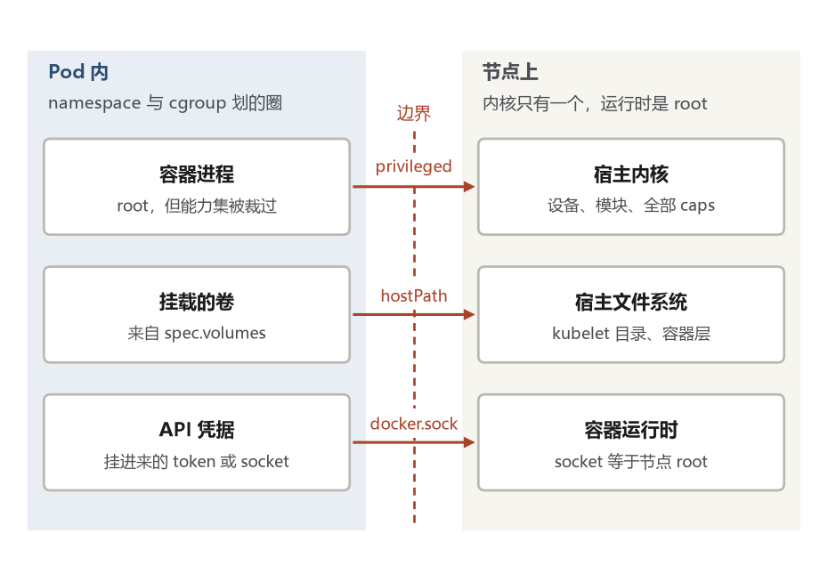
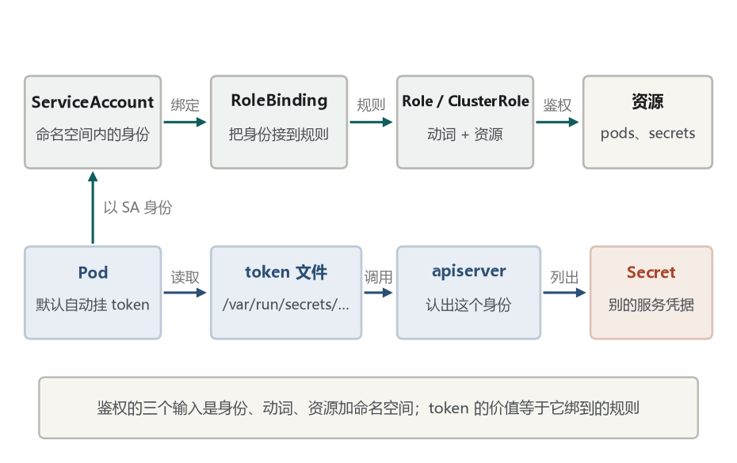

# 第二十一章　容器与 Kubernetes 实战

一个 CI 流水线的构建任务卡住了。运维上去看，发现那个 Pod 里的进程正在用 `kubectl` 列出整个集群的 Secret，一个命名空间一个命名空间地读。Pod 是流水线自己创建的，镜像是内部仓库里的，谁也没觉得有问题。

问题出在三处默认值上。Pod 自动挂了 ServiceAccount 的令牌，那个 ServiceAccount 被绑了 `cluster-admin`，因为半年前有人为了“先让它跑起来”加了一条绑定，之后再没人回头看过。

容器给人的感觉是“隔离好的小虚拟机”，实际上它只是一个被限制过的进程。限制有多少，全看配置。默认配置的目标是让东西跑起来，不是让它跑得安全，这两件事在容器生态里被分得特别清楚。

这一章的实验全部在自己用 kind 或 minikube 起的集群里做，跑完 `kind delete cluster` 一句就清干净。生产集群上的 `kubectl` 权限，哪怕是只读的，也不要拿来试这些判断。

## 21.1 隔离是三层拼起来的

容器不是一个轻量虚拟机，这个说法会误导人。它就是宿主机上的一个普通进程，被三样东西围起来。

第一层是命名空间（namespace）。挂载点、进程号、网络、主机名、进程间通信、用户 ID 各自有一套命名空间，`unshare` 一下就有了。容器的根文件系统看着独立，是因为它在一个独立的挂载命名空间里，看到的 `/` 是镜像解出来的那一层。

第二层是控制组（cgroup）。它管的是资源，CPU 配额、内存上限、IO 权重。它不管安全，一个容器能吃多少内存和它能读多少文件是两件事，很多加固清单把这两个混在一起讲。

第三层是能力、系统调用过滤和安全模块。Linux 把 root 的特权拆成几十个能力（capability），容器默认只拿到一个白名单，`NET_RAW`、`CHOWN`、`SETUID` 这些常见的在里面，`SYS_ADMIN`、`SYS_MODULE` 不在。seccomp 再过滤一层系统调用，AppArmor 或 SELinux 再按路径和标签过滤一层。

<figure>

<figcaption>图 21-1　Pod 与节点之间只有一层边界，三个配置项就能让箭头穿过去。左边每一个开关都写在 Pod 的 spec 里，右边是它能触到的宿主资源。</figcaption>
</figure>

用户的命名空间（user namespace）能让容器里的 root 映射成宿主上的普通用户，这一层做对了，前面三层里最要命的那部分风险会被削掉一大截。它不在默认配置里，因为早年内核支持不完全，打开之后不少老镜像的行为会变。愿意打开它的运行时，容器内 root 的破坏力会降一个档。

关键在这句话上，所有容器共用同一个内核。命名空间让进程看不见别人，cgroup 让它吃不到太多资源，但系统调用最终都由同一个内核执行。内核里任何一个提权漏洞，对容器来说就是逃逸；反过来，只要给容器足够的能力，根本不需要漏洞，它本来就有权限动宿主。

Kubernetes 在这之上又加了一层抽象。最小的调度单位是 Pod，不是一个容器。同一个 Pod 里的容器共享网络命名空间和 IPC 命名空间，它们之间的隔离比两个 Pod 之间弱得多，只有一个容器能拿到 Pod IP，其他容器通过 `localhost` 访问它。这个设计影响了后面所有判断，一个 Pod 里如果有一个高权限的边车容器，同 Pod 的其他容器也就站在了同一侧。

## 21.2 起一个能拆的集群

kind 用容器当节点，起一个单节点集群大约二十秒，删掉也是一条命令。minikube 更接近真实节点，支持多种驱动，资源占用大一些。两个都够用，选哪个看机器。

```bash
kind create cluster --name lab
kubectl cluster-info --context kind-lab
kubectl get nodes -o wide
```

要模拟多节点和端口映射时用配置文件，`kind create cluster --config kind.yaml`，文件里写 `role: control-plane` 和 `role: worker`。单节点也能做完全部实验，只是看不到跨节点的调度差异。

kind 和 minikube 都往 `~/.kube/config` 里写上下文，多个集群并存时切来切去很容易切错。做安全实验时建议给每个集群单独一个 context 名字，并且每次动手前先跑一条 `kubectl config current-context`，确认自己在哪个集群里。这条命令看起来多余，直到有一次你在生产集群上执行了一条以为是本地集群的命令。

集群起来之后，先认清四类对象。

工作负载是 Pod、Deployment、Job 这些，它们描述“跑什么”。服务发现是 Service、Ingress，描述“怎么访问”。配置是 ConfigMap、Secret，描述“给什么参数”。身份是 ServiceAccount、Role、RoleBinding、ClusterRole、ClusterRoleBinding，描述“以什么身份跑、能做什么”。

前两类大家都熟，出问题的几乎全在后两类。

ServiceAccount 是 Pod 的身份。默认情况下，每个命名空间有一个叫 `default` 的，Pod 如果没有指定，就用它。更麻烦的是令牌会自动挂进容器，从 1.24 起这个令牌是投射卷（projected volume）形式，绑定了有效期，kubelet 负责轮换，路径固定。

```bash
kubectl get sa -A
kubectl get pod mypod -o jsonpath='{.spec.serviceAccountName}{"\n"}'
kubectl exec mypod -- ls /var/run/secrets/kubernetes.io/serviceaccount/
```

第三个命令列出来的三个文件，`token`、`namespace`、`ca.crt`，就是容器里的全部凭据。拿到 `token` 就等于拿到了这个 ServiceAccount 的身份，可以在集群外用它调 API。

<figure>

<figcaption>图 21-2　上半是规则怎么落地，下半是令牌怎么被换成数据。两条链在 ServiceAccount 处合上，所以一个 Pod 的实际权限，等于它那个 ServiceAccount 绑到的全部规则。</figcaption>
</figure>

RBAC 的模型很小。角色（Role）是一组规则，每条规则写“对什么资源、允许哪些动词”。绑定（RoleBinding）把角色接到一个主体上，主体可以是用户、组或者 ServiceAccount。Role 和 RoleBinding 有命名空间，ClusterRole 和 ClusterRoleBinding 没有。

查自己的权限，不要靠猜。

```bash
kubectl auth can-i --list
kubectl auth can-i get secrets --as=system:serviceaccount:default:default -n default
kubectl auth can-i '*' '*' --as=system:serviceaccount:kube-system:default
```

第二条命令里的 `--as` 是模拟，管理员权限下可以直接问“这个身份能不能做这件事”，不需要真的用那个身份登录。第三条是一个值得每个集群都跑一遍的自检，返回 `yes` 就说明那个默认身份的权限大得离谱。

`--as` 只能模拟身份，不能模拟绑定关系的变化。想验证“删掉这条绑定之后还能不能”，得先把绑定备份下来，删掉，再问一次。

## 21.3 六种配置错误

容器逃逸的公开案例里，绝大多数不是内核漏洞，是配置。下面六条按出现频率排。

`privileged: true`。这一个布尔值等于把前面三层里后两层全部拆掉，容器拿到所有能力、所有设备、没有 seccomp 过滤。它本来是给需要动硬件的守护进程用的，被大量复制到了业务负载的 YAML 里。

`hostPath`。把宿主的一个目录挂进容器。挂 `/var/lib/kubelet` 能读到所有 Pod 的令牌和卷，挂 `/etc/kubernetes` 能读到集群的证书和 kubelet 的配置，挂 `/var/lib/docker` 或 `/run/containerd` 能读到所有镜像层。挂载本身不是错，错在挂的是这些路径。

`hostNetwork`、`hostPID`、`hostIPC`。三个开关分别让容器看到宿主的网络栈、进程表、共享内存。开了 `hostPID` 之后，容器里 `ps` 能看到宿主上所有进程，配合 `CAP_SYS_PTRACE` 就能读别人的内存。

挂运行时 socket。把 `/var/run/docker.sock` 或 `/run/containerd/containerd.sock` 挂进容器，等于把“创建容器”的能力交给容器里的进程，而运行时守护进程是以 root 跑的。这类配置在 CI 里特别常见，因为构建镜像需要它。

自动挂载令牌加过大的 ServiceAccount。前面那个 CI 的例子就是这一条，令牌本身没问题，绑定的角色有问题。

没有安全上下文。`runAsNonRoot`、`readOnlyRootFilesystem`、`allowPrivilegeEscalation: false`、`capabilities.drop: ["ALL"]` 一个都没写。这不算漏洞，但它让上面几条的后果放大。

这些配置之所以被反复复制，是因为它们都能解决一个眼前的麻烦。CI 要构建镜像，于是挂 socket；监控要读宿主指标，于是开 `hostPID`；旧镜像里的进程必须以 root 跑，于是加 `privileged`。每一条在写下的那一刻都是合理的，积累起来就成了攻击面。治理的办法不是禁止，是把它们集中到少数几个命名空间里，其余地方用准入控制挡住，这样需要审计的范围就从一个集群缩到了几张 YAML。

扫一遍自己的集群，用 `kubectl` 加 `jq` 就够，不需要装东西。

```bash
kubectl get pods -A -o json | jq -r '
  .items[] | select(.spec.hostNetwork == true or .spec.hostPID == true)
  | "\(.metadata.namespace)/\(.metadata.name)"'

kubectl get pods -A -o json | jq -r '
  .items[] | .metadata as $m | .spec.volumes[]?
  | select(.hostPath != null)
  | "\($m.namespace)/\($m.name)  \(.hostPath.path)"'

kubectl get pods -A -o json | jq -r '
  .items[] | .metadata as $m | .spec.containers[]?
  | select(.securityContext.privileged == true)
  | "\($m.namespace)/\($m.name)  \(.name)"'
```

第三条同样能用来找挂载 socket 的卷，把 `select` 的条件换成 `.hostPath.path | test("docker.sock|containerd.sock")`。查绑定，看谁被绑了集群管理员。

```bash
kubectl get clusterrolebindings -o json | jq -r '
  .items[] | select(.roleRef.name == "cluster-admin")
  | "\(.metadata.name)  \(.subjects // [] | map(.kind + "/" + .name) | join(","))"'
```

最后一行输出里的 `ServiceAccount/xxx` 就是需要在报告里点名的那几个。

## 21.4 从 Pod 到节点：判据而不是步骤

判断一个 Pod 有没有逃逸风险，看的不是它跑了什么命令，是它拿到了哪些原语。

| 配置 | 得到的原语 | 边界状态 |
| --- | --- | --- |
| `privileged: true` | 全部能力、全部设备、可加载模块 | 已失效 |
| `CAP_SYS_ADMIN` | 挂载文件系统、操作命名空间 | 已失效 |
| `CAP_DAC_READ_SEARCH` | 绕过文件路径权限读任意文件 | 已失效 |
| `hostPath` 指向 kubelet 或 etcd 目录 | 读其他 Pod 令牌、读集群凭据 | 已失效 |

`CAP_SYS_ADMIN` 之所以和 root 差不多，是因为挂载这个动作本身就是边界。能挂载就能把宿主的块设备挂进来，也能把自己的 procfs 挂到别处。`CAP_DAC_READ_SEARCH` 更隐蔽，它允许用文件句柄直接读，绕过路径上的权限检查，效果是不需要知道路径就能读到 `/etc/shadow`。这两个能力在默认白名单里都没有，出现就说明有人手动加了。

`hostPath` 的风险取决于挂哪里。挂一个日志目录，风险很低；挂 kubelet 的数据目录，等于拿到这个节点上所有 Pod 的令牌，包括那些权限更高的系统组件；挂 etcd 的数据目录，等于拿到整个集群的状态，包括所有 Secret 的密文和加密密钥的位置。

`docker.sock` 这一条要单独说。它不是“给了一个文件”，是“给了运行时守护进程的控制接口”。守护进程以 root 跑，能创建带任意挂载的容器，所以控制它就等于控制节点，中间不需要任何漏洞。

判断一个 Pod 属于哪一档，把它的 spec 打出来看就行。

```bash
kubectl get pod mypod -o jsonpath='{.spec.containers[*].securityContext}{"\n"}'
kubectl get pod mypod -o jsonpath='{.spec.volumes}{"\n"}'
kubectl get pod mypod -o jsonpath='{.spec.hostNetwork}{" "}{.spec.hostPID}{"\n"}'
```

三条命令分别回答能力、挂载、命名空间三个问题。任何一条的输出里有 `privileged`、有指向宿主关键目录的 `hostPath`、或者 `hostNetwork` 是 `true`，这个 Pod 就落在“边界已失效”那一档，不需要再往下验证。

横向这一类要单独提一下，因为它常常比逃逸更容易发生。同一个节点上的 Pod 共享网络，开 `hostNetwork` 的 Pod 能直接看到节点上的所有监听端口，其中包括 kubelet 的 10250 和各类探针的端口。kubelet 的接口如果没有开匿名认证，从节点内部访问就能执行命令。这类路径不需要任何提权，只需要一个能发 HTTP 请求的位置。

需要说明的是，落在一档不代表它一定被利用过。它代表的是可能性，而安全评估里“可能性存在”本身就是结论。给这类 Pod 排优先级，看它同时满足几条，以及它所在的命名空间里有没有敏感数据。

收住这一类问题，靠的是准入控制。Pod 安全准入（Pod Security Admission）用三个级别标注命名空间，`privileged` 什么都不管，`baseline` 禁掉明显危险的配置，`restricted` 要求非 root、只读根文件系统、丢弃全部能力。

```bash
kubectl label --overwrite ns prod \
  pod-security.kubernetes.io/enforce=restricted \
  pod-security.kubernetes.io/warn=restricted
```

`enforce` 直接拒绝不合规的 Pod，`warn` 只在客户端打警告。上线顺序应该反过来，先 `warn` 跑两周，看清楚哪些负载会被拦，再改成 `enforce`，否则一次变更会把半个集群的发布卡死。

## 21.5 Secret 不是加密的

Secret 这个对象名容易让人误解。它在 API 层做的是 base64 编码，不是加密。base64 是可逆的编码，看一眼就知道内容。

```bash
kubectl get secret db-password -o jsonpath='{.data.password}' | base64 -d
```

能跑这条命令的人，已经拿到了明文。所以 Secret 的安全性完全取决于两件事，谁有权读它，以及它在磁盘上是不是加密的。

第二件事在 etcd 里。默认情况下，Secret 以明文存在 etcd 里，能读 etcd 数据目录的人不需要经过 API 就能看到全部内容。做成静态加密要在 apiserver 上加一个配置。

```yaml
apiVersion: apiserver.config.k8s.io/v1
kind: EncryptionConfiguration
resources:
  - resources:
      - secrets
    providers:
      - aescbc:
          keys:
            - name: key1
              secret: <32 字节的 base64>
      - identity: {}
```

`providers` 是一个有序列表，第一个用来加密，全部用来解密，所以新密钥放在最前面，旧密钥留着供解密，轮换就是这么做的。末尾的 `identity` 表示明文，留着它的原因是还没被重写的旧对象仍然以明文存在。

加了配置之后要重启 apiserver，并且把已有对象重写一遍，否则它们还是明文。重写的方式是读出再写回，一条 `kubectl get secrets -A -o json | kubectl replace -f -` 循环就能做到。检查有没有生效，先看 apiserver 的启动参数。

```bash
kubectl -n kube-system get pod kube-apiserver-lab-control-plane \
  -o jsonpath='{.spec.containers[0].command}' | tr ',' '\n' | grep encryption
```

输出里出现 `--encryption-provider-config` 才算配上了。aescbc 的密钥本身放在控制节点的磁盘上，拿到磁盘的人还是能解，所以更高一档的做法是用 KMS 提供商，把密钥放在外部密钥管理服务里，apiserver 只持有引用。

etcd 的备份文件要按最高敏感级别保管，原因很直接，备份里包含全部 Secret，加密配置和密钥如果也一起备份了，那么拿到备份就等于拿到全部明文。很多团队把 etcd 快照和普通数据库备份放在同一个存储桶里，这个选择在出事那天会变成最难受的一件事。

另一件事是 RBAC。`get` 或 `list` 权限在 secrets 这个资源上，等于该命名空间里的全部凭据。集群级别的 `list secrets` 等于整个集群。这类权限在运维角色里很常见，因为排查问题时确实需要，代价是这条路径必须有人盯着。

容器里怎么用 Secret，也有区别。做成环境变量，它会出现在进程的环境里，`/proc/1/environ` 能读到，崩溃转储和日志里也可能带出来，子进程还会继承。做成挂载的文件，只有能读那个路径的进程能拿到，配合 `readOnly: true` 和合适的文件模式，暴露面小得多。

再往前一步是用外部密钥管理。Secret 里只放一个引用，真正的内容由 external-secrets 这类控制器在运行时同步，或者由 CSI 驱动直接挂载。这样 etcd 里从来没有明文，备份泄露也不会连带凭据。

## 21.6 审计日志里该看什么

Kubernetes 的审计日志是 apiserver 自己产生的，记录每一次请求，格式是结构化的 JSON。它在 apiserver 上要显式开启，配一个策略文件。

```yaml
apiVersion: audit.k8s.io/v1
kind: Policy
rules:
  - level: RequestResponse
    resources:
      - group: ""
        resources: ["secrets"]
  - level: Request
    verbs: ["create", "delete", "patch"]
    resources:
      - group: "rbac.authorization.k8s.io"
        resources: ["clusterrolebindings", "rolebindings"]
  - level: Metadata
    omitStages: ["RequestReceived"]
```

三个级别对应三种详细程度。`Metadata` 只记谁、什么时候、对什么、结果如何；`Request` 再加上请求体；`RequestResponse` 连响应体也记。`RequestResponse` 记在 secrets 上要谨慎，日志里会出现明文凭据，日志系统本身的权限就得比 Secret 还严。

五个字段决定一条记录有没有用。`user.username` 是调用者，`system:serviceaccount:ns:name` 这种格式一眼能看出是工作负载还是人。`verb` 加 `objectRef` 说明做了什么，`objectRef.subresource` 是 `exec` 时，代表这是一次进入容器的操作。`responseStatus.code` 是结果，200 和 403 的意义完全不同，大量 403 往往是在试探。`sourceIPs` 里出现集群外的地址，说明有人在用令牌远程调用。

值得单独告警的请求有这几类。对 `pods/exec` 的 `create`，正常运维也会用，但频率和来源可以做基线。对 `secrets` 的 `list`，尤其是跨命名空间。对 `clusterrolebindings` 的 `create`，这是提权最直接的动作。对 `serviceaccounts/token` 的 `create`，这是手动签发令牌。以及任何 `user.username` 是 `system:anonymous` 却返回 200 的请求，那说明有匿名访问被放行了。

```bash
kubectl auth can-i --list --as=system:anonymous -n default
kubectl auth can-i get pods --as=system:anonymous -n default
```

第一条列出一个匿名请求在默认命名空间里能做的事。正常集群里这份清单是空的，只剩几条公开的发现类接口；多出任何一条都值得查。第二条是更直接的问法，返回 `no` 才对。

日志量的取舍要提前想清楚。`Metadata` 级别的记录在大集群上一天也能到几十 GB，全量存三个月不现实，常见的折中是按命名空间分级，系统组件和敏感业务用 `Request`，其余用 `Metadata`，并且把日志写到集群外的一个只写不删的存储上。攻击者拿到集群管理员权限之后第一件想做的事就是关审计、删日志，日志不在集群里，这一步就做不成。

运行时那一侧还有一类信号，审计日志看不到。容器里出现了 `sh`、`curl`、`nc`，容器开始挂载新的文件系统，容器向外发起从没出现过的连接，这些属于运行时行为，要用 Falco 这类工具基于系统调用去检测。审计日志管的是“对集群做了什么”，运行时检测管的是“容器里发生了什么”，两边都要有。

给一个集群做评估，顺序可以固定下来。先看谁能进 API，也就是所有 ClusterRoleBinding 的主体里有几个是 ServiceAccount。再看进来之后能拿到什么，也就是 secrets 的读写权限分布。然后看工作负载的配置里有多少条落在“边界已失效”那一档。最后看日志能不能回答前面三个问题。四步做完，一个集群的风险轮廓就出来了，比逐条对照上百项基准快得多。

容器和虚拟机的区别，最后都落回一句话。虚拟机有一条由 hypervisor 守住的边界，容器的边界是配置出来的，配置里少写一行，边界就退回到“同一个内核上的两个进程”。上面这些判断，本质上都是在问同一个问题，这个进程离内核有多近。
